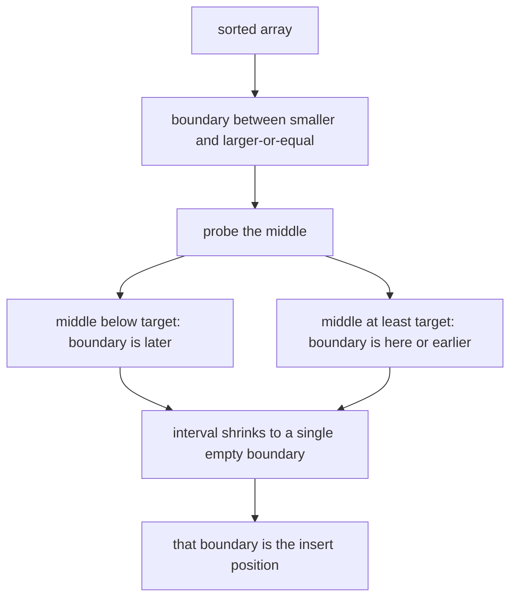
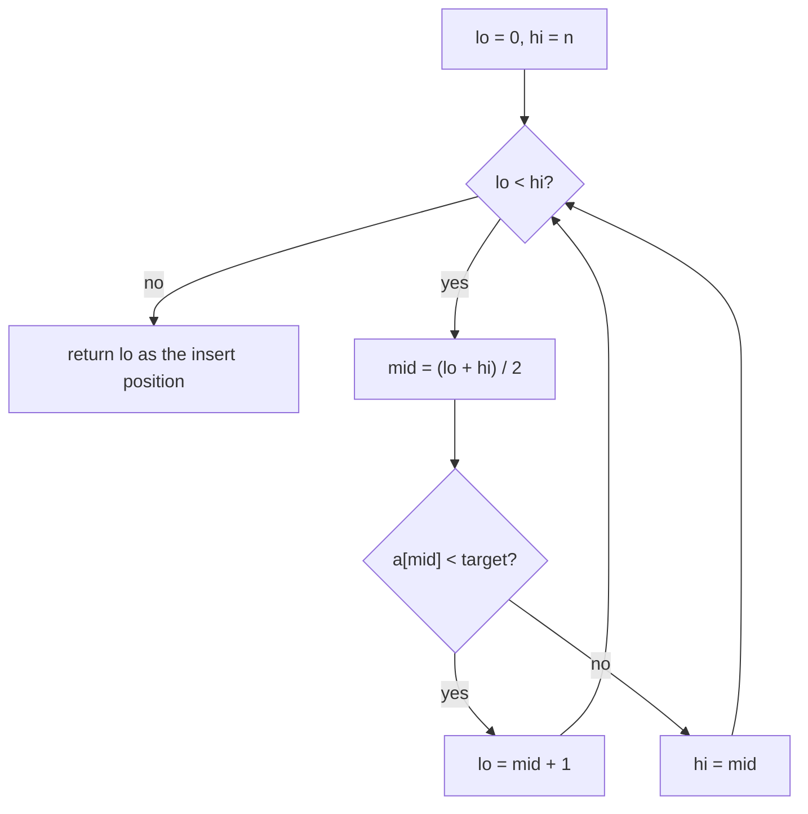
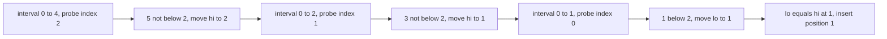
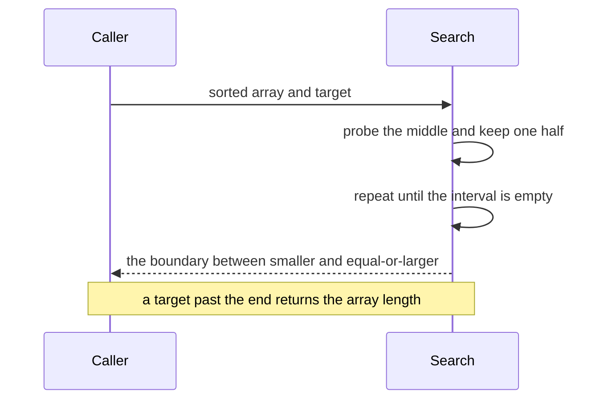

# 079 — Find insert position for target in sorted array.

> **Tier:** Beginner · **CTCI chapter:** Ch 10 — Sorting and Searching
> **Task spec:** [079-find-insert-position-for-target-in-sorted-array.md](../../../tasks/beginner/079-find-insert-position-for-target-in-sorted-array.md)
> **Solutions:** [Python](../../../solutions/python/beginner/079-find-insert-position-for-target-in-sorted-array/solution.py) ·
> [Java](../../../solutions/java/beginner/079-find-insert-position-for-target-in-sorted-array/Solution.java) ·
> [JavaScript](../../../solutions/javascript/beginner/079-find-insert-position-for-target-in-sorted-array/solution.js) ·
> [C#](../../../solutions/csharp/beginner/079-find-insert-position-for-target-in-sorted-array/Solution.cs)

## 1. Problem restatement

**Input.** A sorted array of distinct integers and a target value that may or may not be present.

**Output.** The index at which the target would have to be inserted so that the array stays sorted. That
is the same as the index of the target if it is already there.

| Call on `a = [1, 3, 5, 6]` | Result | What it checks |
| --- | --- | --- |
| `search_insert(a, 5)` | `2` | the value is present |
| `search_insert(a, 2)` | `1` | the value belongs between `1` and `3` |
| `search_insert(a, 7)` | `4` | the value belongs after the end; the answer equals `n` |
| `search_insert(a, 0)` | `0` | the value belongs before everything |
| `search_insert([], 42)` | `0` | the empty array accepts the value at index `0` |

All five rows are asserted in all four files. The Python docstring names the function it computes:
`lower_bound`, the index where the target should be inserted to keep the array sorted.

## 2. Intuition

This is task 077's search with one line removed. There, the lower bound had to be verified against the
array so that an absent target could be reported as `-1`. Here the lower bound *is* the answer:

- if the target occurs, the lower bound is the index of its first copy, which is where it already is;
- if the target does not occur, the lower bound is the first index holding a larger value — moving that
  element and everything after it right by one makes room for the target — and if every element is
  smaller, the lower bound is `n`, which means "append at the end".

So the answer set is `0 .. n` inclusive, one more value than an index range usually allows, and `-1`
never appears. That extra possibility is the detail to keep straight: an insert position of `n` is a
perfectly good answer, and the search must be able to produce it.

The loop that produces it keeps exactly the same two-way comparison as the first-occurrence search:

- if `a[mid] < target`, the answer is strictly after `mid`, so `lo` moves past it;
- otherwise the answer is at `mid` or before, so `hi = mid`.

When `lo == hi` the interval is empty and `lo` is the boundary between "smaller than the target" and
"greater than or equal to the target" — the insertion point.



## 3. Algorithm

1. Set `lo = 0` and `hi = n`, the half-open interval of candidate positions.
2. While `lo < hi`:
3. Compute `mid = (lo + hi) / 2` with integer division.
4. If `a[mid] < target`, set `lo = mid + 1`.
5. Otherwise set `hi = mid`.
6. When the loop ends, `lo == hi` and that value is the insert position: return `lo`.

```text
function search_insert(a, target)
    lo ← 0
    hi ← length(a)
    while lo < hi do
        mid ← (lo + hi) / 2
        if a[mid] < target then
            lo ← mid + 1
        else
            hi ← mid
        end
    end
    return lo
end
```

There is no post-loop verification, and that is the only structural difference from
[077-find-first-occurrence-of-target-in-sorted-array-with-duplicates.md](../../../tasks/beginner/077-find-first-occurrence-of-target-in-sorted-array-with-duplicates.md).
Because `lo` starts at `0` and `hi` at `n`, and because `lo` only moves when `a[mid]` is strictly smaller
than the target, `lo` can never exceed `n`: the answer is always a legal insertion index.

Never reading `a[lo]` is also why the function is safe on an array of any length, including zero. For an
empty array the loop does not run and the answer is `0` — the only possible insertion position.



## 4. Worked example

Find the insert position of `2` in `a = [1, 3, 5, 6]`, so `n = 4` and the interval starts as `[0, 4)`.

| Probe | `lo` | `hi` | `mid` | `a[mid]` | Comparison with `2` | Next interval |
| --- | --- | --- | --- | --- | --- | --- |
| 1 | `0` | `4` | `2` | `5` | not below | `[0, 2)` |
| 2 | `0` | `2` | `1` | `3` | not below | `[0, 1)` |
| 3 | `0` | `1` | `0` | `1` | below | `[1, 1)` |
| — | `1` | `1` | — | — | loop ends | return `1` |

Three probes for four elements, and the result `1` is the boundary between the `1` at index `0` and the
`3` at index `1`. Inserting there and shifting the tail right keeps the array sorted.

Now the two boundary cases, which are the ones an off-by-one breaks:

| Target | Interval progression | Result | Why |
| --- | --- | --- | --- |
| `5` (present) | `[0, 4)` → probe `2` (`5` not below) → `[0, 2)` → probe `1` (`3` below) → `[2, 2)` | `2` | the lower bound of a present value is its own index |
| `7` (after the end) | `[0, 4)` → probe `2` → `[3, 4)` → probe `3` (`6` below) → `[4, 4)` | `4` | every probe was "below", so `lo` walked to `n` |
| `0` (before the start) | `[0, 4)` → probe `2` (`5` not below) → `[0, 2)` → probe `1` (`3` not below) → `[0, 1)` → probe `0` (`1` not below) → `[0, 0)` | `0` | every probe was "not below", so `hi` walked to `0` |

The `7` row shows why the answer is allowed to equal `n`: `lo` was pushed to the end of the array and the
loop stopped there. The `0` row shows the mirror: `hi` walked all the way down and `lo` never moved.





## 5. Complexity

Let `n` be the length of the array.

| Measure | Bound | Why it holds |
| --- | --- | --- |
| Time, best | `O(1)` | for an empty array, and for an array of length one, the loop runs at most once |
| Time, average | `O(log n)` | each probe halves the candidate interval |
| Time, worst | `O(log n)` | `floor(log2 n) + 1` probes, then `lo` and `hi` meet |
| Space | `O(1)` | two bounds and one midpoint |
| Range of the result | `0 .. n` inclusive | `n` legitimate positions, one more value than the index range of the array |
| Alternative: linear scan | `O(n)` | stops at the first element that is at least the target |
| Alternative: search then adjust | `O(log n)` plus a walk | task 075 followed by a leftward walk loses the logarithmic bound on equal elements |
| Related function | lower bound | [077](../../../tasks/beginner/077-find-first-occurrence-of-target-in-sorted-array-with-duplicates.md) adds a verification step and returns `-1` for absent targets |

The comparison with a linear scan is the practical one, because insertion into a sorted array is a common
operation: finding the position is `O(log n)`, but the insertion itself still costs `O(n)` shifts, so the
search is never the bottleneck there. The search matters when the array is used as a read-only index.

## 6. Pitfalls and edge cases

- **The result may equal `n`.** `search_insert([1, 3, 5, 6], 7)` returns `4`, which is *not* a valid
  index. Any caller that then reads `a[result]` unconditionally is reading past the end. The contract is
  an insertion position, not an index of an existing element.
- **Every implementation is off by one until proven otherwise.** `lo` must start at `0`, `hi` at `n`, and
  the update on the "below" branch must be `lo = mid + 1`. Writing `lo = mid` makes the loop stall when
  the interval has width one; writing `hi = n - 1` excludes the append position and breaks the `7` case.
- **No verification, by design.** Adding the `a[lo] == target` check from task 077 and returning `-1` when
  it fails replaces this function with the first-occurrence search. The two tasks differ by exactly that
  line, and the task spec asks for the version without it.
- **Midpoint arithmetic.** The files write `(lo + hi) / 2`; the overflow-proof `lo + (hi - lo) / 2` used
  in task 075 is equivalent here and safer for very large arrays.
- **The equality case belongs to `hi`.** Only strictly smaller values push `lo` past `mid`, which is what
  makes the returned position the *first* place a value equal to the target could live. Moving `lo` on
  equality would return the index after the existing copies, where inserting would be wrong for the
  "insert only if absent" use case.
- **Empty array.** No probes, `lo = 0`, and the answer is `0`. All four files assert `search_insert([], 42)
  == 0` (Java with `new int[0]`).
- **Length-one array.** The single element either pushes `lo` to `1` (it is smaller than the target) or
  `hi` to `0` (it is not), giving `1` or `0` respectively. No special case is needed.
- **Duplicates are not a problem here.** With several equal copies, the lower bound is the position of the
  first one, which is a valid place to insert (it shifts the run rather than splitting it).
- **The array must be sorted.** As always with binary search, unsorted input produces a wrong position
  silently.

## 7. Variants and follow-ups

- **First occurrence.** [077-find-first-occurrence-of-target-in-sorted-array-with-duplicates.md](../../../tasks/beginner/077-find-first-occurrence-of-target-in-sorted-array-with-duplicates.md)
  is this loop plus the verification step, and
  [078-find-last-occurrence-of-target-in-sorted-array-with-duplicates.md](../../../tasks/beginner/078-find-last-occurrence-of-target-in-sorted-array-with-duplicates.md)
  is the upper-bound mirror.
- **Plain search.** [075-binary-search-iterative-on-sorted-array.md](../../../tasks/beginner/075-binary-search-iterative-on-sorted-array.md)
  and its recursive twin
  [076-binary-search-recursive.md](../../../tasks/beginner/076-binary-search-recursive.md) return `-1` when
  the value is absent, which is the information this function deliberately discards.
- **Insertion into a sorted array.** The position comes from this search, but the shift that follows costs
  `O(n)` — the reason sorted arrays are used for lookup-heavy, write-light workloads.
- **Sorted arrays versus balanced trees.** A balanced binary search tree supports the same `O(log n)`
  search *and* an `O(log n)` insertion, which this array cannot.
- **Ordering the input.** [068-heapsort-using-heap-operations.md](../../../tasks/beginner/068-heapsort-using-heap-operations.md)
  and the simpler sorts in this tier are what produce the sorted array in the first place.
- **Merging instead of inserting.**
  [020-merge-two-sorted-arrays-into-a-sorted-array.md](../../../tasks/beginner/020-merge-two-sorted-arrays-into-a-sorted-array.md)
  builds a new sorted array from two, which avoids the in-place shift entirely.
- [Sorting and Searching](../../ctci/10-sorting-and-searching.md) covers binary search and its variants.

## 8. Check yourself

1. What is the range of possible return values, and why is it larger than the index range?

<details><summary>Show answer</summary>

`0` to `n` inclusive. An index must be `< n` to be valid, but an insertion position of `n` means "append
after the last element", which is a legitimate answer when the target is larger than everything stored.
That is why `lo` starts at `0` and `hi` at `n`, and why the loop can end with `lo == n`.

</details>

2. How does this differ from the first-occurrence search of task 077?

<details><summary>Show answer</summary>

By the verification step. Both loops are identical — half-open interval, `a[mid] < target` moves `lo`,
otherwise `hi = mid`. Task 077 then checks `a[lo] == target` and returns `-1` when the value is absent,
separating "found at the lower bound" from "would be inserted here". This function returns the lower bound
unconditionally.

</details>

3. Why must the equality case move `hi` rather than `lo`?

<details><summary>Show answer</summary>

Because the returned position must be the first place the target could live. If `a[mid] == target`, index
`mid` is already usable, so the boundary is at `mid` or earlier, which is the `hi = mid` branch. Moving
`lo` on equality would skip past the existing copies and return a position where inserting duplicates the
value after the run.

</details>

4. What does `search_insert([], 42)` return, and why is that not a special case?

<details><summary>Show answer</summary>

`0`. The loop `while lo < hi` is false immediately because `hi` starts at `n = 0`, so `lo = 0` is returned
unchanged. The same reasoning covers a length-one array, where at most one probe runs and either bound
moves to the only available answer.

</details>

5. Why is this search rarely the expensive part of inserting into a sorted array?

<details><summary>Show answer</summary>

Because the insertion itself is `O(n)`: every element after the position has to shift right by one slot to
make room. Finding the position costs `O(log n)`, which is dominated completely by the shift on any array
of practical size — so sorted arrays are chosen for read-heavy workloads, and tree or hash structures for
write-heavy ones.

</details>
