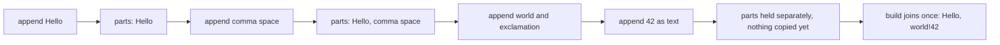
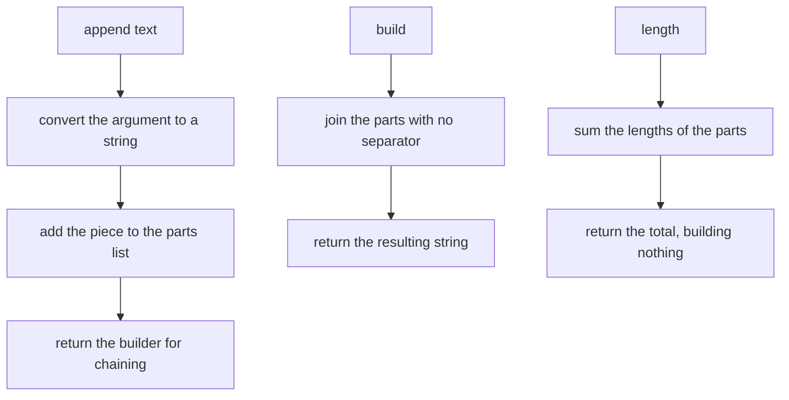
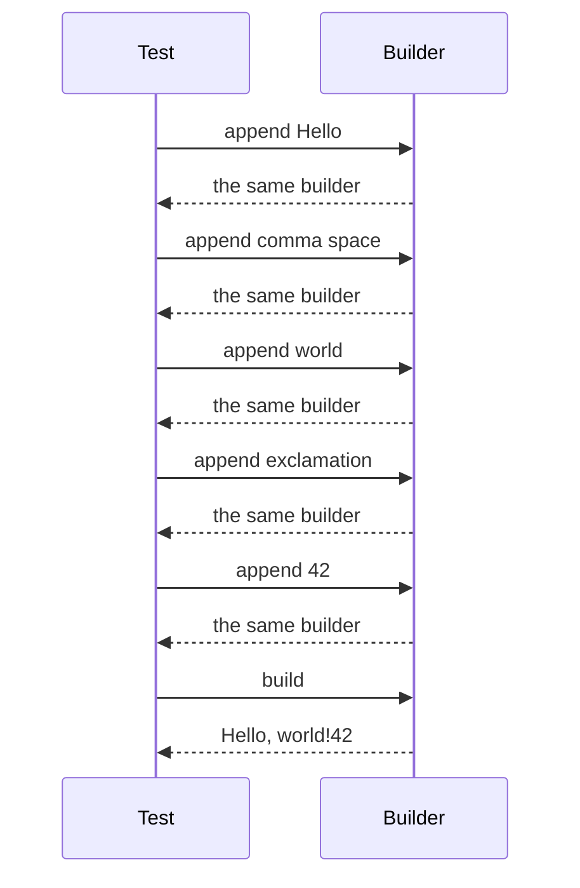
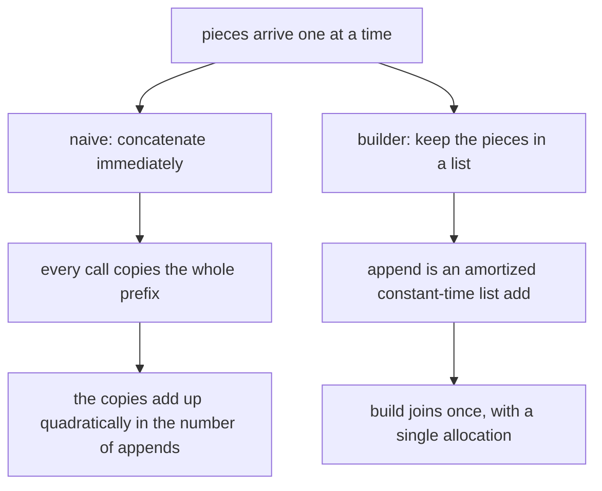

# 080 — Implement string builder/concatenation efficient.

> **Tier:** Beginner · **CTCI chapter:** Ch 7 — Object-Oriented Design
> **Task spec:** [080-implement-string-builder-concatenation-efficient.md](../../../tasks/beginner/080-implement-string-builder-concatenation-efficient.md)
> **Solutions:** [Python](../../../solutions/python/beginner/080-implement-string-builder-concatenation-efficient/solution.py) ·
> [Java](../../../solutions/java/beginner/080-implement-string-builder-concatenation-efficient/Solution.java) ·
> [JavaScript](../../../solutions/javascript/beginner/080-implement-string-builder-concatenation-efficient/solution.js) ·
> [C#](../../../solutions/csharp/beginner/080-implement-string-builder-concatenation-efficient/Solution.cs)

## 1. Problem restatement

**Input.** A sequence of `append(text)` calls, each contributing a piece of text that may be a string or
a number.

**Output.** A builder object with three capabilities: `append` accumulates a piece, `build` returns the
concatenation of everything appended so far, and `length` reports the total number of characters
currently held.

| Call sequence | Result | What it checks |
| --- | --- | --- |
| `append("Hello")`, `append(", ")`, `append("world")`, `append("!")`, `append(42)`, then `build()` | `"Hello, world!42"` | mixed types and chained calls |
| `length` after those appends | `15` | the running total counts every character |
| `build()` on a fresh builder | `""` | the empty case |
| a single `join` over a large list of pieces | `O(n)` build cost | the point of the whole exercise, see section 5 |

All four files assert the first three rows. The Python file also assembles a string from `10000` pieces in
one join and compares its length with the same text built another way — the comparison is about the
mechanism (one allocation), not a timing claim.

## 2. Intuition

Strings are immutable in every language used here. That single fact turns the natural loop into a
quadratic algorithm:

```text
result ← ""
for each piece in pieces do
    result ← result + piece
end
```

Each `result + piece` allocates a *new* string and copies the whole existing prefix into it. After `k`
pieces of average length `m`, the copies total roughly `m * (1 + 2 + ... + k)`, which is `O(k² m)` — the
quadratic term is in the number of appends, not in the final length. The Python file's docstring states
the intended contrast plainly: `O(n)` via a join buffer instead of repeated `O(n)` immutable
concatenations.

The fix is the classic space-for-time trade: keep the pieces **separately** in a growable list, and
perform exactly one concatenation at the end, when the total length is known and a single result buffer
can be allocated. Appending to a list is `O(1)` amortized, joining once is `O(n)` in the total character
count, and no prefix is ever copied twice.

The second half of the design is what makes the class pleasant to use: `append` returns the builder
itself, so calls chain without a temporary variable — `sb.append("Hello").append(", ")`. That fluent
shape is the object-oriented part of this task, and it is the same idea as the builders in the standard
libraries (`StringBuilder` in Java and .NET, `Array.join` in JavaScript, `"".join` or `io.StringIO` in
Python).



Note what the diagram does *not* show: no intermediate string is ever constructed. Up to the `build`
call, the builder's state is a list of pieces, which is why its storage cost is the total text length
plus one pointer per piece rather than a stack of ever-growing copies.

## 3. Algorithm

1. A new builder starts with an empty list of parts.
2. `append(text)`: convert `text` to a string if it is not one, add it to the list, and return the
   builder so the call can be chained.
3. `build()`: join the parts into one string with no separator and return it. On an empty builder this is
   the empty string.
4. `length`: return the sum of the lengths of the parts — again without building anything.

```text
class StringBuilder
    parts ← empty list

    function append(text)
        append text converted to a string to parts
        return this
    end

    function build
        return the concatenation of parts with no separator
    end

    function length
        total ← 0
        for each part in parts do
            total ← total + length(part)
        end
        return total
    end
end
```

Step 2's conversion is what makes the mixed-type assertion work: `42` must become `"42"`. The four files
do it with `str(text)` in Python, `String.valueOf(text)` in Java, `String(text)` in JavaScript and
`text.ToString() ?? ""` in C#, and the C# version's null-coalescing is the only one that needs a guard
because `Object.ToString()` is nullable there.

The Python and JavaScript files use a list plus `join` as the buffer; Java uses `String.join` over an
`ArrayList`; C# uses `string.Join`. The task asks for an implementation rather than a wrapper, and all
four files stay at the level of the list-plus-join mechanism, which is what a minimal builder *is*.



## 4. Worked example

Run the assertion sequence from the files — `append("Hello")`, `append(", ")`, `append("world")`,
`append("!")`, `append(42)` — and track the list of parts and the running character count.

| Step | Call | Argument converted | Parts after | `length` now |
| --- | --- | --- | --- | --- |
| 1 | `append("Hello")` | `"Hello"` | `["Hello"]` | `5` |
| 2 | `append(", ")` | `", "` | `["Hello", ", "]` | `7` |
| 3 | `append("world")` | `"world"` | `["Hello", ", ", "world"]` | `12` |
| 4 | `append("!")` | `"!"` | `["Hello", ", ", "world", "!"]` | `13` |
| 5 | `append(42)` | `"42"` | `["Hello", ", ", "world", "!", "42"]` | `15` |
| 6 | `build()` | — | unchanged | `15` |

After the five appends the builder holds five pieces and no concatenated string: the total of `5 + 2 + 5
+ 1 + 2` is `15`, which is the value the `length` assertion checks. `build()` then joins them into
`"Hello, world!42"`, and calling `build()` again on the same builder produces the same string, because
joining does not consume the parts.

The same trace written as chained calls shows why `append` returns the builder — every call in the chain
receives the object the previous call returned:



The alternative — concatenating on every append — would copy the prefix once per call. The diagram below
puts the two shapes side by side; the left column is the shape this task exists to avoid:



## 5. Complexity

Let `k` be the number of pieces appended and `n` the total number of characters.

| Measure | Bound | Why it holds |
| --- | --- | --- |
| Time, `append` | `O(1)` amortized | a growable list add; the doubling reallocation is amortized away |
| Time, `append` worst single call | `O(k)` | the one call that triggers a reallocation copies the existing pointers |
| Time, `build` | `O(n)` | one pass over the parts, one allocation of the result |
| Time, `length` as implemented | `O(k)` | the four files sum the per-part lengths on demand |
| Time, the naive `+=` loop | `O(k²)` in appends | each concatenation copies the whole prefix it extends |
| Space | `O(n + k)` | the characters plus one pointer per piece; the built string adds another `O(n)` |
| Peak space at `build` | about `2 * O(n)` | the pieces and the joined result coexist while the join runs |

The one place the shipped implementation is not optimal is `length`: a production builder keeps a running
counter and answers in `O(1)`, while these files recompute the sum from the parts. That is a deliberate
simplification for a beginner task — the parts list is the source of truth, and a running total would be a
second thing to keep consistent.

## 6. Pitfalls and edge cases

- **Appending inside `build`.** If `build` were implemented as a loop that concatenates into a growing
  string, the quadratic cost would simply move from `append` to `build`. The whole point is the single
  join.
- **Forgetting to return the builder.** An `append` that returns nothing breaks chaining. The Python and
  Java files return `self` / `this`, the JavaScript file returns `this`, and the C# file returns the
  instance — the assertion sequences in all four depend on it.
- **Non-string arguments must be converted.** `append(42)` has to become `"42"`. Skipping the conversion
  fails in Python (joining non-strings raises), Java (`String.join` needs strings), JavaScript (the join
  produces `"42"` anyway, but a `null` would print as an empty string rather than as `"null"`), and C#
  (`ToString()` is nullable, hence the `?? ""`).
- **No separator is added.** `build` concatenates, it does not delimit. A method that inserted a comma
  between parts would produce `"Hello, , world, !, 42"`; if a separator is wanted, that is
  `String.join(", ", parts)` rather than a builder concern.
- **Empty builder.** No appends means no parts, and joining zero pieces yields `""`. All four files assert
  this, which also covers the "build twice" case.
- **`build` does not reset.** The parts are still there afterwards, so a second `build` returns the same
  string. If the caller expects a consuming operation, it should clear the list explicitly — none of the
  four files implement `clear`.
- **Mutating the parts outside the class.** In Python and JavaScript a caller can reach the list
  attribute and corrupt the builder's state. The Java and C# versions keep it `private` / `final`; the
  Python and JavaScript files prioritise brevity.
- **Growing by one character at a time.** The builder makes the *implementation* efficient, not the
  design: appending a million one-character pieces holds a million pointers. Grouping text before
  appending, or writing into a fixed buffer, is the next step when piece counts get extreme.
- **Language-provided alternatives.** Java has `java.lang.StringBuilder` and `System.Text.StringBuilder`
  exists in .NET; Python's idiomatic answer is `"".join(...)` or `io.StringIO`; JavaScript's is an array
  plus `join`. The four files reimplement the minimal version deliberately, because the task says
  "implement".

## 7. Variants and follow-ups

- **String building elsewhere in this tier.** [001-reverse-a-string.md](../../../tasks/beginner/001-reverse-a-string.md)
  shows the same reasoning applied to one string — allocate once, fill in one pass.
- **Text assembly with a loop.** [040-merge-two-strings-alternately.md](../../../tasks/beginner/040-merge-two-strings-alternately.md)
  builds a result character by character and has to make the same choice between a buffer and
  concatenation.
- **Joining versus searching.** [046-implement-substring-search-naive.md](../../../tasks/beginner/046-implement-substring-search-naive.md)
  cares about the *contents* of the pieces; here only their concatenation matters.
- **Shared prefixes over many pieces.** [094-find-longest-common-prefix-in-array-of-strings.md](../../../tasks/beginner/094-find-longest-common-prefix-in-array-of-strings.md)
  processes a collection of strings without building a new one at all.
- **Other linear-time primitives.** [081-compute-prefix-sums-for-an-array.md](../../../tasks/beginner/081-compute-prefix-sums-for-an-array.md)
  is the numeric counterpart of this task: one pass, one output, no repeated copying.
- **The design angle.** [Object-Oriented Design](../../ctci/07-object-oriented-design.md) is the chapter
  the spec assigns, and [Arrays and Strings](../../ctci/01-arrays-and-strings.md) is where the solution
  files place the problem — the two views of the same class.

## 8. Check yourself

1. Why is the naive `result = result + piece` loop quadratic in the number of pieces?

<details><summary>Show answer</summary>

Because strings are immutable: every concatenation allocates a new string and copies the whole existing
prefix into it. After `k` pieces the copies total roughly the sum `m * (1 + 2 + ... + k)`, which is
quadratic in `k`. The final string is only `k * m` characters, so most of the work is wasted recopying
text that has already been copied.

</details>

2. What does the builder do instead, and what does it cost?

<details><summary>Show answer</summary>

It keeps the pieces in a growable list, so `append` is an amortized `O(1)` list add with no copying of
text, and `build` performs a single join: one pass over the pieces and one allocation of the result,
`O(n)` in the total character count. Space is `O(n + k)` — the characters plus one pointer per piece —
and the peak doubles momentarily during the join.

</details>

3. Why does `append` return the builder?

<details><summary>Show answer</summary>

To allow call chaining, `sb.append(a).append(b).append(c)`. The next call in the chain is made on the
value the previous call returned, so returning the builder keeps the chain intact; returning nothing
would force the caller to name the variable on every line. The assertion sequences in all four files use
the chained form.

</details>

4. What does `build()` return for a builder with no appends, and why does that matter?

<details><summary>Show answer</summary>

`""`. Joining an empty list yields an empty string in every language, so no special case is needed. It
matters because it is the one assertion that catches a `build` implementation that assumes there is at
least one piece — for instance one that uses the first part as a seed and then appends the rest.

</details>

5. How would you make `length` `O(1)` instead of `O(k)`?

<details><summary>Show answer</summary>

Keep a running total as a field and update it inside `append` by adding the length of the converted piece.
Then `length` becomes a field read. The cost is that the total and the list have to stay consistent; the
shipped version recomputes the sum from the parts instead, which is simpler and still correct.

</details>
