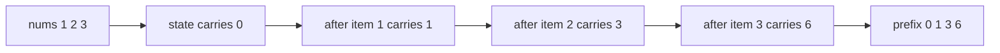
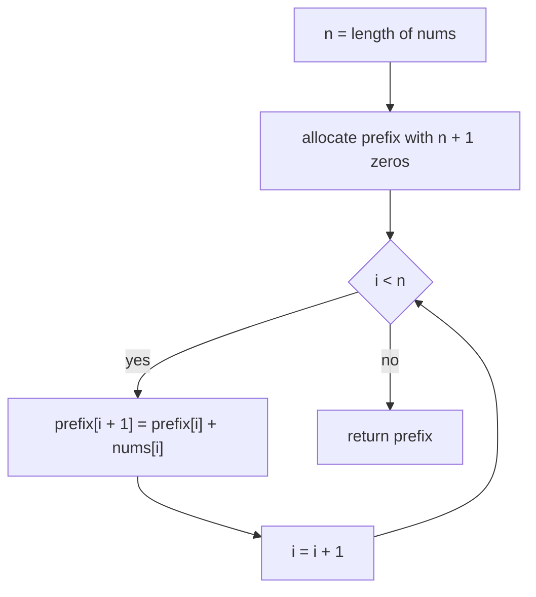
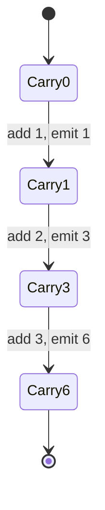

# 081 — Compute prefix sums for an array.

> **Tier:** Beginner · **CTCI chapter:** Ch 1 — Arrays and Strings
> **Task spec:** [081-compute-prefix-sums-for-an-array.md](../../../tasks/beginner/081-compute-prefix-sums-for-an-array.md)
> **Solutions:** [Python](../../../solutions/python/beginner/081-compute-prefix-sums-for-an-array/solution.py) ·
> [Java](../../../solutions/java/beginner/081-compute-prefix-sums-for-an-array/Solution.java) ·
> [JavaScript](../../../solutions/javascript/beginner/081-compute-prefix-sums-for-an-array/solution.js) ·
> [C#](../../../solutions/csharp/beginner/081-compute-prefix-sums-for-an-array/Solution.cs)

## 1. Problem restatement

**Input:** an array of integers `nums` with `n` elements. `n` may be `0`; values may be negative,
zero or repeated.

**Output:** a *new* array `prefix` of `n + 1` integers where `prefix[i]` is the sum of the first
`i` elements of `nums`. Equivalently: `prefix[0] = 0`, and for every `i` in `1..n`,
`prefix[i] = nums[0] + nums[1] + ... + nums[i - 1]`.

The “`n + 1`” length is the entire point of the task. The empty prefix gets its own slot, so no
query ever needs an extra “is the range empty?” branch: `prefix[j] - prefix[i]` is the sum of
`nums[i..j)` for every legal `i <= j`, including `i == j`.

The task spec is a one-liner, so the contract is pinned down by the assertions the four solution
files ship with. All four assert the same six rows:

| Call | Result | Why |
| --- | --- | --- |
| `prefix_sums([])` | `[0]` | `n = 0`, so the answer is just the empty prefix |
| `prefix_sums([5])` | `[0, 5]` | one element, two prefix slots |
| `prefix_sums([1, 2, 3])` | `[0, 1, 3, 6]` | running total 1, 3, 6 |
| `prefix_sums([-1, 1, -1])` | `[0, -1, 0, -1]` | prefix sums are not monotone |
| `prefix_sums([4, 4, 4, 4])` | `[0, 4, 8, 12, 16]` | duplicates are summed, not deduplicated |
| length of `prefix_sums([1, 2, 3, 4, 5])` | `6` | the `n + 1` invariant |

Python's `main`, Java's `main`, the JavaScript block under `require.main === module` and the C#
`Main` all assert exactly these rows, so any implementation that returns `n` slots, drops the
leading zero, or sorts the input is wrong by construction.

## 2. Intuition

The naive way to answer “what is the sum of the first `i` elements?” is to add them up on demand:

```text
function prefix_naive(nums, k)
    total ← 0
    for i ← 0 to k - 1 do
        total ← total + nums[i]
    end
    return total
end
```

Correct, but wasteful: computing every prefix this way re-reads `nums[0]` `n` times, `nums[1]`
`n - 1` times, and so on — `n(n + 1)/2` additions to fill one array. The fix is embarrassingly
simple once you notice the recurrence

```text
prefix[i + 1] = prefix[i] + nums[i]
```

Each prefix is built from the *previous* prefix plus one new element. One addition per element,
no re-reading. That is the whole insight: **a running total carried forward**.

The second insight is about the shape of the output. Storing `n + 1` values instead of `n` costs
one extra slot and buys a uniform algebra: ranges become subtractions rather than conditionals.
This leading-zero convention is what makes
[082 — Range sum query naive using prefix sums](../../../tasks/beginner/082-range-sum-query-naive-using-prefix-sums.md)
a two-line function.



Read the picture as a pipeline: the state on each arrow is the running total, and the output
array is the sequence of states, *including* the initial one. That is why the output is one
element longer than the input — the “before anything was added” state is a legitimate answer.

## 3. Algorithm

1. Let `n` be the length of `nums`.
2. Allocate `prefix` with `n + 1` slots, all initialised to `0`.
3. Walk `i` from `0` to `n - 1`. Set `prefix[i + 1] ← prefix[i] + nums[i]`.
4. Return `prefix`.

```text
procedure prefix_sums(nums)
    n ← length(nums)
    prefix ← new array of n + 1 zeros
    for i ← 0 to n - 1 do
        prefix[i + 1] ← prefix[i] + nums[i]
    end
    return prefix
end
```

Note the direction of the dependency: slot `i + 1` reads slot `i`, which was written in the
previous iteration. The loop therefore cannot be reordered or parallelised along `i` without a
prefix-scan transformation — a detail worth stating out loud in an interview, because it is the
difference between a linear scan and a log-depth parallel scan.

The loop is deliberately a *single* pass that writes each slot exactly once. The alternative —
`prefix[i + 1] = sum(nums[0..i])` recomputed from scratch — is what section 2 rejects.



The loop never touches `prefix[0]` after initialisation, which is exactly why the initial value
must be zero in every language:

- Python: `[0] * (n + 1)`
- Java: `new int[n + 1]` (default `0`)
- JavaScript: `new Array(n + 1).fill(0)` — `fill` is mandatory, because `new Array(5)` holds
  *holes*, and `undefined + 4` would poison every later slot
- C#: `new int[n + 1]` (default `0`)

## 4. Worked example

Trace `prefix_sums([1, 2, 3])`. `n = 3`, so `prefix` starts as `[0, 0, 0, 0]`:

| Step | `i` | `nums[i]` | reads | writes | `prefix` after the step |
| --- | --- | --- | --- | --- | --- |
| start | — | — | — | — | `[0, 0, 0, 0]` |
| 1 | 0 | 1 | `prefix[0] = 0` | `prefix[1] = 1` | `[0, 1, 0, 0]` |
| 2 | 1 | 2 | `prefix[1] = 1` | `prefix[2] = 3` | `[0, 1, 3, 0]` |
| 3 | 2 | 3 | `prefix[2] = 3` | `prefix[3] = 6` | `[0, 1, 3, 6]` |

The third row is the interesting one: `prefix[3] = 6` is computed without ever looking at
`nums[0]` or `nums[1]` again — the value `3` already encodes them.

Rows 2 and 3 also show why the running total must be read *after* it was written. Reading
`prefix[i + 1]` on the left and `prefix[i]` on the right means each slot depends on its left
neighbour only, i.e. the classic linear-chain dependency:



The same trace on an empty array collapses to a single state: `n = 0`, the loop body never runs,
and the returned array is `[0]`. The negative case `[-1, 1, -1]` walks *down* then up
(`0 → -1 → 0 → -1`), which is a reminder that prefix sums are ordinary integers, not counts —
nothing in the algorithm assumes monotonicity.

## 5. Complexity

Let `n` be the number of input elements.

| Measure | Bound | Why it holds |
| --- | --- | --- |
| Time, best | O(n) | even the empty-input case allocates and returns one slot (`n + 1` is still O(n)) |
| Time, average | O(n) | one addition, one read and one write per element |
| Time, worst | O(n) | the loop body has no data-dependent branches or early exits |
| Space, output | O(n) | the returned array holds `n + 1` integers |
| Space, extra | O(n) | the output array *is* the auxiliary structure — no other buffer is used |
| Naive recomputation | O(n²) | computing prefix `i` from scratch costs `i` additions |

The `n + 1` sizing means the empty input still allocates one slot; that is a constant-time
allocation, so it does not change the asymptotics, but it does mean the function is never
`O(1)` even for `n = 0`.

A neat sanity property that the bounds make visible: filling the array costs exactly `n`
additions, and the returned array answers any of the `n + 1` prefix questions in `O(1)` — the
precomputation is strictly cheaper than one naive query on average.

## 6. Pitfalls and edge cases

- **Off-by-one on the output length.** It is `n + 1`, not `n`. Python, Java, JavaScript and C#
  each assert `len(prefix_sums([1,2,3,4,5])) == 6` (or `.length`), so this is checked in all four.
- **Empty input.** `prefix_sums([])` must be `[0]`, not `[]` and not a `null`/`nil` return. All
  four solutions assert it. Returning `null` here would break every range query built on top.
- **Uninitialised slots in JavaScript.** `new Array(n + 1)` produces a sparse array of holes;
  `prefix[0] + nums[0]` would then be `NaN`. The solution calls `.fill(0)` for exactly this
  reason. Python, Java and C# give zero-initialised storage automatically.
- **Shared slot between input and output.** The result must be a fresh array; do not return
  `nums` with a zero pushed onto the front, because callers may still be using `nums`.
- **Negative values and duplicates.** `[-1, 1, -1]` yields `[0, -1, 0, -1]` and `[4, 4, 4, 4]`
  yields `[0, 4, 8, 12, 16]`. Prefix sums never require sorted input and never filter values.
- **Integer overflow.** Java and C# use 32-bit `int`, and the task spec sets no value range. A
  long array of large values can overflow `int` in the middle of the scan, silently wrapping the
  answer. Python integers are unbounded, and JavaScript numbers are doubles, so the four
  solutions do not all fail the same way — if the interview allows large inputs, say that you
  would widen the accumulator.
- **Do not sort.** Prefix sums are order-sensitive; sorting `nums` changes every answer.
- **Floating-point addition.** Relevant only if you generalise the code to doubles: prefix sums
  accumulate rounding error, and `prefix[j] - prefix[i]` is no longer exactly the true range sum.
  Not an issue for the integer arrays these files test.

## 7. Variants and follow-ups

- **Range sum queries.** The direct consumer of this array is
  [082-range-sum-query-naive-using-prefix-sums.md](../../../tasks/beginner/082-range-sum-query-naive-using-prefix-sums.md),
  where `sum(nums, i, j) = prefix[j] - prefix[i]`.
- **Suffix sums.** Running the same recurrence from the right gives a suffix array; the two
  together answer “sum outside a range” questions.
- **Sliding window sums.** [090-implement-sliding-window-sum-of-size-k.md](../../../tasks/beginner/090-implement-sliding-window-sum-of-size-k.md)
  is the same running-total idea with an explicit subtraction of the element that leaves the
  window, i.e. a streaming prefix sum.
- **Inversion counting.** The merge in
  [087-implement-merge-and-count-inversions-using-merge-sort.md](../../../tasks/beginner/087-implement-merge-and-count-inversions-using-merge-sort.md)
  reuses the “carry a running quantity across a linear scan” habit, but counts crossings instead
  of adding values.
- **Difference arrays.** The inverse trick: adding `v` to a whole range is one `+v` and one `-v`
  in a difference array, and prefix-summing it recovers the array. Same array, opposite direction.
- **Prefix products / gcd.** Any associative operation works, provided it has an identity for
  slot zero — for products that identity is `1`, and for sums with real numbers you must be
  careful about the identity and about division-based range queries.

## 8. Check yourself

1. Why is the output array one element longer than the input?

<details><summary>Show answer</summary>

Because the array stores the `n + 1` *prefix* sums for the cut positions `0..n`, and the cut
before the first element has sum `0`. Keeping that slot means `prefix[j] - prefix[i]` is the sum
of `nums[i..j)` for every `0 <= i <= j <= n`, with no special case for empty ranges.

</details>

2. How many additions does the shipped algorithm perform on an array of `n` elements, and how
   many would the naive per-prefix recomputation perform?

<details><summary>Show answer</summary>

The shipped code performs exactly `n` additions — one per loop iteration. The naive version
computes prefix `i` with `i` additions, so it performs `0 + 1 + ... + n = n(n + 1)/2` additions,
which is why it is O(n²) instead of O(n).

</details>

3. What breaks if you write `prefix[i + 1] = prefix[i] + nums[i]` in JavaScript without calling
   `fill(0)` first?

<details><summary>Show answer</summary>

`new Array(n + 1)` creates an array of holes, so `prefix[0]` is `undefined`. `undefined + nums[0]`
is `NaN`, and `NaN` propagates through every following slot, so the function returns an array of
`NaN`s rather than prefix sums. The JavaScript solution calls `.fill(0)` for exactly this reason.

</details>

4. Does the algorithm still work when the array contains negative numbers? What about duplicates?

<details><summary>Show answer</summary>

Yes to both. The recurrence only uses addition, so `[-1, 1, -1]` produces `[0, -1, 0, -1]` (not
monotone, but correct) and `[4, 4, 4, 4]` produces `[0, 4, 8, 12, 16]`. Both rows are asserted in
all four solution files. Nothing in the algorithm assumes sortedness or distinct values.

</details>

5. Can the loop be rewritten to run in parallel, and what would that cost?

<details><summary>Show answer</summary>

Not as written: slot `i + 1` depends on slot `i`, a linear dependency chain. The standard
remedy is a parallel prefix scan (Hillis–Steele or Blelloch), which trades `O(n)` work for
`O(log n)` depth at the cost of more total operations. For a single array of this size the
sequential loop is the right answer; the parallel scan only pays off on large hardware vectors.

</details>
