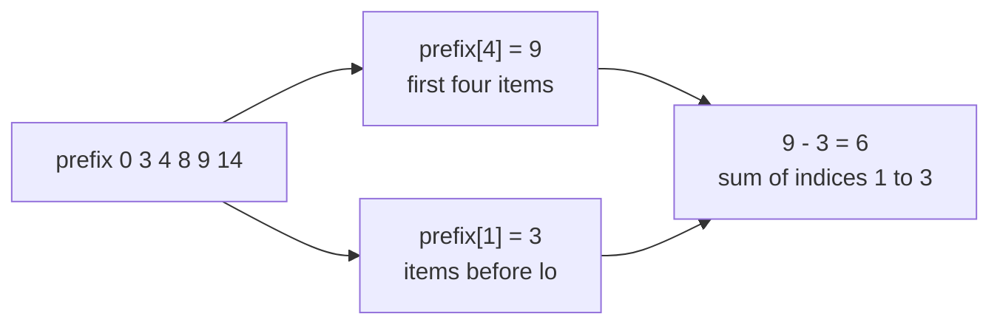
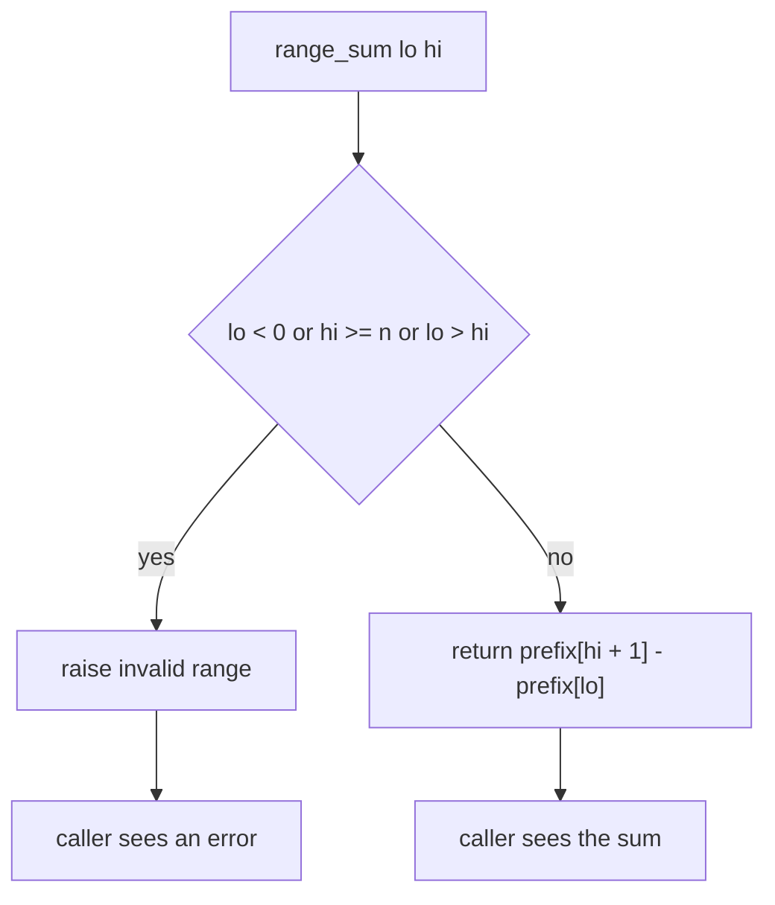
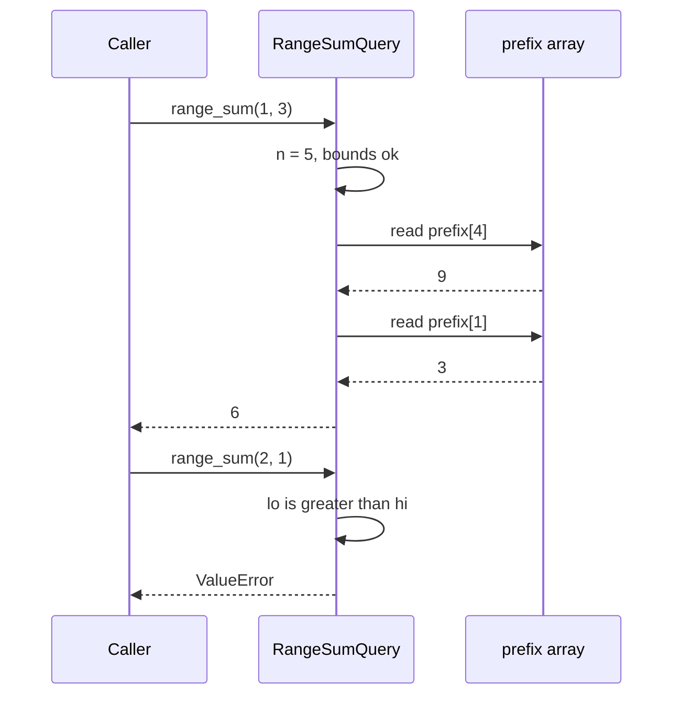

# 082 — Range sum query naive using prefix sums.

> **Tier:** Beginner · **CTCI chapter:** Ch 1 — Arrays and Strings
> **Task spec:** [082-range-sum-query-naive-using-prefix-sums.md](../../../tasks/beginner/082-range-sum-query-naive-using-prefix-sums.md)
> **Solutions:** [Python](../../../solutions/python/beginner/082-range-sum-query-naive-using-prefix-sums/solution.py) ·
> [Java](../../../solutions/java/beginner/082-range-sum-query-naive-using-prefix-sums/Solution.java) ·
> [JavaScript](../../../solutions/javascript/beginner/082-range-sum-query-naive-using-prefix-sums/solution.js) ·
> [C#](../../../solutions/csharp/beginner/082-range-sum-query-naive-using-prefix-sums/Solution.cs)

## 1. Problem restatement

**Input:** an array of integers, plus a stream of **inclusive** range queries `(lo, hi)` meaning
“the sum of elements from index `lo` to index `hi`, both ends included”.

**Output:** one integer per query. Queries may repeat, overlap, or arrive in any order, and the
same object answers all of them.

The four solution files make the contract concrete by wrapping the work in a `RangeSumQuery`
class that the caller constructs once and queries many times:

| Call on `RangeSumQuery([3, 1, 4, 1, 5])` | Result | Why |
| --- | --- | --- |
| `range_sum(0, 4)` | `14` | the whole array: `3 + 1 + 4 + 1 + 5` |
| `range_sum(1, 3)` | `6` | `1 + 4 + 1` |
| `range_sum(2, 2)` | `4` | a single element, `lo == hi` is legal |
| `range_sum(0, 0)` | `3` | a single element at the left edge |
| `range_sum(4, 4)` | `5` | a single element at the right edge |
| `range_sum(0, 0)` on `RangeSumQuery([7])` | `7` | the smallest non-empty array |

Invalid ranges are *rejected*, not clamped. All four files assert that these four calls throw:

| Call | Error | Reason |
| --- | --- | --- |
| `range_sum(-1, 2)` | `ValueError` / `IllegalArgumentException` / `Error` / `ArgumentException` | `lo < 0` |
| `range_sum(2, 1)` | same | `lo > hi` |
| `range_sum(1, 5)` | same | `hi >= n` (there is no index `5`) |
| `range_sum(0, 0)` on an empty array | same | `n = 0`, so every index is out of range |

All four assert those four throwing cases, so silently returning `0` for a bad range — a tempting
“robustness” choice — fails the task.

## 2. Intuition

The naive query is a loop:

```text
function range_sum_scan(nums, lo, hi)
    total ← 0
    for i ← lo to hi do
        total ← total + nums[i]
    end
    return total
end
```

Its cost is proportional to the *width* of the range, so a query that spans the whole array costs
`O(n)` and a workload of `q` queries costs `O(q · n)`. For a chatty caller (a dashboard that
re-queries on every keystroke, say) that is the wrong side of the trade.

The key insight, from [081 — Compute prefix sums for an array](../../../tasks/beginner/081-compute-prefix-sums-for-an-array.md),
is that a single `O(n)` precomputation makes every query `O(1)`:

```text
sum of nums[lo .. hi] = prefix[hi + 1] - prefix[lo]
```

Read it as bookkeeping: `prefix[hi + 1]` is “everything up to and including `hi`” and
`prefix[lo]` is “everything before `lo`”. Their difference is exactly the middle slice, because
every element outside the range appears in both terms and cancels.



The trade is explicit: pay `O(n)` once, then `O(1)` per query, at the cost of `O(n)` extra
memory. The task name calls the structure “naive” because it is the simplest member of a family —
it handles *static* data beautifully and has no answer at all for updates. Inserting a value in
the middle invalidates every later prefix entry, which is where the segment tree and the Fenwick
tree in the intermediate tiers come from.

The second design decision is where the validation lives. The three checks `lo < 0`, `hi >= n`,
`lo > hi` are not defensive noise; they encode the definition of an inclusive range over an
array of size `n`, and `lo > hi` in particular catches the “reversed endpoints” typo that would
otherwise return a silently wrong `0` (the subtraction would be negative and meaningless).

## 3. Algorithm

**Construction (once):**

1. Let `n` be the length of the array.
2. Allocate `prefix` with `n + 1` slots, all zero.
3. For `i` from `0` to `n - 1`, set `prefix[i + 1] ← prefix[i] + nums[i]`.
4. Store `prefix` on the object.

**Query (per call):**

5. Derive `n ← length(prefix) - 1` — the array length is recoverable from the prefix array, so no
   second field is needed.
6. Reject the query if `lo < 0`, or `hi >= n`, or `lo > hi`.
7. Return `prefix[hi + 1] - prefix[lo]`.

```text
procedure build(nums)
    prefix ← new array of length(nums) + 1 zeros
    for i ← 0 to length(nums) - 1 do
        prefix[i + 1] ← prefix[i] + nums[i]
    end
    store prefix
end

function range_sum(lo, hi)
    n ← length(prefix) - 1
    if lo < 0 or hi >= n or lo > hi then
        raise invalid range
    end
    return prefix[hi + 1] - prefix[lo]
end
```

Notice that step 6 runs *before* any indexing: the guard exists to make
`prefix[hi + 1] - prefix[lo]` safe. In Java and C# an out-of-range index would be
`ArrayIndexOutOfBoundsException` / `IndexOutOfRangeException` anyway, but Python would silently
read from the *end* of the list (negative indices wrap) and JavaScript would compute `undefined`,
so an explicit check is the only portable behaviour — and it is what all four files assert.



Because the query never loops, its running time is independent of how wide the range is: a
one-element query and a whole-array query cost the same. That invariance is the property to
demonstrate when you are asked “why is this O(1)?”.

## 4. Worked example

Build on `nums = [3, 1, 4, 1, 5]` and trace three queries. `n = 5`, so `prefix` has six slots:

| Step | `i` | `nums[i]` | `prefix[i + 1]` | `prefix` so far |
| --- | --- | --- | --- | --- |
| start | — | — | — | `[0, 0, 0, 0, 0, 0]` |
| 1 | 0 | 3 | `0 + 3 = 3` | `[0, 3, 0, 0, 0, 0]` |
| 2 | 1 | 1 | `3 + 1 = 4` | `[0, 3, 4, 0, 0, 0]` |
| 3 | 2 | 4 | `4 + 4 = 8` | `[0, 3, 4, 8, 0, 0]` |
| 4 | 3 | 1 | `8 + 1 = 9` | `[0, 3, 4, 8, 9, 0]` |
| 5 | 4 | 5 | `9 + 5 = 14` | `[0, 3, 4, 8, 9, 14]` |

Now the query table. Each row reads two slots and subtracts:

| Query | `prefix[hi + 1]` | `prefix[lo]` | Difference | Elements summed |
| --- | --- | --- | --- | --- |
| `(0, 4)` | `prefix[5] = 14` | `prefix[0] = 0` | `14` | `3 1 4 1 5` |
| `(1, 3)` | `prefix[4] = 9` | `prefix[1] = 3` | `6` | `1 4 1` |
| `(2, 2)` | `prefix[3] = 8` | `prefix[2] = 4` | `4` | `4` |

The `(2, 2)` row is the crucial one for off-by-one confidence: for a one-element range the two
indices are adjacent (`hi + 1 = lo + 1`), so the subtraction leaves exactly `nums[2]`. Getting
`prefix[hi] - prefix[lo]` instead of `prefix[hi + 1] - prefix[lo]` would drop the last element and
return `0` here.

Rejections follow the same two-slot read but never reach it:



The second exchange is the whole value of the guard: a reversed range is detected in constant
time, before any indexing happens, and the failure is loud rather than a bogus number.

## 5. Complexity

Let `n` be the array length, `q` the number of queries and `w` the width of a queried range.

| Measure | Bound | Why it holds |
| --- | --- | --- |
| Build time | O(n) | one addition per element, `n` iterations |
| Query time | O(1) | two array reads and one subtraction, no loop |
| Total time for `q` queries | O(n + q) | the build is amortised over all queries |
| Space | O(n) | the prefix array holds `n + 1` integers |
| Validation time | O(1) | three comparisons |
| Naive scan per query | O(w) | the loop in section 2 walks the range; O(n) worst case |
| Naive total for `q` queries | O(q · n) | worst case, when every query spans the array |

The crossover is easy to state: prefix sums win as soon as the total width of all queries exceeds
`n`, and they lose only when the caller will run exactly one narrow query, where the `O(n)` build
is pure overhead. A second cost to name out loud is memory: `n + 1` extra integers, which matters
when `n` is large enough that the array no longer fits in cache.

Because the query time does not depend on `w`, a workload of `q` whole-array queries costs
`O(n + q)` here versus `O(q · n)` for the scan — the difference between a linear and a quadratic
growth in practice.

## 6. Pitfalls and edge cases

- **Inclusive versus exclusive ranges.** `range_sum(lo, hi)` includes `hi`, which is why the
  upper term is `prefix[hi + 1]`, not `prefix[hi]`. The `(2, 2)` assertion in every solution file
  is the guard against this classic off-by-one.
- **Reversed endpoints.** `range_sum(2, 1)` must throw. A subtraction-based implementation would
  happily return a negative number. All four files assert that it throws.
- **Out-of-bounds endpoints.** `range_sum(1, 5)` on a five-element array must throw. In Python a
  missing check would not even crash — `prefix[1]` and `prefix[6]` on a six-slot list would raise
  `IndexError`, but `range_sum(5, 5)` would read `prefix[5]` and `prefix[6]`… which is the exact
  reason the explicit `hi >= n` test exists rather than relying on the language.
- **Empty array.** `RangeSumQuery([]).range_sum(0, 0)` must throw: `n = 0`, so `hi = 0 >= n`. The
  build itself is fine (`prefix = [0]`), and every query on it is invalid — all four solutions
  assert the throw.
- **Negative numbers.** The structure is a sum, so negatives are fine; the only consequence is
  that `prefix` is not monotone, which is why “binary search the prefix array to find a range” is
  not a valid extension of this idea.
- **Errors versus sentinel values.** Python raises `ValueError`, Java
  `IllegalArgumentException`, JavaScript a plain `Error`, C# `ArgumentException`. The task does
  not fix a single exception type, but it does require *some* exception, so an implementation that
  returns `0`, `-1` or `null` for a bad range is not conforming.
- **Overflow.** Java and C# accumulate in 32-bit `int`; a long array of large values can wrap.
  Widening the accumulator (or the prefix type) is the standard fix and is worth mentioning when
  the input range is unspecified, as it is here.
- **No updates.** The name says “naive” for a reason: mutating an element invalidates every later
  prefix entry, and re-building costs `O(n)`. If the caller interleaves updates with queries, this
  structure is the wrong tool.
- **State is immutable after construction.** The constructor copies everything into `prefix`, so
  later changes to the caller's array do not silently change query results — a property the
  `RangeSumQuery` wrapper buys for free.

## 7. Variants and follow-ups

- **Build the array.** The prerequisite is
  [081-compute-prefix-sums-for-an-array.md](../../../tasks/beginner/081-compute-prefix-sums-for-an-array.md);
  this task is that array plus a validated query.
- **Streaming window sums.** [090-implement-sliding-window-sum-of-size-k.md](../../../tasks/beginner/090-implement-sliding-window-sum-of-size-k.md)
  answers a *fixed-width* window at every position in one pass, which is cheaper than `n` queries
  when the width is constant.
- **Range maxima instead of sums.** Subtracting does not work for `max`, because there is no
  inverse operation. [091-max-over-sliding-window-naive.md](../../../tasks/beginner/091-max-over-sliding-window-naive.md)
  and [092-max-over-sliding-window-using-deque.md](../../../tasks/beginner/092-max-over-sliding-window-using-deque.md)
  show the two ways around that: rescan, or keep a monotone deque.
- **Fenwick / segment trees.** The natural upgrade once updates appear: `O(log n)` per update and
  query, and no assumption that the operation has an inverse.
- **2D prefix sums.** Doubling the recurrence over rows and columns gives `O(1)` sub-rectangle
  sums from an `(n + 1) x (m + 1)` table — the same subtraction-of-corner-totals idea.
- **Difference arrays.** The inverse direction: record `+v` at `lo` and `-v` at `hi + 1`, then
  prefix-sum once to apply many range updates in `O(n + q)`.

## 8. Check yourself

1. Why is the upper term `prefix[hi + 1]` rather than `prefix[hi]`?

<details><summary>Show answer</summary>

Because `prefix[k]` is the sum of the first `k` elements, i.e. of indices `0..k-1`. The sum
including index `hi` is therefore the sum of the first `hi + 1` elements, which is `prefix[hi + 1]`.
Subtracting `prefix[lo]` (the sum of `0..lo-1`) leaves exactly `nums[lo..hi]`, inclusive.

</details>

2. What is the time and space cost of building the structure, and of each query?

<details><summary>Show answer</summary>

Build: `O(n)` time and `O(n)` extra space for the `n + 1` prefix slots. Query: `O(1)` time — three
comparisons, two reads and one subtraction — regardless of how wide the range is.

</details>

3. Why must `range_sum(2, 1)` throw instead of returning `0`?

<details><summary>Show answer</summary>

`(2, 1)` is not a range: a range over `[lo, hi]` with `lo > hi` is empty or, more usefully here,
a sign of a bug in the caller. Both shipped behaviours that return a number would be wrong —
`prefix[2] - prefix[2] = 0` looks plausible but hides the mistake, and `prefix[2] - prefix[3]` is
negative. All four solutions throw, and all four assert that they do.

</details>

4. When is the plain scan a better choice than this structure?

<details><summary>Show answer</summary>

When the caller asks one or two narrow questions about an array it will never query again. The
prefix build always costs `O(n)`, so a single query of width `w` costs `O(n + 1)` here versus
`O(w)` for the scan. Prefix sums pay off when `q` queries are numerous or wide enough that
`q · w` exceeds `n`, or when the array is queried repeatedly.

</details>

5. The array must not change after construction. Why, and what would you use instead?

<details><summary>Show answer</summary>

Changing `nums[i]` changes every prefix entry from `i + 1` onward, so the stored array becomes
stale; repairing it costs `O(n)`, which erases the query advantage. A Fenwick tree or a segment
tree keeps updates and queries at `O(log n)` and needs no inverse operation, so it also handles
non-invertible aggregates such as `max` and `gcd`.

</details>
