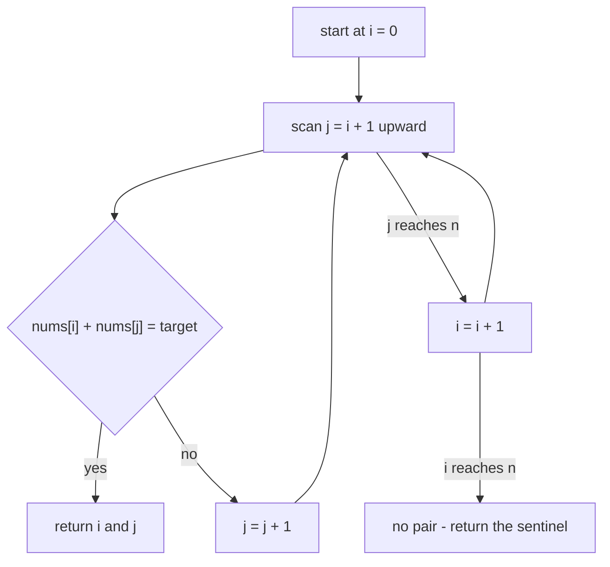
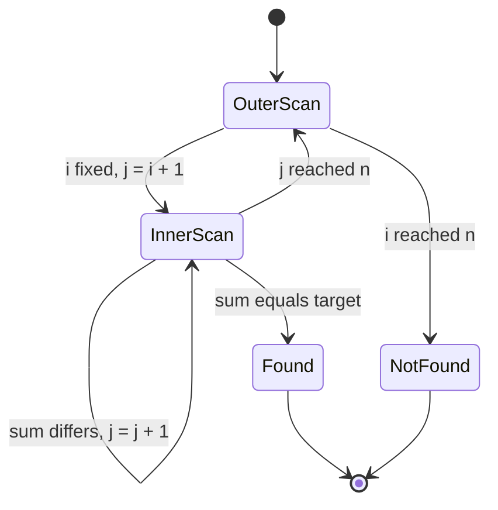
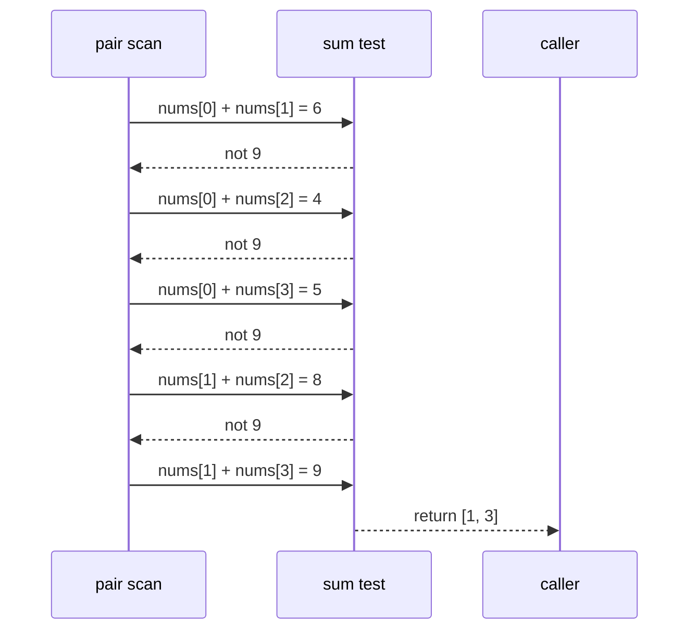

# 083 — Two-sum problem (brute force).

> **Tier:** Beginner · **CTCI chapter:** Ch 1 — Arrays and Strings
> **Task spec:** [083-two-sum-problem-brute-force.md](../../../tasks/beginner/083-two-sum-problem-brute-force.md)
> **Solutions:** [Python](../../../solutions/python/beginner/083-two-sum-problem-brute-force/solution.py) ·
> [Java](../../../solutions/java/beginner/083-two-sum-problem-brute-force/Solution.java) ·
> [JavaScript](../../../solutions/javascript/beginner/083-two-sum-problem-brute-force/solution.js) ·
> [C#](../../../solutions/csharp/beginner/083-two-sum-problem-brute-force/Solution.cs)

## 1. Problem restatement

**Input:** an array of integers `nums` (length `n`, possibly `0`) and an integer `target`.

**Output:** the indices `[i, j]` of a pair with `i < j` such that
`nums[i] + nums[j] == target`. When several pairs qualify, the repository's contract is
*deterministic*: the pair with the **smallest `i`**, and among those the **smallest `j`**. When no
pair exists, Python returns the empty list `[]` while Java, JavaScript and C# return `{-1, -1}` /
`[-1, -1]`.

The two-element answer is a pair of *indices*, not of values: the task is about positions in the
array, and the same value may appear at many positions (see the `[3, 3]` row below). Equal indices
are never allowed, so an element can never be paired with itself.

The four solution files assert the same nine rows — seven found pairs and two misses:

| Call | Python | Java / JavaScript / C# | Why |
| --- | --- | --- | --- |
| `two_sum_brute([2, 7, 11, 15], 9)` | `[0, 1]` | `[0, 1]` | the textbook case |
| `two_sum_brute([3, 3], 6)` | `[0, 1]` | `[0, 1]` | two equal values, distinct indices |
| `two_sum_brute([3, 2, 4], 6)` | `[1, 2]` | `[1, 2]` | not `[0, 0]`, even though `3 + 3 = 6` |
| `two_sum_brute([-3, 4, 3, 90], 0)` | `[0, 2]` | `[0, 2]` | negative plus positive |
| `two_sum_brute([1, 5, 3, 4], 9)` | `[1, 3]` | `[1, 3]` | the only matching pair; trace in section 4 |
| `two_sum_brute([2, 2, 2, 2], 4)` | `[0, 1]` | `[0, 1]` | four duplicates, the earliest pair is chosen |
| `two_sum_brute([1, 2, 3], 7)` | `[]` | `[-1, -1]` | no pair exists |
| `two_sum_brute([], 0)` | `[]` | `[-1, -1]` | empty input |
| `two_sum_brute([5], 5)` | `[]` | `[-1, -1]` | one element cannot pair with itself |

The `[3, 2, 4]` row is the one that kills the tempting shortcut “check `nums[i] * 2 == target`
first”: that would pair index `0` with itself.

## 2. Intuition

The problem asks for *any* pair, so the naive idea is to look at every pair and stop at the first
hit:

```text
for each i in 0 .. n - 1 do
    for each j in i + 1 .. n - 1 do
        if nums[i] + nums[j] = target then report i and j
    end
end
```

Why does the loop start `j` at `i + 1` and not at `0`? Two reasons, and both matter:

1. **Correctness.** `j = i` would test `nums[i] + nums[i] == target`, pairing an element with
   itself — exactly what the `[3, 2, 4]` assertion forbids.
2. **Uniqueness.** Starting at `0` would test `(i, j)` and later `(j, i)`, i.e. every unordered
   pair twice, which doubles the work for no new information. The `i < j` triangle visits each
   unordered pair exactly once.

Why is it not good enough? Because the triangle has `n(n-1)/2` cells, so the worst case is
**quadratic**. For `n = 100 000` that is roughly five billion additions. The fix — remember the
complements you have already seen in a hash map — is a separate task,
[084 — Two-sum using hashmap](../../../tasks/beginner/084-two-sum-using-hashmap.md), and it takes
the expected time down to `O(n)`. This task deliberately implements the slow version, because the
pair-scan is the baseline every other two-sum variant is measured against, and because the
*ordering* rule (smallest `i`, then smallest `j`) falls out of the scan order for free.



The picture also shows the visitation order: row by row, left to right. That order is what makes
the first hit canonical — the first pair encountered is by definition the one with the smallest
`i`, and for that `i` the smallest `j`.

## 3. Algorithm

1. Let `n` be the length of `nums`.
2. For `i` from `0` to `n - 1`:
   1. For `j` from `i + 1` to `n - 1`:
      1. If `nums[i] + nums[j] == target`, return `[i, j]` immediately.
3. If both loops finish, no pair exists: return the not-found sentinel (`[]` in Python,
   `[-1, -1]` elsewhere).

```text
procedure two_sum_brute(nums, target)
    n ← length(nums)
    for i ← 0 to n - 1 do
        for j ← i + 1 to n - 1 do
            if nums[i] + nums[j] = target then
                return [i, j]
            end
        end
    end
    return [-1, -1]
end
```

Two details carry the whole contract:

- The early `return` inside the inner loop is what selects the *first* pair in the canonical
  order. Recording a match and continuing (to “collect all pairs”) would change the answer for
  `[2, 2, 2, 2]` with `target = 4`, where `[0, 1]` is asserted rather than, say, `[2, 3]`.
- The sentinel is `[-1, -1]` in the compiled languages and the empty list in Python. Both encode
  “no pair”, and both are asserted; the difference is a porting hazard, not a design difference.



The two terminal states are the two outcomes: `Found` is reached from the inner loop at the first
match, `NotFound` only after the outer loop is exhausted. There is no backtracking and no state
that depends on earlier iterations, which is why the algorithm needs `O(1)` extra memory.

## 4. Worked example

Trace `two_sum_brute([1, 5, 3, 4], 9)`. The target pair is `nums[1] + nums[3] = 5 + 4 = 9`, so the
answer is `[1, 3]`. The scan visits pairs in this order:

| Step | `i` | `j` | `nums[i]` | `nums[j]` | Sum | Matches `9`? |
| --- | --- | --- | --- | --- | --- | --- |
| 1 | 0 | 1 | 1 | 5 | 6 | no |
| 2 | 0 | 2 | 1 | 3 | 4 | no |
| 3 | 0 | 3 | 1 | 4 | 5 | no |
| 4 | 1 | 2 | 5 | 3 | 8 | no |
| 5 | 1 | 3 | 5 | 4 | 9 | **yes** |

Five additions out of a possible six — the early exit saves the pair `(2, 3)`. More importantly,
row 5 shows that the win is *ordering*, not speed: a hash-map solution would also return a valid
pair, but not necessarily `[1, 3]` unless it is written to scan left to right and to prefer the
earliest index.

Now the miss case, `two_sum_brute([1, 2, 3], 7)`:

| Step | `i` | `j` | Sum | Matches `7`? |
| --- | --- | --- | --- | --- |
| 1 | 0 | 1 | 3 | no |
| 2 | 0 | 2 | 4 | no |
| 3 | 1 | 2 | 5 | no |
| end | — | — | — | outer loop exhausted → sentinel |

Three pairs, three additions, then the outer loop increments `i` past `n - 1` and the function
returns `[]` in Python or `[-1, -1]` in the other three.



The degenerate inputs behave as the state machine predicts: `n = 0` and `n = 1` never enter the
inner loop, so they fall straight through to the sentinel, which is why `two_sum_brute([5], 5)`
does *not* return `[0, 0]`.

## 5. Complexity

Let `n` be the length of `nums`, and count one addition plus one comparison as the unit of work.

| Measure | Bound | Why it holds |
| --- | --- | --- |
| Time, best | O(1) | the very first pair tested can match, as in `[2, 7, ...]` with `target = 9` |
| Time, average | O(n²) | the early exit only helps when a pair exists and sits early |
| Time, worst | O(n²) | no pair exists, so all `n(n - 1)/2` pairs are tested |
| Pairs tested, worst | `n(n - 1)/2` | the strict triangle `0 <= i < j < n` |
| Space, extra | O(1) | two loop counters and the two-element result |
| Result size | O(1) | always exactly two indices, for any `n` |
| Hash-map alternative | O(n) expected time, O(n) space | see task 084 below |

The two bounds worth quoting in an interview are `n(n - 1)/2` pairs and `O(1)` extra space: the
brute force is the *space-efficient* member of the family, and it is the right choice when `n` is
tiny or when allocation must be avoided. Note also that the best case is genuinely `O(1)` and not
`Ω(n)`: unlike many array problems, this one can finish before looking at the whole input.

## 6. Pitfalls and edge cases

- **Pairing an element with itself.** `j` must start at `i + 1`. The assertion
  `two_sum_brute([3, 2, 4], 6) == [1, 2]` exists precisely to catch `[0, 0]`, since `3 + 3 = 6`
  would otherwise look like a valid answer.
- **Duplicates with different indices.** `[3, 3]` with `target = 6` must return `[0, 1]`; two
  equal *values* at two different *positions* are a legal pair. A solution built on a set of
  values (rather than of indices) can wrongly reject this row.
- **Equal values and the identity trap.** `[2, 2, 2, 2]` with `target = 4` returns `[0, 1]`, not
  any other of the six valid pairs — the ordering rule, not just existence, is asserted.
- **No pair.** `[1, 2, 3]` with `7` returns Python's `[]` and the other languages' `[-1, -1]`.
  Returning `None`/`null`, or `[0, 0]`, fails. Do not assume the sentinel is the same in all four:
  it is not, and the tutorial's header links show exactly where each convention lives.
- **Empty and single-element input.** `[]` and `[5]` both skip the inner loop; the second one is
  the classic test that “an element may not be used twice” is enforced structurally rather than by
  a special case.
- **Negative numbers and zero.** `[-3, 4, 3, 90]` with `target = 0` returns `[0, 2]`; nothing in
  the algorithm assumes positive values, sortedness, or `target` being non-negative.
- **Overflow.** Java and C# add two `int`s with `+`, so a large positive and a large negative can
  overflow in a hypothetical large-value test even though the true sum is representable. Python's
  integers are unbounded and JavaScript's numbers are doubles, so the languages differ; when the
  value range is unspecified, say which arithmetic you are relying on.
- **`NaN` in JavaScript.** `NaN === target` is always false, so a `NaN` element simply never
  matches — a silent no-match rather than a crash. Not asserted by the tests, but worth knowing
  when the input comes from user data.
- **The early return is load-bearing.** Collecting all pairs and then taking the first would be
  correct but slower and would allocate on every input; the shipped code returns the moment it
  finds the canonical pair.
- **Quadratic cost is not a bug.** This task *is* the `O(n²)` baseline. Do not “fix” it by adding a
  map: that is task 084's job, and its output ordering guarantees differ.

## 7. Variants and follow-ups

- **Hash map (the standard upgrade).** [084-two-sum-using-hashmap.md](../../../tasks/beginner/084-two-sum-using-hashmap.md)
  trades `O(n)` space for `O(n)` expected time by storing each value's index as it is seen.
- **Sorted two-pointer.** With a sorted array, `lo` and `hi` pointers move inward in `O(n)` time
  and `O(1)` space, at the cost of losing the original indices (or of storing them alongside).
- **Three-sum.** [085-three-sum-return-any-triplet.md](../../../tasks/beginner/085-three-sum-return-any-triplet.md)
  is the same “pick one element, then solve two-sum on the rest” reduction, which is exactly what
  makes it `O(n²)` when the inner two-sum is done with pointers.
- **Count pairs instead of finding one.** The same triangle counts matching pairs in `O(n²)`; a
  hash map does it in `O(n)` with a frequency table.
- **Closest pair to a target.** No early exit is available, so the full triangle is required
  unless the array is sorted (then two pointers again).
- **Related in this repository:** [086-count-inversion-pairs-using-naive-o-n-2.md](../../../tasks/beginner/086-count-inversion-pairs-using-naive-o-n-2.md)
  is literally the same double loop with a different comparison, and
  [087-implement-merge-and-count-inversions-using-merge-sort.md](../../../tasks/beginner/087-implement-merge-and-count-inversions-using-merge-sort.md)
  is the divide-and-conquer replacement for that quadratic scan — the same “pair scan then
  upgrade” arc as 083 → 084.

## 8. Check yourself

1. Why does the inner loop start at `j = i + 1` rather than `j = 0`?

<details><summary>Show answer</summary>

Two reasons. It prevents pairing an element with itself (`j = i`), which is required by the
`[3, 2, 4]` assertion, and it visits each unordered pair exactly once, halving the work compared
with scanning all `n²` index pairs.

</details>

2. What does `two_sum_brute([1, 2, 3], 7)` return, and in which language does the value differ?

<details><summary>Show answer</summary>

Python returns `[]`; Java, JavaScript and C# return `[-1, -1]` (the C# literal is `new[] { -1, -1 }`).
All four files assert their own convention, so a port must translate the sentinel as well as the
loop.

</details>

3. How many pairs are tested in the worst case, and what is the best case?

<details><summary>Show answer</summary>

Worst case, `n(n - 1)/2` pairs — when no pair sums to the target the loops run to completion, so
the time is Θ(n²). Best case is a single test: if `nums[0] + nums[1] == target` the function
returns immediately, in `O(1)`.

</details>

4. `two_sum_brute([2, 2, 2, 2], 4)` returns `[0, 1]`. What does that tell you about the
   specification?

<details><summary>Show answer</summary>

That a pair is an ordered-by-index answer, not merely a set of values: the specification requires
the pair with the smallest first index and then the smallest second index, and all six valid pairs
`(0,1) (0,2) (0,3) (1,2) (1,3) (2,3)` would otherwise be defensible. The left-to-right scan order
delivers the canonical answer naturally.

</details>

5. The brute force uses `O(1)` extra space while the hash-map solution uses `O(n)`. When is the
   brute force the better engineering choice?

<details><summary>Show answer</summary>

When `n` is small (a handful of elements makes the quadratic term irrelevant), when the pair is
likely to be found early so the early exit actually fires, or when allocation is expensive or
forbidden — for example inside a tight numeric loop or on a memory-constrained device. The
hash-map version is preferable as soon as `n` grows large or the array is queried repeatedly.

</details>
