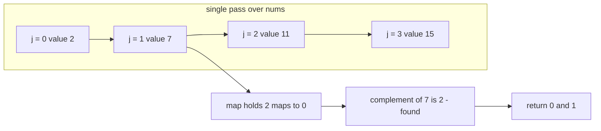
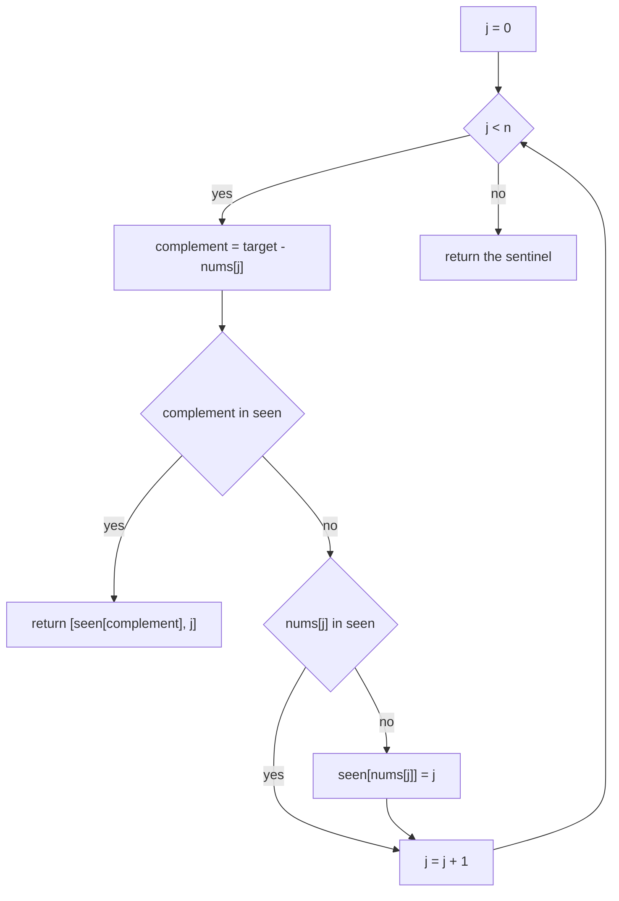
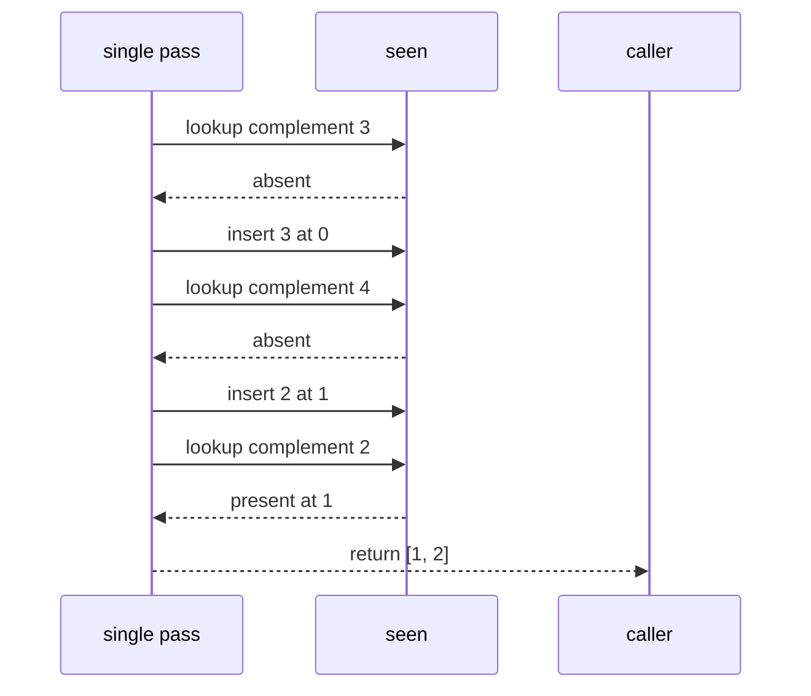

# 084 — Two-sum using hashmap.

> **Tier:** Beginner · **CTCI chapter:** Ch 1 — Arrays and Strings
> **Task spec:** [084-two-sum-using-hashmap.md](../../../tasks/beginner/084-two-sum-using-hashmap.md)
> **Solutions:** [Python](../../../solutions/python/beginner/084-two-sum-using-hashmap/solution.py) ·
> [Java](../../../solutions/java/beginner/084-two-sum-using-hashmap/Solution.java) ·
> [JavaScript](../../../solutions/javascript/beginner/084-two-sum-using-hashmap/solution.js) ·
> [C#](../../../solutions/csharp/beginner/084-two-sum-using-hashmap/Solution.cs)

## 1. Problem restatement

**Input:** an array of integers `nums` (possibly empty) and an integer `target`.

**Output:** indices `[i, j]` with `i < j` and `nums[i] + nums[j] == target`, or the not-found
sentinel — `[]` in Python, `[-1, -1]` in Java, JavaScript and C#. This is the same problem as
[083 — Two-sum problem (brute force)](../../../tasks/beginner/083-two-sum-problem-brute-force.md),
solved in one pass instead of two nested loops.

The four solution files assert the fast function on seven inputs, then run a second battery of
nine cases in which they compare against the brute-force function from task 083:

| Call | Python | Java / JavaScript / C# | Why |
| --- | --- | --- | --- |
| `two_sum_hash([2, 7, 11, 15], 9)` | `[0, 1]` | `[0, 1]` | the textbook case |
| `two_sum_hash([3, 2, 4], 6)` | `[1, 2]` | `[1, 2]` | `2 + 4`; not `[0, 0]` |
| `two_sum_hash([3, 3], 6)` | `[0, 1]` | `[0, 1]` | duplicates at distinct indices |
| `two_sum_hash([-3, 4, 3, 90], 0)` | `[0, 2]` | `[0, 2]` | negatives are fine |
| `two_sum_hash([1, 2, 3], 7)` | `[]` | `[-1, -1]` | no pair |
| `two_sum_hash([], 0)` | `[]` | `[-1, -1]` | empty input |
| `two_sum_hash([5], 5)` | `[]` | `[-1, -1]` | an element may not pair with itself |

The cross-check battery in all four files adds `([0, 0, 1], 0)` and `([1, 5, 3, 4], 9)` to the
seven above, and asserts three properties for every result: the hash version finds a pair exactly
when the brute force does (agreement on *existence*), and any returned pair satisfies
`0 <= i < j < n` and `nums[i] + nums[j] == target`. The exact pair is deliberately **not**
compared — section 6 explains why the two functions may legitimately return different valid pairs.

## 2. Intuition

The brute force asks, for each pair, “do these two sum to `target`?”. Turn the question inside
out and ask, for each element `nums[j]`, a different one:

> which value `c` would complete the sum, and have I already walked past it?

The completing value is the **complement** `c = target - nums[j]`. If a map remembers where each
value was last seen, the question “have I seen `c`?” is a single lookup — no inner loop.

The reason a *single* pass suffices is subtle and worth stating precisely: when the scan reaches
index `j`, every index before `j` has already been stored, and no index after `j` has been stored.
So every pair `(i, j)` with `i < j` is discovered exactly once — at the moment its **later**
element arrives — and every pair is discovered, because the later element of *any* pair is
eventually visited with its partner already in the map. Nothing is missed by never looking
backwards explicitly.



The map's job is to answer “where was this value first seen?”. That is why the shipped code stores
an index only when the value is **not already present**: keeping the *earliest* occurrence is what
makes the answer deterministic. Overwriting with the newest index would still find a pair, but it
would report a later `i`, as the example in section 6 shows.

## 3. Algorithm

1. Create an empty map from value to the earliest index at which it was seen.
2. For `j` from `0` to `n - 1`:
   1. Compute the complement `target - nums[j]`.
   2. If the complement is already a key in the map, return `[map[complement], j]`.
   3. Otherwise, if `nums[j]` is **not** already a key, insert `nums[j] -> j`.
3. If the loop ends without a hit, return the not-found sentinel.

```text
procedure two_sum_hash(nums, target)
    seen ← empty map from value to index
    for j ← 0 to length(nums) - 1 do
        complement ← target - nums[j]
        if seen contains complement then
            return [seen[complement], j]
        end
        if seen does not contain nums[j] then
            seen[nums[j]] ← j
        end
    end
    return [-1, -1]
end
```

The **order of the two statements inside the loop** is the whole trick. The lookup happens
*before* the insertion, so an element can never match itself: when the scan is at `j`, `j` is not
in the map yet. Swapping the two statements would make `[3, 2, 4]` with `target = 6` return
`[0, 0]` — the classic self-pairing bug that task 083's assertion set exists to catch.



The loop body is `O(1)` expected work, so the traversal is linear in `n` even though the problem
is about pairs: each element is inserted once at most and looked up once.

## 4. Worked example

Trace `two_sum_hash([2, 7, 11, 15], 9)`:

| Step | `j` | `nums[j]` | complement | in map? | map after the step |
| --- | --- | --- | --- | --- | --- |
| start | — | — | — | — | `{}` |
| 1 | 0 | 2 | 7 | no | `{2: 0}` |
| 2 | 1 | 7 | 2 | **yes, at 0** | unchanged — returns `[0, 1]` |

Two steps instead of the brute force's one step (the pair happens to be adjacent), but the win
shows on the wide case. Trace `two_sum_hash([3, 2, 4], 6)`, where the answer is `[1, 2]`:

| Step | `j` | `nums[j]` | complement | in map? | map after the step |
| --- | --- | --- | --- | --- | --- |
| 1 | 0 | 3 | 3 | no | `{3: 0}` |
| 2 | 1 | 2 | 4 | no | `{3: 0, 2: 1}` |
| 3 | 2 | 4 | 2 | **yes, at 1** | unchanged — returns `[1, 2]` |

Step 1 is the interesting one: the complement of the value `3` is `3` itself, but the map does not
contain `3` yet at that moment, so no self-pair is produced. Only after the lookup fails is `3`
stored.

Now the miss case `two_sum_hash([1, 2, 3], 7)`: complements are `6`, `5`, `4`, none of which is
ever in the map, so three insertions happen and the loop falls through to the sentinel.



Compare the amount of work with task 083 on the same input: the brute force visited three pairs,
the hash map visits three elements. For `n = 1000` the gap is roughly a thousand operations
versus half a million.

## 5. Complexity

Let `n` be the length of `nums`.

| Measure | Bound | Why it holds |
| --- | --- | --- |
| Time, best | O(1) | the pair can be completed at index `1`, as in `[2, 7]` with `target = 9` |
| Time, average | O(n) expected | one complement lookup and at most one insertion per element |
| Time, worst | O(n²) | adversarial hash collisions degrade a single lookup to linear time; Python's dict, Java's `HashMap`, the JavaScript `Map` and the C# `Dictionary` all assume well-distributed hashes |
| Space | O(n) | the map can hold one entry per distinct value |
| Result size | O(1) | two indices |
| Brute force (task 083) | O(n²) time, O(1) space | no auxiliary structure, all `n(n - 1)/2` pairs tested |

The trade is the classic one: `O(n)` extra memory buys a quadratic-to-linear improvement in time.
Notice that the space bound is in terms of *distinct values*, so an array of duplicates costs
less than `n` entries — the guard `if not already present` is what keeps the map from growing past
the number of distinct values.

## 6. Pitfalls and edge cases

- **Lookup before insert.** The complement test must precede the insertion, otherwise `j` is
  already in the map and `nums[j] + nums[j] == target` self-pairs. Every solution file ships the
  `[3, 2, 4] / 6 → [1, 2]` assertion precisely to pin this down.
- **Keep the earliest index.** The insertion is guarded by “value not already present”. Without
  the guard, `two_sum_hash([2, 1, 2, 3], 5)` would overwrite `2 -> 0` with `2 -> 2` and then answer
  `[2, 3]` instead of the earlier-first-index answer `[0, 3]`.
- **The pair is *not* the same pair the brute force returns.** Both are valid, but they can differ:
  for `[4, 8, 5, 2, 6]` with `target = 10` the brute force returns `[0, 4]` (`4 + 6`, smallest `i`
  first) while the hash map returns `[1, 3]` (`8 + 2`, discovered at the earliest `j`). That is why
  the cross-check battery in the solution files compares *existence* and *validity*, not the exact
  indices: `(got[0] !== -1) === (brute[0] !== -1)` plus `nums[i] + nums[j] === target`.
- **No pair.** `[1, 2, 3]` with `7`, `[]` and `[5]` with `5` all return the sentinel. Note again
  that the sentinel differs by language: Python's `[]` versus `[-1, -1]` elsewhere.
- **Duplicates at distinct indices.** `[3, 3]` with `6` returns `[0, 1]`; `[0, 0, 1]` with `0`
  returns `[0, 1]`. A set of values instead of a map of indices cannot produce these answers.
- **Signed zero and `NaN` in JavaScript.** `Map` keys use SameValueZero, so `-0` and `0` are the
  same key and `NaN` matches `NaN` — which is convenient for `-0` and surprising for `NaN`, whose
  arithmetic always produces `NaN` complements. In Java and C#, `NaN` is likewise awkward as a map
  key and the tests use integers only.
- **Float keys.** With `double` values, a complement computed as `target - value` may not compare
  equal to a stored key that “should” be the same number. Exact equality on floating-point keys is
  a real hazard; the shipped tests avoid it by using integers.
- **Overflow in the complement.** `target - nums[j]` in Java or C# can overflow `int` for extreme
  operands even when the true complement is representable — the same caveat as the addition in
  task 083.
- **Memory on huge inputs.** `O(n)` extra storage is the point of the trade, but it is also the
  reason the brute force still exists: for a one-shot query on a giant array, avoiding a
  million-entry map can be worth the quadratic time.
- **Mutation is fine.** Unlike the prefix-sum structure of task 082, this map is local to the call,
  so the caller's array is untouched and no state is retained between calls.

## 7. Variants and follow-ups

- **The baseline it improves on.** [083-two-sum-problem-brute-force.md](../../../tasks/beginner/083-two-sum-problem-brute-force.md)
  is the `O(n²)` / `O(1)` counterpart, and the two are compared inside the solution files.
- **Sorted two pointers.** If the array is already sorted, `lo`/`hi` pointers reach `O(n)` time and
  `O(1)` space; the cost is that sorting loses the original indices unless they are carried along.
- **Three-sum.** [085-three-sum-return-any-triplet.md](../../../tasks/beginner/085-three-sum-return-any-triplet.md)
  fixes one element and looks for two others — the same “reduce to a two-sum” step, where either a
  map or two pointers can serve as the inner loop.
- **Count instead of find.** A map of value frequencies counts all matching pairs in one pass
  without storing indices; the same structure answers “how many pairs sum to `target`?”.
- **Two-sum with a limit on index distance.** The same map, but rejecting entries whose index is
  too far behind — a natural bridge to the sliding-window tasks
  [090-implement-sliding-window-sum-of-size-k.md](../../../tasks/beginner/090-implement-sliding-window-sum-of-size-k.md)
  and [092-max-over-sliding-window-using-deque.md](../../../tasks/beginner/092-max-over-sliding-window-using-deque.md).
- **Counting with a map.** [089-implement-simple-frequency-histogram-integers.md](../../../tasks/beginner/089-implement-simple-frequency-histogram-integers.md)
  uses the same dictionary machinery for frequencies rather than for lookups, and is the natural
  next exercise in map-based counting.

## 8. Check yourself

1. Why is one pass enough, when every pair involves an earlier *and* a later element?

<details><summary>Show answer</summary>

Because a pair `(i, j)` with `i < j` is always discovered when the scan reaches `j`: at that moment
`i` has already been inserted, so its value is available as the complement. Every pair has a later
element, and every later element is visited once, so no pair is missed.

</details>

2. What breaks if you insert `nums[j]` into the map *before* looking up the complement?

<details><summary>Show answer</summary>

An element can match itself. Scanning `[3, 2, 4]` with `target = 6`, index `0` would be inserted as
`3 -> 0`, then its own complement `3` would be found and the function would return `[0, 0]`. The
assertion `two_sum_hash([3, 2, 4], 6) == [1, 2]` in all four files rejects that answer.

</details>

3. What is the time and space complexity, and what makes the space bound smaller in practice?

<details><summary>Show answer</summary>

`O(n)` expected time for one pass with `O(1)` expected map operations, and `O(n)` space. In practice
the map holds one entry per *distinct* value, because the insertion is guarded by “not already
present” — so an array of a few repeated values uses far fewer entries than `n`.

</details>

4. The hash version and the brute force both return valid pairs, but sometimes different ones.
   Why do the tests not compare the exact indices?

<details><summary>Show answer</summary>

Because the two algorithms pick different valid answers: the brute force reports the pair with the
smallest `i`, while the hash map reports the pair whose second index is reached first. For
`[4, 8, 5, 2, 6]` with `target = 10` these are `[0, 4]` and `[1, 3]`. The battery asserts agreement
on existence, plus `0 <= i < j < n` and `nums[i] + nums[j] == target` for whatever pair is returned.

</details>

5. On what kind of input does this solution become quadratic, and why?

<details><summary>Show answer</summary>

Adversarial inputs whose values collide in the hash table: every lookup then degrades toward a
linear scan of one bucket, so the pass becomes `O(n²)`. Real languages mitigate this (Java switches
heavily collided buckets to trees, for instance), but no hash-table solution can promise `O(n)`
worst case. When `n` is small, the brute force of task 083 avoids the issue entirely.

</details>
