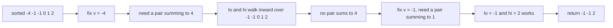
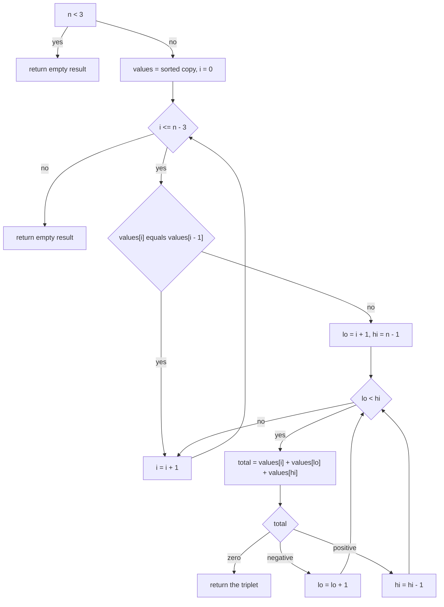
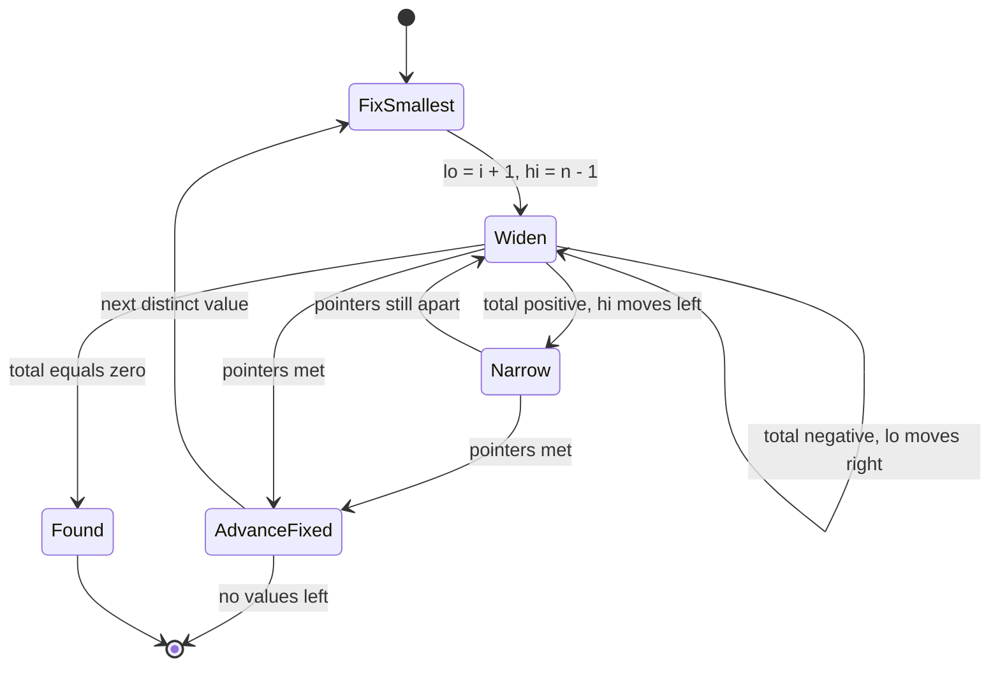

# 085 — Three-sum (return any triplet).

> **Tier:** Beginner · **CTCI chapter:** Ch 1 — Arrays and Strings
> **Task spec:** [085-three-sum-return-any-triplet.md](../../../tasks/beginner/085-three-sum-return-any-triplet.md)
> **Solutions:** [Python](../../../solutions/python/beginner/085-three-sum-return-any-triplet/solution.py) ·
> [Java](../../../solutions/java/beginner/085-three-sum-return-any-triplet/Solution.java) ·
> [JavaScript](../../../solutions/javascript/beginner/085-three-sum-return-any-triplet/solution.js) ·
> [C#](../../../solutions/csharp/beginner/085-three-sum-return-any-triplet/Solution.cs)

## 1. Problem restatement

**Input:** an integer array `nums` of `n` elements, in any order, possibly with duplicates and
possibly shorter than three elements.

**Output:** *any* triplet of **values** `[v1, v2, v3]` with `v1 <= v2 <= v3`, summing to `0`,
whose three values can be matched to three **distinct positions** of the input. When no such
triplet exists the functions return an empty result: `[]` in Python and JavaScript, `new int[0]`
in Java and C#.

Because only “any” triplet is required, the tests cannot compare against one fixed answer. Their
shape is worth studying, because it is the pattern for every “find any” interview question:

| Input | Result | How the test verifies it |
| --- | --- | --- |
| `[-1, 0, 1, 2, -1, -4]` | a triplet found | length `3`, sum `0`, ascending order, and `contains_triplet` passes |
| `[0, 0, 0]` | `[0, 0, 0]` | exact equality — the only possible answer |
| `[-3, 1, 2]` | `[-3, 1, 2]` | exact equality — the only possible answer |
| `[1, -1, 0]` | `[-1, 0, 1]` | exact equality; note the output is *sorted* although the input is not |
| `[-2, 0, 0, 2, 2]` | `[-2, 0, 2]` | exact equality: duplicates are not used twice for the same position |
| `[1, 2, 3]` | `[]` | no zero-sum triplet exists |
| `[1, 1, 1]` | `[]` | sums to `3`, not `0` |
| `[0, 0]` | `[]` | fewer than three elements |
| `[]` | `[]` | empty input |
| `[8, -4, -2, 3, 1, -5, 7]` | a triplet found | length `3`, sum `0`, ascending, `contains_triplet` passes |

Python's test for the first row is written as `t == [-1, -1, 2] or t == [-1, 0, 1]` — both are
zero-sum triplets of the input — while the other three languages assert the weaker but exact
programmatic properties (length, sum, sortedness, positional validity). The helper
`contains_triplet(nums, triplet)` (`containsTriplet` in Java, JavaScript and C#) walks the triplet
and marks a *position* used for each value, which is how the tests distinguish “three copies of a
value exist” from “the same position was reused”.

## 2. Intuition

The naive idea is a triple loop, `O(n³)`:

```text
for each i < j < k do
    if nums[i] + nums[j] + nums[k] = 0 then return the three values
end
```

For `n = 100` that is about 161 700 additions; for `n = 1000` it is roughly 166 million. Sorting
plus two pointers removes one whole factor.

The insight has two halves:

1. **Sorting makes the two-sum step monotone.** After sorting, fixing the smallest element `v` and
   asking for two others that sum to `-v` is the classic *sorted two-pointer* problem: if the
   current total is too small, only the left pointer can raise it; if it is too large, only the
   right pointer can lower it. Each pointer moves in one direction, so the inner scan is `O(n)`
   rather than `O(n²)`.
2. **The fixed element must be the smallest.** Process elements in sorted order and only ever look
   to the right, so every triplet is examined with its smallest value in the role of `v`. That is
   what makes the early `return` legal: as soon as a zero-sum pair is found to the right of `v`,
   the triplet is valid and can be handed back immediately.



The duplicate-skipping line `if i > 0 and values[i] == values[i - 1] then continue` is not needed
for correctness of a *single* answer, but it prevents the same fixed value from being tried twice,
which matters the moment the problem is upgraded to “return **all** triplets” — the classic
follow-up. It is also the cheapest way to keep the inner scans from repeating identical work.

## 3. Algorithm

1. If `n < 3`, return the empty result immediately.
2. Copy the input and sort the copy — never the caller's array.
3. For `i` from `0` to `n - 3`:
   1. If `i > 0` and `values[i] == values[i - 1]`, skip this `i` (the same fixed value was
      already tried).
   2. Set `lo ← i + 1`, `hi ← n - 1`.
   3. While `lo < hi`:
      1. `total ← values[i] + values[lo] + values[hi]`.
      2. If `total == 0`, return `[values[i], values[lo], values[hi]]`.
      3. If `total < 0`, `lo ← lo + 1` (the smallest available partner is too small).
      4. Otherwise `hi ← hi - 1` (the largest available partner is too large).
4. If every `i` is exhausted, return the empty result.

```text
function three_sum(nums)
    if length(nums) < 3 then
        return empty result
    end
    values ← sorted copy of nums
    n ← length(values)
    for i ← 0 to n - 3 do
        if i > 0 and values[i] = values[i - 1] then
            continue
        end
        lo ← i + 1
        hi ← n - 1
        while lo < hi do
            total ← values[i] + values[lo] + values[hi]
            if total = 0 then
                return [values[i], values[lo], values[hi]]
            end
            if total < 0 then
                lo ← lo + 1
            else
                hi ← hi - 1
            end
        end
    end
    return empty result
end
```

Three properties of the loop are worth calling out because the tests depend on them:

- **`lo < hi`, not `lo <= hi`.** The three values must come from three *distinct positions*, so
  the two remaining pointers may never coincide. `[1, 1, 1]` therefore returns nothing: the only
  available total would reuse a single position.
- **`i` stops at `n - 3`.** With `i` at `n - 2` or beyond there are not two more positions to the
  right, so those iterations can never find anything.
- **The returned triplet is already sorted ascending**, because it is read out of the sorted copy in
  index order. Every solution file asserts this with `is_sorted` / `isSorted` for the “any triplet”
  rows, where exact comparison is impossible.



## 4. Worked example

Trace `three_sum([-1, 0, 1, 2, -1, -4])`. The sorted copy is `[-4, -1, -1, 0, 1, 2]`; the algorithm
returns `[-1, -1, 2]`, one of the two zero-sum triplets the Python test accepts.

| `i` | `values[i]` | `lo` | `hi` | `values[lo]` | `values[hi]` | total | Action |
| --- | --- | --- | --- | --- | --- | --- | --- |
| 0 | -4 | 1 | 5 | -1 | 2 | -3 | negative → `lo = 2` |
| 0 | -4 | 2 | 5 | -1 | 2 | -3 | negative → `lo = 3` |
| 0 | -4 | 3 | 5 | 0 | 2 | -2 | negative → `lo = 4` |
| 0 | -4 | 4 | 5 | 1 | 2 | -1 | negative → `lo = 5` |
| 0 | -4 | 5 | 5 | — | — | — | `lo` met `hi` → next `i` |
| 1 | -1 | 2 | 5 | -1 | 2 | **0** | return `[-1, -1, 2]` |

Row five is the pointer-meeting case: `lo` has caught up with `hi`, so the while loop stops
without ever testing a “pair” of one element. Row six is the first hit. Note that `i = 1` is not
skipped even though `values[1] == values[0]` is false here — skipping only triggers for *equal
adjacent* fixed values.

A second trace, on the row the tests pin exactly: `three_sum([-2, 0, 0, 2, 2])`, sorted to
`[-2, 0, 0, 2, 2]`:

| `i` | `values[i]` | `lo` | `hi` | total | Action |
| --- | --- | --- | --- | --- | --- |
| 0 | -2 | 1 | 4 | `-2 + 0 + 2 = 0` | return `[-2, 0, 2]` |

One comparison. The four remaining values are duplicates, and the answer uses positions `0`, `1`
and `3` of the sorted array — three distinct positions, which is exactly what `contains_triplet`
verifies.



The state machine has exactly one absorbing state for success and one for exhaustion, which is why
the function cannot loop forever: every branch either moves a pointer inward or advances `i`.

## 5. Complexity

Let `n` be the number of input elements.

| Measure | Bound | Why it holds |
| --- | --- | --- |
| Time, best | O(1) | `n < 3` returns immediately; with `n >= 3` a hit on the first pointer comparison is possible, e.g. `[-3, 1, 2]` |
| Time, average | O(n²) | the outer loop runs `O(n)` times and each inner two-pointer scan is `O(n)` |
| Time, worst | O(n²) | when no triplet exists every `(i, lo, hi)` trajectory is walked to completion |
| Sorting | O(n log n) | dominated by the quadratic loop, so it does not change the bound |
| Space, extra | O(n) | the sorted copy (Python's `sorted`, Java's `Arrays.copyOf`, JavaScript's `slice`, C#'s `Clone`) |
| Space, auxiliary | O(1) | three indices and one running total |
| Naive triple loop | O(n³) time, O(1) space | all `n(n-1)(n-2)/6` index triples |
| Exact-count variant (all triplets) | O(n²) time, O(1) extra per answer | the same scan without the early return |

The honest comparison is `O(n³)` versus `O(n²)`: for `n = 1000` the triple loop performs on the
order of a hundred million additions, while the two-pointer version performs about a million. The
price is a copy of the array and a sort, both `O(n)` / `O(n log n)`.

## 6. Pitfalls and edge cases

- **Sorting the caller's array.** All four solutions copy first (`sorted(nums)`, `Arrays.copyOf`,
  `nums.slice()`, `(int[])nums.Clone()`). Sorting in place would mutate the caller's data — and for
  a function whose job is to *report*, not to reorganise, that is a surprising side effect.
- **Distinct positions, not distinct values.** `[0, 0, 0]` is a valid triplet (three positions,
  all value `0`), while `[1, 1, 1]` is not a valid *zero-sum* triplet. The `contains_triplet`
  helper exists precisely because value-multiset equality is too weak a check.
- **`lo < hi` and not `lo <= hi`.** Allowing equality would let one position be used twice.
- **Fewer than three elements.** `[]` and `[0, 0]` must both return the empty result; the guard is
  `n < 3`, and the loop bound `i <= n - 3` would otherwise run zero times anyway.
- **Output order.** The answer is read out of the sorted copy, so it is ascending by construction.
  The Python test for `[1, -1, 0]` expects `[-1, 0, 1]`, not `[1, -1, 0]`.
- **Values, not indices.** The task returns the numbers themselves. That is the version where
  sorting is free; a variant that must return *original indices* cannot sort without carrying
  positions along.
- **“Any” means the tests cannot demand a specific triplet — except when only one exists.** The
  first and last rows of the test battery assert properties, the middle rows assert exact arrays.
  When you write such a test yourself, that split is the pattern to copy.
- **Duplicate skipping is a performance guard here, a correctness requirement later.** For the
  “return all triplets” follow-up, omitting it produces duplicate answers; for “any”, it simply
  avoids retrying an identical fixed value.
- **Overflow.** `values[i] + values[lo] + values[hi]` uses 32-bit arithmetic in Java and C#; three
  large values can wrap and produce a spurious zero. A `long` accumulator is the usual fix.
- **Empty versus null result.** The sentinel is `[]` / `new int[0]`, never `null`/`None`; the
  Java, JavaScript and C# tests call `.length` on the result, so a `null` would fail loudly.
- **Quadratic is the target here.** Unlike task 084, there is no `O(n)` solution known for
  three-sum, so `O(n²)` with `O(n)` space is the expected answer, not a compromise.

## 7. Variants and follow-ups

- **Two-sum, this task's inner step.** [084-two-sum-using-hashmap.md](../../../tasks/beginner/084-two-sum-using-hashmap.md)
  solves the pair problem in `O(n)` with a map; using it inside the loop gives the same `O(n²)`
  total but with different constants and `O(n)` per-iteration memory.
- **The brute-force counterpart.** [083-two-sum-problem-brute-force.md](../../../tasks/beginner/083-two-sum-problem-brute-force.md)
  is the same “lower the exponent” arc one level down.
- **All triplets, deduplicated.** Drop the early return and advance both pointers past equal values
  after each hit; the answer becomes a list of triplets, still `O(n²)`.
- **Three-sum closest to a target.** No exact hit is required, so the early return disappears and
  the best total must be tracked — the same scan with a different comparator.
- **Four-sum.** Fix two elements and run two pointers over the rest: `O(n³)`, which is the general
  `k`-sum pattern.
- **Range and window problems in this repository.**
  [090-implement-sliding-window-sum-of-size-k.md](../../../tasks/beginner/090-implement-sliding-window-sum-of-size-k.md)
  and [092-max-over-sliding-window-using-deque.md](../../../tasks/beginner/092-max-over-sliding-window-using-deque.md)
  use the same “two indices moving in a controlled direction” discipline on contiguous windows.
- **Counting inversions.** [086-count-inversion-pairs-using-naive-o-n-2.md](../../../tasks/beginner/086-count-inversion-pairs-using-naive-o-n-2.md)
  is another `O(n²)` pair problem whose faster version needs sorting, so the two tasks share the
  “sort to beat the pair loop” intuition.

## 8. Check yourself

1. Why does sorting make the inner two-sum solvable with two pointers in linear time?

<details><summary>Show answer</summary>

Because the array is monotone, the sum `values[lo] + values[hi]` changes predictably when a pointer
moves: increasing `lo` can only increase the sum, decreasing `hi` can only decrease it. So if the
total is negative the left pointer must move right and if it is positive the right pointer must
move left — each pointer moves at most `n` times per fixed `i`, giving an `O(n)` inner scan.

</details>

2. What is the difference between `[0, 0, 0]` (valid) and `[1, 1, 1]` (invalid)?

<details><summary>Show answer</summary>

`[0, 0, 0]` has three distinct positions whose values sum to `0`, so it is a valid triplet.
`[1, 1, 1]` also has three available positions, but its sum is `3`, not `0`, so it is rejected —
not because of duplicates, but because the sum is wrong. Duplicates are only a problem when they
would force the same *position* to be used twice, which the `lo < hi` condition prevents.

</details>

3. Why is the `n < 3` guard present when the loop bound `i <= n - 3` already prevents iterations?

<details><summary>Show answer</summary>

It makes the intent explicit and keeps the function correct under refactoring — for instance if
someone changes the loop to `i < n`. It also short-circuits before allocating and sorting a copy
for a two-element input, which is the more common reason in performance-sensitive code.

</details>

4. What does the test helper `contains_triplet` add over simply checking `sum(triplet) == 0`?

<details><summary>Show answer</summary>

It verifies that the three values can be matched to three *distinct* input positions. Without it, a
buggy implementation that returned `[3, 3, -6]` for an input containing only one `3` would pass a
sum check. The helper marks each position used as it consumes one triplet value and fails if a
value cannot be matched.

</details>

5. How does the algorithm change if the caller wants *all* zero-sum triplets, and what is the new
   complexity?

<details><summary>Show answer</summary>

Replace the early `return` with “record the triplet, then advance `lo` past equal values and `hi`
past equal values”, and keep the duplicate-skipping of the fixed value. The scan is unchanged in
shape, so the complexity stays `O(n²)`, but the output grows to `O(n²)` triplets in the worst case,
which is why the returned space is usually counted separately from the `O(n)` working copy.

</details>
