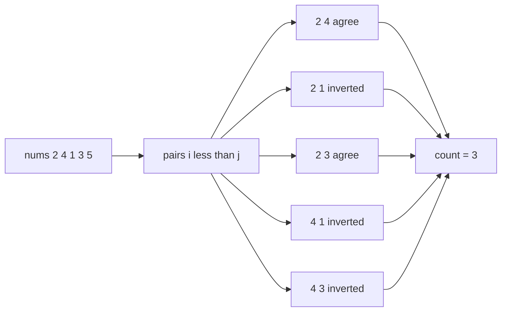
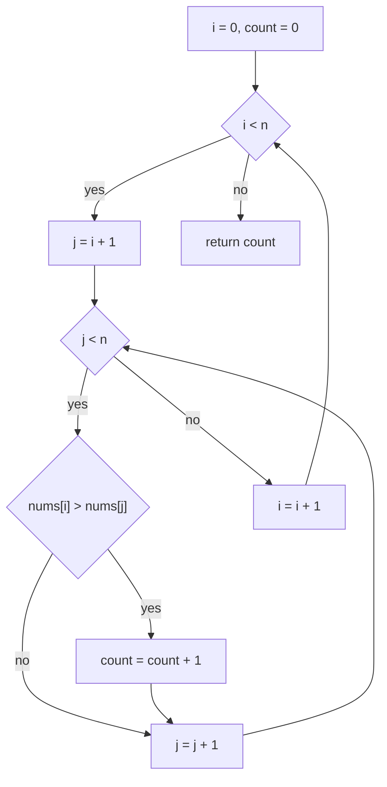
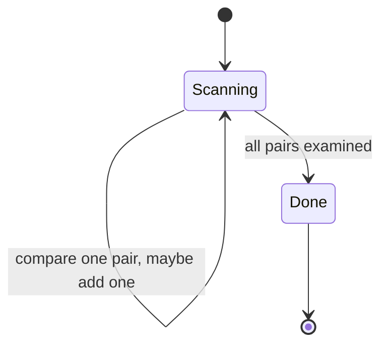

# 086 — Count inversion pairs using naive O(n^2).

> **Tier:** Beginner · **CTCI chapter:** Ch 10 — Sorting and Searching
> **Task spec:** [086-count-inversion-pairs-using-naive-o-n-2.md](../../../tasks/beginner/086-count-inversion-pairs-using-naive-o-n-2.md)
> **Solutions:** [Python](../../../solutions/python/beginner/086-count-inversion-pairs-using-naive-o-n-2/solution.py) ·
> [Java](../../../solutions/java/beginner/086-count-inversion-pairs-using-naive-o-n-2/Solution.java) ·
> [JavaScript](../../../solutions/javascript/beginner/086-count-inversion-pairs-using-naive-o-n-2/solution.js) ·
> [C#](../../../solutions/csharp/beginner/086-count-inversion-pairs-using-naive-o-n-2/Solution.cs)

## 1. Problem restatement

**Input:** an integer array `nums` of `n` elements, in any order; duplicates and negatives allowed.

**Output:** the number of **inversion pairs** — index pairs `(i, j)` with `i < j` and
`nums[i] > nums[j]`. The comparison is strict, so equal values never form an inversion.

The four solution files assert exactly ten rows:

| Call | Result | Why |
| --- | --- | --- |
| `count_inversions_naive([])` | `0` | no pairs exist |
| `count_inversions_naive([1])` | `0` | no pairs exist |
| `count_inversions_naive([1, 2, 3])` | `0` | already sorted: nothing is out of order |
| `count_inversions_naive([1, 1, 1])` | `0` | `1 > 1` is false — equality is not an inversion |
| `count_inversions_naive([2, 2])` | `0` | same, for the smallest duplicate pair |
| `count_inversions_naive([1, 3, 2])` | `1` | only `(3, 2)` is out of order |
| `count_inversions_naive([3, 2, 1])` | `3` | every one of the three pairs is an inversion |
| `count_inversions_naive([2, 4, 1, 3, 5])` | `3` | `(2,1)`, `(4,1)`, `(4,3)` |
| `count_inversions_naive([-1, -2, -3])` | `3` | negatives compare like any other integers |
| `count_inversions_naive([5, 4, 3, 2, 1])` | `10` | the maximum for `n = 5`: `5 · 4 / 2 = 10` |

The last row is the sanity ceiling: a strictly decreasing array of `n` elements inverts **every**
pair, and there are `n(n - 1)/2` of them. No input can produce a larger count. Note also that the
function returns a *count*, not the pairs themselves — a much cheaper contract than listing them.

## 2. Intuition

An inversion is a disagreement between the *position* order and the *value* order. If the array
were sorted ascending, every pair would agree and the count would be zero; each inversion is one
pair that points the wrong way.

The naive idea is the definition, applied literally:

```text
count ← 0
for each i do
    for each j after i do
        if nums[i] > nums[j] then count ← count + 1
    end
end
```

Because the definition quantifies over all pairs, a direct implementation must ask the question of
every pair, and there are `n(n - 1)/2` of them. Unlike
[083 — Two-sum problem (brute force)](../../../tasks/beginner/083-two-sum-problem-brute-force.md),
there is **no early exit**: the answer is a total, so a single unexamined pair could change it, and
the loop must run to completion even for an already-sorted input. The `j = i + 1` start is what
keeps the work at the strict triangle rather than the full square: pairs are unordered, and
`(i, j)` with `i < j` enumerates each one exactly once.

The insight that unlocks the faster algorithm is that the count has structure: **partially sorting
the array reveals the inversions in bulk**. When merge sort merges a left half and a right half, the
moment a right-half element wins the comparison, every *remaining* left-half element is larger than
it — so one comparison can account for many inversions at once. That is
[087 — Implement merge and count inversions using merge sort](../../../tasks/beginner/087-implement-merge-and-count-inversions-using-merge-sort.md),
which runs in `O(n log n)` and agrees with this task's function on every input.



## 3. Algorithm

1. Initialise `count ← 0`.
2. For `i` from `0` to `n - 1`:
   1. For `j` from `i + 1` to `n - 1`:
      1. If `nums[i] > nums[j]`, increment `count`.
3. Return `count`.

```text
function count_inversions_naive(nums)
    n ← length(nums)
    count ← 0
    for i ← 0 to n - 1 do
        for j ← i + 1 to n - 1 do
            if nums[i] > nums[j] then
                count ← count + 1
            end
        end
    end
    return count
end
```

Two lines decide the semantics:

- **`i < j` in the loop bounds.** Every unordered pair is examined exactly once. Looping `j` from
  `0` would double-count every inversion (`(i, j)` and `(j, i)` would both look inverted) and would
  also test `i = j`, where `nums[i] > nums[i]` is always false.
- **strict `>`.** `>=` would count equal values as inversions, breaking the
  `[1, 1, 1] → 0` and `[2, 2] → 0` rows that every solution file asserts. “How many swaps would a
  strict insertion sort need?” is the right mental model; a *stable* sort of the array needs
  exactly this count of adjacent swaps.



There is no state besides the counter, no early exit, and no data structure, which is exactly why
this version needs `O(1)` extra memory while its `O(n log n)` cousin needs `O(n)`.

## 4. Worked example

Trace `count_inversions_naive([2, 4, 1, 3, 5])`, the “mixed” row of the test battery. All ten pairs
are examined:

| Step | `i` | `j` | `nums[i]` | `nums[j]` | Inverted? | `count` after |
| --- | --- | --- | --- | --- | --- | --- |
| 1 | 0 | 1 | 2 | 4 | no | 0 |
| 2 | 0 | 2 | 2 | 1 | **yes** | 1 |
| 3 | 0 | 3 | 2 | 3 | no | 1 |
| 4 | 0 | 4 | 2 | 5 | no | 1 |
| 5 | 1 | 2 | 4 | 1 | **yes** | 2 |
| 6 | 1 | 3 | 4 | 3 | **yes** | 3 |
| 7 | 1 | 4 | 4 | 5 | no | 3 |
| 8 | 2 | 3 | 1 | 3 | no | 3 |
| 9 | 2 | 4 | 1 | 5 | no | 3 |
| 10 | 3 | 4 | 3 | 5 | no | 3 |

Ten comparisons, three hits. The winning three are `(2, 1)`, `(4, 1)` and `(4, 3)` — the elements
that would have to cross a smaller element behind them to sort the array.

Contrast with `count_inversions_naive([5, 4, 3, 2, 1])`, where **every** comparison hits:

| Step | `i` | `j` | Comparison | Inverted? | `count` |
| --- | --- | --- | --- | --- | --- |
| 1 | 0 | 1 | `5 > 4` | yes | 1 |
| 2 | 0 | 2 | `5 > 3` | yes | 2 |
| 3 | 0 | 3 | `5 > 2` | yes | 3 |
| 4 | 0 | 4 | `5 > 1` | yes | 4 |
| 5 | 1 | 2 | `4 > 3` | yes | 5 |
| 6 | 1 | 3 | `4 > 2` | yes | 6 |
| 7 | 1 | 4 | `4 > 1` | yes | 7 |
| 8 | 2 | 3 | `3 > 2` | yes | 8 |
| 9 | 2 | 4 | `3 > 1` | yes | 9 |
| 10 | 3 | 4 | `2 > 1` | yes | 10 |

The count climbs exactly once per step and ends at `10 = 5 · 4 / 2`, the maximum. The work is the
same ten comparisons as in the previous trace — the loop count never depends on the data, only the
counter does. That is the distinguishing feature of a *counting* problem: no early exit is
possible, so the best case and the worst case take the same time.



## 5. Complexity

Let `n` be the number of elements and let one comparison plus one conditional increment be the unit
of work.

| Measure | Bound | Why it holds |
| --- | --- | --- |
| Time, best | Θ(n²) | the loops always run `n(n - 1)/2` times, even on a sorted array |
| Time, average | Θ(n²) | the comparison count is data-independent |
| Time, worst | Θ(n²) | same, plus up to `n(n - 1)/2` increments |
| Comparisons | exactly `n(n - 1)/2` | the strict triangle, for every input |
| Space, extra | O(1) | one counter and two loop indices |
| Result magnitude | up to `n(n - 1)/2` | a strictly decreasing array inverts every pair |
| Merge-sort alternative (task 087) | O(n log n) time, O(n) space | counts whole blocks of inversions per comparison |

The “best case is also quadratic” row is unusual and worth saying out loud: an early-exit loop
cannot help, because a counter is only complete when every pair has been examined. The only way to
beat `Θ(n²)` is to change the algorithm — which is what
[087](../../../tasks/beginner/087-implement-merge-and-count-inversions-using-merge-sort.md) does.

Watch the return type as `n` grows: the maximum count is `n(n - 1)/2`, which overflows 32-bit `int`
well before `n = 100 000` (about five billion). The task 086 solutions use `int` because their
asserted inputs are tiny; the task 087 solutions return `long` for exactly this reason. Python and
JavaScript have no such limit at these magnitudes.

## 6. Pitfalls and edge cases

- **Strict versus non-strict comparison.** `nums[i] > nums[j]` is required. Using `>=` breaks
  `[1, 1, 1] → 0`, `[2, 2] → 0` and `[2, 1, 2, 1] → 3` (that last input is asserted in task 087's
  tests, where the inversions are `(0, 1)`, `(0, 3)` and `(2, 3)`).
- **Double counting.** Starting `j` at `0` instead of `i + 1` counts every inversion twice and
  compares each element with itself; the strict triangle is the fix.
- **Empty and single-element input.** Both return `0`; the outer loop runs zero or one iteration and
  the inner loop never starts. Every solution file asserts these rows.
- **Duplicates are not inversions.** Equal values are in the same relative order in any stable
  sort, so they contribute nothing. This is what makes the count equal to the number of adjacent
  swaps a stable insertion sort would perform.
- **Negatives.** `[-1, -2, -3]` counts `3`: the comparison operator handles them, and no absolute
  value or magnitude reasoning is involved anywhere in the algorithm.
- **Sorted input is the best case for the *count*, not for the *time*.** `[1, 2, 3]` costs the same
  `n(n - 1)/2` comparisons as `[3, 2, 1]`; only the counter differs. Do not claim a better
  complexity than the sorted case (there is none), and do not claim `O(1)` for it either.
- **Count versus list.** Returning the count is `O(1)` output; returning the *pairs* would force
  `O(n²)` output in the worst case (a decreasing array) and change the space story entirely.
- **Overflow.** Java and C# accumulate in a `long`; the naive task 086 solutions use `int` because
  the tests stay small. If you lift this code into a large-input setting, widen the counter —
  `n(n - 1)/2` exceeds `2^31 - 1` around `n ≈ 65 536`.
- **Do not modify the input.** The count is a read-only query; the shipped code never reorders
  anything. This matters because callers often use the count and then the original array.
- **Naive is the deliverable here.** The task name says `O(n^2)`; the point of the exercise is to
  state the definition precisely before optimising it in task 087.

## 7. Variants and follow-ups

- **Merge-sort counting.** [087-implement-merge-and-count-inversions-using-merge-sort.md](../../../tasks/beginner/087-implement-merge-and-count-inversions-using-merge-sort.md)
  is the direct upgrade: `O(n log n)` by counting left-half remainders whenever a right-half
  element is taken, and it cross-checks against this algorithm on pseudo-random arrays.
- **Adjacent swaps to sort.** The minimum number of adjacent swaps needed to sort an array equals
  its inversion count — a useful framing if the interviewer starts from “swaps” rather than
  “pairs”.
- **Counting smaller elements to the right.** With a Fenwick tree or a merge sort, the same
  machinery answers “for each element, how many smaller elements follow it?” in `O(n log n)`.
- **Kendall tau / rank correlation.** Normalising the count by `n(n - 1)/2` turns it into a distance
  measure between two orderings, which is the same computation on the *ranks* of one array.
- **Reversed pairs with ties allowed.** Changing the comparison to `>=` counts pairs of equal
  elements too; the natural next question is how many pairs satisfy `nums[i] >= nums[j]`.
- **Pair-shaped neighbours in this repository.** [083-two-sum-problem-brute-force.md](../../../tasks/beginner/083-two-sum-problem-brute-force.md)
  shares the double loop, and [085-three-sum-return-any-triplet.md](../../../tasks/beginner/085-three-sum-return-any-triplet.md)
  shares the “loop over pairs, but smarter” trajectory.

## 8. Check yourself

1. How many comparisons does `count_inversions_naive` perform on an array of `n` elements, and does
   the input affect that number?

<details><summary>Show answer</summary>

Exactly `n(n - 1)/2` — the number of pairs `(i, j)` with `i < j`. The input never affects it: the
loops have no early exit, so a sorted array costs exactly as much as a reversed one. Only the
counter's value, which ranges from `0` to `n(n - 1)/2`, depends on the data.

</details>

2. Why is equality excluded from the definition of an inversion?

<details><summary>Show answer</summary>

Because an inversion measures disagreement between position order and value order. Equal values
have no strict order to disagree with, and a stable sort leaves them in place — so they contribute
zero adjacent swaps. The assertions `[1, 1, 1] → 0` and `[2, 2] → 0` pin this down; using `>=`
would break both.

</details>

3. What is the largest possible count for `n = 5`, which input achieves it, and what does the trace
   look like?

<details><summary>Show answer</summary>

`10 = 5 · 4 / 2`, achieved by the strictly decreasing array `[5, 4, 3, 2, 1]`, where every one of the
ten pairs is inverted. That array is one of the asserted rows, and the trace in section 4 shows the
counter incrementing at every single step.

</details>

4. Why can this problem not be given an early exit the way the brute-force two-sum was?

<details><summary>Show answer</summary>

Two-sum asked for *one* witness, so the first match is the answer. Inversion counting asks for a
*total*: any pair left unexamined could have increased it, so the scan must cover all pairs unless
the algorithm itself changes — which is what merge-sort counting does by accounting for many
inversions per comparison.

</details>

5. Why do the task 087 solutions return a `long` where these return an `int`?

<details><summary>Show answer</summary>

Because the true count reaches `n(n - 1)/2`, which passes the 32-bit limit around `n ≈ 65 536`;
task 087's test suite includes a 300-element case and larger random arrays, and the author chose a
type that cannot silently wrap. Python integers and JavaScript numbers do not need the same care at
these sizes.

</details>
