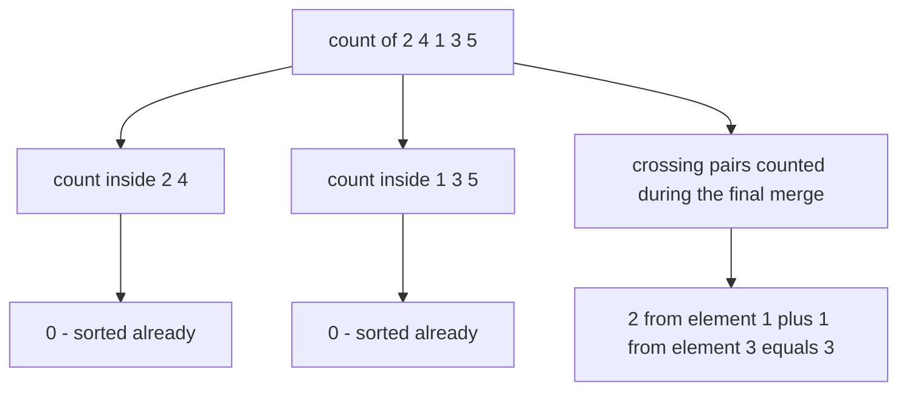
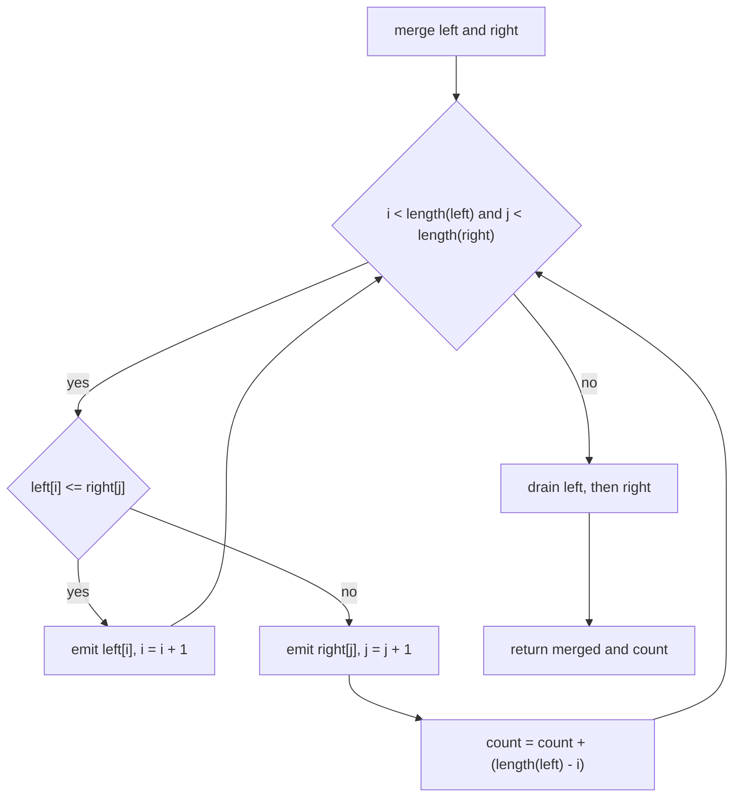
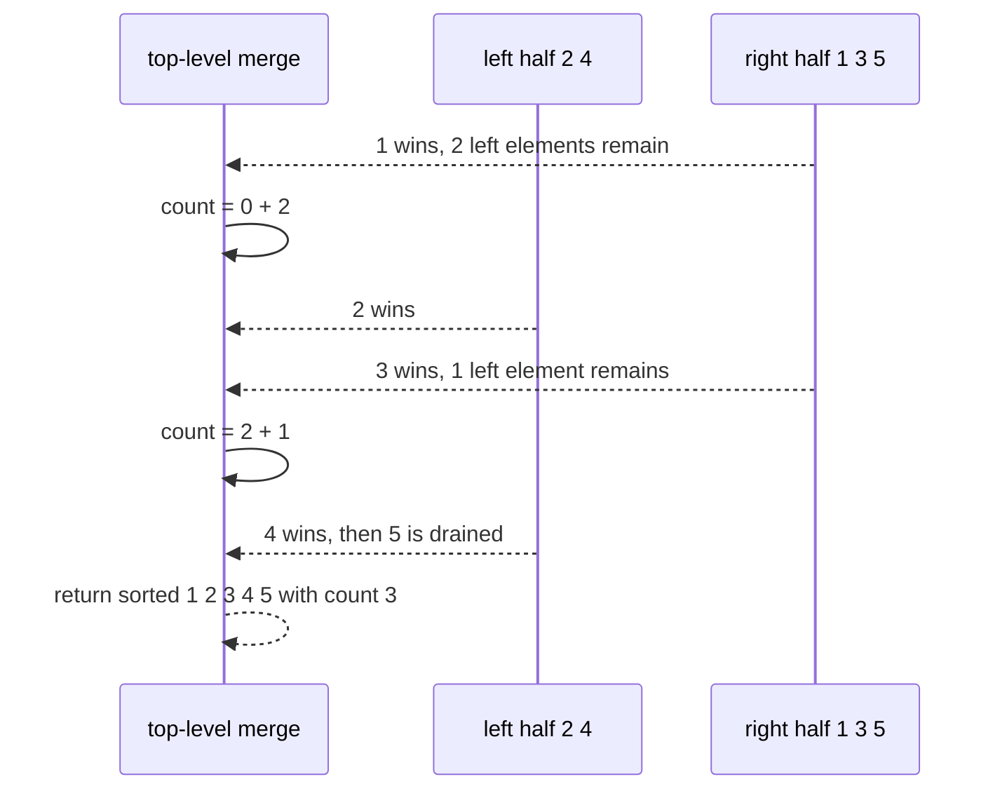

# 087 — Implement merge and count inversions using merge sort.

> **Tier:** Beginner · **CTCI chapter:** Ch 10 — Sorting and Searching
> **Task spec:** [087-implement-merge-and-count-inversions-using-merge-sort.md](../../../tasks/beginner/087-implement-merge-and-count-inversions-using-merge-sort.md)
> **Solutions:** [Python](../../../solutions/python/beginner/087-implement-merge-and-count-inversions-using-merge-sort/solution.py) ·
> [Java](../../../solutions/java/beginner/087-implement-merge-and-count-inversions-using-merge-sort/Solution.java) ·
> [JavaScript](../../../solutions/javascript/beginner/087-implement-merge-and-count-inversions-using-merge-sort/solution.js) ·
> [C#](../../../solutions/csharp/beginner/087-implement-merge-and-count-inversions-using-merge-sort/Solution.cs)

## 1. Problem restatement

**Input:** an integer array `nums` of `n` elements, in any order, with duplicates and negatives
allowed.

**Output:** the number of inversion pairs `(i, j)` with `i < j` and `nums[i] > nums[j]` — the same
quantity as [086 — Count inversion pairs using naive O(n^2)](../../../tasks/beginner/086-count-inversion-pairs-using-naive-o-n-2.md),
but computed in `O(n log n)` by augmenting merge sort. The function must leave the caller's array
untouched.

The four solution files assert the same core rows and then run a *cross-check* battery against the
naive counter:

| Call | Result | Why |
| --- | --- | --- |
| `count_inversions([])` | `0` | base case, nothing to count |
| `count_inversions([1])` | `0` | single element |
| `count_inversions([1, 2, 3, 4])` | `0` | sorted halves never produce a right-half win |
| `count_inversions([3, 2, 1])` | `3` | every pair inverted |
| `count_inversions([5, 4, 3, 2, 1])` | `10` | the maximum for `n = 5` |
| `count_inversions([2, 1, 2, 1])` | `3` | duplicates: `(0,1)`, `(0,3)`, `(2,3)` |
| `count_inversions([2, 4, 1, 3, 5])` | `3` | traced in section 4 |
| `count_inversions([1, 1, 1])` | `0` | equality is never an inversion |
| `count_inversions(reverse of 1..300)` | `44850` | `300 · 299 / 2`, the maximum for `n = 300` |
| pseudo-random arrays of size `2, 7, 50, 200` | equal to the naive count | agreement check, not a fixed value |

The pseudo-random generator is the same in all four files: a Lehmer recurrence
`state ← state · 48271 mod 2147483647` starting from seed `7`, with each value reduced modulo
`1000`. That matters for reproducibility — the cross-check compares the two algorithms on *identical*
arrays in every language, so a disagreement is a real bug rather than a difference in test data.

The return type is `long` in Java and C# (`int` would overflow around `n ≈ 65 536`), Python's
unbounded `int` in Python, and a plain number in JavaScript.

## 2. Intuition

Merge sort already solves a closely related problem for free. During a merge, the left half and the
right half are each **sorted**, and the merge walks them with two cursors:

```text
if left[i] <= right[j] then take left[i]
else take right[j]
```

The second branch is the key. When `right[j] < left[i]`, the sortedness of the left half means
`left[i]`, `left[i + 1]`, …, `left[end]` are *all* greater than `right[j]`. Each of them forms an
inversion with it — and their count is simply `length(left) - i`. One comparison therefore accounts
for a whole block of inversions.

Where do all the remaining inversions come from? Every inversion pair is either

- **inside the left half**, or
- **inside the right half**, or
- **crossing**: left index before right index with a larger value.

The recursion counts the first two by definition, and the merge counts exactly the third set, once,
because the halves it merges are contiguous in the original array. That partition is what makes the
algorithm correct — no inversion is counted twice, and none is missed.



The three boxes labelled `0`, `0` and `3` add up to the answer, and the merge is the only place
where non-zero work happens. Recursion is therefore a device for *splitting the inversion set into
three disjoint classes*, not merely for sorting.

## 3. Algorithm

The core routine returns two things at once — the sorted copy of its slice and the number of
inversions inside that slice:

1. **Base case.** If the slice has `0` or `1` elements, return a copy of it with count `0`.
2. **Split.** `mid ← lo + (hi - lo) / 2`.
3. **Recurse.** `(left, left_count) ← sort_count(lo, mid)` and
   `(right, right_count) ← sort_count(mid, hi)`; start with `count ← left_count + right_count`.
4. **Merge.** Walk `i` over `left` and `j` over `right`:
   1. If `left[i] <= right[j]`, emit `left[i]` and advance `i`.
   2. Otherwise emit `right[j]`, advance `j`, and add `length(left) - i` to `count` — the number of
      left elements still unemitted, all of which exceed `right[j]`.
5. **Drain.** Append whatever remains in either half (these contribute no new inversions).
6. Return the merged sequence and `count`.

```text
function count_inversions(nums)
    sorted_copy, count ← sort_and_count(nums)
    return count
end

function sort_and_count(items)
    if length(items) <= 1 then
        return copy of items, 0
    end
    mid ← length(items) div 2
    left, left_count ← sort_and_count(items before mid)
    right, right_count ← sort_and_count(items from mid)
    merged ← empty sequence
    count ← left_count + right_count
    i ← 0
    j ← 0
    while i < length(left) and j < length(right) do
        if left[i] <= right[j] then
            append left[i] to merged
            i ← i + 1
        else
            append right[j] to merged
            j ← j + 1
            count ← count + (length(left) - i)
        end
    end
    append the remaining elements of left to merged
    append the remaining elements of right to merged
    return merged, count
end
```

Three decisions carry the whole contract:

- **`<=` in the left-wins test.** Using `<` would route equal values into the right-win branch and
  count them as inversions, breaking `[1, 1, 1] → 0` and `[2, 1, 2, 1] → 3`. `<=` also makes the
  merge *stable*, which is the property that keeps the count equal to the number of adjacent swaps
  a stable sort would need.
- **The multiplier is `length(left) - i`, not `1`.** This is the augmentation; a plain merge sort
  would only ever add `1`.
- **Counting happens only when a right element wins.** Left-half wins cannot create crossings with
  the already-emitted prefix, and the drain phase is by definition free of inversions.



## 4. Worked example

Trace `count_inversions([2, 4, 1, 3, 5])`. The recursion splits once into `[2, 4]` and `[1, 3, 5]`,
and both halves are already sorted, so all the work happens in the final merge:

| Phase | Sub-slice | Emitted | `count` contribution |
| --- | --- | --- | --- |
| recurse | `[2, 4]` | `[2, 4]` | `0` |
| recurse | `[1, 3, 5]` | `[1, 3, 5]` | `0` |
| merge | — | see the table below | `3` |

The merge of `left = [2, 4]` with `right = [1, 3, 5]`:

| Step | `i` | `j` | Compare | Branch | Emitted | Added | `count` |
| --- | --- | --- | --- | --- | --- | --- | --- |
| 1 | 0 | 0 | `2 <= 1` false | right wins | `1` | `2 - 0 = 2` | 2 |
| 2 | 0 | 1 | `2 <= 3` true | left wins | `2` | `0` | 2 |
| 3 | 1 | 1 | `4 <= 3` false | right wins | `3` | `2 - 1 = 1` | 3 |
| 4 | 1 | 2 | `4 <= 5` true | left wins | `4` | `0` | 3 |
| 5 | 2 | 2 | left exhausted | drain | `5` | `0` | 3 |

Step 1 is the augmentation in action: `1` is smaller than both `2` and `4`, so two inversions are
recorded with a single comparison. Step 3 records one more because only `4` remains unemitted on the
left. Steps 2, 4 and 5 are ordinary merge steps.

Now compare with the naive algorithm's four-step view on the same input (task 086): the naive scan
needed ten comparisons and counted three hits; this merge needed five comparisons and counted the
same three inversions, two of them in one step.

The reversed input shows the extreme: `count_inversions(reverse of 1..300)` returns `44850`, the
maximum `300 · 299 / 2`. Every left element is larger than every right element at every level, so
each right-win step adds the full remaining left length.



The sequence diagram doubles as the correctness argument for this input: the two right-win events
are the only places where a smaller value was emitted before a larger one from the left half, and
together they account for all three crossing pairs.

## 5. Complexity

Let `n` be the number of elements and let one comparison plus one output write be the unit of work.

| Measure | Bound | Why it holds |
| --- | --- | --- |
| Time, best | O(n log n) | the recursion tree always has `log n` levels and each level merges `n` elements |
| Time, average | O(n log n) | the merge work per level is linear regardless of the data |
| Time, worst | O(n log n) | no comparison pattern changes the shape of the tree |
| Comparisons | O(n log n) | at most `n` per level, `log n` levels |
| Space, extra | O(n) | Java and C# use one shared buffer of `n` slots; Python and JavaScript allocate per call |
| Element copies | O(n log n) across the whole run | each level copies every element once |
| Naive alternative (task 086) | Θ(n²) time, O(1) space | every pair examined, always |

The space row deserves precision, because the four implementations differ:

- **Java and C#** copy the input once, then merge *in place* into the original array using a single
  shared buffer (`System.arraycopy` / `Array.Copy` fills the buffer for the current segment before
  the two-cursor walk). Peak extra memory is one array of `n` elements plus the copy.
- **Python** allocates fresh lists for each merge (`merged.append(...)`), so the live memory at any
  moment is bounded by the `O(n)` elements spread across the active recursion levels, and the total
  number of element copies over the run is the usual `O(n log n)`.
- **JavaScript** builds a `merged` array per call and copies it back into the slice, which is the
  same trade as Python with a more explicit write-back loop.

The important point for an interview answer is the asymptotics: `O(n log n)` time, `O(n)` auxiliary
space, versus `Θ(n²)` time and `O(1)` space for the naive counter. Sorting the array is *not* a
prerequisite — it is a by-product.

## 6. Pitfalls and edge cases

- **Counting only right-half wins.** Adding `1` in both branches, or counting during the drain
  phase, inflates the total. Inversions cross from the left half to the right half only when a
  right element is emitted early.
- **The multiplier.** `count ← count + (length(left) - i)` is the augmentation; getting the index
  wrong (using `j`, or `length(right) - j`) produces plausible but wrong numbers, which is why the
  cross-check against the naive counter exists in all four files.
- **`<=` versus `<`.** Equal values must let the *left* half win, otherwise duplicates count as
  inversions and `[1, 1, 1]` returns something other than `0`.
- **Base case.** `length <= 1` returns a copy and count `0`. Returning the original slice by
  reference is fine for counting but would break the “do not modify the caller's array” promise in
  the in-place implementations, which is why each of them copies first.
- **Empty and single-element input.** `[]` and `[1]` must both return `0`; the recursion stops
  immediately and no merge ever runs. Both are asserted in all four files.
- **Do not disturb the input.** `count_inversions` copies (`Arrays.copyOf`, `(int[])nums.Clone()`,
  `nums.slice()`, `list(items)`) before sorting, because merge sort writes into its working array.
- **Return type overflow.** Java and C# return `long`; the maximum count `n(n - 1)/2` exceeds 32-bit
  `int` around `n ≈ 65 536`. The 300-element test alone yields `44850`, comfortably inside `int`, so
  only a deliberate large-input test would expose an `int` version.
- **Recursion depth.** The recursion is `O(log n)` deep — merge sort splits in the middle — so stack
  overflow is not a practical concern here, unlike quicksort's adversarial `O(n)` worst case.
- **Determinism of the cross-check.** The Lehmer generator is seeded identically in all four
  languages (`state = 7`, multiplier `48271`, modulus `2147483647`, values reduced modulo `1000`),
  so any mismatch between the two algorithms is a bug, not a difference in inputs. Note that the
  Java and C# versions use `long` for the generator state to avoid overflow before the modulus.
- **Duplicate-heavy input.** `[2, 1, 2, 1]` gives `3`: the algorithm must count `(0,1)`, `(0,3)` and
  `(2,3)` while ignoring the equal pair `(0,2)`.
- **Negatives.** No absolute values or sign assumptions appear anywhere; `[-1, -2, -3]` would count
  `3` exactly as in the naive version.

## 7. Variants and follow-ups

- **The baseline this replaces.** [086-count-inversion-pairs-using-naive-o-n-2.md](../../../tasks/beginner/086-count-inversion-pairs-using-naive-o-n-2.md)
  is the `Θ(n²)` counter, and each task 087 solution file imports or re-implements it purely to
  assert agreement.
- **Count of smaller elements to the right.** The same recursion can emit, for every element, how
  many later elements are smaller — a common interview descendant of this exercise.
- **Fenwick tree / BIT counting.** The alternative `O(n log n)` approach: compress the values to
  ranks, then count how many smaller ranks have already been seen while scanning right to left.
- **Kendall tau distance.** Normalising the count by `n(n - 1)/2` gives a rank-correlation measure
  between the input order and sorted order; the same augmented merge computes it.
- **Merge sort itself.** Beyond inversions, this is the reference implementation of a stable
  `O(n log n)` sort, and the buffer-versus-slice difference between the Java/C# and Python/JavaScript
  versions is a good illustration of the space trade.
- **Pair-shaped neighbours in this repository.** [083-two-sum-problem-brute-force.md](../../../tasks/beginner/083-two-sum-problem-brute-force.md)
  is another “count/compare all pairs” task whose faster version (task 084) likewise trades memory
  for time, and [085-three-sum-return-any-triplet.md](../../../tasks/beginner/085-three-sum-return-any-triplet.md)
  uses sorting to collapse a pair loop.

## 8. Check yourself

1. Why does a right-half win in the merge add `length(left) - i` rather than `1`?

<details><summary>Show answer</summary>

Because the left half is sorted and its first `i` elements have already been emitted. Every one of
the remaining `length(left) - i` elements is greater than `right[j]` and sits at a smaller original
index, so each forms its own inversion pair with `right[j]`. One comparison therefore accounts for
that whole block.

</details>

2. Into which three disjoint classes does the recursion partition the inversions of a slice?

<details><summary>Show answer</summary>

Inversions wholly inside the left half (counted by the left recursion), wholly inside the right half
(counted by the right recursion), and crossing pairs where the left index precedes the right index
but holds a larger value (counted by the merge itself). The classes are disjoint because the halves
are contiguous ranges of the original array, so every pair of indices falls into exactly one class.

</details>

3. What changes if the merge uses `<` instead of `<=` when deciding that the left element wins?

<details><summary>Show answer</summary>

Equal values are routed to the right-win branch and counted as inversions: `count_inversions([1, 1, 1])`
would return a positive number instead of `0`, contradicting the assertions in all four solution
files. The merge would also stop being stable, breaking the interpretation of the count as the
number of adjacent swaps a stable sort needs.

</details>

4. The algorithm's output is the count, yet it also sorts. What is the cost of that by-product, and
   why is it worth paying?

<details><summary>Show answer</summary>

The sort itself is the mechanism, not an extra step: the divide-and-conquer structure gives
`O(n log n)` levels and the sorted halves are exactly what lets one comparison stand for many
inversions. The price is `O(n)` auxiliary space (a shared buffer in Java and C#, per-call lists in
Python and JavaScript) and `O(n log n)` element copies, replacing the naive counter's `O(1)` space
and `Θ(n²)` time.

</details>

5. Why does the test suite not compare against fixed inversion counts for the pseudo-random arrays?

<details><summary>Show answer</summary>

Because there is nothing meaningful to hard-code: the arrays are generated, and the real check is
that the augmented merge sort agrees with the naive counter on identical data. That comparison is
the strongest available evidence that the `length(left) - i` accounting matches the definition, and
the shared seeded generator guarantees the four languages test the same arrays.

</details>
