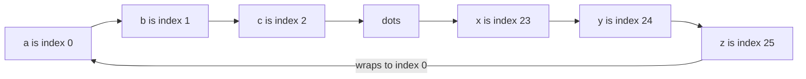
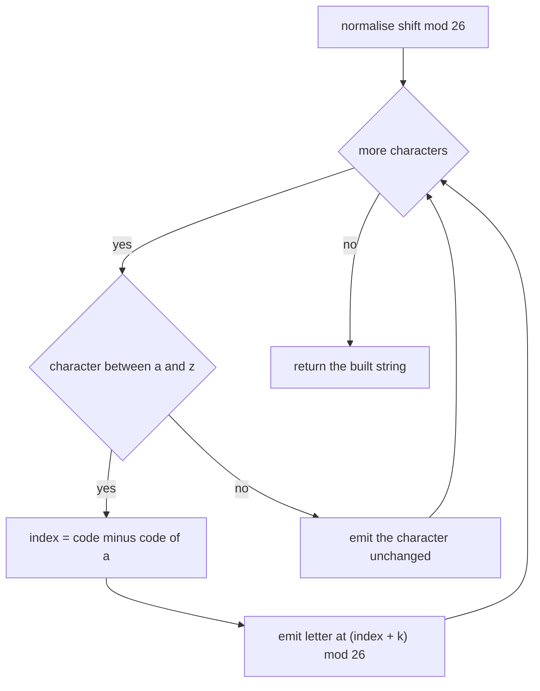
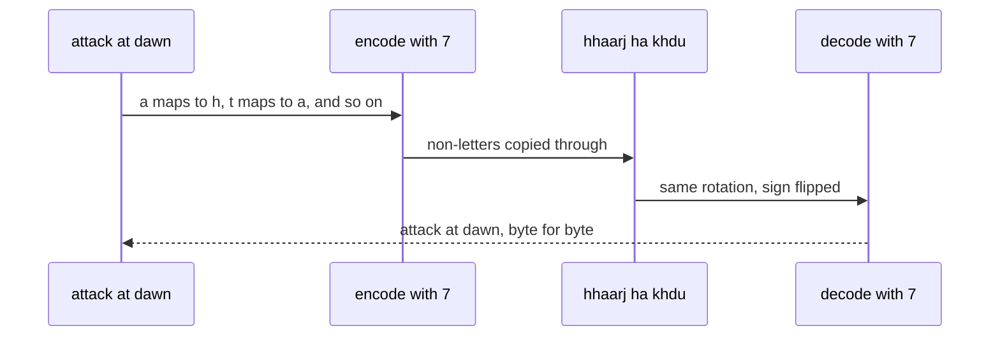

# 088 — Classic Caesar cipher encode/decode.

> **Tier:** Beginner · **CTCI chapter:** Ch 1 — Arrays and Strings
> **Task spec:** [088-classic-caesar-cipher-encode-decode.md](../../../tasks/beginner/088-classic-caesar-cipher-encode-decode.md)
> **Solutions:** [Python](../../../solutions/python/beginner/088-classic-caesar-cipher-encode-decode/solution.py) ·
> [Java](../../../solutions/java/beginner/088-classic-caesar-cipher-encode-decode/Solution.java) ·
> [JavaScript](../../../solutions/javascript/beginner/088-classic-caesar-cipher-encode-decode/solution.js) ·
> [C#](../../../solutions/csharp/beginner/088-classic-caesar-cipher-encode-decode/Solution.cs)

## 1. Problem restatement

**Input:** a text string and an integer `shift`, which may be negative, zero, or larger than the
alphabet size.

**Output:** the text with every **lowercase** letter `a`–`z` rotated forward by `shift` positions
in the alphabet, wrapping around at `z`; every other character is copied unchanged. `decode` is the
same operation with the sign of the shift flipped.

The shift is reduced modulo `26` before use, so `29` behaves like `3`, `26` like `0`, and `-29` like
`-3`. The four solution files assert exactly these rows:

| Call | Result | Why |
| --- | --- | --- |
| `caesar_encode("abc", 3)` | `"def"` | the plain case |
| `caesar_encode("xyz", 3)` | `"abc"` | wrap-around at the end of the alphabet |
| `caesar_encode("hello, world!", 3)` | `"khoor, zruog!"` | punctuation and the space are untouched |
| `caesar_encode("abc", -3)` | `"xyz"` | a negative shift runs the alphabet backwards |
| `caesar_encode("abc", 29)` | `"def"` | `29 mod 26 = 3` |
| `caesar_encode("abc", 26)` | `"abc"` | a full rotation is the identity |
| `caesar_encode("abc", -29)` | `"xyz"` | `-29 mod 26` is `-3` after normalisation |
| `caesar_encode("", 5)` | `""` | empty input |
| `caesar_encode("a1 B2 c!", 1)` | `"b1 B2 d!"` | digits, spaces, uppercase and punctuation pass through |
| `caesar_encode("Hello", 1)` | `"Hfmmp"` | the leading uppercase `H` is *not* shifted |
| `caesar_decode("khoor", 3)` | `"hello"` | decode undoes encode |
| `caesar_decode("def", 3)` | `"abc"` | and the other way round |

The two round-trip assertions are the real specification:

```text
caesar_decode(caesar_encode("attack at dawn!", 7), 7) == "attack at dawn!"
caesar_decode(caesar_encode("the quick brown fox 123", 13), 13) == "the quick brown fox 123"
```

Round-tripping works *because* non-lowercase characters are left alone: a transformation that
dropped or uppercased punctuation could not be inverted.

## 2. Intuition

A Caesar cipher is a rotation of a 26-element alphabet. Number the letters `a = 0, b = 1, …,
z = 25`; then shifting is a single modular addition:

```text
new_index = (old_index + shift) mod 26
```

The modulo is what turns the end of the alphabet into the beginning: `z` is index `25`, and
`25 + 3 = 28`, which is index `2` — the letter `c`. And `x` is `23`, `23 + 3 = 26 ≡ 0` — `a`. That
is the whole wrap-around case; there is no special “if past z, restart at a” branch, because the
modulo already encodes the boundary.

Two details make the implementation match the tests:

1. **Normalise the shift once, not per character.** `shift mod 26` is computed a single time before
   the loop. It is what makes `29`, `-3` and `-29` work, and it is a pure time saver: doing the
   modulo inside the loop yields identical characters (because addition mod 26 is associative) but
   repeats the work for every character.
2. **Only `a`–`z` are in the rotation.** The comparison `'a' <= ch <= 'z'` is a membership test of a
   single contiguous range of character codes, which is why the shift can be done with arithmetic
   on codes rather than with a lookup table. Uppercase letters fall outside it and are copied
   verbatim — hence `"Hello"` becomes `"Hfmmp"` and not `"Khoor"`. That choice is what the solution
   files document in their header comments.



Because the alphabet is a *ring*, a shift is a rotation of that ring by `shift` positions. Decoding
is the rotation by `-shift`, which is the same code path with the argument negated — literally one
line in all four files.

## 3. Algorithm

**Encode:**

1. Normalise once: `k ← shift mod 26`, mapped into `0..25` (for negative shifts this means adding 26
   until the value is non-negative).
2. Create an output buffer with room for `n` characters.
3. For each character `ch` of the text:
   1. If `'a' <= ch <= 'z'`, write
      `character at code('a') + (code(ch) - code('a') + k) mod 26`.
   2. Otherwise write `ch` unchanged.
4. Return the buffer as a string.

**Decode:** call encode with `-shift`.

```text
procedure caesar_encode(text, shift)
    k ← shift mod 26, adjusted into the range 0 to 25
    out ← new buffer for length(text) characters
    for each ch in text do
        if ch is between 'a' and 'z' then
            index ← code(ch) - code('a')
            out ← out followed by character with code('a' + (index + k) mod 26)
        else
            out ← out followed by ch
        end
    end
    return out
end

procedure caesar_decode(text, shift)
    return caesar_encode(text, -shift)
end
```

The normalisation differs slightly by language, and the difference is worth knowing:

- **Python** writes `shift % 26` directly, because Python's `%` already returns a non-negative result
  for a positive modulus, so `-29 % 26` is `23`.
- **Java, JavaScript and C#** write `((shift % 26) + 26) % 26`, because their `%` keeps the sign of
  the left operand, so `-29 % 26` is `-3` and a second addition-and-modulo is needed.

Both forms produce `k` in `0..25`, which is what makes a single expression correct for negative
shifts.



## 4. Worked example

Trace `caesar_encode("xyz", 3)`, the wrap-around row:

| Step | Character | Index | `index + 3` | mod 26 | Emitted | Output so far |
| --- | --- | --- | --- | --- | --- | --- |
| 1 | `x` | 23 | 26 | 0 | `a` | `"a"` |
| 2 | `y` | 24 | 27 | 1 | `b` | `"ab"` |
| 3 | `z` | 25 | 28 | 2 | `c` | `"abc"` |

All three characters wrapped, and the output is `"abc"`.

Now trace `caesar_encode("a1 B2 c!", 1)`, the row that pins down what is *not* transformed:

| Step | Character | In `a`–`z`? | Emitted | Output so far |
| --- | --- | --- | --- | --- |
| 1 | `a` | yes (index 0 → 1) | `b` | `"b"` |
| 2 | `1` | no | `1` | `"b1"` |
| 3 | ` ` | no | ` ` | `"b1 "` |
| 4 | `B` | no — uppercase | `B` | `"b1 B"` |
| 5 | `2` | no | `2` | `"b1 B2"` |
| 6 | ` ` | no | ` ` | `"b1 B2 "` |
| 7 | `c` | yes (index 2 → 3) | `d` | `"b1 B2 d"` |
| 8 | `!` | no | `!` | `"b1 B2 d!"` |

The word “case-insensitive” is nowhere in this table: `B` is copied, not shifted, which is exactly
what the assertion `caesar_encode("Hello", 1) == "Hfmmp"` records.

Finally, the round trip with shift `7` on `"attack at dawn!"`: encoding produces `"haahjr ha khdu!"`
and decoding with the same key flips every one of those letters back by seven, while the space and
the `!` are copied in both directions and therefore survive the round trip untouched.



## 5. Complexity

Let `n` be the length of the text.

| Measure | Bound | Why it holds |
| --- | --- | --- |
| Time, best | O(n) | every character must be inspected; only the empty string is O(1) |
| Time, average | O(n) | one range test and at most one modular addition per character |
| Time, worst | O(n) | no input-dependent branching changes the per-character cost |
| Space, output | O(n) | the ciphertext is as long as the plaintext |
| Space, extra | O(n) | the buffer that becomes the result: `StringBuilder` (Java), `char[]` (C#), a list joined once (Python), a rope-built string (JavaScript) |
| Naive alternative (per-character modulo) | O(n) | same bound, more constant work — the modulo is hoisted out of the loop here |
| Brute-force attack | O(26 · n) | trying all 26 keys is a constant factor in theory and utterly fatal in practice |

The security note is part of the complexity story: with only 26 keys, an exhaustive search costs
`26 · n` character operations, so a Caesar cipher has no meaningful secrecy. The task is an exercise
in modular arithmetic and character classification, not in cryptography.

## 6. Pitfalls and edge cases

- **Uppercase letters are not shifted.** `"Hello"` becomes `"Hfmmp"`, not `"Khoor"`. A common
  “improvement” is to shift uppercase too, but that contradicts the assertions and would also break
  the round trip only in appearance (it still round-trips) while changing the documented behaviour.
- **Non-letters must pass through untouched.** Digits, spaces, punctuation and (in Python and
  JavaScript) any other character go through unchanged — that is what makes the round trip exact.
- **Negative shifts.** `caesar_encode("abc", -3) == "xyz"`. In Java, JavaScript and C# this requires
  the double modulo `((shift % 26) + 26) % 26`; a naive `(ch - 'a' + shift) % 26` would produce a
  negative index and a character outside `a`–`z`. Python's `%` handles it directly.
- **Shifts larger than 26.** `29` must behave like `3` and `-29` like `-3`; the normalisation step is
  what guarantees it. A shift of exactly `26` (or any multiple) is the identity, asserted separately.
- **Empty text.** `caesar_encode("", 5)` must return `""`, not `null`.
- **Digit and letter collision in code arithmetic.** The implementation works on *character codes*,
  which means it must offset by the code of `'a'` (97) before the modulo and add it back after. A
  classic bug is forgetting one of the two offsets, e.g. shifting codes `97..122` directly and
  emitting control characters.
- **Unicode beyond ASCII.** Python's version is safe on any code point because non-`a`–`z`
  characters are copied. Java and C# index UTF-16 code units (`charAt`/`text[i]`), so a surrogate
  pair is copied one unit at a time — harmless for copying, but the two operations must not be
  interleaved with anything that assumes one unit equals one character. JavaScript iterates code
  points with `for … of`, which is the same as Python for this purpose.
- **Combining marks and accented letters.** `"é"` is not `a`–`z`, so it is copied verbatim; a
  cipher that folded accents would need a stated normalisation policy.
- **String building.** The Java version uses `StringBuilder`, C# a `char[]`, Python a generator
  joined once. The JavaScript version concatenates with `+=` in a loop; engines usually keep that
  near-linear via rope strings, but it is the one place where the code leans on the runtime rather
  than on an explicit buffer. If you port this to a language with purely immutable strings, use a
  buffer.
- **Not a secure cipher.** Say this out loud if the interview wanders toward “is this encryption?”.
  A Caesar cipher is a teaching device; the 26-key space is brute-forced instantly.

## 7. Variants and follow-ups

- **Uppercase-aware variant.** Shift `A`–`Z` as well, using the same arithmetic with a different
  base code — `code('A')` instead of `code('a')`.
- **Generalised affine cipher.** Replace “add `k`” with “multiply by `a` and add `b`”, which keeps
  the operation invertible only when `a` and 26 are coprime; the inverse is a modular inverse.
- **Vigenère cipher.** The shift varies per position, driven by a repeating key — the same character
  loop with a key index that advances only over letters.
- **ROT13.** The special case `shift = 13`, which is its own inverse: encoding twice returns the
  original. Try it against the round-trip assertions here.
- **Character classification.** [089-implement-simple-frequency-histogram-integers.md](../../../tasks/beginner/089-implement-simple-frequency-histogram-integers.md)
  counts instead of transforming, but shares the “walk every character, classify it, update one
  bucket” shape.
- **Validation-style parsing.** [095-validate-ipv4-address-basic.md](../../../tasks/beginner/095-validate-ipv4-address-basic.md)
  and [096-simple-url-parser-extract-protocol-host.md](../../../tasks/beginner/096-simple-url-parser-extract-protocol-host.md)
  are the other two beginner string scanners in this repository, both dominated by the same
  character-by-character loop.

## 8. Check yourself

1. Why is no “if the letter passes `z`, restart at `a`” branch needed?

<details><summary>Show answer</summary>

Because the modular arithmetic already performs the wrap: `z` has index `25`, and
`(25 + 3) mod 26 = 2`, which is `c`; `x` gives `(23 + 3) mod 26 = 0`, which is `a`. The ring
structure of the alphabet is encoded in the `mod 26`.

</details>

2. What does `caesar_encode("Hello", 1)` return, and why is it not `"Khoor"`?

<details><summary>Show answer</summary>

It returns `"Hfmmp"`: the uppercase `H` is outside the `a`–`z` range and is copied verbatim, while
`e`, `l`, `l`, `o` shift by one to `f`, `m`, `m`, `p`. All four solution files assert this exact
value, so shift-uppercase-too is a behaviour change, not an implementation detail.

</details>

3. Why do Java, JavaScript and C# write `((shift % 26) + 26) % 26` while Python writes `shift % 26`?

<details><summary>Show answer</summary>

Because their remainder operator keeps the sign of the dividend, so `-29 % 26` is `-3`, which would
produce character indices below `a`. Adding 26 and taking the modulo again maps it into `0..25`.
Python's `%` with a positive divisor already returns a non-negative result, so the extra step is
unnecessary there.

</details>

4. What are the time and space complexities, and what is the practical strength of the cipher?

<details><summary>Show answer</summary>

`O(n)` time and `O(n)` output space, with one range test and one modular addition per character. The
key space is 26, so an exhaustive attack costs `26 · n` character operations — trivial. The exercise
is about modular arithmetic and character classification, not security.

</details>

5. The round-trip assertion uses text with a space and an exclamation mark. Why does that matter?

<details><summary>Show answer</summary>

Because it proves the non-letter handling is lossless in both directions. If encoding normalised,
dropped or replaced punctuation, decoding could not restore the original text; because each
non-lowercase character is copied through both phases, `decode(encode(text, k), k)` is the identity
for the whole string, not just for the letters.

</details>
