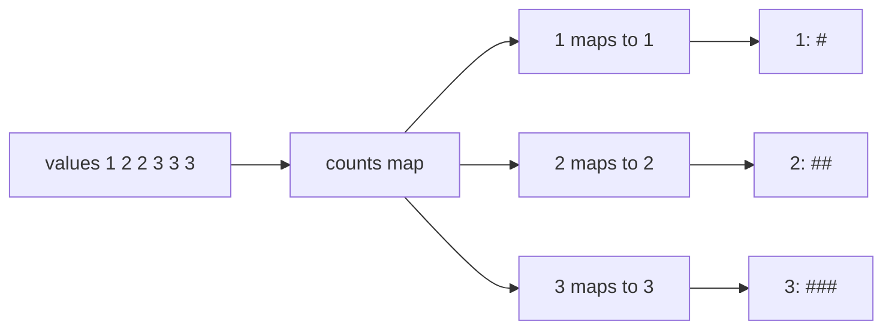
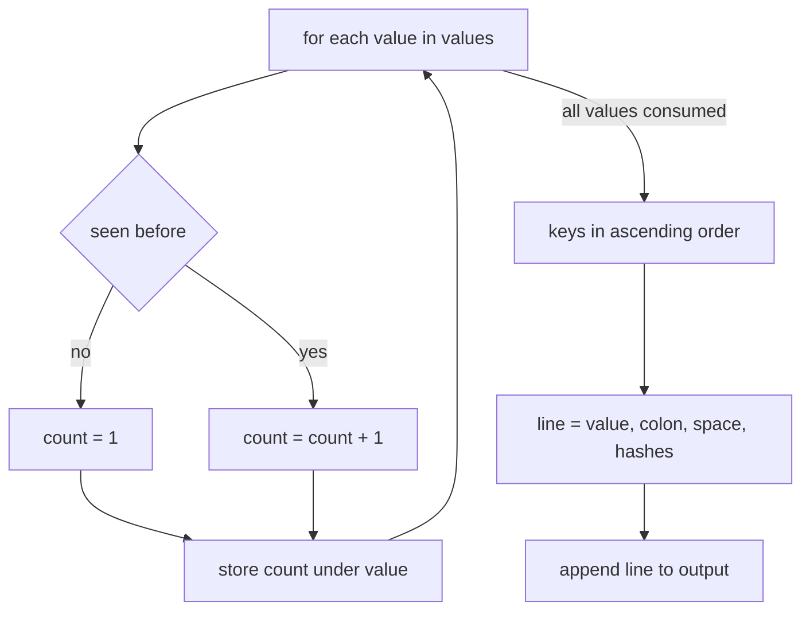
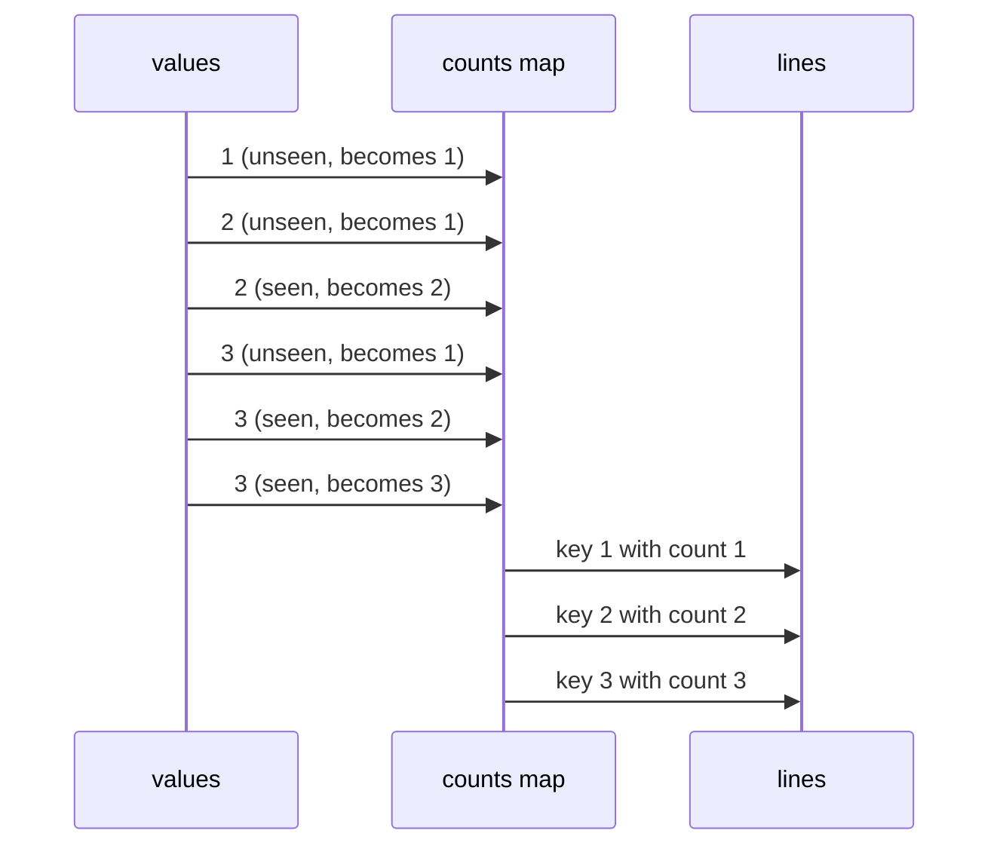

# 089 — Implement simple frequency histogram (integers).

> **Tier:** Beginner · **CTCI chapter:** Ch 1 — Arrays and Strings
> **Task spec:** [089-implement-simple-frequency-histogram-integers.md](../../../tasks/beginner/089-implement-simple-frequency-histogram-integers.md)
> **Solutions:** [Python](../../../solutions/python/beginner/089-implement-simple-frequency-histogram-integers/solution.py) ·
> [Java](../../../solutions/java/beginner/089-implement-simple-frequency-histogram-integers/Solution.java) ·
> [JavaScript](../../../solutions/javascript/beginner/089-implement-simple-frequency-histogram-integers/solution.js) ·
> [C#](../../../solutions/csharp/beginner/089-implement-simple-frequency-histogram-integers/Solution.cs)

## 1. Problem restatement

The task has two functions, and the tests exercise them as a pair.

**`histogram_counts(values)`** — input: a list of integers (possibly empty, possibly repeated,
possibly negative). Output: a map from each *distinct* value to the number of times it occurs.

**`render_histogram(counts)`** — input: such a map. Output: one text line per distinct value, in
**ascending value order**, each line being `<value>: ` followed by exactly one `#` per occurrence.

The four solution files assert these rows:

| Input to `histogram_counts` | Map | Lines from `render_histogram` |
| --- | --- | --- |
| `[1, 2, 2, 3, 3, 3]` | `{1: 1, 2: 2, 3: 3}` | `["1: #", "2: ##", "3: ###"]` |
| `[]` | `{}` | `[]` |
| `[-1, -1, 0, 2, 2, 2]` | `{-1: 2, 0: 1, 2: 3}` | `["-1: ##", "0: #", "2: ###"]` |
| `[7]` | `{7: 1}` | `["7: #"]` |

Three contracts are pinned down by those rows:

- **Distinct values only.** `[1, 2, 2, 3, 3, 3]` has six elements but three lines; the number of
  lines is the number of distinct values, asserted as `len(lines) == 3`.
- **Ascending order.** The negative row proves it is a *numeric* sort, not a lexicographic one:
  `-1` comes before `0` before `2`. (A string sort would put `-1` first too, but `10` would sort
  before `2` — the numeric comparison is what the rendering uses.)
- **A `#` per occurrence, not a scaled bar.** `3: ###` has exactly three characters, so the format
  is a literal repetition of the count, and `-1: ##` works even though the value is negative —
  the bar length is the *count*, never the value.

The map type differs by language but the semantics do not: Python `dict`, Java `TreeMap`, JavaScript
`Map`, C# `SortedDictionary<int, int>`.

## 2. Intuition

The naive way to count occurrences is to look up each value with a fresh scan:

```text
for each distinct value v do
    count ← 0
    for each element x do
        if x = v then count ← count + 1
    end
end
```

That is `O(n · d)` for `d` distinct values — quadratic on an array of all-distinct values. The fix
is the same one used by [084 — Two-sum using hashmap](../../../tasks/beginner/084-two-sum-using-hashmap.md):
keep a map from value to count and update a single entry per element.

```text
counts[v] ← counts.get(v, 0) + 1
```

The subtlety is the `0` default. Every language expresses it differently, and all four forms encode
the same idea — “the count of an unseen value is zero”:

- **Python:** `counts[value] = counts.get(value, 0) + 1`
- **Java:** `counts.merge(value, 1, Integer::sum)` — merge inserts `1` if absent, otherwise sums
- **JavaScript:** `counts.set(value, (counts.get(value) || 0) + 1)`
- **C#:** `counts.TryGetValue(value, out int current); counts[value] = current + 1;`

The second insight concerns the *ordered* half of the task. Since the lines must appear in ascending
value order, either the container keeps its keys sorted (Java's `TreeMap`, C#'s `SortedDictionary`,
which iterate in key order for free) or the keys must be sorted before rendering (Python's `sorted`,
JavaScript's `Array.prototype.sort` on the extracted keys). Both strategies produce the same text;
they differ only in where the ordering cost is paid — during insertion or before output.



The picture is the two-phase shape of the whole task: collapse the input into counts, then expand the
counts into text. Nothing is lost in the first phase — the total of all counts equals the input
length — and nothing is invented in the second.

## 3. Algorithm

**Phase 1 — count:**

1. Create an empty map from value to count.
2. For each `value` in `values`:
   1. Look up the current count, using `0` when the value has not been seen.
   2. Store the incremented count back.
3. Return the map.

**Phase 2 — render:**

4. Extract the keys in ascending value order (from a sorted container, or by sorting the key list).
5. For each key `v` in that order, emit the line `v` followed by `": "` and `counts[v]` copies of `#`.
6. Return the list of lines.

```text
function histogram_counts(values)
    counts ← empty map from value to count
    for each value in values do
        counts[value] ← (counts[value] or 0) + 1
    end
    return counts
end

function render_histogram(counts)
    lines ← empty list
    for each value in counts ordered ascending by key do
        bar ← repeat "#" counts[value] times
        append (value as text) followed by ": " followed by bar to lines
    end
    return lines
end
```

The idiom `for each value in counts ordered ascending by key` is the only implementation-dependent
step. Python does `sorted(counts)`; JavaScript does `[...counts.keys()].sort((a, b) => a - b)`;
Java and C# simply iterate their containers, which are ordered by construction. The
`(a, b) => a - b` comparator in JavaScript is not decoration: the default sort is *lexicographic*, so
`[10, 2, 3]` would be ordered `10, 2, 3` without it. That is the single most common bug in this task
outside Python.



## 4. Worked example

Trace `histogram_counts([1, 2, 2, 3, 3, 3])` step by step. The map starts empty:

| Step | `value` | Lookup before | Stored count | Map after the step |
| --- | --- | --- | --- | --- |
| start | — | — | — | `{}` |
| 1 | 1 | absent → `0` | `1` | `{1: 1}` |
| 2 | 2 | absent → `0` | `1` | `{1: 1, 2: 1}` |
| 3 | 2 | present → `1` | `2` | `{1: 1, 2: 2}` |
| 4 | 3 | absent → `0` | `1` | `{1: 1, 2: 2, 3: 1}` |
| 5 | 3 | present → `1` | `2` | `{1: 1, 2: 2, 3: 2}` |
| 6 | 3 | present → `2` | `3` | `{1: 1, 2: 2, 3: 3}` |

Steps 3, 5 and 6 are the interesting ones: each insert-and-add touches exactly one entry, which is
why the pass is linear rather than quadratic.

Then `render_histogram` walks the sorted keys `1, 2, 3`:

| Step | Key | Count | Bar | Line |
| --- | --- | --- | --- | --- |
| 1 | 1 | 1 | `#` | `"1: #"` |
| 2 | 2 | 2 | `##` | `"2: ##"` |
| 3 | 3 | 3 | `###` | `"3: ###"` |

The negative row shows the same pipeline with keys that must not be compared as text:
`histogram_counts([-1, -1, 0, 2, 2, 2])` gives `{-1: 2, 0: 1, 2: 3}` and renders
`["-1: ##", "0: #", "2: ###"]` — one line per distinct value, three lines for six elements, and the
negative key printed with its sign.



## 5. Complexity

Let `n` be the number of elements and `d` the number of distinct values (`d <= n`).

| Measure | Bound | Why it holds |
| --- | --- | --- |
| Count time, best | O(n) | every element is inspected once; the empty input is O(1) |
| Count time, average | O(n) expected | one map lookup and one map store per element |
| Count time, worst | O(n²) for hash maps under adversarial collisions; O(n log d) for the tree-based `TreeMap` and `SortedDictionary` | hashing degrades on pathological keys, while ordered maps always pay `log d` per operation |
| Render time | O(d log d) if the keys must be sorted, O(d) if the container is already ordered | Python and JavaScript sort the keys; Java and C# iterate pre-sorted containers |
| Space | O(d) | one entry per distinct value |
| Output size | O(n + d) characters | the bars contain `sum(counts) = n` hashes plus the labels |
| Double-loop alternative | O(n · d) | rescanning the input for each distinct value |

Note the two independent orderings of cost: the *build* is linear in `n` while the *render* is linear
in `d` plus a sort. When almost every value is distinct (`d ≈ n`), both phases are near-linear; when
there are few distinct values, the render is cheap but the bars are long, which is where the
`O(n + d)` output size comes from — the bars are literally one character per input element.

## 6. Pitfalls and edge cases

- **The `0` default.** Incrementing an unseen key must not produce a missing-value error or `NaN`.
  Python's `dict.get`, Java's `merge`, JavaScript's `|| 0` and C#'s `TryGetValue` all provide the
  default; writing the update without it is the most common crash in this task.
- **Numeric sort, not lexicographic.** This bites hardest in JavaScript, where `keys.sort()` compares
  strings: `[2, 10]` would render as `10` then `2`. The solution passes `(a, b) => a - b`. Python's
  `sorted` is numeric by default; Java's `TreeMap` and C#'s `SortedDictionary` order keys by their
  natural integer comparison.
- **Empty input.** `histogram_counts([])` must be an empty map and `render_histogram({})` must be an
  empty list — not a single empty line, and not `null`. Both are asserted in all four files.
- **Negative and zero values.** `-1`, `0` and `2` are ordinary keys. The value is printed with its
  sign (`-1: ##`) and the bar length is the *count*, never the value, so a negative or huge value
  still renders a short bar.
- **Duplicates are the whole point.** The number of lines equals `d`, which is strictly smaller than
  `n` as soon as any value repeats; `[1, 2, 2, 3, 3, 3]` gives three lines for six elements.
- **A `#` per occurrence, not a scaled bar.** There is no normalisation to the maximum count, no
  rounding, and no truncation: `3: ###` is exactly three hashes even when another value occurs a
  thousand times.
- **`sum(counts) == n`.** A useful invariant to assert while debugging: if the counts do not add up
  to the input length, an element was dropped or double-counted.
- **Type of the key.** The functions are documented for integers; floating-point keys would make the
  `-0.0`/`0.0` and `NaN` cases awkward in every language, and JavaScript's `Map` uses SameValueZero,
  so `-0` and `0` collapse into one bucket while `NaN` matches itself.
- **Mutation.** The map returned by phase 1 is handed to phase 2 unmodified; the renderer must not
  delete entries or reorder its argument. All four renderers only read.
- **Repeated rendering.** Calling `render_histogram` twice on the same map yields identical output —
  a small but useful property when the histogram is printed and then written to a file.

## 7. Variants and follow-ups

- **Character histogram.** The same two functions on the characters of a string; the counting phase is
  identical, and the sorting question gains a twist because letters have a natural code order.
- **Top-k most frequent.** Build the same counts, then select the `k` largest counts — either by
  sorting the whole map (`O(d log d)`) or with a size-`k` heap (`O(d log k)`).
- **Map-based lookups in general.** [084-two-sum-using-hashmap.md](../../../tasks/beginner/084-two-sum-using-hashmap.md)
  uses the same dictionary machinery to answer “have I seen this value?” instead of “how often?”.
- **Fixed-range counting array.** When the values are known to be small and non-negative (grades,
  byte values), an array of size `max + 1` replaces the map entirely and gives guaranteed `O(n)`
  time with no hashing.
- **Character-by-character scanning.** [088-classic-caesar-cipher-encode-decode.md](../../../tasks/beginner/088-classic-caesar-cipher-encode-decode.md)
  walks a string in the same way but transforms instead of counting, and
  [095-validate-ipv4-address-basic.md](../../../tasks/beginner/095-validate-ipv4-address-basic.md)
  counts digits and dots while validating.
- **Aggregation with ordering.** Java's `TreeMap` and C#'s `SortedDictionary` are the standard answer
  whenever a result must be produced in sorted key order without a final sort.

## 8. Check yourself

1. Why is the counting pass `O(n)` rather than `O(n · d)`?

<details><summary>Show answer</summary>

Because each element updates exactly one map entry: look up the current count (treating an absent
key as `0`) and store the incremented value. No scan over the distinct values happens inside the
loop, so the work is proportional to the number of elements, not to elements times distinct values.

</details>

2. Why does the JavaScript renderer pass `(a, b) => a - b` to `sort`, and what happens without it?

<details><summary>Show answer</summary>

Because `Array.prototype.sort` defaults to converting entries to strings and comparing them
lexicographically, so `[2, 3, 10]` would be ordered `10, 2, 3`. The numeric comparator restores
ascending value order. Python's `sorted`, Java's `TreeMap` order and C#'s `SortedDictionary` are
already numeric.

</details>

3. `histogram_counts([1, 2, 2, 3, 3, 3])` has six elements. Why does `render_histogram` return three
   lines, and what does `3: ###` encode?

<details><summary>Show answer</summary>

Because there are three *distinct* values, and the output has one line per distinct value. The line
`3: ###` encodes the value `3` and a bar of three `#` characters — one per occurrence — not the
magnitude of `3`.

</details>

4. How must the implementation treat a value like `-1` in both phases?

<details><summary>Show answer</summary>

As an ordinary key: it counts like any other value and appears in its numeric position (`-1` before
`0` before `2`) with its sign printed. Only the *count* determines the bar length, so `-1: ##`
means “the value `-1` occurred twice”.

</details>

5. The renderer either sorts the keys or relies on an ordered container. Which of the four solutions
   does which, and what is the consequence for the complexity?

<details><summary>Show answer</summary>

Python (`sorted(counts)`) and JavaScript (`[...counts.keys()].sort(...)`) sort before rendering, so
the render costs `O(d log d)`. Java (`TreeMap`) and C# (`SortedDictionary`) keep the keys ordered as
they are inserted, so rendering is `O(d)` but every insertion costs `O(log d)` instead of `O(1)`
expected. Both approaches are `O(n log d)` in the worst case overall; the difference is where the
logarithm is paid.

</details>
