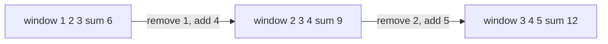
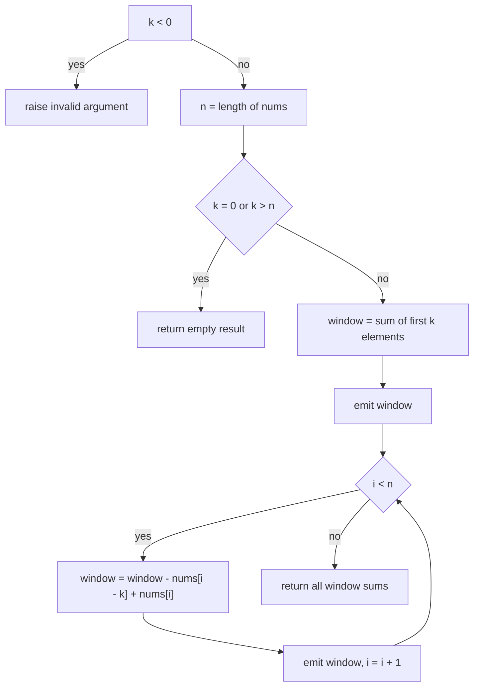
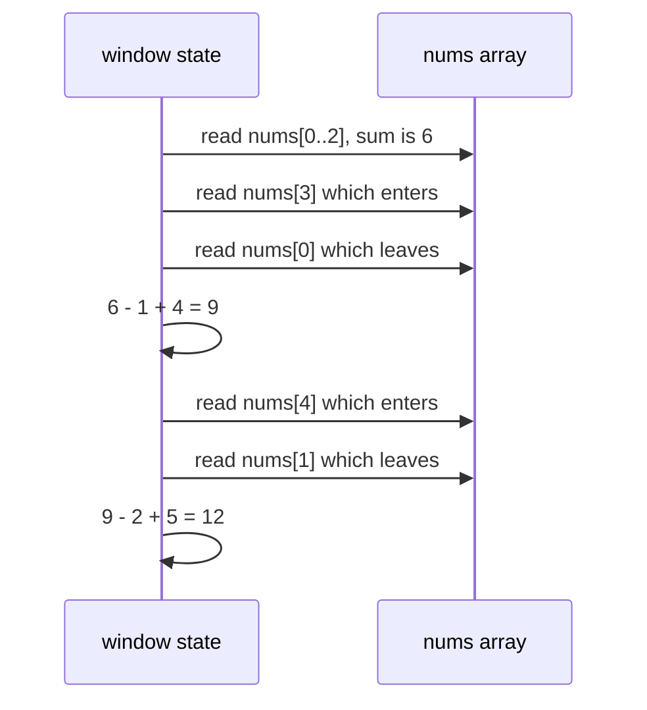

# 090 — Implement sliding window sum of size k.

> **Tier:** Beginner · **CTCI chapter:** Ch 1 — Arrays and Strings
> **Task spec:** [090-implement-sliding-window-sum-of-size-k.md](../../../tasks/beginner/090-implement-sliding-window-sum-of-size-k.md)
> **Solutions:** [Python](../../../solutions/python/beginner/090-implement-sliding-window-sum-of-size-k/solution.py) ·
> [Java](../../../solutions/java/beginner/090-implement-sliding-window-sum-of-size-k/Solution.java) ·
> [JavaScript](../../../solutions/javascript/beginner/090-implement-sliding-window-sum-of-size-k/solution.js) ·
> [C#](../../../solutions/csharp/beginner/090-implement-sliding-window-sum-of-size-k/Solution.cs)

## 1. Problem restatement

**Input:** an integer array `nums` of length `n` and a window size `k`.

**Output:** the sums of all `n - k + 1` contiguous windows of size `k`, in left-to-right order.
Degenerate `k` values are defined by the shipped contracts:

| `k` | Result | Why |
| --- | --- | --- |
| `0 < k <= n` | `n - k + 1` sums | the normal case |
| `k == 0` | `[]` | there are no windows of size zero |
| `k > n` | `[]` | a window does not fit |
| `k < 0` | raises `ValueError` / `IllegalArgumentException` / `Error` / `ArgumentException` | negative sizes are a caller bug |

The asserted rows, all present in the four solution files:

| Call | Result | Why |
| --- | --- | --- |
| `window_sums([1, 2, 3, 4, 5], 3)` | `[6, 9, 12]` | `1+2+3`, `2+3+4`, `3+4+5` |
| `window_sums([1, 2, 3, 4, 5], 1)` | `[1, 2, 3, 4, 5]` | windows of size one are the elements |
| `window_sums([1, 2, 3, 4, 5], 5)` | `[15]` | exactly one window, the whole array |
| `window_sums([1, 2, 3, 4, 5], 6)` | `[]` | `k > n` |
| `window_sums([1, 2, 3, 4, 5], 0)` | `[]` | `k == 0` |
| `window_sums([], 1)` and `window_sums([], 0)` | `[]` | nothing to slide over |
| `window_sums([4], 1)` | `[4]` | the smallest non-empty case |
| `window_sums([-1, -2, -3, -4], 2)` | `[-3, -5, -7]` | negatives are summed like any values |
| `window_sums([2, 2, 2, 2], 2)` | `[4, 4, 4]` | duplicates are not deduplicated |

There is also a scale assertion in every language: on `nums = [0, 1, …, 19999]` with `k = 100` the
function must produce `n - k + 1 = 19901` sums, the first being `k(k-1)/2 = 4950` and the last being
`(n - k)·k + k(k-1)/2 = 1994950`. Those closed forms are the check that the running update never
drifts from the true window contents.

## 2. Intuition

The naive version recomputes each window from scratch:

```text
for each start s from 0 to n - k do
    total ← 0
    for i from s to s + k - 1 do
        total ← total + nums[i]
    end
    emit total
end
```

That is `O(n · k)` — quadratic when `k` is proportional to `n`. The waste is obvious once you look at
two consecutive windows: they share `k - 1` of their `k` elements.

```text
window(s + 1) = window(s) - nums[s] + nums[s + k]
```

The element at `s` **leaves** the window and the element at `s + k` **enters** it. One subtraction
and one addition replace `k - 1` additions. That single identity turns the whole sweep into a linear
pass:

```text
window ← sum of the first k elements
emit window
for i from k to n - 1 do
    window ← window - nums[i - k] + nums[i]
    emit window
end
```

Two implementation details follow from the same picture:

- **The initial sum is unavoidable.** The recurrence needs a starting value, and computing the first
  window costs `O(k)`. Everything after it is `O(1)` per position, which is why the total is
  `O(n)` rather than `O(n · k)`.
- **`i - k` is the departing index.** During iteration `i` the window covers `[i - k + 1, i]`, so the
  element that just fell off the left edge is `nums[i - k]` and the one that just arrived is
  `nums[i]`. Getting this index wrong by one is the classic bug in the whole sliding-window family.



Read the arrows as the recurrence: each step discards the left-most element and appends the next
one, so the window is a *queue* of fixed capacity whose contents are summarised by a single number.

## 3. Algorithm

1. If `k < 0`, raise the language's invalid-argument error.
2. Let `n ← length(nums)`. If `k == 0` or `k > n`, return the empty result.
3. Compute `window ← nums[0] + … + nums[k - 1]` and append it to the result.
4. For `i` from `k` to `n - 1`:
   1. `window ← window - nums[i - k] + nums[i]`.
   2. Append `window` to the result.
5. Return the result.

```text
function window_sums(nums, k)
    if k < 0 then
        raise invalid argument error
    end
    n ← length(nums)
    if k = 0 or k > n then
        return empty result
    end
    window ← 0
    for i ← 0 to k - 1 do
        window ← window + nums[i]
    end
    result ← [window]
    for i ← k to n - 1 do
        window ← window - nums[i - k] + nums[i]
        append window to result
    end
    return result
end
```

The position bookkeeping is worth writing into the code as an invariant: at the top of the loop body
for index `i`, `window` equals the sum of `nums[i - k .. i - 1]` — the window that *ends* just before
`i`. After the update it equals the sum of `nums[i - k + 1 .. i]`, which is appended at output
position `i - k + 1`. The Python and JavaScript versions append, the Java and C# versions preallocate
`n - k + 1` slots and write into index `i - k + 1`; both express the same mapping.



## 4. Worked example

Trace `window_sums([1, 2, 3, 4, 5], 3)`. The first window is `1 + 2 + 3 = 6`, then each step swaps
one element out and one in:

| Step | `i` | Window indices | Leaves | Enters | `window` | Result so far |
| --- | --- | --- | --- | --- | --- | --- |
| init | — | `[0, 2]` | — | — | `6` | `[6]` |
| 1 | 3 | `[1, 3]` | `nums[0] = 1` | `nums[3] = 4` | `6 - 1 + 4 = 9` | `[6, 9]` |
| 2 | 4 | `[2, 4]` | `nums[1] = 2` | `nums[4] = 5` | `9 - 2 + 5 = 12` | `[6, 9, 12]` |

Two updates for three windows, and each window is produced with exactly two arithmetic operations —
six additions in total for an input where the naive version would perform nine.

The degenerate cases cost almost nothing:

| Call | Steps | Result |
| --- | --- | --- |
| `k = 1`, `[1, 2, 3, 4, 5]` | init `1`, then four updates `+ 2 - 1`, `+ 3 - 2`, `+ 4 - 3`, `+ 5 - 4` | `[1, 2, 3, 4, 5]` |
| `k = 5`, `[1, 2, 3, 4, 5]` | init `15`, loop body never runs | `[15]` |
| `k = 6`, `[1, 2, 3, 4, 5]` | rejected before the init | `[]` |
| `k = 0` | rejected before the init | `[]` |
| `k = -1` | rejected with an error | raises |

For `k = 1` the update degenerates into “subtract the value you just passed and add the current
one”, which is why the result is the input array itself — a nice self-check on the index arithmetic.

On the 20 000-element scale test the invariant is verified numerically: with `nums[i] = i` and
`k = 100`, the first window sums `0..99 = 4950` and the last window sums
`19900..19999 = 1994950`, both matching the closed forms the tests assert.



## 5. Complexity

Let `n` be the length of `nums` and `k` the window size (`0 <= k <= n` for non-degenerate calls).

| Measure | Bound | Why it holds |
| --- | --- | --- |
| Time, best | O(k) | the loop body runs only when `k < n`; for `k == n` the whole cost is the initial sum |
| Time, average | O(n) | the init costs `k`, the sweep costs `n - k`, so the total is exactly `n` additions and `n - k` subtractions |
| Time, worst | O(n) | no input value changes the number of operations |
| Space, output | O(n - k + 1) | one number per window |
| Space, extra | O(1) | a single running sum plus three indices |
| Degenerate calls | O(1) | `k == 0`, `k > n` and `k < 0` return or raise before summing |
| Naive per-window summation | O(n · k) | recomputes `k - 1` shared elements every step |

The precise operation count is worth quoting, because it makes the improvement concrete: the shipped
loop performs `k` additions for the initial window plus exactly two arithmetic operations per
remaining window (`n - k` of them), against `(n - k + 1) · k` additions for the naive version. For
`n = 20000` and `k = 100` that is about `100 + 2 · 19900` operations versus roughly two million.

## 6. Pitfalls and edge cases

- **`k == 0` returns no windows, not one empty window.** `window_sums([1, 2, 3], 0)` must be `[]`;
  a “sum of nothing is zero” reading would emit `[0, 0, 0, 0]` and contradicts all four assertions.
- **`k > n` returns `[]`, not an error.** The size is legal but no window fits. Note this is the
  opposite convention from task 082, where an out-of-range *query* raises.
- **`k < 0` raises.** All four files assert the throw, so clamping a negative size to zero — which
  would then return `[]` — is not conforming.
- **The departing index is `i - k`, not `i - k + 1`.** At loop step `i` the incoming element is
  `nums[i]`, so the outgoing one is exactly `k` positions earlier. An off-by-one here produces sums
  that are subtly wrong for the first window and drift thereafter — and because the tests include
  `k == n` (a single window, no updates) a purely off-by-one implementation can still pass that row,
  which is why the `k == 3` and scale rows exist.
- **Result length.** It is `n - k + 1`, which for `k == n` is `1` and for `k > n` would be
  non-positive — hence the early return. The Java and C# versions preallocate exactly that many
  slots, so the early return is also what keeps the allocation legal.
- **Negative values.** The running sum is an ordinary integer, so `[-1, -2, -3, -4]` with `k = 2`
  gives `[-3, -5, -7]`; nothing assumes non-negative input and nothing assumes the sums are
  monotone.
- **Empty array.** `n = 0` with `k = 1` gives `k > n → []`, and with `k = 0` gives `k == 0 → []`.
  Neither case may compute a sum, so the initial `nums[0]` access must be guarded by the early
  return.
- **Overflow.** Java, C# and JavaScript-style doubles are fine at these sizes, but a long array of
  large `int`s can overflow a 32-bit accumulator in Java or C# — the running sum is never reset, so
  the wrap would persist for every later window rather than only for one. Widen the accumulator when
  the value range is unbounded.
- **Input must not be modified.** The sweep only reads; there is no in-place compaction, which
  distinguishes this task from the rotation and removal tasks in the same tier.

## 7. Variants and follow-ups

- **Fixed-width maxima.** Sums have an inverse, so the departure can be subtracted. Maxima do not,
  which is why [091-max-over-sliding-window-naive.md](../../../tasks/beginner/091-max-over-sliding-window-naive.md)
  rescans each window and [092-max-over-sliding-window-using-deque.md](../../../tasks/beginner/092-max-over-sliding-window-using-deque.md)
  keeps a monotone deque.
- **Variable-length windows.** Two-pointer techniques (grow while the constraint holds, shrink when it
  breaks) generalise this sweep to “longest subarray with sum at most `S`” and its relatives.
- **Prefix sums as the other answer.** [082-range-sum-query-naive-using-prefix-sums.md](../../../tasks/beginner/082-range-sum-query-naive-using-prefix-sums.md)
  answers arbitrary ranges in `O(1)` after an `O(n)` build; the sliding window is the better tool
  when the ranges are all the same width and arrive in order.
- **Streaming windows.** The recurrence needs only the outgoing element and the incoming one, so it
  works on a stream where `nums[i - k]` is recalled from a small ring buffer instead of an array.
- **Averages and variances.** Dividing each sum by `k` gives the moving average; the same recurrence
  extends to running variance with the sum of squares, with the usual floating-point caveats.
- **Counting-window aggregation.** [089-implement-simple-frequency-histogram-integers.md](../../../tasks/beginner/089-implement-simple-frequency-histogram-integers.md)
  aggregates globally while this task aggregates locally — the two together are the standard
  “histogram over a sliding window” pattern.

## 8. Check yourself

1. Why does the recurrence subtract `nums[i - k]` and add `nums[i]`?

<details><summary>Show answer</summary>

Before the update, `window` is the sum of `nums[i - k .. i - 1]`. After it, the window must cover
`nums[i - k + 1 .. i]`: the only element gone is the left-most one, `nums[i - k]`, and the only
element new is the right-most one, `nums[i]`. Subtracting one and adding the other keeps the running
sum equal to the true window without re-adding the `k - 1` shared elements.

</details>

2. What are the results for `k = 0`, `k = n`, `k > n` and `k < 0`?

<details><summary>Show answer</summary>

`k = 0` returns `[]` (no windows exist); `k = n` returns a single element, the sum of the whole
array; `k > n` returns `[]` because no window fits; `k < 0` raises the language's invalid-argument
error. All four behaviours are asserted in all four solution files.

</details>

3. How many arithmetic operations does the sweep perform in total, and how does that compare with
   recomputing each window?

<details><summary>Show answer</summary>

The initial sum costs `k` additions and each of the `n - k` updates costs one subtraction and one
addition, so the total is `k + 2(n - k)` operations — `O(n)`. Recomputing each of the `n - k + 1`
windows costs `(n - k + 1) · k` additions, which is `O(n · k)` and about two million operations for
`n = 20000`, `k = 100`.

</details>

4. Why is the result length asserted as `n - k + 1`?

<details><summary>Show answer</summary>

Because a window is identified by its start index, which ranges over `0 .. n - k`. That is `n - k + 1`
values, and it is also the number of prefix sums the sweep produces: one initial window plus the
`n - k` updates. When `k > n` the expression is non-positive, which is exactly why the function
returns early instead of allocating.

</details>

5. `window_sums([1, 2, 3, 4, 5], 1)` returns the input array. Is that a coincidence?

<details><summary>Show answer</summary>

No. With `k = 1` the window before step `i` is the single element `nums[i - 1]`, so the update
`window - nums[i - 1] + nums[i]` replaces the value wholesale and each output equals one input
element. It is a useful sanity check that the index arithmetic is consistent.

</details>
