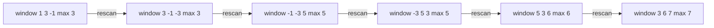
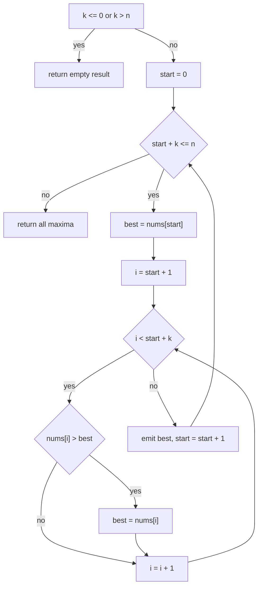
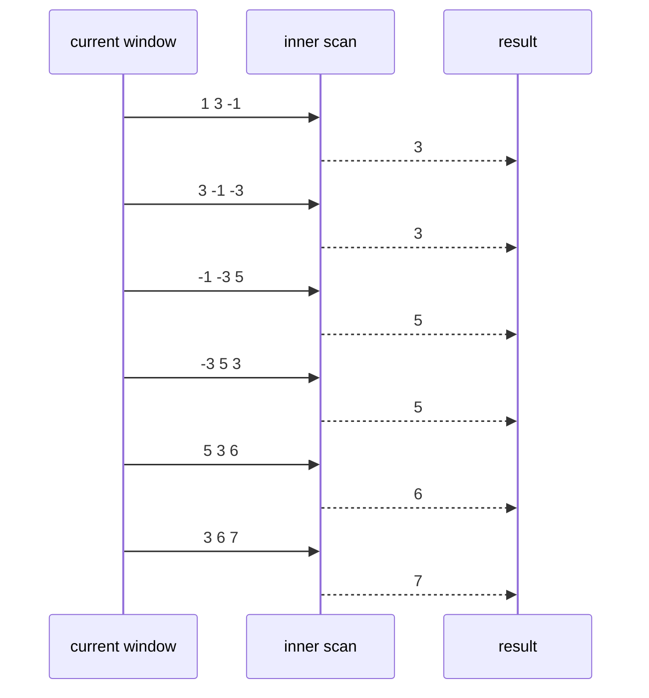

# 091 — Max over sliding window naive.

> **Tier:** Beginner · **CTCI chapter:** Ch 1 — Arrays and Strings
> **Task spec:** [091-max-over-sliding-window-naive.md](../../../tasks/beginner/091-max-over-sliding-window-naive.md)
> **Solutions:** [Python](../../../solutions/python/beginner/091-max-over-sliding-window-naive/solution.py) ·
> [Java](../../../solutions/java/beginner/091-max-over-sliding-window-naive/Solution.java) ·
> [JavaScript](../../../solutions/javascript/beginner/091-max-over-sliding-window-naive/solution.js) ·
> [C#](../../../solutions/csharp/beginner/091-max-over-sliding-window-naive/Solution.cs)

## 1. Problem restatement

**Input:** an integer array `nums` of length `n` and a window size `k`.

**Output:** the **maximum** of every contiguous window of size `k`, in left-to-right order. This is
the mirror image of [090 — Implement sliding window sum of size k](../../../tasks/beginner/090-implement-sliding-window-sum-of-size-k.md):
same window enumeration, different aggregate.

The degenerate contracts are pinned down by the assertions:

| `k` | Result | Why |
| --- | --- | --- |
| `1 <= k <= n` | `n - k + 1` maxima | the normal case |
| `k == 0` | `[]` | no windows exist |
| `k > n` | `[]` | a window does not fit |
| `k < 0` | `[]` | also rejected — note this *differs* from task 090, which raises |

The asserted rows in all four solution files:

| Call | Result | Why |
| --- | --- | --- |
| `max_sliding_window_naive([1, 3, -1, -3, 5, 3, 6, 7], 3)` | `[3, 3, 5, 5, 6, 7]` | six windows of three elements |
| `max_sliding_window_naive([1, 3, -1, -3, 5, 3, 6, 7], 1)` | the input array | each window is one element |
| `max_sliding_window_naive([1, 3, -1, -3, 5, 3, 6, 7], 8)` | `[7]` | one window, the whole array |
| `max_sliding_window_naive([9, 9, 9], 2)` | `[9, 9]` | ties are reported as the tied value |
| `max_sliding_window_naive([-5, -2, -9], 2)` | `[-2, -2]` | all-negative input; the maximum is the least negative |
| `max_sliding_window_naive([5], 1)` | `[5]` | the smallest non-empty case |
| `max_sliding_window_naive([1, 2, 3], 0)` | `[]` | `k == 0` |
| `max_sliding_window_naive([1, 2, 3], 4)` | `[]` | `k > n` |
| `max_sliding_window_naive([], 1)` | `[]` | empty input |

The all-negative row is the one that catches a common bug: an implementation that seeds `best = 0`
(or `-Infinity` in a language without a natural minimum) returns `0` for `[-5, -2, -9]` instead of
`-2`. The shipped code seeds with `nums[start]`, the first element of the window, so the seed is
always a genuine member of the window.

## 2. Intuition

Two obvious approaches exist, and this task deliberately implements the first:

1. **Rescan each window.** For every start index, loop over its `k` elements and keep the largest.
   Simple, obviously correct, and `O(n · k)`.
2. **Maintain a monotone deque.** Keep candidate maxima in decreasing order so the front is always the
   window maximum, discarding elements that leave the window or that can never be the maximum again.
   That is `O(n)` and is
   [092 — Max over sliding window using deque](../../../tasks/beginner/092-max-over-sliding-window-using-deque.md).

Why is the rescan the version worth writing first? Because max has **no inverse**. In task 090 the
window sum could be updated with one subtraction and one addition:

```text
window ← window - nums[i - k] + nums[i]
```

For a maximum there is nothing to subtract: when the largest element leaves the window, the new
maximum is the largest of the *remaining* elements, and that information was not stored anywhere. A
running “current maximum” variable is therefore wrong — it can only fail by reporting an element
that has already slid out of the window. (A running maximum *is* valid for the non-windowed
“maximum of every prefix” problem, where elements never leave.)

That single observation is the point of the exercise: recognizing which aggregates compose with a
sliding window (sums, counts, products-with-care) and which do not (max, min, mode) is the
difference between an `O(n)` and an `O(n · k)` solution.



Each arrow is a fresh scan of `k` elements, because no information carries from one window to the
next except by re-reading the overlap.

## 3. Algorithm

1. Let `n ← length(nums)`. If `k <= 0` or `k > n`, return the empty result.
2. For `start` from `0` while `start + k <= n`:
   1. `best ← nums[start]` — a real element of the window, so negatives are handled correctly.
   2. For `i` from `start + 1` to `start + k - 1`: if `nums[i] > best`, set `best ← nums[i]`.
   3. Append `best` to the result.
3. Return the result.

```text
function max_sliding_window_naive(nums, k)
    n ← length(nums)
    if k <= 0 or k > n then
        return empty result
    end
    result ← empty list
    start ← 0
    while start + k <= n do
        best ← nums[start]
        for i ← start + 1 to start + k - 1 do
            if nums[i] > best then
                best ← nums[i]
            end
        end
        append best to result
        start ← start + 1
    end
    return result
end
```

Two index decisions are worth naming:

- **The loop condition is `start + k <= n`**, which is the same as `start <= n - k`. The Java and C#
  versions preallocate `n - k + 1` slots and index the output with `start`, so the condition also
  guarantees the write index is in range.
- **`best` starts as `nums[start]`**, not as `0`, `-1` or the smallest representable integer. Seeding
  with a constant is what breaks the all-negative assertion; seeding with the window's own first
  element makes the comparison purely relational.



## 4. Worked example

Trace `max_sliding_window_naive([1, 3, -1, -3, 5, 3, 6, 7], 3)`. There are `8 - 3 + 1 = 6` windows and
each costs two comparisons:

| Window | Indices | Elements | `best` progression | Maximum |
| --- | --- | --- | --- | --- |
| 1 | 0–2 | `1, 3, -1` | `1 → 3 → 3` | `3` |
| 2 | 1–3 | `3, -1, -3` | `3 → 3 → 3` | `3` |
| 3 | 2–4 | `-1, -3, 5` | `-1 → -1 → 5` | `5` |
| 4 | 3–5 | `-3, 5, 3` | `-3 → 5 → 5` | `5` |
| 5 | 4–6 | `5, 3, 6` | `5 → 5 → 6` | `6` |
| 6 | 5–7 | `3, 6, 7` | `3 → 6 → 7` | `7` |

Twelve comparisons produce `[3, 3, 5, 5, 6, 7]`. Notice window 2: the maximum is `3`, which is
literally `nums[1]` — the first element of that window. Window 6 is the mirror case: `7` arrives at
the very end of the scan.

The tie row shows the comparison must be `>` (strict) and not `>=`-with-replacement of the index: the
function only returns *values*, so `[9, 9, 9]` with `k = 2` yields `[9, 9]` either way. That changes
in the deque version, where the tie rule decides which index is kept and hence when it expires.

The degenerate rows are cheap:

| Call | Behaviour |
| --- | --- |
| `k = 1` | each window is a single element; the inner loop never runs, so the result is `nums` |
| `k = n` | one window; the inner loop scans all `n - 1` remaining elements once |
| `k = 0`, `k > n`, `k < 0` | returned before any index arithmetic, so no invalid access occurs |



## 5. Complexity

Let `n` be the length of `nums` and `k` the window size (`1 <= k <= n` for non-degenerate calls).

| Measure | Bound | Why it holds |
| --- | --- | --- |
| Time, best | O(n) | when `k == 1` the inner loop never runs: one pass with one comparison per element |
| Time, average | O(n · k) | `n - k + 1` windows × `k - 1` comparisons each |
| Time, worst | O(n²) | maximised near `k ≈ n / 2`, giving about `n²/4` comparisons |
| Comparisons | exactly `(n - k + 1)(k - 1)` | the inner loop range is fixed by the indices alone |
| Space, output | O(n - k + 1) | one maximum per window |
| Space, extra | O(1) | `best`, `start` and `i` |
| Deque alternative (task 092) | O(n) time, O(k) space | each index is pushed and popped at most once |

The comparison count is exact and data-independent, which is a nice property to state in an
interview: `(n - k + 1)(k - 1)`. For `n = 1000`, `k = 500` that is about 250 000 comparisons; the
deque version would perform a few thousand. The pattern of `k` is worth remembering — the naive
version is linear for tiny windows, quadratic for medium ones, and linear again for `k = n`
(one window, `n - 1` comparisons).

## 6. Pitfalls and edge cases

- **A running maximum is wrong.** Unlike sums, maxima cannot be updated by removing the departing
  element. Any implementation that keeps one `best` across windows and never rescans will eventually
  report a maximum that has slid out of the window. This is the core lesson of the task.
- **Seeding `best`.** Use `nums[start]`. Seeding with `0` breaks `[-5, -2, -9] → [-2, -2]`; seeding
  with the smallest integer breaks on an empty window, which cannot happen here but would silently
  produce a bogus value in a refactor.
- **`k <= 0` returns `[]` here, but task 090 raises for `k < 0`.** The two sibling tasks disagree by
  design: this function treats any non-positive size as “no windows”. If you are asked to unify them,
  say which convention you are choosing and why.
- **`k > n` returns `[]`.** Not an error, not a single element: there is no window to maximise.
- **Empty input.** `([] with k = 1)` returns `[]` before any indexing, so no out-of-range access
  happens. All four files assert it.
- **All-negative windows.** Handled by the relational seeding; there is no assumption that maxima are
  positive and no sentinel value participates in the comparisons.
- **Ties.** `[9, 9, 9]` with `k = 2` gives `[9, 9]`; the strict `>` keeps the first of the equal
  maxima, but since only values are returned, the choice is invisible here. It becomes visible in the
  deque version, where the index matters for expiry.
- **Output length.** `n - k + 1`, asserted indirectly by the preallocated arrays in Java and C# and
  by the `k = n → [7]` row.
- **No early exit.** The maximum could be anywhere in the window, so each window needs all `k - 1`
  comparisons — the same “counting problem, no shortcut” property as the inversion counter in
  [086](../../../tasks/beginner/086-count-inversion-pairs-using-naive-o-n-2.md).
- **Input untouched.** The sweep only reads; nothing is sorted or reordered. Task 092 also leaves the
  array alone, keeping only indices in its deque.

## 7. Variants and follow-ups

- **The deque solution.** [092-max-over-sliding-window-using-deque.md](../../../tasks/beginner/092-max-over-sliding-window-using-deque.md)
  reaches `O(n)` by keeping indices whose values are decreasing, dropping from the back anything
  smaller than the newcomer and from the front anything that has left the window.
- **Minimum instead of maximum.** Flip the comparison; the reasoning and the complexity are identical,
  and the deque version becomes a non-decreasing deque.
- **Sum instead of maximum.** [090-implement-sliding-window-sum-of-size-k.md](../../../tasks/beginner/090-implement-sliding-window-sum-of-size-k.md)
  updates in `O(1)` per step because addition is invertible — the contrast is the whole point.
- **Range maximum of arbitrary (not fixed) ranges.** Neither approach generalises directly; that is
  what a sparse table or a segment tree is for, and it is why the max problem is the standard
  introduction to monotonic deques.
- **Sliding-window median.** Needs two heaps or an order-statistics structure; another aggregate with
  no inverse.
- **Two-pointer sweeps in general.** The window enumeration here is the same loop shape used by
  [085-three-sum-return-any-triplet.md](../../../tasks/beginner/085-three-sum-return-any-triplet.md)
  (two indices moving in a controlled direction) and by every “longest subarray satisfying a
  constraint” problem.

## 8. Check yourself

1. Why can the sum window be updated in `O(1)` while the maximum window cannot?

<details><summary>Show answer</summary>

Addition is invertible: subtracting the departing element recovers the sum of the remaining ones, so
the running value stays exact. There is no inverse operation for maximum — knowing that the largest
element left tells you nothing about the next largest, so the remaining `k - 1` elements have to be
examined again unless they were stored (which is what the deque version does).

</details>

2. How many comparisons does the function perform on `n` elements with window size `k`?

<details><summary>Show answer</summary>

Exactly `(n - k + 1)(k - 1)`: each of the `n - k + 1` windows scans its `k - 1` non-seed elements
once. For `k = 1` that is zero comparisons, and it peaks near `k ≈ n / 2` at about `n² / 4`.

</details>

3. What does `max_sliding_window_naive([-5, -2, -9], 2)` return, and what bug does it expose?

<details><summary>Show answer</summary>

`[-2, -2]`. It exposes any implementation that seeds `best` with a constant such as `0`: that version
would return `[0, 0]`, because no element exceeds the seed. Seeding with `nums[start]` guarantees the
seed is a real member of the window.

</details>

4. Both this task and task 090 take a window size `k`. How do they treat `k < 0`, and why does it
   matter?

<details><summary>Show answer</summary>

Task 090 raises an invalid-argument error for `k < 0`; this task returns `[]`, collapsing `k < 0`,
`k == 0` and `k > n` into the same “no windows” answer. The difference matters when code from one is
reused in the other: the caller-facing contract, not just the arithmetic, has to be carried along.

</details>

5. Why is there no useful early exit inside the inner scan?

<details><summary>Show answer</summary>

Because the maximum has no upper bound that the remaining elements must respect — any of them could
still be larger. Without extra information (such as the monotone ordering the deque maintains), every
element of the window must be compared.

</details>
