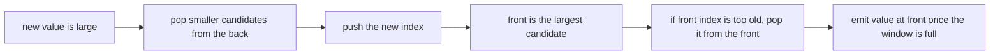
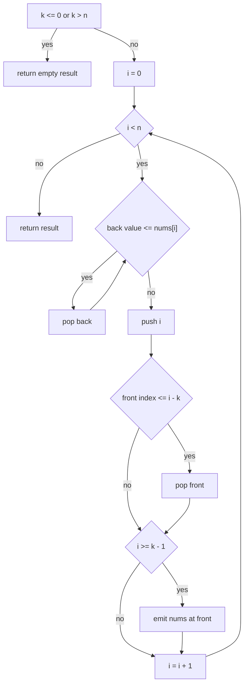
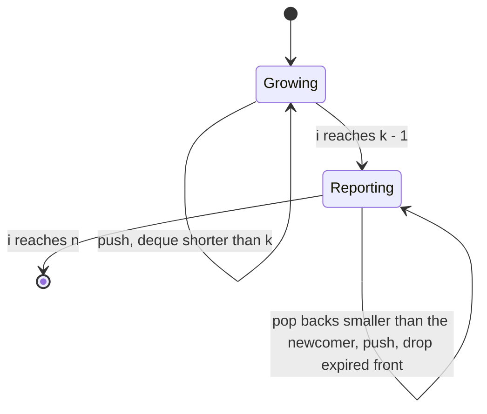

# 092 — Max over sliding window using deque.

> **Tier:** Beginner · **CTCI chapter:** Ch 3 — Stacks and Queues
> **Task spec:** [092-max-over-sliding-window-using-deque.md](../../../tasks/beginner/092-max-over-sliding-window-using-deque.md)
> **Solutions:** [Python](../../../solutions/python/beginner/092-max-over-sliding-window-using-deque/solution.py) ·
> [Java](../../../solutions/java/beginner/092-max-over-sliding-window-using-deque/Solution.java) ·
> [JavaScript](../../../solutions/javascript/beginner/092-max-over-sliding-window-using-deque/solution.js) ·
> [C#](../../../solutions/csharp/beginner/092-max-over-sliding-window-using-deque/Solution.cs)

## 1. Problem restatement

**Input:** an integer array `nums` of length `n` and a window size `k`.

**Output:** the maximum of every contiguous window of size `k`, left to right — exactly the same
output as the naive version, [091 — Max over sliding window naive](../../../tasks/beginner/091-max-over-sliding-window-naive.md),
but computed in `O(n)` instead of `O(n · k)`.

| Call | Result | Why |
| --- | --- | --- |
| `max_sliding_window_deque([1, 3, -1, -3, 5, 3, 6, 7], 3)` | `[3, 3, 5, 5, 6, 7]` | the reference case |
| `max_sliding_window_deque([1, 3, -1, -3, 5, 3, 6, 7], 1)` | the input array | windows of size one |
| `max_sliding_window_deque([1, 3, -1, -3, 5, 3, 6, 7], 8)` | `[7]` | one window |
| `max_sliding_window_deque([9, 9, 9], 2)` | `[9, 9]` | ties |
| `max_sliding_window_deque([-5, -2, -9], 2)` | `[-2, -2]` | all-negative input |
| `max_sliding_window_deque([5], 1)` | `[5]` | smallest non-empty case |
| `max_sliding_window_deque([1, 2, 3], 0)` and `…, 4)` and `([], 1)` | `[]` | `k <= 0` or `k > n` |

Every solution file ships *both* functions and asserts that the deque version agrees with the naive
one on a battery of inputs — the reference array for all `k` from `0` to `n + 1`:

```text
arr = [9, -4, 7, 7, 2, -1, 8, 0, 5, 3],  k = 0, 1, 2, ..., 11
```

and five hand-picked samples:

| Sample | `k` | Why it is included |
| --- | --- | --- |
| `[4, 2, 12, 3, 8, 7, 5, 9, 1, 6]` | `4` | a large element in the middle that must expire |
| `[-1, -1, -2, -3]` | `2` | equal values at the front, then strictly decreasing |
| `[1, 1, 1, 1]` | `3` | all values equal — the tie rule is exercised on every step |
| `[10, -10, 5, -5, 0]` | `5` | one window spanning positive and negative values |
| `[7, 2]` | `2` | the minimal two-element window |

That cross-check is the specification: agreement with the naive algorithm on every window size,
including the degenerate ones.

## 2. Intuition

The naive version rescans each window because it has forgotten the relative order of the elements
that do not win. The deque version remembers exactly the part of that order that matters.

Two observations make an `O(n)` sweep possible:

1. **A smaller element behind a larger one can never be a maximum.** If `nums[i] <= nums[j]` with
   `i < j`, then `nums[i]` is not the maximum of *any* window that contains `j`: it either coexists
   with `nums[j]` (and loses) or it has already left the window before `j` arrives. So when a new
   element arrives, every candidate at the back of the deque that is not larger than it is
   **discarded permanently**.
2. **Only the front can expire, and only in index order.** Candidates are stored as *indices*, which
   arrive in increasing order; the leftmost candidate is therefore the oldest, and it leaves the
   window when its index falls more than `k - 1` behind the current position.

Keeping indices whose values are strictly decreasing yields the invariant:

> after processing index `i`, the deque holds candidate indices in increasing order with strictly
> decreasing values, and its front is the index of the maximum of the current window.

The front is the answer, so each output is a single array read — no scan at all.



## 3. Algorithm

1. Let `n ← length(nums)`. If `k <= 0` or `k > n`, return the empty result.
2. Create an empty double-ended queue `dq` of indices.
3. For `i` from `0` to `n - 1`:
   1. While `dq` is non-empty and `nums[back(dq)] <= nums[i]`, remove the back element. (Those
      candidates can never be a future maximum.)
   2. Push `i` onto the back.
   3. If `front(dq) <= i - k`, remove the front element. (It has left the window.)
   4. If `i >= k - 1`, append `nums[front(dq)]` to the result.
4. Return the result.

```text
function max_sliding_window_deque(nums, k)
    n ← length(nums)
    if k <= 0 or k > n then
        return empty result
    end
    dq ← empty deque of indices
    result ← empty list
    for i ← 0 to n - 1 do
        while dq is not empty and nums[back of dq] <= nums[i] do
            remove the back of dq
        end
        push i onto the back of dq
        if front of dq <= i - k then
            remove the front of dq
        end
        if i >= k - 1 then
            append nums[front of dq] to result
        end
    end
    return result
end
```

Four details carry the correctness:

- **The comparison is `<=`.** Popping *equal* values keeps the newest index among ties. Using `<`
  would keep the older index, which expires sooner — the values would still be right, but the deque
  would hold a dead index whose value equals the live maximum, and the expiry test could then drop
  the front only to expose that dead duplicate. `<=` is the safe, standard form.
- **The expiry test runs after the push.** The front can only become stale as `i` advances, so one
  check per iteration suffices, and `if` (not `while`) is enough because at most one index can cross
  the `i - k` boundary per step.
- **`i >= k - 1` gates the output.** The first full window ends at index `k - 1`; before that the
  deque has no complete window to report. This is what makes the output length `n - k + 1`.
- **The index arithmetic uses `i - k`, not `i - k + 1`.** At position `i` the window spans
  `[i - k + 1, i]`, so an index equal to `i - k` or smaller is outside it.



## 4. Worked example

Trace `max_sliding_window_deque([1, 3, -1, -3, 5, 3, 6, 7], 3)`. The deque is written front-to-back as
pairs of index and value:

| Step | `i` | `nums[i]` | Pops from back | Deque after push | Front expired? | Window full? | Emitted |
| --- | --- | --- | --- | --- | --- | --- | --- |
| 1 | 0 | 1 | none | `[0→1]` | no | no | — |
| 2 | 1 | 3 | pop `0→1` (`1 <= 3`) | `[1→3]` | no | no | — |
| 3 | 2 | -1 | none | `[1→3, 2→-1]` | no | yes | `3` |
| 4 | 3 | -3 | none | `[1→3, 2→-1, 3→-3]` | no (`1 > 0`) | yes | `3` |
| 5 | 4 | 5 | pop `3→-3`, `2→-1`, `1→3` | `[4→5]` | no | yes | `5` |
| 6 | 5 | 3 | none | `[4→5, 5→3]` | no (`4 > 2`) | yes | `5` |
| 7 | 6 | 6 | pop `5→3`, `4→5` | `[6→6]` | no | yes | `6` |
| 8 | 7 | 7 | pop `6→6` | `[7→7]` | no | yes | `7` |

The output is `[3, 3, 5, 5, 6, 7]`, matching the naive algorithm on the same input with a third of the
comparisons. Two rows are worth studying:

- **Step 4** is a pure append: `-3` is smaller than both existing candidates, so the deque grows to
  its maximum useful size of `k` entries. The front (index `1`) is not expired here because the
  window at `i = 3` is `[1, 3]`, so index `1` is its left edge: the test `front <= i - k` reads
  `1 <= 0`, which is false — exactly the boundary the inequality was chosen for.
- **Step 5** shows the bulk discard: five arrives and every candidate is `<= 5`, so all three go.
  That is the amortisation in action — the elements popped there are never examined again.

The next step would be the first expiry: at `i = 5` the front is index `4` and `4 <= 2` is false; at
`i = 7` the front is `7`. Boundary expiries do occur for other `k` values, e.g. `k = 2` on the same
array:

| Step | `i` | Deque after push | Expiry | Emitted |
| --- | --- | --- | --- | --- |
| 1 | 0 | `[0→1]` | — | — |
| 2 | 1 | `[1→3]` | — | `3` |
| 3 | 2 | `[1→3, 2→-1]` | front `1 <= 0`? no | `3` |

With `k = 2` the front index `i - 2` would be dropped, which is the case the cross-check battery
exercises through `k = 0 … len + 1`.



## 5. Complexity

Let `n` be the length of `nums` and `k` the window size (`1 <= k <= n` for non-degenerate calls).

| Measure | Bound | Why it holds |
| --- | --- | --- |
| Time, best | O(n) | each index enters the deque once and leaves at most once |
| Time, average | O(n) | every iteration performs one push plus amortised pops |
| Time, worst | O(n) | total pops over the whole run are bounded by total pushes, which is `n` |
| Total deque operations | at most `2n` | `n` pushes, at most `n` back-pops, at most `n - k + 1` front-pops |
| Space, live candidates | O(k) | the deque never holds more than `k` indices, one per window position |
| Space, extra (implementations) | O(k) to O(n) | see the note below |
| Space, output | O(n - k + 1) | one maximum per window |
| Naive version (task 091) | O(n · k) time, O(1) space | `(n - k + 1)(k - 1)` comparisons |

The amortisation argument is the important one: the inner `while` loop can pop many elements in a
single iteration, but each index is pushed exactly once and popped at most once, so the *total* work
across all iterations is linear even though a single iteration can be long.

The four implementations differ in how the deque is materialised, and this is a genuine engineering
detail rather than a formality:

- **Python** uses `collections.deque`, whose `append`/`pop`/`popleft` are all `O(1)`. Live size
  `O(k)`.
- **Java** uses `ArrayDeque<Integer>` with `addLast`/`pollLast`/`peekLast`/`peekFirst`/`pollFirst`,
  also `O(1)` per operation and `O(k)` live.
- **C#** avoids a container and uses an `int[]` of length `n` as a ring buffer with `head`/`tail`
  indices, which is the classic zero-allocation form but allocates `O(n)` slots.
- **JavaScript** keeps an array plus a `head` index instead of calling `shift()` — `shift()` is
  `O(n)` per call, which would quietly push the total to `O(n²)`. Dead entries before `head` stay in
  the array, so the backing array can hold up to `n` entries even though only `O(k)` are live.

## 6. Pitfalls and edge cases

- **`shift()` in JavaScript would destroy the complexity.** Array `shift` reindexes every remaining
  element, so `n` calls cost `O(n²)`. The solution advances a `head` pointer instead. This is the
  most common way an otherwise correct deque implementation loses its linear bound.
- **The pop comparison must be `<=`, not `<`.** With `<`, equal values leave an older index in place;
  the values still come out right on simple inputs, but the deque can front an index that expires
  while an equal, newer index sits behind it — and the cross-check battery (`[1, 1, 1, 1]` with
  `k = 3`, for instance) is designed to catch exactly that family of bug.
- **Expiry check after the push, and only once.** Because indices increase strictly, at most one
  entry can become stale per iteration, so `if` is sufficient. Checked *before* the push, the front
  could survive one iteration too long and report a value from outside the window.
- **`i - k`, not `i - k + 1`.** The window at output index `i` is `[i - k + 1, i]`; an index equal to
  `i - k` is out of it. An off-by-one here reports the previous window's maximum for one step.
- **Output gating.** The result must only be appended when `i >= k - 1`, giving exactly `n - k + 1`
  values. Without the gate, the first `k - 1` maxima would be reported for partial windows and the
  output would be `n` long.
- **Degenerate sizes.** `k <= 0` and `k > n` return `[]` before any deque work — the same convention
  as task 091, and deliberately different from task 090, which raises for `k < 0`.
- **Empty input.** `([], 1)` returns `[]`; the loop body never runs, so no front access occurs. All
  four files assert it.
- **All-negative input.** The deque stores indices and compares values; there is no seed value and no
  sentinel, so `[-5, -2, -9]` with `k = 2` gives `[-2, -2]` for the same reason the naive version
  does — the maximum is a genuine element.
- **Input is not modified.** Indices are stored, never elements, so the caller's array is untouched.
- **Both functions in one file.** Each solution keeps the naive implementation for the cross-check;
  that duplication is intentional (it makes the file self-verifying) and should be kept if you adapt
  the code.

## 7. Variants and follow-ups

- **The baseline.** [091-max-over-sliding-window-naive.md](../../../tasks/beginner/091-max-over-sliding-window-naive.md)
  is the `O(n · k)` rescan, and every task 092 file imports it for the agreement tests.
- **Minimum instead of maximum.** Flip the comparison to `>=`; the deque becomes non-decreasing and
  the front holds the window minimum.
- **Sum instead of maximum.** [090-implement-sliding-window-sum-of-size-k.md](../../../tasks/beginner/090-implement-sliding-window-sum-of-size-k.md)
  needs no deque, because addition is invertible — the contrast explains why deques are the tool for
  order statistics and not for additive aggregates.
- **Shortest/longest subarray with a bounded maximum.** The same monotone-deque invariant powers
  “longest subarray whose maximum minus minimum is at most `d`” by keeping one deque per extreme.
- **Sliding-window median.** The monotone deque cannot answer this; the standard tools are two heaps
  or an order-statistics tree, both `O(n log k)`.
- **Stacks and queues beyond this task.** A monotone deque is the pattern behind “largest rectangle in
  a histogram” and “stock span”; both live in the same CTCI chapter as this exercise.
- **Warm-up neighbours.** [089-implement-simple-frequency-histogram-integers.md](../../../tasks/beginner/089-implement-simple-frequency-histogram-integers.md)
  aggregates globally with a map, and [082-range-sum-query-naive-using-prefix-sums.md](../../../tasks/beginner/082-range-sum-query-naive-using-prefix-sums.md)
  aggregates ranges with prefix sums — useful comparisons when deciding which structure an
  aggregate needs.

## 8. Check yourself

1. Why can an element that is smaller than a later element be discarded permanently?

<details><summary>Show answer</summary>

Because with `i < j` and `nums[i] <= nums[j]`, any window containing `i` either also contains `j`
(and `j` is at least as large, so `i` is not the maximum) or lies entirely before `j` (in which case
`i` has already had its chance to be reported). Such an element can never be the answer for a future
window, so removing it keeps the deque minimal without losing information.

</details>

2. What exactly is the loop invariant, and why is the front the answer?

<details><summary>Show answer</summary>

After processing index `i`, the deque holds indices in increasing order with strictly decreasing
values, all of them inside the window `[i - k + 1, i]` (once that window exists), and its front is the
index of the maximum element of that window. It is the maximum because the deque's ordering keeps the
largest candidate first, and all discarded elements were provably not maxima.

</details>

3. Why is the total time `O(n)` when the inner loop can pop many elements at once?

<details><summary>Show answer</summary>

Amortisation: each index is pushed exactly once, so at most `n` pushes ever happen, and therefore at
most `n` back-pops and `n - k + 1` front-pops over the entire run — at most `2n` deque operations in
total. A single step may be long, but the sum over all steps is linear.

</details>

4. What breaks if the expiry test uses `while` before the push instead of `if` after it?

<details><summary>Show answer</summary>

Checking before the push compares the front against the previous position, so the front may survive
one iteration too long and report a value from outside the window. Using `if` after the push is
correct because indices increase strictly, so at most one entry can cross the `i - k` boundary per
step. A `while` after the push is harmless (it never loops twice) but redundant.

</details>

5. Why is `nums[back] <= nums[i]` used rather than `nums[back] < nums[i]`?

<details><summary>Show answer</summary>

Because ties must resolve in favour of the newer index. Popping equal values keeps the deque entries
strictly decreasing and ensures the front is the most recent index among equal maxima, which expires
last. With `<`, an older equal index would remain in front and could be dropped by the expiry test
while an equal, newer index still sits behind it — a state the `[1, 1, 1, 1]` cross-check sample is
aimed at.

</details>
