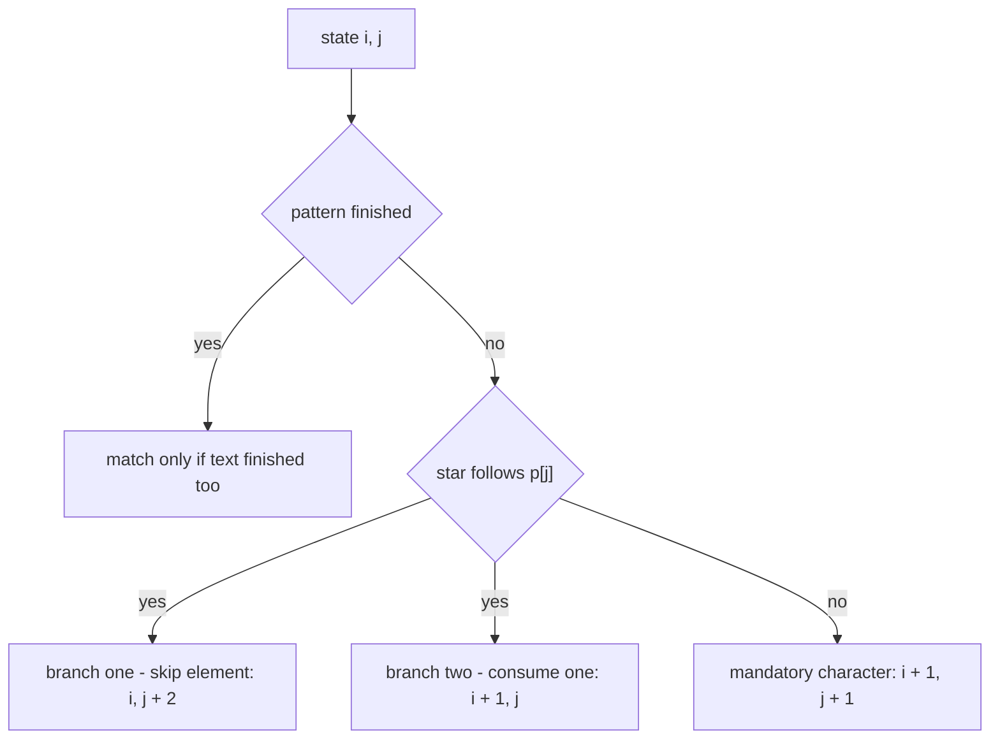
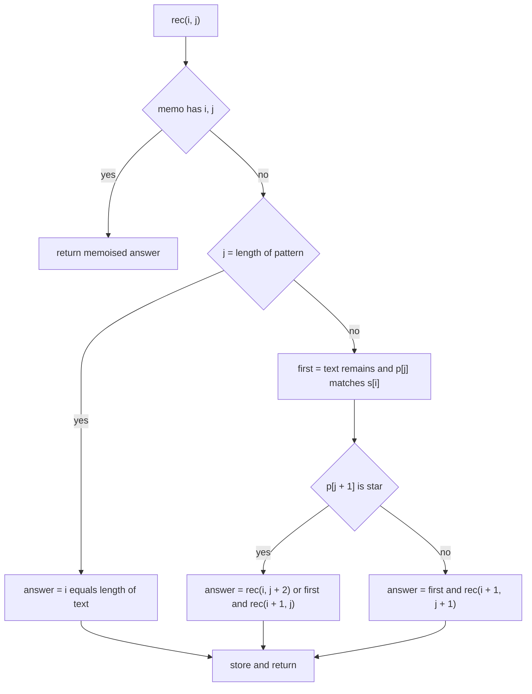
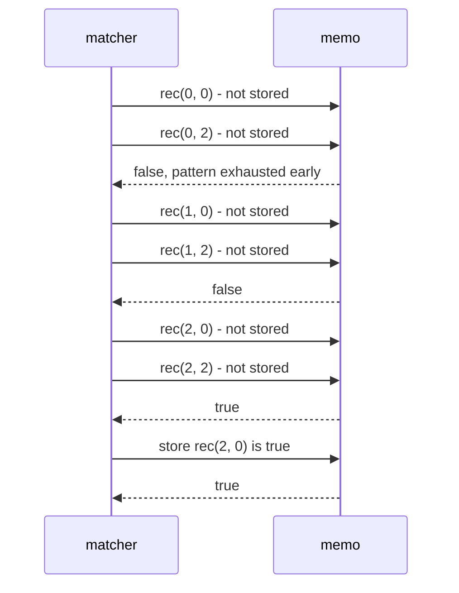

# 093 — Implement basic regex-like matching for '.' and '*' (simple).

> **Tier:** Beginner · **CTCI chapter:** Ch 8 — Recursion and Dynamic Programming
> **Task spec:** [093-implement-basic-regex-like-matching-for-and-simple.md](../../../tasks/beginner/093-implement-basic-regex-like-matching-for-and-simple.md)
> **Solutions:** [Python](../../../solutions/python/beginner/093-implement-basic-regex-like-matching-for-and-simple/solution.py) ·
> [Java](../../../solutions/java/beginner/093-implement-basic-regex-like-matching-for-and-simple/Solution.java) ·
> [JavaScript](../../../solutions/javascript/beginner/093-implement-basic-regex-like-matching-for-and-simple/solution.js) ·
> [C#](../../../solutions/csharp/beginner/093-implement-basic-regex-like-matching-for-and-simple/Solution.cs)

## 1. Problem restatement

**Input:** a text `s` and a pattern `p` over two special symbols:

- `.` matches **any single character**.
- `*` matches **zero or more copies of the preceding element**.

**Output:** `true` when `p` matches the **entire** `s`, `false` otherwise. This is a *full* match, not
a search: the pattern must consume the whole string.

The four solution files assert these nineteen rows, which together define the dialect:

| Call | Result | Why |
| --- | --- | --- |
| `is_match("", "")` | `true` | empty pattern matches empty text |
| `is_match("", "a")` | `false` | `a` requires a character |
| `is_match("", "a*")` | `true` | `*` may match zero copies |
| `is_match("", ".*")` | `true` | same, with `.` as the element |
| `is_match("a", "")` | `false` | text left over |
| `is_match("a", "a")` | `true` | literal match |
| `is_match("a", ".")` | `true` | `.` matches any character |
| `is_match("a", "b")` | `false` | literal mismatch |
| `is_match("aa", "a")` | `false` | full match is required |
| `is_match("aa", "a*")` | `true` | `*` repeats |
| `is_match("aa", ".*")` | `true` | `.` repeats |
| `is_match("ab", ".*")` | `true` | `.*` is “anything” |
| `is_match("aab", "c*a*b")` | `true` | leading `c*` matches zero copies |
| `is_match("abc", "ab.*c")` | `true` | `.*` matches zero characters here |
| `is_match("abXYZc", "ab.*c")` | `true` | `.*` matches the middle |
| `is_match("ab", "ab.*c")` | `false` | the trailing `c` is missing |
| `is_match("aaa", "a*a")` | `true` | the `*` stops at two copies |
| `is_match("aaa", "ab*a")` | `false` | requires a `b` |
| `is_match("mississippi", "mis*is*p*.")` | `false` | the classic counterexample pattern |

The four files use the same function name (`is_match` / `isMatch`) and the same nineteen assertions,
so the dialect is unambiguous: `*` binds to the **single preceding element**, never to a group, and
there are no escapes, anchors, character classes or alternation.

## 2. Intuition

The naive idea is to walk both strings with two indices `i` (over `s`) and `j` (over `p`) and decide
greedily:

```text
while both indices are in range do
    if pattern at j is a star then ... something
    else advance both
end
```

That works for `.`, but `*` breaks the greedy walk: when the pattern is `a*`, the matcher does not
know how many `a`s the star should consume — zero, one, or many. Greedily taking as many as possible
fails on `"aaa"` with `"a*a"`, where the star must stop at two. Talking about it as “try the star
counts” gives an exponential search.

The clean formulation is **recursive with a choice point**. At `(i, j)` the matcher looks at the
*next* character of the pattern before deciding:

- If `p[j + 1]` is `*`, then the element `p[j]` is optional and repeatable, so
  `match(i, j)` is `match(i, j + 2)` **or** (`p[j]` matches `s[i]` and `match(i + 1, j)`).
  The first branch skips the element entirely; the second consumes one character and *stays* at `j`,
  which is what makes repetition possible. Recursing on the same `j` with a larger `i` is the “one or
  more” direction.
- Otherwise the element is mandatory: `p[j]` must match `s[i]`, and both indices advance.

That single distinction — “does a star follow?” — is the whole pattern language.



Every state is identified by the pair `(i, j)`, so there are only `(n + 1) × (m + 1)` distinct
questions to answer. The recursion can revisit the same pair through different branch combinations —
that is what makes memoisation effective, and it turns an exponential search into a table fill.

## 3. Algorithm

Define `rec(i, j)` = “does the pattern suffix `p[j..]` match the text suffix `s[i..]`?”.

1. If `(i, j)` is already memoised, return the stored answer.
2. If `j == length(p)` (the pattern is exhausted), the answer is `i == length(s)`.
3. Otherwise compute `first ← i < length(s) and (p[j] == s[i] or p[j] == '.')`.
4. If `j + 1 < length(p)` and `p[j + 1] == '*'`:
   answer `← rec(i, j + 2) or (first and rec(i + 1, j))`.
5. Else: answer `← first and rec(i + 1, j + 1)`.
6. Store the answer under `(i, j)` and return it.

The entry point is `rec(0, 0)`.

```text
function is_match(s, p)
    memo ← empty map from index pair to boolean
    return rec(0, 0)
end

function rec(i, j)
    if (i, j) is in memo then
        return memo[(i, j)]
    end
    if j = length(p) then
        answer ← (i = length(s))
    else
        first ← i < length(s) and (p[j] = s[i] or p[j] = ".")
        if j + 1 < length(p) and p[j + 1] = "*" then
            answer ← rec(i, j + 2) or (first and rec(i + 1, j))
        else
            answer ← first and rec(i + 1, j + 1)
        end
    end
    memo[(i, j)] ← answer
    return answer
end
```

Four properties of this recursion deserve attention:

- **`first` guards the text index.** `i < length(s)` must be checked before reading `s[i]`,
  otherwise the star branch on an exhausted text would index out of range. The empty-text rows
  (`("", "a*")`, `("", ".*")`) pass precisely because `first` is `false` and only the skip branch is
  taken.
- **The star branch never advances `j` when it consumes.** Recursing on `(i + 1, j)` lets the same
  star consume the next character too, which is how `"aa"` matches `"a*"`.
- **The skip branch is `j + 2`, not `j + 1`.** The `*` is a modifier of the preceding element, so
  skipping the element must skip both characters.
- **The base case is the pattern, not the text.** Termination is decided by `j == length(p)`; if the
  text still has characters left at that point, the match fails. `("aa", "a")` is exactly this row.



## 4. Worked example

Trace `is_match("aa", "a*")`. The entry state is `(0, 0)` and every recursive call is memoised, so
the recursion tree collapses to a handful of distinct states:

| Call | `i` | `j` | Situation | Branches tried | Answer |
| --- | --- | --- | --- | --- | --- |
| 1 | 0 | 0 | `p[1] == '*'` | `rec(0, 2)` or (`first` and `rec(1, 0)`) | from branches |
| 2 | 0 | 2 | pattern exhausted, text has 2 left | none | `false` |
| 3 | 1 | 0 | `p[1] == '*'`, `first` true (`s[0] == 'a'`) | `rec(1, 2)` or (`first` and `rec(2, 0)`) | from branches |
| 4 | 1 | 2 | pattern exhausted, text has 1 left | none | `false` |
| 5 | 2 | 0 | `p[1] == '*'`, text exhausted so `first` false | `rec(2, 2)` only | `true` |
| 6 | 2 | 2 | both exhausted | none | `true` |

Unwinding: state 5 is `true`, so state 3 is `true` (via its second branch), so state 1 is `true`.
The two `false` states are the “pattern ran out but text did not” leaves — they are the reason the
algorithm does not simply return `true` when the pattern is exhausted.

Now the subtler `is_match("aaa", "a*a")`, where a greedy star would fail:

| State | `i` | `j` | Pattern left | Situation and branch taken |
| --- | --- | --- | --- | --- |
| `(0, 0)` | 0 | 0 | `a*a` | star after `a`: all-zero-copies branch `(0, 2)` fails, so consume → `(1, 0)` |
| `(0, 2)` | 0 | 2 | `a` | mandatory `a` matches `s[0]`, so `(1, 3)` is tried |
| `(1, 3)` | 1 | 3 | `""` | pattern exhausted while text has two characters → `false` |
| `(1, 0)` | 1 | 0 | `a*a` | star again: `(1, 2)` fails, so consume a second `a` → `(2, 0)` |
| `(1, 2)` | 1 | 2 | `a` | mandatory `a` matches `s[1]`, then `(2, 3)` also fails |
| `(2, 0)` | 2 | 0 | `a*a` | star: the skip branch `(2, 2)` succeeds → `true` |
| `(2, 2)` | 2 | 2 | `a` | mandatory `a` matches `s[2]` → `(3, 3)` |
| `(3, 3)` | 3 | 3 | `""` | both exhausted → `true` |

The successful path consumes exactly two `a`s with the star and lets the final literal `a` match the
third. The greedy alternative — letting the star take all three `a`s — lands in the state `(3, 1)`,
where the mandatory `a` at pattern index `2` has no character left, which is `false`. So the
algorithm must be allowed to choose, and memoisation ensures the choice is explored once per state
rather than once per path.



## 5. Complexity

Let `n = length(s)` and `m = length(p)`.

| Measure | Bound | Why it holds |
| --- | --- | --- |
| Distinct states | `(n + 1) · (m + 1)` | each state is the pair `(i, j)` |
| Time, best | O(1) | one state answered directly, e.g. `("", "")` |
| Time, average | O(n · m) | each state is computed once and its own work is `O(1)` |
| Time, worst | O(n · m) | memoised recursion never recomputes a state |
| Space | O(n · m) | the memo table (`dict`, `Map`, or an `int[n + 1][m + 1]` grid) |
| Recursion depth | O(n + m) | each call advances `i` or `j` by at least one |
| Naive recursion without memo | exponential | `rec(i, j) or rec(i + 1, j)` branches twice at every star, and paths merge |
| Iterative DP alternative | O(n · m) time, O(n · m) or O(m) space | the same recurrence filled bottom-up |

The memo is what changes the story. Without it, the same `(i, j)` pair can be reached through many
different sequences of “skip” and “consume” decisions — the number of distinct call *paths* grows
exponentially in the number of stars, while the number of distinct *states* grows only linearly in
each dimension.

Two implementation notes on the memo:

- Java and C# allocate `new int[n + 1][m + 1]` with the convention `0 = unknown, 1 = true, 2 = false`,
  which avoids boxing and needs no key objects. The `+ 1` in each dimension is what makes the
  terminal state `(n, m)` legal.
- Python uses a dictionary keyed by the tuple `(i, j)` and JavaScript a `Map` keyed by the string
  `i + "," + j`. Both are sparse-friendly; neither relies on the state space being small.

## 6. Pitfalls and edge cases

- **Full match, not search.** `is_match("aa", "a")` is `false`; the base case is
  `i == length(s)`, so leftover text fails. Anchoring is implicit.
- **The skip branch costs two pattern characters.** `j + 2` removes both the element and its `*`.
  Using `j + 1` leaves a dangling `*` that the algorithm then treats as a literal — a bug that only
  shows up on patterns like `"a*"` against non-empty text.
- **The star’s consume branch stays at `j`.** Recursing on `(i + 1, j)` is what allows the star to
  absorb many characters; recursing on `(i + 1, j + 2)` (a tempting “consume one and move on”)
  breaks `is_match("aa", "a*")`.
- **Zero copies must be tried.** Every star branch must include the skip alternative, otherwise
  `is_match("aab", "c*a*b")` and `is_match("", "a*")` fail.
- **Guard the text index.** `first` must test `i < length(s)` before comparing characters. Without
  it, `is_match("", ".*")` reads past the end of the text.
- **A leading `*` is a literal.** The code only treats `p[j + 1] == '*'` as a quantifier, so a `*` in
  the first position has nothing to modify and is compared as an ordinary character. That is a
  dialect choice, not a bug, but it is worth stating when the task says “simple”.
- **`.`, `*` in the text are ordinary characters.** Only the pattern has special symbols; the text is
  matched literally.
- **`.` matches exactly one character.** It never matches zero and never matches two, so
  `is_match("ab", "ab.*c")` is `false` (the `c` still needs a character) while
  `is_match("abc", "ab.*c")` is `true` (`.*` matches zero characters and `c` matches `c`).
- **Memoise the answer, not the path.** The memo stores booleans per state; nothing about *how* a
  state succeeded is needed, which is what keeps the table small and the code short.
- **Recursion depth.** Each call advances `i` or `j`, so depth is at most `n + m`. For very long
  inputs a language with a small default stack could overflow; the iterative DP variant avoids that
  entirely.
- **Unicode.** Python and JavaScript index by code point when iterating strings with their idiomatic
  operators, whereas Java's `charAt` and C#’s indexer work on UTF-16 code units. All four agree for
  the ASCII inputs the tests use, but a surrogate pair counts as one character in Python/JavaScript
  and two in Java/C#.
- **Pattern `"a**"`** is not a repeated repeat: the algorithm reads `p[1] == '*'` after `a`, skips to
  `j = 2`, and then treats the second `*` as a literal. Again a documented simplification of this
  dialect.

## 7. Variants and follow-ups

- **Iterative dynamic programming.** `dp[i][j]` = “prefixes match”, filled from `(n, m)` backwards,
  with the same recurrence. Same `O(n · m)` time, no recursion, and the space can be reduced to
  `O(m)` rows.
- **`+` and `?` quantifiers.** `+` is “one or more” (consume branch without the skip-only option);
  `?` is “zero or one” — both fall out of the same branch structure.
- **Grouping and alternation.** Requiring a real parser or a Thompson NFA simulation, where the
  recursion becomes a graph reachability problem.
- **Wildcard search (not full match).** Dropping the “pattern exhausted implies text exhausted” base
  case and allowing a restart at the next text position turns the matcher into a search.
- **Subsequence rather than substring.** Counting how many subsequences of `s` equal `p` uses the
  same two-index state but sums counts instead of returning booleans — a common dynamic-programming
  follow-up.
- **String-scanning neighbours in this repository.**
  [094-find-longest-common-prefix-in-array-of-strings.md](../../../tasks/beginner/094-find-longest-common-prefix-in-array-of-strings.md)
  compares strings positionally without quantifiers, and
  [088-classic-caesar-cipher-encode-decode.md](../../../tasks/beginner/088-classic-caesar-cipher-encode-decode.md)
  shows the other extreme: a per-character transform with no backtracking at all.

## 8. Check yourself

1. Why is `is_match("", "a*")` true while `is_match("", "a")` is false?

<details><summary>Show answer</summary>

Because `*` means “zero or more”, so `a*` can match the empty string by choosing the skip branch
`rec(i, j + 2)`. A bare `a` has no quantifier: it needs one character, and `first` is `false` when the
text is exhausted, so the match fails.

</details>

2. In the star branch, why does consuming a character recurse on the same `j` instead of `j + 2`?

<details><summary>Show answer</summary>

Because the star may repeat: after consuming one copy of the element the matcher must be free to
consume another, which is only possible if the pattern index stays at the element. Advancing past the
element would limit the match to exactly one copy and break `is_match("aa", "a*")`.

</details>

3. What is the difference in behaviour between `("abc", "ab.*c")` and `("ab", "ab.*c")`?

<details><summary>Show answer</summary>

`.*` matches zero or more characters, so for `"abc"` it can match nothing and let the trailing `c`
consume the `c`. For `"ab"` the pattern still needs a `c` after the star, and there is no character
left for it, so the match fails. That pair of assertions pins down exactly what `.*` is allowed to do.

</details>

4. Why does memoisation change the complexity from exponential to polynomial?

<details><summary>Show answer</summary>

Because a state is fully described by `(i, j)`: once the answer for a pair is known, every future
path that reaches it can reuse it. There are only `(n + 1) · (m + 1)` pairs, so the recursion performs
at most that much `O(1)` work, whereas the unmemoised recursion explores exponentially many distinct
*paths* that keep collapsing onto the same states.

</details>

5. Does a leading `*` in the pattern act as a quantifier?

<details><summary>Show answer</summary>

No. The implementation only recognises a quantifier when the character *after* the current pattern
position is `*`, so a `*` in the first position has no preceding element to modify and is compared as
a literal character. This is one of the documented simplifications of the “basic / simple” dialect in
this task.

</details>
