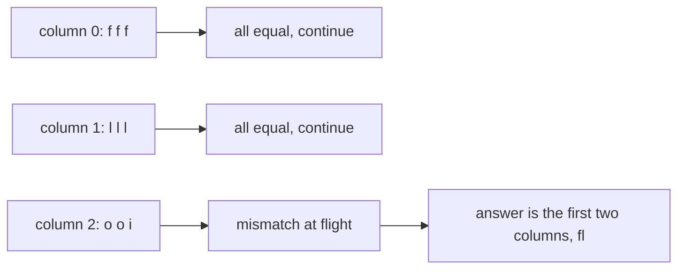
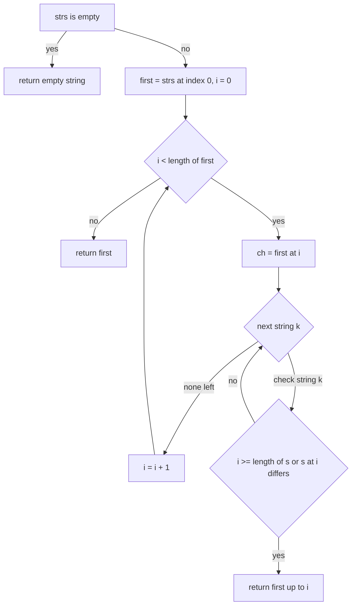
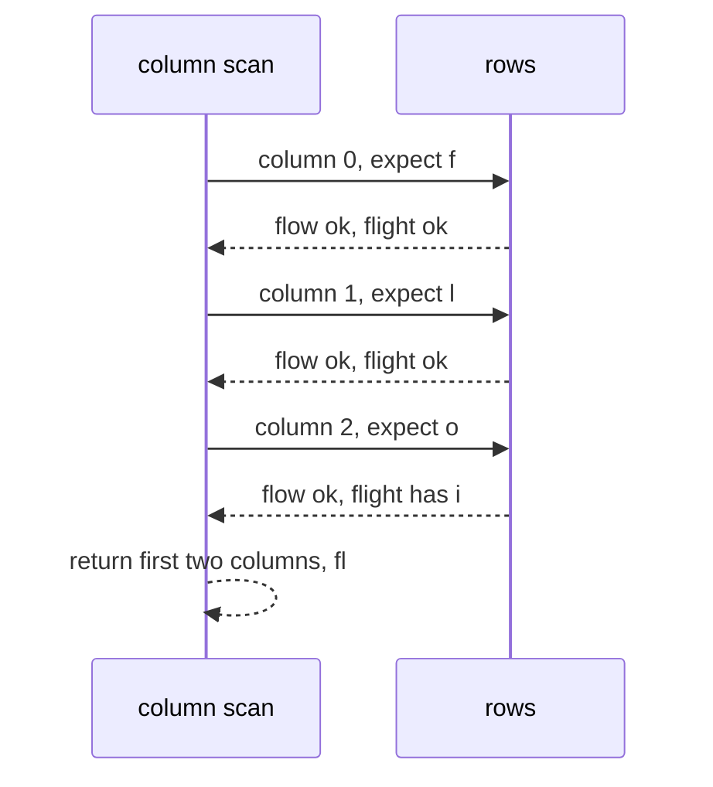

# 094 — Find longest common prefix in array of strings.

> **Tier:** Beginner · **CTCI chapter:** Ch 8 — Recursion and Dynamic Programming
> **Task spec:** [094-find-longest-common-prefix-in-array-of-strings.md](../../../tasks/beginner/094-find-longest-common-prefix-in-array-of-strings.md)
> **Solutions:** [Python](../../../solutions/python/beginner/094-find-longest-common-prefix-in-array-of-strings/solution.py) ·
> [Java](../../../solutions/java/beginner/094-find-longest-common-prefix-in-array-of-strings/Solution.java) ·
> [JavaScript](../../../solutions/javascript/beginner/094-find-longest-common-prefix-in-array-of-strings/solution.js) ·
> [C#](../../../solutions/csharp/beginner/094-find-longest-common-prefix-in-array-of-strings/Solution.cs)

## 1. Problem restatement

**Input:** an array of strings `strs`, of any length, whose elements may be empty and may repeat.

**Output:** the longest string `pre` such that every element of `strs` starts with `pre`. The answer
is itself a prefix of `strs[0]` (and of every other element), and it is `""` when no non-empty
character is shared by all elements. An empty input array returns `""`.

The four solution files assert these ten rows:

| Call | Result | Why |
| --- | --- | --- |
| `longest_common_prefix(["flower", "flow", "flight"])` | `"fl"` | mismatch at index `2` (`o` versus `i`) |
| `longest_common_prefix(["dog", "racecar", "car"])` | `""` | the first characters already differ |
| `longest_common_prefix(["apple"])` | `"apple"` | one string is its own prefix |
| `longest_common_prefix([])` | `""` | no elements, no common prefix |
| `longest_common_prefix([""])` | `""` | the empty string has no non-empty prefix |
| `longest_common_prefix(["", "a"])` | `""` | the empty element blocks everything |
| `longest_common_prefix(["a", "ab"])` | `"a"` | the answer may be the whole first string |
| `longest_common_prefix(["abc", "abc", "abc"])` | `"abc"` | identical strings |
| `longest_common_prefix(["prefix", "pref"])` | `"pref"` | the second string ends inside the first |
| `longest_common_prefix(["ab", "ac"])` | `"a"` | one shared character |

Two rows define the boundaries of the answer: `["a", "ab"] → "a"` shows the prefix may be the entire
*first* element, and `["prefix", "pref"] → "pref"` shows it may be as long as the *shortest* element.

## 2. Intuition

A common prefix can never be longer than the shortest string, and it can never contain a character
that disagrees with any other string. Both facts are captured by a **vertical scan**: fix a column
index `i`, check that every string has the same character there, and only then move to column `i + 1`.

The naive alternatives are instructive:

- **Pairwise horizontal scan.** Compare `strs[0]` with `strs[1]`, shrink the answer to the shared
  prefix, then repeat with `strs[2]`, and so on. Correct, and equally `O(S)` in total, but it requires
  repeatedly materialising and truncating an intermediate string.
- **All-pairs search.** For every candidate prefix length, test every string — which is `O(n · L²)`
  if the candidate is rebuilt each time.

The vertical scan avoids both problems by never building anything: it walks the columns of the matrix
of characters and stops at the first column that is not constant.



Reading the array row-wise gives the strings; reading it column-wise gives the answer. The loop order
is exactly that transpose: outer loop over columns, inner loop over rows.

Two boundary conditions fall out of the same picture:

- **A missing column.** If some row is shorter than `i`, that row has no character in column `i`, so
  the shared prefix must stop before `i`. This is why the inner test is
  `i >= length(s) or s[i] != ch` — the length check comes first because it protects the access.
- **An empty first row.** If `strs[0]` is empty then there are no columns to scan at all, and the
  loop body never runs — the function returns `strs[0]`, which is `""`. That is why `["", "a"]`
  yields `""` without a special case.

## 3. Algorithm

1. If `strs` is empty, return `""`.
2. Let `first ← strs[0]`.
3. For `i` from `0` to `length(first) - 1`:
   1. Let `ch ← first[i]`.
   2. For every other string `s`:
      1. If `i >= length(s)` or `s[i] != ch`, return `first[0..i-1]` — the prefix up to but not
         including column `i`.
4. If the loop completes, every column of `first` is shared, so return `first`.

```text
function longest_common_prefix(strs)
    if length(strs) = 0 then
        return ""
    end
    first ← strs[0]
    for i ← 0 to length(first) - 1 do
        ch ← first[i]
        for each s in strs from index 1 onward do
            if i >= length(s) or s[i] ≠ ch then
                return first[0 .. i - 1]
            end
        end
    end
    return first
end
```

Three details carry the contract:

- **The result is a slice of the first string**, `first[0..i-1]` — never a newly assembled prefix. The
  slice is `first[:i]` in Python, `first.substring(0, i)` in Java, `first.slice(0, i)` in JavaScript
  and `first.Substring(0, i)` in C#. All four languages define `i = 0` as the empty string, so the
  “mismatch in column 0” case needs no special handling.
- **The length test precedes the character test.** `i >= length(s)` short-circuits the access, which
  is both a safety requirement and the semantic rule for short strings.
- **The final `return first` is reachable.** It happens exactly when the first string is a prefix of
  every other string — the `["a", "ab"]` and `["abc", "abc", "abc"]` rows.



## 4. Worked example

Trace `longest_common_prefix(["flower", "flow", "flight"])`. The scan proceeds column by column:

| Column `i` | `ch = first[i]` | `"flow"` | `"flight"` | Verdict |
| --- | --- | --- | --- | --- |
| 0 | `f` | `f` matches | `f` matches | continue |
| 1 | `l` | `l` matches | `l` matches | continue |
| 2 | `o` | `o` matches | `i` differs | return `first[:2] = "fl"` |

Only five character comparisons were needed, and the third column ended the scan. Note that `"flow"`
was checked before `"flight"`, but the order is irrelevant here: the mismatch is a property of the
column, not of the check order.

A second trace showing the “short string” exit, `longest_common_prefix(["prefix", "pref"])`:

| Column `i` | `ch = first[i]` | `"pref"` at `i` | Verdict |
| --- | --- | --- | --- |
| 0 | `p` | `p` | continue |
| 1 | `r` | `r` | continue |
| 2 | `e` | `e` | continue |
| 3 | `f` | `f` | continue |
| 4 | `i` | index `4 >= 4` | return `first[:4] = "pref"` |

The loop reached a column that the second string does not have, which is exactly the
`i >= length(s)` branch — the prefix is bounded by the shortest element, not by the first one.

Finally, the degenerate rows:

| Call | Behaviour | Result |
| --- | --- | --- |
| `[]` | the empty-array guard fires before any indexing | `""` |
| `[""]` | `first = ""`, so the outer loop body never runs | `""` |
| `["", "a"]` | same, even though `"a"` has a character | `""` |
| `["dog", "racecar", "car"]` | column 0: `r` differs from `d` | `""` (slice of length 0) |



## 5. Complexity

Let `n` be the number of strings, `L` the length of the shortest string and `S` the total number of
characters across all strings.

| Measure | Bound | Why it holds |
| --- | --- | --- |
| Time, best | O(1) | `strs[0]` is empty, so the outer loop body never runs |
| Time, average | O(S) | each column costs at most `n - 1` comparisons and the scan stops early |
| Time, worst | O(n · L) | every column of the shortest string is compared against every string |
| Comparisons | at most `(n - 1) · L` | one per (column, row) pair actually examined |
| Space, extra | O(1) | a column index, a character, and the index for the returned slice |
| Space, output | O(L) | the returned prefix, which is a slice of `strs[0]` |
| Horizontal pairwise scan | O(S) time, O(L) extra | shrinks an intermediate prefix once per string |
| All-pairs candidate search | O(n · L²) | rebuilding/recomparing a candidate of length up to `L` |

The `O(S)` phrasing is the most useful bound in practice, because the scan stops as soon as a column
disagrees: with random strings the expected work is close to one column, and the worst case
`O(n · L)` is reached only when all strings share a long common prefix, in which case `S` is itself
about `n · L`.

## 6. Pitfalls and edge cases

- **Empty array returns `""`, not `null`.** All four files assert `longest_common_prefix([]) == ""`.
  Returning the first element would crash; returning `null` would break the callers' string handling.
- **An empty string anywhere forces the empty answer.** `[""]` and `["", "a"]` both give `""`. With
  the vertical scan this needs no special case — an empty `strs[0]` yields no columns, and an empty
  string later in the array triggers the `i >= length(s)` branch immediately.
- **The answer can be the whole first string.** `["a", "ab"] → "a"`. Do not assume the prefix is
  strictly shorter than every element.
- **The answer is bounded by the shortest string, not by `strs[0]`.** `["prefix", "pref"] → "pref"`,
  which is shorter than `strs[0]` and equal to the shortest element.
- **Check the length before indexing.** `i >= length(s)` must come first; reading `s[i]` on a short
  string is an out-of-range error in Java and C# and yields `undefined` in JavaScript.
- **The returned prefix is a *prefix*, never a substring or a longest repeated block.**
  `["ab", "ac"]` yields `"a"`, not `"a"`-plus-anything, and `["dog", "racecar", "car"]` yields `""`
  even though `"racecar"` and `"car"` share the substring `"car"` — a common misreading of the task.
- **Case sensitivity.** Strings are compared by exact character; `"Flower"` and `"flower"` share no
  prefix at column 0. Nothing is normalised.
- **Unicode.** Python and JavaScript index strings in a way that counts characters sensibly for the
  ASCII tests, while Java's `charAt` and C#'s indexer work on UTF-16 code units. For a non-BMP
  character the two camps disagree on what “column 3” means; the tests use ASCII only.
- **Complexity of the inner loop.** It exits at the first disagreement, so a “bad” string early in
  the array makes the scan cheaper, not more expensive — the bound is a *worst* case, not a floor.
- **No mutation.** The input array and its strings are only read; the result is a slice of one of the
  inputs (which is safe because strings are immutable in all four languages).

## 7. Variants and follow-ups

- **Horizontal (pairwise) scan.** Keep a running prefix, shrink it against each new string. Same
  `O(S)` bound, but it writes and reads an intermediate prefix, so it is usually slower in practice.
- **Divide and conquer.** Split the array, find the prefix of each half, then find the common prefix
  of the two answers. A useful exercise in the recursion chapter, with the same asymptotics.
- **Binary search on the answer length.** Test whether the first `k` characters are a common prefix in
  `O(n)`; search over `k` in `O(log L)` steps. Better than the scan when the strings are long but the
  prefix is short.
- **Longest common subsequence.** A related-sounding but fundamentally different problem (Ch 8's
  classic DP, and the same two-index state as
  [093-implement-basic-regex-like-matching-for-and-simple.md](../../../tasks/beginner/093-implement-basic-regex-like-matching-for-and-simple.md)).
- **Longest common suffix.** Scan columns from the right using the same structure.
- **Comparison-driven string tasks elsewhere in this repository.**
  [088-classic-caesar-cipher-encode-decode.md](../../../tasks/beginner/088-classic-caesar-cipher-encode-decode.md)
  transforms characters one at a time, and
  [089-implement-simple-frequency-histogram-integers.md](../../../tasks/beginner/089-implement-simple-frequency-histogram-integers.md)
  aggregates them — together with this task they cover the three basic string-scan shapes.

## 8. Check yourself

1. Why is the answer always a prefix of `strs[0]`?

<details><summary>Show answer</summary>

Because a common prefix must be a prefix of *every* element, and in particular of `strs[0]`. That is
what allows the implementation to scan `strs[0]`'s columns and return a slice of it rather than
assembling a new string.

</details>

2. What does `longest_common_prefix(["", "a"])` return, and why does the code need no special case
   for it?

<details><summary>Show answer</summary>

`""`. `strs[0]` is empty, so the outer loop over its columns runs zero times and the function falls
straight through to `return first`, which is the empty string. Had the empty string been later in the
array instead, the `i >= length(s)` test would have produced the same answer.

</details>

3. How does `["prefix", "pref"] → "pref"` happen in the scan?

<details><summary>Show answer</summary>

Columns `0..3` of `"prefix"` all match `"pref"`. At column `4` the check `i >= length(s)` fires
because `"pref"` has no index `4`, so the function returns `first[:4] = "pref"` — the answer is capped
by the shortest string.

</details>

4. How many character comparisons does the vertical scan perform in the worst case, and when is that
   reached?

<details><summary>Show answer</summary>

At most `(n - 1) · L`, where `n` is the number of strings and `L` the length of the shortest one. It
is reached when every string shares the first `L` characters — for instance when all strings are
identical, or when one string is a prefix of all the others.

</details>

5. Why does the horizontal pairwise scan, which has the same asymptotic bound, still compare
   differently in practice?

<details><summary>Show answer</summary>

Because it maintains an intermediate prefix string that is truncated after each comparison, so it
performs extra work proportional to the current prefix length for every string, and it materialises a
new string for each step. The vertical scan only reads characters and returns one final slice, so its
constants are smaller and it stops at the first bad column, which may occur before many strings have
been inspected.

</details>
