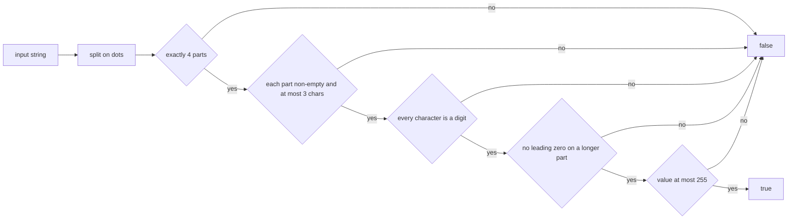
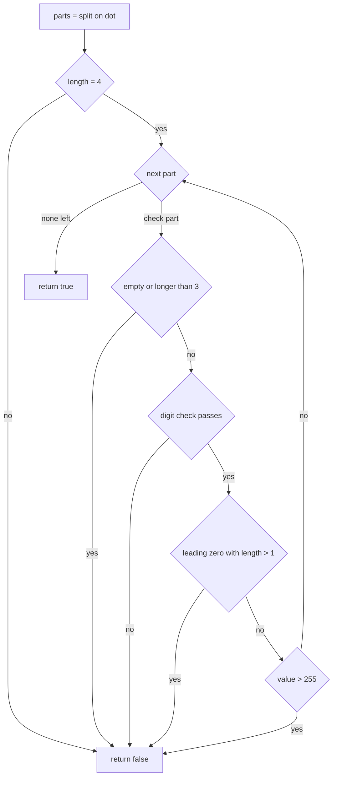
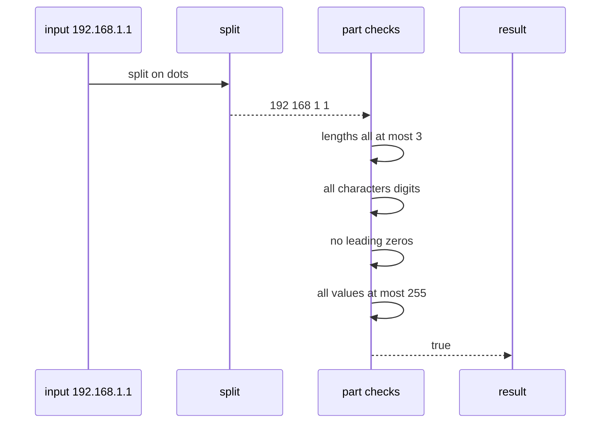

# 095 — Validate IPv4 address (basic).

> **Tier:** Beginner · **CTCI chapter:** Ch 1 — Arrays and Strings
> **Task spec:** [095-validate-ipv4-address-basic.md](../../../tasks/beginner/095-validate-ipv4-address-basic.md)
> **Solutions:** [Python](../../../solutions/python/beginner/095-validate-ipv4-address-basic/solution.py) ·
> [Java](../../../solutions/java/beginner/095-validate-ipv4-address-basic/Solution.java) ·
> [JavaScript](../../../solutions/javascript/beginner/095-validate-ipv4-address-basic/solution.js) ·
> [C#](../../../solutions/csharp/beginner/095-validate-ipv4-address-basic/Solution.cs)

## 1. Problem restatement

**Input:** a string `s`.

**Output:** `true` when `s` is a valid IPv4 address in dotted-quad form, `false` otherwise.

The rule set implemented by all four solution files is:

1. The string is split on `.` into **exactly four** parts.
2. Each part is **non-empty** and at most **three** characters long.
3. Every character of a part is an **ASCII digit** (`0`–`9`).
4. A part of length greater than 1 may **not** start with `0`.
5. The numeric value of each part is at most **255**.

Rule 4 is a documented *choice* — the file headers say “leading zeros are rejected
(`"1.2.3.04"` invalid), except the value `0` itself” — and it is exercised directly by the
assertions.

The twenty asserted rows, five valid and fifteen invalid:

| Call | Result | Rule that decides it |
| --- | --- | --- |
| `is_valid_ipv4("192.168.1.1")` | `true` | the ordinary case |
| `is_valid_ipv4("0.0.0.0")` | `true` | four zeroes, each of length 1 |
| `is_valid_ipv4("255.255.255.255")` | `true` | the maximum value in every part |
| `is_valid_ipv4("10.0.0.255")` | `true` | mixed widths |
| `is_valid_ipv4("1.2.3.0")` | `true` | a trailing single `0` is legal |
| `is_valid_ipv4("256.1.1.1")` | `false` | value > 255 (rule 5) |
| `is_valid_ipv4("1.2.3.256")` | `false` | value > 255 in the last part |
| `is_valid_ipv4("1.2.3")` | `false` | three parts (rule 1) |
| `is_valid_ipv4("1.2.3.4.5")` | `false` | five parts (rule 1) |
| `is_valid_ipv4("")` | `false` | the split yields one empty part, not four |
| `is_valid_ipv4(".1.2.3")` | `false` | an empty first part (rule 2) |
| `is_valid_ipv4("1.2.3.")` | `false` | an empty last part (rule 2) |
| `is_valid_ipv4("1..2.3")` | `false` | an empty middle part (rule 2) |
| `is_valid_ipv4("1.2.3.a")` | `false` | a letter (rule 3) |
| `is_valid_ipv4("1.2.3.4x")` | `false` | a trailing letter (rule 3) |
| `is_valid_ipv4("01.2.3.4")` | `false` | leading zero (rule 4) |
| `is_valid_ipv4("1.2.3.00")` | `false` | leading zero, value `0` (rule 4) |
| `is_valid_ipv4("1.2.3.1234")` | `false` | four digits (rule 2) |
| `is_valid_ipv4("-1.2.3.4")` | `false` | the minus sign is not a digit (rule 3) |
| `is_valid_ipv4("1.2.3.4 ")` | `false` | the trailing space is not a digit (rule 3) |

The last row also proves there is **no trimming**: the input is used verbatim.

## 2. Intuition

Validation is a sequence of filters, and each one is cheapest to apply in a specific order. The
order implemented by the solutions is:

```text
split → count parts → per part: non-empty and short → digits only → no leading zero → value <= 255
```

Why this order?

- **Split and count first.** It is a single operation, and it rejects the “wrong number of
  components” inputs immediately — three parts, five parts, and the empty string.
- **Length before digits.** A part longer than three characters can never be valid (the largest
  value is `255`), and the length test is cheaper than walking the characters. It also protects the
  “four digits” case `1234`, which must fail even though every character is a digit.
- **Digits before conversion.** Converting to an integer is the only operation that can throw or
  misbehave (`int.Parse("1a")` raises, `Number("1a")` gives `NaN`), so every character is checked
  first. After that check, `int(part)` is guaranteed to succeed on a non-empty digit string.
- **Leading zero after digits, before conversion.** The rule is textual, not numeric: `"04"` and
  `"4"` have the same value but only one is accepted. Checking it before the numeric bound keeps the
  two ideas separate.
- **Value last.** It is the most expensive test and the one with the most lenient precondition.



The picture is a chain of vetoes: every rule can only reject. That is the standard shape of a
validator — collect the conditions, fail fast, and never “fix up” the input.

## 3. Algorithm

1. Split `s` on `'.'` into `parts`, keeping empty fields.
2. If `length(parts) != 4`, return `false`.
3. For each `part`:
   1. If `part` is empty or `length(part) > 3`, return `false`.
   2. If any character of `part` is outside `'0'..'9'`, return `false`.
   3. If `length(part) > 1` and `part[0] == '0'`, return `false`.
   4. If the numeric value of `part` is greater than `255`, return `false`.
4. Return `true`.

```text
function is_valid_ipv4(s)
    parts ← split s on "."
    if length(parts) ≠ 4 then
        return false
    end
    for each part in parts do
        if length(part) = 0 or length(part) > 3 then
            return false
        end
        for each c in part do
            if c < "0" or c > "9" then
                return false
            end
        end
        if length(part) > 1 and part[0] = "0" then
            return false
        end
        if value(part) > 255 then
            return false
        end
    end
    return true
end
```

The one implementation difference that matters is **how the split treats trailing empty fields**:

- Python's `s.split(".")`, JavaScript's `s.split(".")` and C#'s `s.Split('.')` keep empty fields, so
  `"1.2.3."` yields four parts with an empty last one and is rejected by the empty-part test.
- Java's `String.split` **removes trailing empty strings by default**, so the solution passes a limit
  of `-1`: `s.split("\\.", -1)`. Without it, `"1.2.3.4."` would split into four non-empty parts and
  be accepted — a genuine bug that the `"1.2.3."` assertion is one step away from catching.



## 4. Worked example

Trace `is_valid_ipv4("192.168.1.1")`:

| Part | Text | Length | Digits only? | Leading zero? | Value | Verdict |
| --- | --- | --- | --- | --- | --- | --- |
| 1 | `192` | 3 | yes | no | 192 | ok |
| 2 | `168` | 3 | yes | no | 168 | ok |
| 3 | `1` | 1 | yes | n/a | 1 | ok |
| 4 | `1` | 1 | yes | n/a | 1 | ok |

All four parts survive, so the function returns `true`.

Now the rejections, each stopping at a different filter:

| Input | Split result | Failing filter | Detail |
| --- | --- | --- | --- |
| `"1.2.3"` | 3 parts | part count | exactly four required |
| `"1.2.3.4.5"` | 5 parts | part count | exactly four required |
| `""` | 1 part (empty) | part count | the empty string does not split into four |
| `"1..2.3"` | `1`, ``, `2`, `3` | non-empty | the empty middle part |
| `"1.2.3.1234"` | `1`, `2`, `3`, `1234` | length | four characters |
| `"1.2.3.4 "` | `1`, `2`, `3`, `4 ` | digits | the space is not `0`–`9` |
| `"01.2.3.4"` | `01`, `2`, `3`, `4` | leading zero | length 2 starting with `0` |
| `"1.2.3.00"` | `1`, `2`, `3`, `00` | leading zero | `"0"` would be fine, `"00"` is not |
| `"256.1.1.1"` | `256`, `1`, `1`, `1` | value | 256 exceeds 255 |
| `"1.2.3.0"` | `1`, `2`, `3`, `0` | none | single `0` is legal → `true` |

Two of these rows are worth extra attention. `"1.2.3.4 "` fails on the digit filter because `"4 "`
is a two-character part, so the length filter passes and the digit filter is what catches it — there
is no trimming anywhere in the pipeline. And `"1.2.3.0"` versus `"1.2.3.00"` shows that the
leading-zero rule is about the *text*, not the value.



## 5. Complexity

Let `n` be the length of the input string.

| Measure | Bound | Why it holds |
| --- | --- | --- |
| Time, best | O(1) | the part count is wrong after one split pass of a short string |
| Time, average | O(n) | the split scans `n` characters, then at most 4 parts of at most 3 characters are inspected |
| Time, worst | O(n) | the digit checks touch every character of a long single part before the length filter rejects it |
| Space, extra | O(n) | the array of parts (at most 4 useful entries, but the split itself may materialise many empty fields) |
| Space, alternative | O(1) | a hand-written scanner that walks the string once, counting dots and validating digits in place |
| Constant-factor note | at most 4 parts × 3 digits | once the count and length filters pass, the remaining work is bounded by a small constant |

The asymptotic statement is almost beside the point for a validator bounded by four small fields —
the interesting bound is the *constant*: after the count check, at most four parts of at most three
digits are examined, so the post-split work is at most twelve character comparisons. The operator that
makes the worst case linear is the split itself, which must scan the whole input even when the input
is a thousand-character string with no dots.

## 6. Pitfalls and edge cases

- **Java's `split` drops trailing empty fields.** `"1.2.3.4."` would yield four parts and be accepted
  without the `-1` limit. The solution passes `-1` for exactly this reason; Python, JavaScript and C#
  keep empty fields by default.
- **Empty string.** `"".split(".")` is a one-element array, not a zero-element one, so it fails the
  count check rather than crashing. Asserted in all four files.
- **Leading and trailing dots.** `".1.2.3"` and `"1.2.3."` both produce an empty part that the
  non-empty filter catches.
- **Doubled dots.** `"1..2.3"` produces exactly four parts, so the *count* check passes and the
  empty-part check is what rejects it — a good reminder that no single filter is sufficient.
- **More than three digits.** `"1.2.3.1234"` is all digits, so the length filter is what rejects it.
- **Leading zeros.** `"01.2.3.4"` and `"1.2.3.00"` are rejected by the textual rule, while `"0"` and
  `"1.2.3.0"` are accepted. This is a *policy* choice: some real parsers accept `"010"` as octal, and
  some accept it as decimal `10`. The header comments in the solution files state the choice
  explicitly, which is the important part of the answer.
- **Non-digit characters.** Letters (`"1.2.3.a"`, `"1.2.3.4x"`), signs (`"-1.2.3.4"`) and spaces
  (`"1.2.3.4 "`) all fail the digit filter. Checking characters before converting is what keeps
  `int.Parse`/`Number` from throwing or producing `NaN`.
- **No trimming, no normalisation.** `" 1.2.3.4"` and `"1.2.3.4 "` are invalid. Whether to accept
  surrounding whitespace is a product decision, not a parsing accident — the task asserts the strict
  reading.
- **Boundary values.** `"0.0.0.0"` and `"255.255.255.255"` are valid; `"256.1.1.1"` is not. The
  comparison must be `> 255` on the parsed value, so `255` itself passes.
- **Overflow is not reachable here.** Values are parsed only after the three-digit length filter, so
  the maximum parsed value is `999`, which fits every language's integer type. (A validator without
  that filter would need care with very long digit runs in C#/Java.)
- **Return type.** Every solution returns a boolean, never a reason string; callers that need to
  explain the failure would have to re-derive it.

## 7. Variants and follow-ups

- **Single-pass scanner.** Replace the split with one walk that counts dots, accumulates each part's
  value, and validates characters in place — `O(1)` extra space and one pass over the input.
- **IPv6 validation.** Eight groups of four hex digits with `::` compression; the “exactly four
  parts” rule becomes an eight-group rule with a compression edge case, which is far more involved.
- **CIDR suffix.** Accept `a.b.c.d/len` with `0 <= len <= 32`, splitting on `/` before validating the
  address.
- **URL parsing.** [096-simple-url-parser-extract-protocol-host.md](../../../tasks/beginner/096-simple-url-parser-extract-protocol-host.md)
  follows the same “split, then validate each field” recipe on a different grammar.
- **Character classification.** [088-classic-caesar-cipher-encode-decode.md](../../../tasks/beginner/088-classic-caesar-cipher-encode-decode.md)
  and [089-implement-simple-frequency-histogram-integers.md](../../../tasks/beginner/089-implement-simple-frequency-histogram-integers.md)
  classify characters one at a time without splitting, which makes them a good contrast for when a
  delimiter-based pipeline is appropriate.
- **Real parsers.** A full IP parser also handles IPv4-mapped IPv6 forms and, in some APIs, the
  bare-integer and octal forms that RFC 3986 suggests deprecating — the same “which dialect?” question
  this task answers explicitly in its header comments.

## 8. Check yourself

1. Why is the leading-zero rule checked *after* the digit check but *before* the numeric bound?

<details><summary>Show answer</summary>

It is textual, so it must come after the characters are known to be digits (otherwise the character
`0` could appear as part of some other token), and its semantics do not depend on the numeric value,
so it reads most naturally right before the value test. Ordering it before the bound also keeps the
two rules independent: `"01"` fails for a textual reason, `"256"` for a numeric one.

</details>

2. What does `is_valid_ipv4("1.2.3.")` return, and which language needs special care for it?

<details><summary>Show answer</summary>

It returns `false` in all four languages because the trailing dot produces an empty part.
JavaScript, Python and C# keep trailing empty fields; Java's `String.split` removes them, so the Java
solution passes a limit of `-1` to preserve them. Without that, a case like `"1.2.3.4."` would be
wrongly accepted.

</details>

3. How do `"1.2.3.0"` and `"1.2.3.00"` differ, given that both denote the value zero?

<details><summary>Show answer</summary>

`"1.2.3.0"` is valid and `"1.2.3.00"` is not, because the rule rejects a part of length greater than
one that starts with `0`. The distinction is about the textual form, not the numeric value — exactly
the kind of policy choice a specification must state rather than leave to the implementation.

</details>

4. Why must every character be checked for being a digit before converting the part to an integer?

<details><summary>Show answer</summary>

Because the conversion functions are not total: `int.Parse("1a")` throws in C#/Java, and
`Number("1a")` yields `NaN` in JavaScript. Validating the character range first guarantees the
conversion succeeds on a non-empty digit string, so no exception handling or `NaN` special-casing is
needed.

</details>

5. What is the real cost of this validator?

<details><summary>Show answer</summary>

One pass over the input for the split — `O(n)` time — plus at most four parts × three characters of
checks, so a constant amount of work after splitting. The auxiliary space is the parts array, `O(n)`
in the worst case, and could be reduced to `O(1)` by scanning the string once without splitting.

</details>
