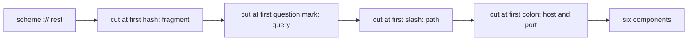
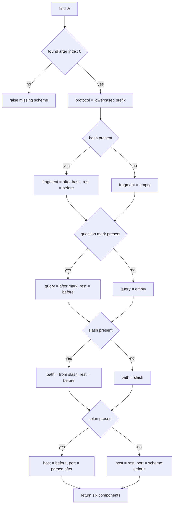
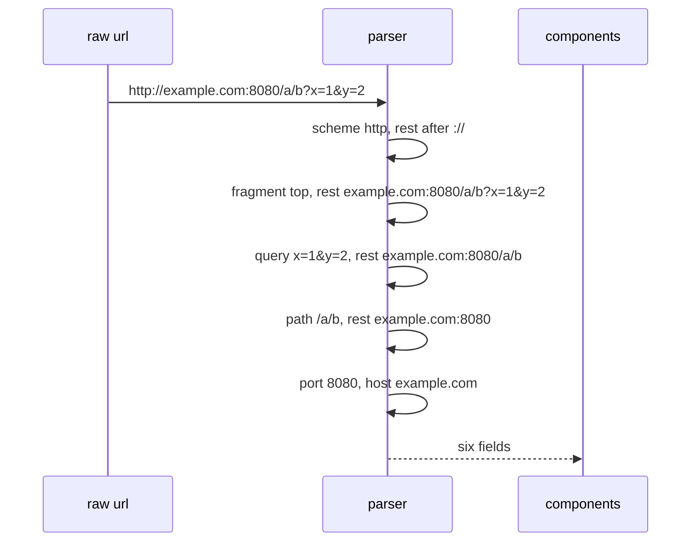

# 096 — Simple URL parser (extract protocol, host).

> **Tier:** Beginner · **CTCI chapter:** Ch 7 — Object-Oriented Design
> **Task spec:** [096-simple-url-parser-extract-protocol-host.md](../../../tasks/beginner/096-simple-url-parser-extract-protocol-host.md)
> **Solutions:** [Python](../../../solutions/python/beginner/096-simple-url-parser-extract-protocol-host/solution.py) ·
> [Java](../../../solutions/java/beginner/096-simple-url-parser-extract-protocol-host/Solution.java) ·
> [JavaScript](../../../solutions/javascript/beginner/096-simple-url-parser-extract-protocol-host/solution.js) ·
> [C#](../../../solutions/csharp/beginner/096-simple-url-parser-extract-protocol-host/Solution.cs)

## 1. Problem restatement

**Input:** a URL string of the shape

```text
<protocol>://<host>[:port]<path>?<query>#<fragment>
```

**Output:** the six components — `protocol`, `host`, `port`, `path`, `query`, `fragment`. Where the
input is missing a component, the parser applies the defaults documented in every solution header:

- **protocol** is lowercased (`HTTP` → `http`).
- **path** defaults to `"/"` when absent.
- **port** defaults to `80` for `http`, `443` for `https`, and `0` for any other scheme.
- **query** and **fragment** default to `""`.
- A URL without `"://"` (or with an empty scheme) is an error, not a `null` result.

The asserted rows:

| Input | protocol | host | port | path | query | fragment |
| --- | --- | --- | --- | --- | --- | --- |
| `https://example.com/path?q=1#frag` | `https` | `example.com` | `443` | `/path` | `q=1` | `frag` |
| `http://example.com` | `http` | `example.com` | `80` | `/` | `` | `` |
| `HTTP://example.com/x` | `http` | `example.com` | `80` | `/x` | `` | `` |
| `http://example.com:8080/a/b?x=1&y=2#top` | `http` | `example.com` | `8080` | `/a/b` | `x=1&y=2` | `top` |
| `https://host?q=1` | `https` | `host` | `443` | `/` | `q=1` | `` |
| `https://host/#f` | `https` | `host` | `443` | `/` | `` | `f` |
| `https://example.com:8443` | `https` | `example.com` | `8443` | `/` | `` | `` |
| `ftp://files.example.com/pub` | `ftp` | `files.example.com` | `0` | `/pub` | `` | `` |

and the error row: `parse_url("example.com/no-scheme")` must raise (`ValueError`,
`IllegalArgumentException`, `Error`, `ArgumentException` respectively).

The `ftp` row is the one that pins the port policy: an unknown scheme gets port `0`, not `80` and not
an error. The `HTTP://` row pins the case policy: only the *scheme* is lowercased, everything else is
preserved verbatim.

## 2. Intuition

A URL is a fixed sequence of delimited sections, so parsing it is a sequence of **ordered splits**.
The order is not arbitrary — it is dictated by the grammar's nesting:

```text
scheme :// host [":" port] path ["?" query] ["#" fragment]
```

Because `?` and `#` can legally appear *inside* later sections, the parser must cut from the right end
inwards:

1. **Fragment first.** Everything after the first `#` is the fragment, whatever it contains — including
   `?` and more `#` characters in the simplest reading.
2. **Query next.** In what remains, everything after the first `?` is the query.
3. **Path next.** In what remains, everything from the first `/` onward is the path.
4. **Port last.** What remains is `host[:port]`; split on the first `:`.

Cutting in the wrong order produces wrong-but-plausible results, which is the exact hazard this task
is designed to expose: if the query were extracted before the fragment, a URL like
`http://h/p#frag?x` would report `query = "x"` instead of `query = ""` and `fragment = "frag?x"`.



Each cut shortens the remaining string, so four sequential scans handle the whole URL — no regular
expression, no backtracking, and no ambiguity about which delimiter wins.

The other design decision is that **splitting is not validating**. The parser does not check that the
host looks like a hostname or that the port is in range; it extracts components and lets the caller
decide. The only structural requirement is the presence of a non-empty scheme followed by `"://"`.

## 3. Algorithm

1. Find the first occurrence of `"://"` in the URL. If it is missing or at index `0`, raise an error.
2. `protocol ← lowercased text before the separator`; `rest ← text after it` (three characters skipped).
3. If `'#'` occurs in `rest`: `fragment ← text after the first '#'`, and `rest ← text before it`.
   Otherwise `fragment ← ""`.
4. If `'?'` occurs in `rest`: `query ← text after the first '?'`, `rest ← text before it`.
   Otherwise `query ← ""`.
5. If `'/'` occurs in `rest`: `path ← text from the first '/' onward`, `rest ← text before it`.
   Otherwise `path ← "/"`.
6. `host ← rest`; `port ← default for protocol` (`80` for `http`, `443` for `https`, else `0`).
7. If `':'` occurs in `rest`: `host ← text before the ':'`, `port ← numeric value of the text after it`.
8. Return the six components.

```text
function parse_url(url)
    sep ← position of "://" in url
    if sep is missing or sep <= 0 then
        raise error requiring scheme
    end
    protocol ← lowercase(url[0 .. sep - 1])
    rest ← url[sep + 3 ..]

    fragment ← ""
    if "#" occurs in rest then
        fragment ← text after the first "#"
        rest ← text before the first "#"
    end

    query ← ""
    if "?" occurs in rest then
        query ← text after the first "?"
        rest ← text before the first "?"
    end

    path ← "/"
    if "/" occurs in rest then
        path ← text from the first "/" onward
        rest ← text before the first "/"
    end

    host ← rest
    port ← default port for protocol
    if ":" occurs in rest then
        host ← text before the ":"
        port ← number from the text after the ":"
    end

    return protocol, host, port, path, query, fragment
end
```

Notes on the details that the tests actually verify:

- **`sep <= 0` catches both failure modes.** No `"://"` at all gives `sep = -1`; a URL like
  `"://host"` gives `sep = 0`, meaning an empty scheme. Both raise.
- **Only the scheme is lowercased.** `"HTTP://Example.COM/x"` yields protocol `http` and host
  `Example.COM`.
- **The port is parsed with the language's integer conversion**, so a non-numeric port is an error in
  Python, Java and C# and `NaN` in JavaScript — the one place where the four implementations differ
  observably.
- **The returned record type** differs by language: a dictionary in Python, a small immutable `Url`
  class in Java, a plain object literal in JavaScript, and a tuple in C#.



## 4. Worked example

Trace `parse_url("http://example.com:8080/a/b?x=1&y=2#top")`:

| Stage | `rest` before the cut | Cut at | Extracted | `rest` after the cut |
| --- | --- | --- | --- | --- |
| scheme | `http://example.com:8080/a/b?x=1&y=2#top` | `"://"` at index 4 | `protocol = "http"` | `example.com:8080/a/b?x=1&y=2#top` |
| fragment | `example.com:8080/a/b?x=1&y=2#top` | `#` | `fragment = "top"` | `example.com:8080/a/b?x=1&y=2` |
| query | `example.com:8080/a/b?x=1&y=2` | `?` | `query = "x=1&y=2"` | `example.com:8080/a/b` |
| path | `example.com:8080/a/b` | `/` | `path = "/a/b"` | `example.com:8080` |
| host/port | `example.com:8080` | `:` | `port = 8080` | `host = "example.com"` |

The result matches the asserted record exactly. Note how each stage only looks at the part of the URL
that is still unparsed, which is why no stage has to “skip over” already-recognised text.

Now the two rows that show defaults being applied:

| Input | After scheme | After fragment | After query | After path | host / port |
| --- | --- | --- | --- | --- | --- |
| `http://example.com` | `example.com` | fragment `""` | query `""` | no `/`, so path `"/"` | host `example.com`, port `80` |
| `https://host/#f` | `host/#f` | fragment `"f"`, rest `host/` | query `""` | path `"/"`, rest `host` | host `host`, port `443` |

In the second row the path is `"/"` even though the URL does contain a slash — the slash is the
separator before the fragment, and the text after it is empty, so the extracted path is exactly `"/"`.
That is the behaviour the assertion `parse_url("https://host/#f")["fragment"] == "f"` (plus the
`path == "/"` checks in Java and C#) records.



## 5. Complexity

Let `n` be the length of the URL string.

| Measure | Bound | Why it holds |
| --- | --- | --- |
| Time, best | O(n) | the `"://"` search alone may scan the whole string before failing |
| Time, average | O(n) | four delimiter searches, each over a shrinking suffix |
| Time, worst | O(n) | the searches never overlap in the characters they must skip past the last cut, so the total is bounded by a small constant times `n` |
| Space, extra | O(1) | four search positions plus the protocol/port temporaries |
| Space, output | O(n) | the six components together contain at most `n` characters |
| Naive regex approach | O(n) worst case with far larger constants | backtracking regular expressions can degrade badly on malformed input |

The linear bound is worth stating precisely, because it is not automatic: each `indexOf`/`find` scans
only the *remaining* suffix after the previous cut, so the four searches together touch each character
of the URL a constant number of times. (Even if each search restarted from the beginning, the constant
would be four and the asymptotics unchanged — but the shrink-as-you-go formulation is what keeps the
implementation simple.)

## 6. Pitfalls and edge cases

- **Cut order matters.** Fragment before query, query before path, path before port. Reversing the
  first two makes `http://h/p#frag?x` report `query = "x"` and `fragment = "frag"`, when the fragment
  should be everything after the first `#`.
- **A missing scheme is an error, not a default.** `"example.com/no-scheme"` must raise. The check is
  `sep <= 0`, which also rejects `"://host"` (an empty scheme).
- **Only the scheme is lowercased.** Hosts are returned verbatim; `"HTTP://Example.COM/x"` gives an
  uppercase host. Do not apply `toLowerCase` to the whole URL — it would also change the path, the
  query and the fragment, all of which are case-sensitive.
- **Default path is `"/"`, not `""`.** Both `http://example.com` and `https://host?q=1` report path
  `"/"`. Note the subtler variant `https://host/#f`: the slash is present but the text after it is
  empty, so the path is `"/"` again.
- **Port defaults are scheme-dependent.** `80` for `http`, `443` for `https`, `0` for anything else
  (asserted with `ftp`). A parser that defaults everything to `80` fails the `ftp` row.
- **The port is parsed, not pattern-checked.** `int(...)` / `Integer.parseInt` / `int.Parse` raise on
  a non-numeric port, while JavaScript's `Number` yields `NaN`. The tests avoid the case, but the
  difference is real and worth stating when the task is extended.
- **Empty components are legal.** An empty host, an empty query (`https://host?`) and an empty
  fragment (`https://host#`) are all produced without error; the parser only enforces the presence of
  the scheme separator.
- **A `#` inside the query is a fragment separator.** Per the grammar the first `#` wins, even if it
  appears before the `?`: `http://h/p#f#g` yields fragment `"f#g"` and no query, because everything
  after the first `#` is the fragment.
- **Repeated delimiters.** Splitting uses the *first* occurrence, so `http://h/a/b?x=1?y=2` puts
  `x=1?y=2` in the query, and `http://h/a#f#g` puts `f#g` in the fragment.
- **No normalisation of the path.** `"/a/b"` stays `/a/b`; no collapsing of `//`, no dot-segment
  removal, no percent-decoding. This is a *simple* parser.
- **Unicode hostnames.** No IDN conversion happens; the host is returned as written. Real parsers
  would punycode it.
- **The returned record.** Python returns a dictionary keyed by the six field names, Java a small
  `Url` class with `final` fields, JavaScript an object literal, C# a value tuple — so field access
  syntax differs even though the content does not.

## 7. Variants and follow-ups

- **Validate the pieces.** Compose this parser with
  [095-validate-ipv4-address-basic.md](../../../tasks/beginner/095-validate-ipv4-address-basic.md)
  to reject URLs whose host is not a valid address, or add a port-range check (`1..65535`).
- **Relative URLs.** Take a base URL plus a reference and resolve them (RFC 3986 section 5) — the
  interesting cases are empty references, absolute paths and `..` segments.
- **Percent-decoding.** Apply `%XX` decoding to the path, query and fragment after splitting; the
  split must come first, because `%23` is an encoded `#` and must not be treated as a delimiter.
- **Query-string parsing.** Turn `x=1&y=2` into key/value pairs, with the usual caveats about repeated
  keys and `=` in values.
- **A state-machine parser.** One pass with a mode per section, which handles nested delimiters and is
  the shape real URL parsers use internally.
- **Data classes in other tasks.** The Java `Url` record and the C# tuple in this task are the same
  “return a small immutable bundle” idea used by
  [089-implement-simple-frequency-histogram-integers.md](../../../tasks/beginner/089-implement-simple-frequency-histogram-integers.md)
  (a map of counts) and
  [082-range-sum-query-naive-using-prefix-sums.md](../../../tasks/beginner/082-range-sum-query-naive-using-prefix-sums.md)
  (an object holding precomputed state).

## 8. Check yourself

1. Why must the fragment be cut before the query?

<details><summary>Show answer</summary>

Because the grammar puts the fragment last and lets it contain `?` characters. Everything after the
first `#` is the fragment, so cutting the query first would steal a `?` that belongs to the fragment:
`http://h/p#frag?x` would report `query = "x"` instead of `query = ""` and `fragment = "frag?x"`.

</details>

2. What port does `parse_url("ftp://files.example.com/pub")` report, and why?

<details><summary>Show answer</summary>

`0`. The default port table covers `http` (80) and `https` (443) only; any other scheme — `ftp` here
— falls back to `0`. The Java, JavaScript and C# solutions express this with an explicit conditional
or lookup, and the Python solution with `DEFAULT_PORTS.get(protocol, 0)`.

</details>

3. What does `parse_url("HTTP://example.com/x")` return for the host, and what does that show about
   the lowercasing rule?

<details><summary>Show answer</summary>

The host is `example.com` unchanged — but only because it was already lowercase in the input. The rule
is that *only the scheme* is lowercased; a host written as `Example.COM` would be returned verbatim.
Lowercasing the whole URL would silently alter case-sensitive paths and queries.

</details>

4. Which two inputs demonstrate that the default path is `"/"`, and how do they differ?

<details><summary>Show answer</summary>

`http://example.com` has no slash at all, so the path default applies directly. `https://host/#f` does
contain a slash, but it is the separator immediately before the fragment, so the text after it is
empty and the extracted path is still `"/"`. Both cases must produce `"/"`.

</details>

5. Why is a URL without `"://"` an error rather than a URL with an empty scheme or host?

<details><summary>Show answer</summary>

Because the shape `<scheme>://<rest>` is the parser's precondition: without the separator there is no
way to tell where the scheme ends, and the task's contract says the input must start with it. The
implementation encodes this as `sep <= 0`, which rejects both a missing separator and an empty scheme
(`"://host"`). Every solution file asserts that such an input raises.

</details>
