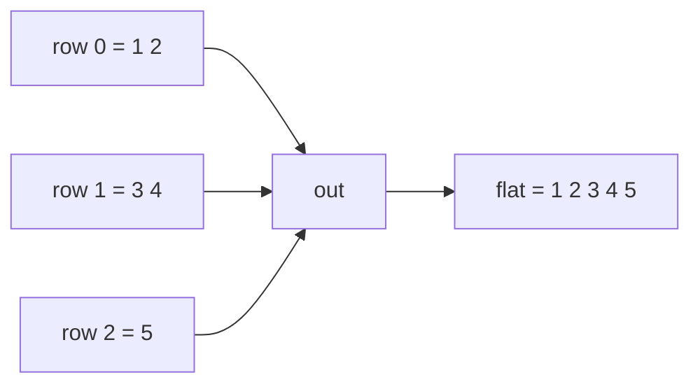
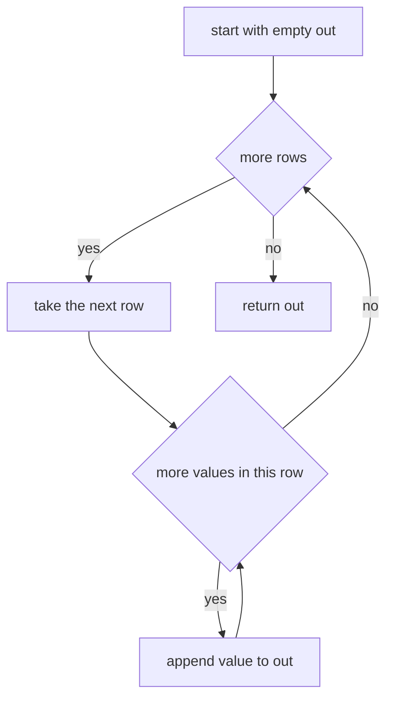
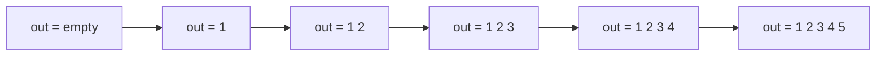

# 097 — Flatten a 2D array (row-major).

> **Tier:** Beginner · **CTCI chapter:** Ch 1 — Arrays and Strings
> **Task spec:** [097-flatten-a-2d-array-row-major.md](../../../tasks/beginner/097-flatten-a-2d-array-row-major.md)
> **Solutions:** [Python](../../../solutions/python/beginner/097-flatten-a-2d-array-row-major/solution.py) ·
> [Java](../../../solutions/java/beginner/097-flatten-a-2d-array-row-major/Solution.java) ·
> [JavaScript](../../../solutions/javascript/beginner/097-flatten-a-2d-array-row-major/solution.js) ·
> [C#](../../../solutions/csharp/beginner/097-flatten-a-2d-array-row-major/Solution.cs)

## 1. Problem restatement

**Input:** a two-dimensional collection — a sequence of rows, where each row is itself a
sequence of values. The shape is **not** required to be rectangular: rows may have different
lengths, rows may be empty, and the outer collection may be empty.

**Output:** a new one-dimensional sequence that lists every value in **row-major order**: the
values of row 0 from left to right, then the values of row 1 from left to right, and so on.

The task spec is a single line ("Flatten a 2D array (row-major)."), so the exact contract is
fixed by the assertions the four solution files ship with:

| Call | Result | Why |
| --- | --- | --- |
| `flatten_2d([[1, 2], [3, 4], [5]])` | `[1, 2, 3, 4, 5]` | ragged input: the last row is short |
| `flatten_2d([[1], [2, 3], [4, 5, 6]])` | `[1, 2, 3, 4, 5, 6]` | rows of growing length |
| `flatten_2d([[1, 2, 3], [4, 5, 6]])` | `[1, 2, 3, 4, 5, 6]` | the rectangular case |
| `flatten_2d([[], [1, 2], []])` | `[1, 2]` | empty rows contribute nothing |
| `flatten_2d([[1]])` | `[1]` | a 1×1 grid |
| `flatten_2d([])` | `[]` | there is no row at all |
| `flatten_2d([[]])` | `[]` | there is one row, and it is empty |
| `flatten_2d([[], []])` | `[]` | two empty rows |
| `flatten_2d([[-1, 0], [0, -1]])` | `[-1, 0, 0, -1]` | values may repeat and may be negative |

Every row above except the two-empty-rows case is asserted by all four solutions — the Java and C#
files cover that shape with `[[], [1, 2], []]` instead — so "ragged friendly" and "empty rows are
legal" are part of the contract, not an accident. Nothing is validated and nothing is
mutated: each solution returns a fresh container that shares no storage with the input.

## 2. Intuition

The tempting one-liner is index arithmetic. If the grid were a rectangle with `R` rows and `C`
columns, then output index `i` holds `matrix[i / C][i % C]`, and a single loop over `i` would
flatten it. That formula is exactly where naive implementations break: the moment one row is
shorter than another, `i / C` and `i % C` stop describing the real shape. Row 2 of
`[[1, 2], [3, 4], [5]]` starts at output index 4, but `4 / 2` is 2 and `4 % 2` is 0, so the
formula claims a value that does not exist.

The key insight is that row-major order is not an arithmetic property of the grid at all — it is
the natural order of the cells when you enumerate `(row, column)` pairs lexicographically.
The nested loop *is* the answer:

```text
for each row, in order
    for each value of that row, in order
        emit the value
```

No division, no modulo, no assumption about shape. Everything the four solutions add on top of
that loop is bookkeeping forced by their container type: Python, JavaScript and C# append into a
growable list, while Java must know the final length up front and therefore counts first.



Reading that diagram the other way round is the useful direction: any flat index can be mapped
back to a row by walking the row lengths, which is what a real ragged-grid library does when it
implements random access.

## 3. Algorithm

The append variant, which is what the Python, JavaScript and C# files implement:

1. Create an empty result container.
2. Take the rows in order, one at a time.
3. Inside a row, take the values in order, one at a time.
4. Append each value to the result.
5. When every row is exhausted, return the result.

```text
procedure flatten_2d(matrix)
    out ← empty list
    for each row in matrix do
        for each value in row do
            append value to out
        end
    end
    return out
end
```

The Java file implements the same walk with a different shape, because a Java array cannot grow:

1. Walk the rows once and add up `row.length` to get the total element count `total`.
2. Allocate `int[total]`.
3. Walk the rows again with a write cursor `out`, copying each value into `result[out]` and
   incrementing `out`.

```text
procedure flatten_2d_fixed_size(matrix)
    total ← 0
    for each row in matrix do
        total ← total + length(row)
    end
    result ← new array of total slots
    out ← 0
    for each row in matrix do
        for each value in row do
            result[out] ← value
            out ← out + 1
        end
    end
    return result
end
```

Both shapes visit the values in the same order; only the moment at which the output size becomes
known differs. The C# file reaches for a dynamically sized list and converts it with `ToArray`
at the end, which is why the C# code looks like the Python code rather than like the Java code.



## 4. Worked example

Trace `flatten_2d([[1, 2], [3, 4], [5]])`, a ragged grid with five values in three rows:

| Step | Row | Column | Value read | `out` after the step |
| --- | --- | --- | --- | --- |
| 1 | 0 | 0 | `1` | `[1]` |
| 2 | 0 | 1 | `2` | `[1, 2]` |
| 3 | 1 | 0 | `3` | `[1, 2, 3]` |
| 4 | 1 | 1 | `4` | `[1, 2, 3, 4]` |
| 5 | 2 | 0 | `5` | `[1, 2, 3, 4, 5]` |

Five steps for five values: no cell is visited twice, and the row index only ever increases.
The Java variant performs a first pass that sums `2 + 2 + 1 = 5`, allocates five slots, and then
repeats exactly the same five reads while writing them into the array — the same table with an
extra left-to-right bookkeeping pass in front of it.



Now trace the ragged case `[[1], [2, 3], [4, 5, 6]]`, which is the second assertion:

| Step | Row | Row length | Value read | `out` after the step |
| --- | --- | --- | --- | --- |
| 1 | 0 | 1 | `1` | `[1]` |
| 2 | 1 | 2 | `2` | `[1, 2]` |
| 3 | 1 | 2 | `3` | `[1, 2, 3]` |
| 4 | 2 | 3 | `4` | `[1, 2, 3, 4]` |
| 5 | 2 | 3 | `5` | `[1, 2, 3, 4, 5]` |
| 6 | 2 | 3 | `6` | `[1, 2, 3, 4, 5, 6]` |

The row pointer advances only when the inner loop runs out of values, which is precisely why the
algorithm needs no length information: the inner iterator *is* the length of the current row.

## 5. Complexity

Let `N` be the total number of values across all rows (`N = 2 + 2 + 1 = 5` in the first example
above) and let `R` be the number of rows.

| Measure | Bound | Why it holds |
| --- | --- | --- |
| Time, best | O(N) | every value must appear in the output, so even a perfectly shaped input costs one read per value |
| Time, average | O(N) | one read plus one append per value; append is amortised O(1) in Python and C#, and a plain store in Java and JavaScript |
| Time, worst | O(N) | the Java variant makes an extra O(R) counting pass, which is dominated by O(N) because `R` is at most `N` |
| Space, output | O(N) | the result holds all `N` values |
| Space, extra | O(R) | O(1) cursor state per language; Python, JavaScript and C# also keep some spare capacity inside the growable list, bounded by a constant factor of `N` |
| Time of the recursive alternative | O(N) | one visit per value, but the call stack costs O(depth) space |
| Time of a plausible wrong approach | — | the `i / C` formula is O(N) only when the grid is rectangular and rejects every ragged input |

The write pattern is sequential in all four languages, which is the friendliest possible access
pattern for a cache: each row is read front to back and each value is stored next to the previous
one. A column-major flattening would break that locality, which is one of the follow-ups below.

## 6. Pitfalls and edge cases

- **Empty outer collection.** `flatten_2d([])` returns `[]`. Python, Java, JavaScript and C# all
  assert this. The Java variant's counting pass sums nothing and allocates `new int[0]`.
- **One empty row.** `flatten_2d([[]])` is `[]`, not an error, and `flatten_2d([[], []])` is also
  `[]`. An implementation that reads `matrix[0][0]` for "shape discovery" crashes here.
- **Empty rows mixed with data.** `[[], [1, 2], []]` gives `[1, 2]`; an empty row simply
  contributes zero iterations.
- **Ragged rows of growing length.** `[[1], [2, 3], [4, 5, 6]]` is the assertion that kills any
  `rows * cols` assumption.
- **Do not hard-code a rectangular shape.** `cols = len(matrix[0])` is the single most common
  bug in this task; the solutions never compute it.
- **The input is not modified.** The append variant copies values into a new container, and the
  Java variant writes into a freshly allocated array, so the caller's rows keep their contents.
  This is the opposite convention from the in-place rotation in
  [099-rotate-matrix-90-degrees-clockwise-in-place-for-square.md](../../../tasks/beginner/099-rotate-matrix-90-degrees-clockwise-in-place-for-square.md).
- **Java jagged arrays.** The solutions use `int[][]` (an array of arrays), not the rectangular
  `int[,]`. A two-pass implementation must not assume `matrix[0].length` describes every row, and
  it will throw on a `null` row — the solutions do not defend against that.
- **Identity of the values.** Both negative and repeated values are asserted
  (`[[-1, 0], [0, -1]]` flattens to `[-1, 0, 0, -1]`), so an implementation may not sort,
  deduplicate or compare values to decide what to append.
- **Zero-length output.** `[]` and `[[]]` both produce a container of size zero; Java returns
  `int[0]` and Python returns `[]`, and their tests assert that instead of `null` / `None`.

## 7. Variants and follow-ups

- **Column-major flattening.** Read down column 0, then column 1, and so on. The loop nest is the
  transpose of the one above; you can also flatten row-major after a transpose —
  [098-transpose-a-2d-matrix.md](../../../tasks/beginner/098-transpose-a-2d-matrix.md).
- **Rotate instead of flatten.** Rotation is a bijection on the *cells* rather than a
  concatenation of rows: [099-rotate-matrix-90-degrees-clockwise-in-place-for-square.md](../../../tasks/beginner/099-rotate-matrix-90-degrees-clockwise-in-place-for-square.md)
  shows the in-place version of the same traversal idea.
- **Compaction as the same "keep the order" problem.** Removing an element in place
  ([024-remove-element-at-index-from-array-in-place.md](../../../tasks/beginner/024-remove-element-at-index-from-array-in-place.md))
  uses one read cursor and one write cursor, exactly like the Java variant's `out` counter.
- **Arbitrary nesting.** Flattening a structure that nests to unknown depth needs recursion over
  values rather than a fixed two-level loop; the recursive pattern appears in
  [105-implement-dfs-recursive-on-graph.md](../../../tasks/beginner/105-implement-dfs-recursive-on-graph.md).
- The chapter walkthrough [Arrays and Strings](../../ctci/01-arrays-and-strings.md) places
  traversal order next to rotation and compaction as the three Ch 1 index patterns.

## 8. Check yourself

1. Why do the Python, JavaScript and C# solutions append while the Java solution counts first?

<details><summary>Show answer</summary>

Because Java arrays are fixed-size: the code must know the total element count before it can
allocate `int[total]`. Python lists, JavaScript arrays and C# `List<int>` grow on demand, so the
counting pass is unnecessary there. The number of value reads is the same in both designs.

</details>

2. What does `flatten_2d([[1, 2], [3, 4], [5]])` return, and how many loop iterations does it take?

<details><summary>Show answer</summary>

`[1, 2, 3, 4, 5]`, after five inner iterations — one per value. The outer loop iterates three
times for three rows, so total work is `R + N` iterations of the loop headers plus `N` appends.

</details>

3. A teammate writes `cols = len(matrix[0])` and then loops `for i in range(rows * cols)`. Which
   assertion fails first?

<details><summary>Show answer</summary>

`flatten_2d([[1], [2, 3], [4, 5, 6]])`, because the assumed width is 1, so the computed length is
3 and the values `3, 5, 6` are never emitted. `flatten_2d([])` also fails earlier, with an
`IndexError` or `NullPointerException`, because there is no row 0 to inspect.

</details>

4. What is the difference between `flatten_2d([])` and `flatten_2d([[]])`?

<details><summary>Show answer</summary>

Nothing that the caller can observe: both return an empty sequence. The distinction only matters
inside the implementation, because `[[]]` has a row 0 that the loop visits and `[]` has none —
which is why "read `matrix[0][0]` to learn the shape" is unsafe for `[]`.

</details>

5. Flattening is described as "lexicographic order on `(row, column)` pairs". What does that say
   about repeated values?

<details><summary>Show answer</summary>

That order is defined by position, never by value. `[[-1, 0], [0, -1]]` must produce
`[-1, 0, 0, -1]` — the two `0`s and the two `-1`s stay exactly where their positions place them,
so no sorting or deduplication may happen.

</details>
