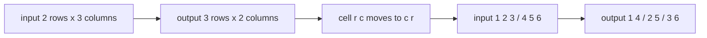
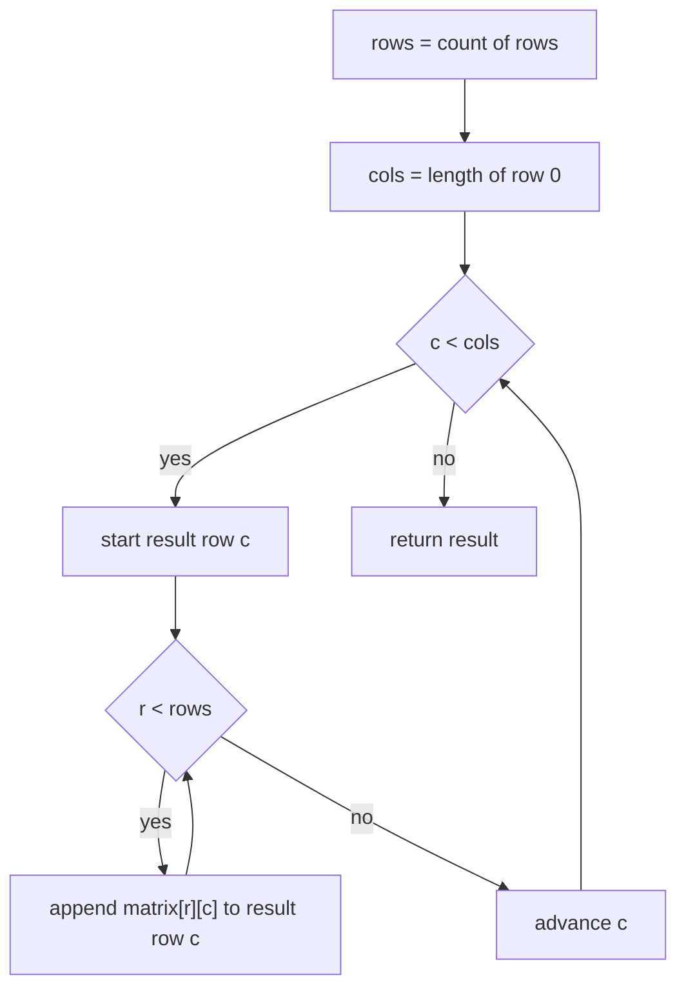
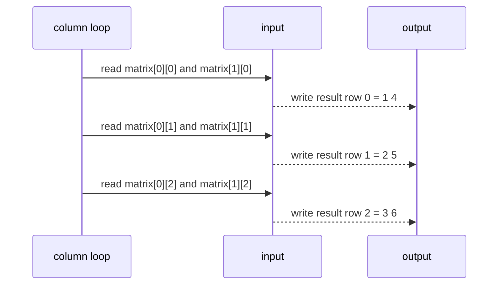

# 098 — Transpose a 2D matrix.

> **Tier:** Beginner · **CTCI chapter:** Ch 1 — Arrays and Strings
> **Task spec:** [098-transpose-a-2d-matrix.md](../../../tasks/beginner/098-transpose-a-2d-matrix.md)
> **Solutions:** [Python](../../../solutions/python/beginner/098-transpose-a-2d-matrix/solution.py) ·
> [Java](../../../solutions/java/beginner/098-transpose-a-2d-matrix/Solution.java) ·
> [JavaScript](../../../solutions/javascript/beginner/098-transpose-a-2d-matrix/solution.js) ·
> [C#](../../../solutions/csharp/beginner/098-transpose-a-2d-matrix/Solution.cs)

## 1. Problem restatement

**Input:** a matrix as a sequence of rows; every row is a sequence of values. The matrix may be
empty (`[]`), may have a single empty row (`[[]]`), and is **not** required to be square — the
solutions are exercised on 1×3, 3×1, 2×3 and 3×2 shapes as well as 2×2 and 1×1.

**Output:** a **new** matrix in which rows and columns have swapped roles. If the input has `R`
rows and `C` columns, the result has `C` rows and `R` columns, and

```text
result[c][r] = matrix[r][c]
```

for every valid pair. The caller's matrix is left untouched — the Python file asserts
`t is not m` and that `m` still equals `[[1, 2], [3, 4]]`.

| Call | Result | Why |
| --- | --- | --- |
| `transpose([[1, 2, 3], [4, 5, 6]])` | `[[1, 4], [2, 5], [3, 6]]` | 2×3 becomes 3×2 |
| `transpose([[1, 2], [3, 4]])` | `[[1, 3], [2, 4]]` | the square case, still a fresh matrix |
| `transpose([[1, 2, 3]])` | `[[1], [2], [3]]` | a single row becomes a column |
| `transpose([[1], [2], [3]])` | `[[1, 2, 3]]` | a column becomes a single row |
| `transpose([[1, 2], [3, 4], [5, 6]])` | `[[1, 3, 5], [2, 4, 6]]` | the second rectangular shape |
| `transpose([[1]])` | `[[1]]` | 1×1 is its own transpose |
| `transpose([])` | `[]` | no rows, therefore no columns |
| `transpose([[]])` | `[]` | one row of zero columns is a zero-column matrix |

That last row is worth pausing on: `[[]]` has one row, so a naive reading of the rule says the
output should have one column and zero rows. The solutions instead treat any matrix with zero
columns as empty and return `[]`, and all four assert exactly that.

## 2. Intuition

The naive approach mirrors the definition literally: for each input row, for each value in the
row, append the value to the output row numbered by its column index. In Python that reads as
"build `C` lists lazily while walking", which means you must either create the `C` result rows on
first touch or pre-create them. The pre-created version is the one all four solutions use, and it
is simpler than it looks:

- the number of result rows equals the number of input **columns**;
- the number of values in result row `c` equals the number of input **rows**;
- so the result can be allocated completely before the first value is read.

The insight is therefore a swap of two numbers plus a swap of two indices:

```text
input index pair         output index pair
    (r, c)        →          (c, r)
```

Because `(r, c) → (c, r)` is its own inverse, transposing twice returns the original matrix — a
cheap invariant to test against, and the reason `transpose(transpose(m)) == m` appears in
discussions of this task even though the shipped assertions do not include it.



The picture also explains the loop order chosen by the solutions: iterate over **columns** on the
outside and **rows** on the inside. That way each result row is filled front to back in the order
its values are produced, which is the sequential write pattern a growable list or a fixed array
likes best. Iterating rows outside and columns inside would scatter writes across all `C` result
rows.

## 3. Algorithm

All four solutions implement the same indexed walk:

1. If the matrix has no rows, return an empty matrix.
2. Let `rows` be the number of rows and `cols` be the number of values in row 0.
3. Create `cols` result rows, each able to hold `rows` values.
4. For each column index `c` from `0` to `cols - 1`:
   1. For each row index `r` from `0` to `rows - 1`: store `matrix[r][c]` as the next value of
      result row `c`.
5. Return the result.

```text
procedure transpose(matrix)
    if length(matrix) = 0 then
        return empty matrix
    end
    rows ← length(matrix)
    cols ← length(matrix[0])
    result ← new matrix with cols rows of rows slots each
    for c ← 0 to cols - 1 do
        for r ← 0 to rows - 1 do
            result[c][r] ← matrix[r][c]
        end
    end
    return result
end
```

The scope of the algorithm is deliberately narrow: it reads the width from row 0 only. The
solutions are written for rectangular input, and ragged input is outside the contract — the
assertions never feed it one.



Two shapes of the same loop nest appear in the repository. Python, JavaScript and C# allocate a
fresh result row per column and append into it; Java and C# may also pre-allocate
`new int[cols][rows]`, which makes every store an indexed assignment. The number of reads is
`rows · cols` in both designs.

## 4. Worked example

Trace `transpose([[1, 2, 3], [4, 5, 6]])`. Here `rows = 2` and `cols = 3`, so the result starts as
three empty rows:

| Step | `c` | `r` | Read | Result after the step |
| --- | --- | --- | --- | --- |
| 1 | 0 | 0 | `matrix[0][0] = 1` | `[[1], [], []]` |
| 2 | 0 | 1 | `matrix[1][0] = 4` | `[[1, 4], [], []]` |
| 3 | 1 | 0 | `matrix[0][1] = 2` | `[[1, 4], [2], []]` |
| 4 | 1 | 1 | `matrix[1][1] = 5` | `[[1, 4], [2, 5], []]` |
| 5 | 2 | 0 | `matrix[0][2] = 3` | `[[1, 4], [2, 5], [3]]` |
| 6 | 2 | 1 | `matrix[1][2] = 6` | `[[1, 4], [2, 5], [3, 6]]` |

Six reads for six values, and the read pattern walks down the input while the write pattern walks
along the output row. Notice how step 2 completes result row 0 before step 3 starts row 1 — that
is why columns must be the outer loop.



Now compare with the square case `[[1, 2], [3, 4]]`, whose assertion expects `[[1, 3], [2, 4]]`.
The same six-step table shrinks to four steps: `(0, 0) → 1`, `(1, 0) → 3`, `(0, 1) → 2`,
`(1, 1) → 4`. In this case the operation is an involution — transposing again restores
`[[1, 2], [3, 4]]` — but the solutions still return a new matrix object rather than the input, and
the Python and JavaScript assertions pin that down with identity checks.

## 5. Complexity

Let `R` be the number of rows and `C` the number of columns.

| Measure | Bound | Why it holds |
| --- | --- | --- |
| Time, best | O(R·C) | every cell must be read; even the 1×1 case costs one read |
| Time, average | O(R·C) | one read and one write per cell, no nested scanning |
| Time, worst | O(R·C) | the index arithmetic per cell is constant |
| Space, output | O(R·C) | the result holds the same `R·C` values as the input |
| Space, extra | O(C) | the cursor state plus one reference per result row; the values themselves live in the output |
| Naive "append into lazily created rows" | O(R·C) | same asymptotics, but each new row may be re-allocated during growth, and Python appends pay an amortised constant per value |
| Alternative "swap in place" | O(R·C) time, O(1) extra | only legal for square matrices, where `(r, c)` and `(c, r)` both exist; see the follow-ups |

The input is read column by column while the output is written row by row. That access pattern is
the reason the naive in-place version is restricted to squares: for `R ≠ C` there is no cell to
swap into, so a full new matrix must be materialised, which is exactly what the shipped solutions
do for every shape.

## 6. Pitfalls and edge cases

- **Empty matrix.** `transpose([])` is `[]` in all four solutions. Both the Python and the Java
  code have an explicit guard before touching `matrix[0]`.
- **A single empty row.** `transpose([[]])` is `[]`, not `[[]]` and not an error: the code reads
  `cols = 0`, the outer loop runs zero times, and an empty result is returned. All four files
  assert this row.
- **Non-square matrices are the point.** 1×3, 3×1, 2×3 and 3×2 all appear in the assertions, so an
  implementation that only works for squares fails immediately.
- **The result is a new object.** Python asserts `t is not m`, JavaScript asserts
  `notStrictEqual(t, m)`, Java asserts reference inequality, and C# asserts `!ReferenceEquals`.
  Transposing into a shared buffer would corrupt callers who still need the original.
- **Ragged input is not supported.** Width is taken from row 0 only, which the task spec never
  promises is representative. Feeding `[[1, 2, 3], [4, 5]]` produces an out-of-range read; the
  solutions deliberately do not guard against it.
- **Zero columns versus zero rows.** A matrix with one empty row has no cells to move, so the
  output is the empty matrix. This agrees with the flattening task's reading of `[[]]` as empty
  ([097-flatten-a-2d-array-row-major.md](../../../tasks/beginner/097-flatten-a-2d-array-row-major.md)).
- **Square in-place transposition has a half-matrix trap.** If you try the in-place route, you
  must only touch `j > i`, otherwise every pair is swapped twice and the matrix returns
  unchanged. The same upper-triangle discipline is what makes
  [100-check-if-matrix-is-symmetric.md](../../../tasks/beginner/100-check-if-matrix-is-symmetric.md)
  cheap.
- **Identity of a symmetric matrix.** Transposing `[[1, 2], [2, 1]]` yields an equal-but-distinct
  matrix; the assertions compare contents, never object identity, for the *content* check.

## 7. Variants and follow-ups

- **Rotation as transpose plus reversal.** Rotating 90° clockwise is a transpose followed by
  reversing every row: [099-rotate-matrix-90-degrees-clockwise-in-place-for-square.md](../../../tasks/beginner/099-rotate-matrix-90-degrees-clockwise-in-place-for-square.md)
  performs both steps in place for square input.
- **Symmetry as a partial transpose test.** Instead of materialising the transpose and comparing,
  walk only the upper triangle:
  [100-check-if-matrix-is-symmetric.md](../../../tasks/beginner/100-check-if-matrix-is-symmetric.md).
- **Flattening keeps the other traversal order.**
  [097-flatten-a-2d-array-row-major.md](../../../tasks/beginner/097-flatten-a-2d-array-row-major.md)
  is the row-major walk; flattening column-major is the transpose of that loop nest.
- **Zero-copy views.** Real libraries return a view with swapped strides rather than a new
  buffer; the follow-up question is which operations remain valid, and every in-place operation
  stops being one.
- The chapter walkthrough [Arrays and Strings](../../ctci/01-arrays-and-strings.md) groups
  transposition, rotation and in-place compaction as the three Ch 1 matrix drills.

## 8. Check yourself

1. For `transpose([[1, 2, 3], [4, 5, 6]])`, what are `rows` and `cols` in the code, and which one
   drives the outer loop?

<details><summary>Show answer</summary>

`rows = 2` and `cols = 3`. The outer loop runs over columns (`c` from 0 to 2) and the inner loop
over rows (`r` from 0 to 1), because result row `c` must be filled completely before the next
result row is started.

</details>

2. Why does `transpose([[]])` return `[]` rather than `[[]]`?

<details><summary>Show answer</summary>

Because the width is read as `cols = 0`, so there are no result rows to create. The value to think
about is the transposed shape: zero columns means zero cells, and a matrix with one row and zero
columns is empty in exactly the same sense that a matrix with zero rows is.

</details>

3. How many reads and writes does the 2×3 example perform, and how does that compare with a
   hypothetical in-place version?

<details><summary>Show answer</summary>

Six reads and six writes — one per cell. An in-place version is impossible for a 2×3 input because
the shape must change; for square input it would still be six reads and six writes but only
`R·C/2` swaps, using O(1) extra space instead of a second `R·C` buffer.

</details>

4. `transpose` is its own inverse. Which single assertion in the shipped files is the closest
   analogue of that property?

<details><summary>Show answer</summary>

None of them asserts the round trip directly. The closest is the pair
`transpose([[1, 2, 3]])  == [[1], [2], [3]]` and `transpose([[1], [2], [3]]) == [[1, 2, 3]]`,
which are transposes of each other and therefore show both directions of the same mapping. The
identity assertions (`t is not m`) instead pin down that a fresh object is returned.

</details>

5. What breaks if you write the loops as "rows outside, columns inside" but keep appending into
   `result[c]`?

<details><summary>Show answer</summary>

Nothing about correctness — every cell still lands at `result[c][r]`. What changes is the write
order: instead of finishing one result row at a time, the code jumps between `C` different result
rows, which is a worse access pattern and, in Java, hides the fact that you must still allocate
`new int[cols][rows]` up front.

</details>
