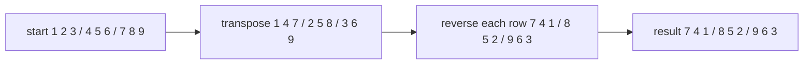
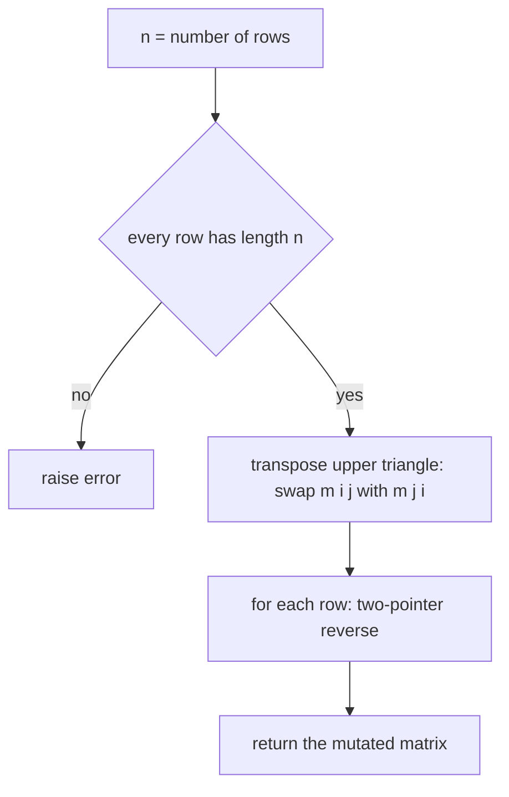
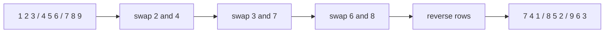

# 099 — Rotate matrix 90 degrees clockwise (in-place for square).

> **Tier:** Beginner · **CTCI chapter:** Ch 1 — Arrays and Strings
> **Task spec:** [099-rotate-matrix-90-degrees-clockwise-in-place-for-square.md](../../../tasks/beginner/099-rotate-matrix-90-degrees-clockwise-in-place-for-square.md)
> **Solutions:** [Python](../../../solutions/python/beginner/099-rotate-matrix-90-degrees-clockwise-in-place-for-square/solution.py) ·
> [Java](../../../solutions/java/beginner/099-rotate-matrix-90-degrees-clockwise-in-place-for-square/Solution.java) ·
> [JavaScript](../../../solutions/javascript/beginner/099-rotate-matrix-90-degrees-clockwise-in-place-for-square/solution.js) ·
> [C#](../../../solutions/csharp/beginner/099-rotate-matrix-90-degrees-clockwise-in-place-for-square/Solution.cs)

## 1. Problem restatement

**Input:** an `n × n` matrix — square, which is the precondition the title states. A matrix whose
rows do not all have length `n` is rejected rather than processed.

**Output:** the same matrix, rotated a quarter turn clockwise. Because the rotation is in place,
the function's observable effect is the mutation of the caller's matrix; the value returned is
that same object (Python and JavaScript return it, Java and C# are `void`).

The rotation rule is a pure index map: the cell that starts at `(i, j)` ends at
`(j, n - 1 - i)`, and the cell that ends at `(i, j)` came from `(n - 1 - j, i)`.

| Call | Result | Why |
| --- | --- | --- |
| `rotate_matrix_90_clockwise([[1]])` | `[[1]]` | a 1×1 matrix is rotation-invariant |
| `rotate_matrix_90_clockwise([[1, 2], [3, 4]])` | `[[3, 1], [4, 2]]` | the left column becomes the top row |
| `rotate_matrix_90_clockwise([[1, 2, 3], [4, 5, 6], [7, 8, 9]])` | `[[7, 4, 1], [8, 5, 2], [9, 6, 3]]` | the whole first column becomes the whole first row |
| `rotate_matrix_90_clockwise([[1, 2, 3, 4], [5, 6, 7, 8], [9, 10, 11, 12], [13, 14, 15, 16]])` | `[[13, 9, 5, 1], [14, 10, 6, 2], [15, 11, 7, 3], [16, 12, 8, 4]]` | the four rings move independently |
| `rotate_matrix_90_clockwise([[1, 2, 3], [4, 5, 6]])` | raises an error | the matrix is not square |

The Python and JavaScript files additionally assert that the returned object *is* the argument
(`rotate(...) is m`), and every language asserts that the non-square input throws
(`ValueError`, `IllegalArgumentException`, `Error` and `ArgumentException` respectively).

## 2. Intuition

The naive version allocates a second matrix: `out[j][n - 1 - i] = m[i][j]`. That is correct,
easy to read, and O(n²) extra memory — an unwanted price for a task whose title says "in-place".
It also has a subtle trap: once you write into `out`, the original matrix is still the only
source of truth, so the input must be read completely before the output is trusted. There is no
way to "fix up" a partially allocated matrix.

The key insight is that a quarter turn is exactly the composition of two operations that are each
easy to perform in place:

1. **Transpose** across the main diagonal: swap `m[i][j]` with `m[j][i]` for every `j > i`.
2. **Reverse every row** end to end.

Transposing turns columns into rows; reversing each row then undoes the horizontal flip that the
plain transpose introduces, leaving a clockwise quarter turn. Both steps touch only existing
cells, so the matrix never needs a second buffer and no value is ever lost.



The same decomposition explains why the title insists on square input. For a non-square matrix the
transpose has a different shape, and "swap `m[i][j]` with `m[j][i]` in place" is meaningless when
`m[j][i]` does not exist. Rectangular rotation needs a fresh `C × R` matrix; square rotation fits
inside the original storage.

## 3. Algorithm

1. Let `n` be the number of rows.
2. Verify every row has length exactly `n`; raise an error otherwise.
3. For each `i` from `0` to `n - 1` and each `j` from `i + 1` to `n - 1`, swap `m[i][j]` with
   `m[j][i]`. Cells on the diagonal satisfy `i = j` and are skipped because they are their own
   mirror; cells below the diagonal are skipped because each off-diagonal pair is swapped once,
   when the *upper* member of the pair is visited.
4. For each row, swap its first value with its last, its second with its second-to-last, and so
   on, stopping in the middle.
5. Return the matrix (Python and JavaScript) or leave the caller to observe the mutation (Java
   and C#).

```text
procedure rotate_matrix_90_clockwise(m)
    n ← length(m)
    for each row in m do
        if length(row) ≠ n then
            raise error "matrix must be square"
        end
    end
    for i ← 0 to n - 1 do
        for j ← i + 1 to n - 1 do
            swap m[i][j] with m[j][i]
        end
    end
    for each row in m do
        lo ← 0
        hi ← length(row) - 1
        while lo &lt; hi do
            swap row[lo] with row[hi]
            lo ← lo + 1
            hi ← hi - 1
        end
    end
    return m
end
```

Both loops are self-inverse in structure: the transpose swaps each upper-triangle cell with its
mirror exactly once, and the row reversal swaps each mirrored column pair exactly once. Running
the whole procedure four times therefore returns the matrix to its starting state, which the
`[[1, 2], [3, 4]] → [[3, 1], [4, 2]]` assertion is a small instance of.



## 4. Worked example

Trace `[[1, 2, 3], [4, 5, 6], [7, 8, 9]]`, the canonical `n = 3` case. Phase 1 visits the three
pairs with `j > i`:

| Phase | `i` | `j` | Swap | Matrix after the swap |
| --- | --- | --- | --- | --- |
| transpose | 0 | 1 | `2 ↔ 4` | `[[1, 4, 3], [2, 5, 6], [7, 8, 9]]` |
| transpose | 0 | 2 | `3 ↔ 7` | `[[1, 4, 7], [2, 5, 6], [3, 8, 9]]` |
| transpose | 1 | 2 | `6 ↔ 8` | `[[1, 4, 7], [2, 5, 8], [3, 6, 9]]` |

Phase 2 reverses each row of that intermediate matrix:

| Phase | Row | Swaps | Row after the phase |
| --- | --- | --- | --- |
| reverse | 0 | `1 ↔ 7` | `[7, 4, 1]` |
| reverse | 1 | `2 ↔ 8` | `[8, 5, 2]` |
| reverse | 2 | `3 ↔ 9` | `[9, 6, 3]` |

The final matrix is `[[7, 4, 1], [8, 5, 2], [9, 6, 3]]`, which matches the assertion. Note the
middle row: `[4, 5, 6]` became `[2, 5, 8]` after the transpose and then `[8, 5, 2]` — the centre
value `5` never moves, which is the visible sign that the diagonal was correctly skipped.



For `n = 4` the same code performs `4 · 3 / 2 = 6` transposition swaps and `4 · 2 = 8` reversal
swaps, then produces the asserted `[[13, 9, 5, 1], [14, 10, 6, 2], [15, 11, 7, 3],
[16, 12, 8, 4]]`. The corner values prove the direction: `1` travels from the top-left to the
top-right, which is what "clockwise" means.

## 5. Complexity

Let `n` be the side of the square matrix, so the matrix holds `n²` cells.

| Measure | Bound | Why it holds |
| --- | --- | --- |
| Time, best | O(n²) | even the 1×1 case performs one shape check over one row; there is no smaller instance with work to skip |
| Time, average | O(n²) | the transpose touches `n(n - 1)/2` pairs and the reversal `n · n/2` pairs, both proportional to `n²` |
| Time, worst | O(n²) | each swap is constant-time and every cell participates in at most one swap per phase |
| Space, extra | O(1) | a single temporary value per swap plus loop counters; the matrix is rewritten in place |
| Space, output | O(n²) | the matrix itself, which the caller already owns |
| Alternative, allocate a new matrix | O(n²) time, O(n²) extra space | `out[j][n - 1 - i] = m[i][j]` is simpler to write but doubles the memory |
| Alternative, four-way ring rotation | O(n²) time, O(1) extra space | rotates each of the `n²/4` orbits in one pass instead of two, with a four-value temporary |

The two-phase version performs about `n²` swaps in total, whereas the orbit version performs
`n²/4` four-way rotations, i.e. the same `n²` value moves. The constants differ; the asymptotics
do not. What matters for the beginner tier is that both are in place, so neither needs to allocate
a second `n × n` buffer.

## 6. Pitfalls and edge cases

- **Non-square input must be rejected.** All four solutions raise before doing any work — Python
  and Java check every row, and the error is an explicit part of the contract (the Python file
  catches the `ValueError` with `pytest`-style `try`/`except` and asserts that it was raised).
  Silently rotating a rectangle would produce the wrong shape.
- **`n = 1` is a no-op.** The transpose loop has `j` starting at `i + 1`, which is out of range
  immediately, and the reversal loop has `lo >= hi` at once. The assertion `[[1]]` stays `[[1]]`.
- **Only the upper triangle may be swapped.** Looping over all `(i, j)` pairs swaps every
  off-diagonal pair twice, returning the transposed-twice matrix — which equals the original.
  This is the classic bug for this task, and it produces a *transpose*, not a rotation, when
  combined with the reversal.
- **The reversal must stop in the middle.** Swapping the whole row with itself in both directions
  undoes the reversal; the `lo < hi` condition guarantees each pair is visited once, and it is why
  a 3-element row performs exactly one swap.
- **The two phases are order-dependent.** Reversing the rows *before* transposing produces a
  counter-clockwise rotation. Both orders are O(n²); only one matches the title.
- **The input is mutated on purpose.** This is the opposite convention from
  [098-transpose-a-2d-matrix.md](../../../tasks/beginner/098-transpose-a-2d-matrix.md), which
  returns a fresh matrix. Python and JavaScript return the same object they were given, so an
  assertion like `result is m` passes; callers who still need the original must copy first.
- **Aliasing across rows.** If two rows of the caller's matrix are the same object (possible in
  Python and JavaScript when rows are built by reference), the in-place swap would observe the
  aliasing and produce a surprising result. The solutions do not defend against it.
- **Integer overflow is not a concern** here: nothing is added or multiplied, so large values in
  the matrix rotate exactly like small ones.

## 7. Variants and follow-ups

- **Rotate counter-clockwise.** Reverse each row first and transpose second, or equivalently
  reverse the *column* order after a transpose. Both are O(n²) in place.
- **Transpose as a standalone operation.**
  [098-transpose-a-2d-matrix.md](../../../tasks/beginner/098-transpose-a-2d-matrix.md) is phase
  one of this algorithm, generalised to non-square shapes with a fresh output matrix.
- **Symmetry testing.** A symmetric matrix is one whose transpose equals itself, so a symmetry
  check only needs the upper triangle:
  [100-check-if-matrix-is-symmetric.md](../../../tasks/beginner/100-check-if-matrix-is-symmetric.md).
- **Row-order reshuffling.** Flattening and re-chunking a matrix
  ([097-flatten-a-2d-array-row-major.md](../../../tasks/beginner/097-flatten-a-2d-array-row-major.md))
  is a third way to re-map cells, this time without preserving the grid's shape.
- The chapter walkthrough [Arrays and Strings](../../ctci/01-arrays-and-strings.md) treats
  rotation as the canonical "rearrange in place with O(1) extra memory" exercise.

## 8. Check yourself

1. After the transpose phase, what is `[[1, 2, 3], [4, 5, 6], [7, 8, 9]]`?

<details><summary>Show answer</summary>

`[[1, 4, 7], [2, 5, 8], [3, 6, 9]]`. Each column of the input has become a row of the intermediate
matrix, and the diagonal values `1, 5, 9` are untouched by the swaps.

</details>

2. How many swaps does the whole algorithm perform for `n = 4`?

<details><summary>Show answer</summary>

Six transposition swaps (`4 · 3 / 2`) plus eight reversal swaps (`4 · 2`, two per row), so fourteen
two-element swaps in total — the same order of magnitude as `n²`, with O(1) extra memory.

</details>

3. Why must the transpose loop use `j` from `i + 1`?

<details><summary>Show answer</summary>

Because swapping `m[i][j]` with `m[j][i]` for all pairs swaps each off-diagonal pair twice,
which restores it. The `j > i` restriction visits each pair exactly once. Diagonal cells need no
work at all, as they map to themselves.

</details>

4. A caller passes a 2×3 matrix. What do the solutions do, and why is refusing the right answer?

<details><summary>Show answer</summary>

They raise (a `ValueError` in Python, `IllegalArgumentException` in Java, `Error` in JavaScript,
`ArgumentException` in C#). A quarter turn changes a 2×3 into a 3×2, so the result cannot live in
the caller's storage; in-place rotation is only defined for square input, and silently allocating
a new matrix would contradict the "in-place" contract.

</details>

5. Rotating four times returns the original matrix. Which values in the 3×3 example prove that the
   centre is fixed?

<details><summary>Show answer</summary>

The centre cell `m[1][1]` holds `5` before and after. It sits on the diagonal, so the transpose
leaves it alone, and it is the middle element of an odd-length row, so the reversal pair loop
(`lo < hi`) never reaches it.

</details>
