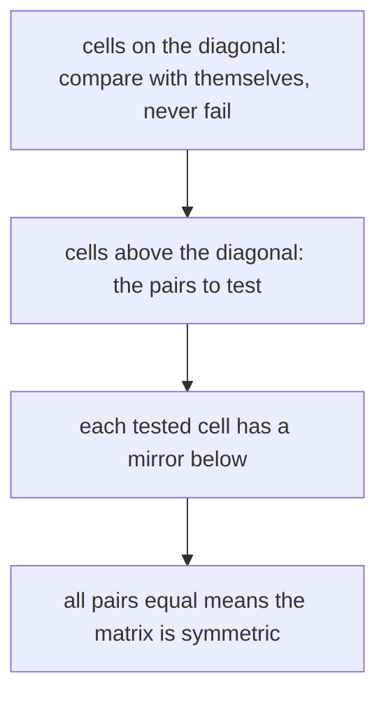
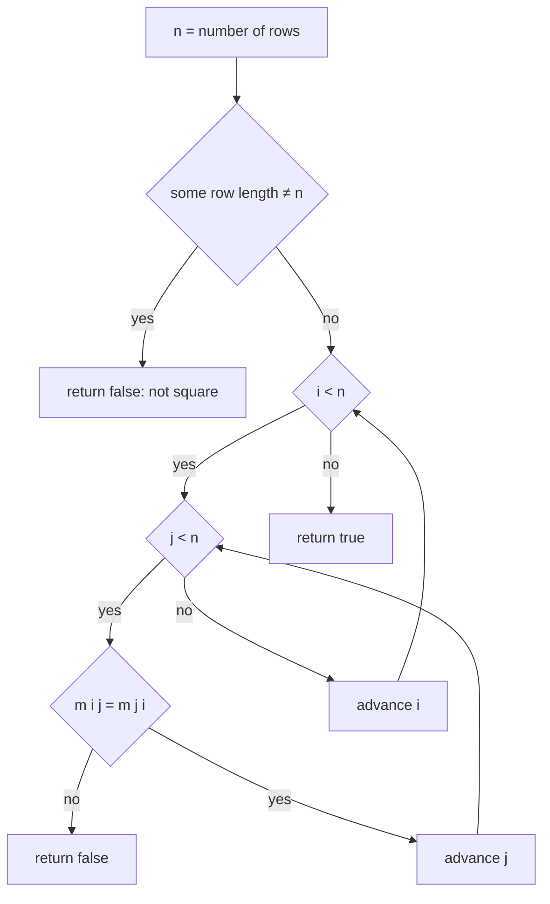
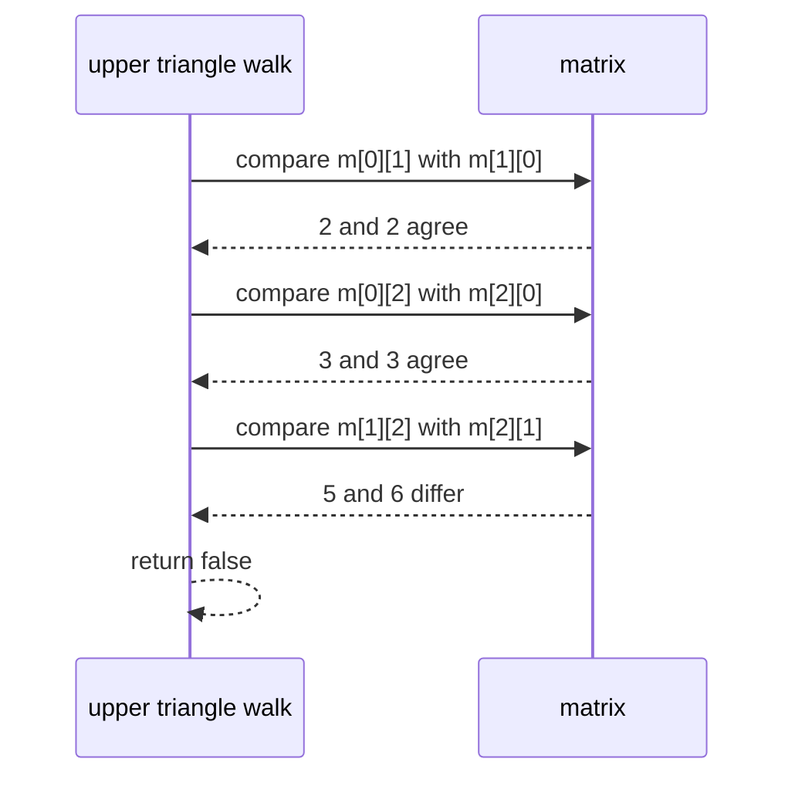

# 100 — Check if matrix is symmetric.

> **Tier:** Beginner · **CTCI chapter:** Ch 1 — Arrays and Strings
> **Task spec:** [100-check-if-matrix-is-symmetric.md](../../../tasks/beginner/100-check-if-matrix-is-symmetric.md)
> **Solutions:** [Python](../../../solutions/python/beginner/100-check-if-matrix-is-symmetric/solution.py) ·
> [Java](../../../solutions/java/beginner/100-check-if-matrix-is-symmetric/Solution.java) ·
> [JavaScript](../../../solutions/javascript/beginner/100-check-if-matrix-is-symmetric/solution.js) ·
> [C#](../../../solutions/csharp/beginner/100-check-if-matrix-is-symmetric/Solution.cs)

## 1. Problem restatement

**Input:** a matrix given as a sequence of rows, each row a sequence of values. Square, ragged and
empty shapes are all reachable inputs.

**Output:** a boolean — `true` exactly when `m[i][j] == m[j][i]` for every pair of valid indices,
i.e. when the matrix equals its own transpose.

Two structural rules come with that definition, and the assertions pin both down:

- a matrix that is not square — including a ragged matrix such as `[[1, 2], [2]]` — is
  immediately `false`, because the mirrored cell `m[j][i]` may not exist;
- the empty matrix is `true`, because the condition is vacuous.

| Call | Result | Why |
| --- | --- | --- |
| `is_symmetric([[1, 2], [2, 1]])` | `true` | the two off-diagonal cells match |
| `is_symmetric([[1, 2], [3, 4]])` | `false` | `m[0][1] = 2` but `m[1][0] = 3` |
| `is_symmetric([[5]])` | `true` | a single cell is trivially mirrored onto itself |
| `is_symmetric([[1, 2, 3], [2, 4, 5], [3, 5, 6]])` | `true` | all three mirrored pairs agree |
| `is_symmetric([[1, 2, 3], [2, 4, 5], [3, 6, 6]])` | `false` | mismatch at `(1, 2)` and `(2, 1)` |
| `is_symmetric([[1, 2, 3], [4, 5, 6]])` | `false` | non-square |
| `is_symmetric([[1, 2], [2]])` | `false` | ragged |
| `is_symmetric([])` | `true` | no cells to compare |
| `is_symmetric([[]])` | `false` | one row of length 0 is not square |

Note that a zero-length row makes the matrix non-square unless `n` is 0, which is why `[[]]` is
`false` while `[]` is `true`: the first has `n = 1` and a row of length 0, the second has `n = 0`
and no rows at all.

## 2. Intuition

The definition suggests an implementation in one line: transpose the matrix and compare it with
the original. That is O(n²) time and O(n²) extra space, and it wastes almost all of the work —
building the full transpose answers a question about every cell when the interesting question is
about pairs.

The insight is that symmetry is a **pairwise** property. Cell `(i, j)` and cell `(j, i)` are
mirror images across the main diagonal, so the check only has to consider the `n(n - 1)/2` pairs
above the diagonal. The cells on the diagonal compare with themselves and can never fail; the
cells below the diagonal are already covered by their upper partners. So the loop is exactly the
upper-triangle loop from the in-place transpose of
[099-rotate-matrix-90-degrees-clockwise-in-place-for-square.md](../../../tasks/beginner/099-rotate-matrix-90-degrees-clockwise-in-place-for-square.md),
except that it compares instead of swapping.



Two further observations shape the code:

- **The shape check comes first.** Instead of letting an index error decide the answer, the
  solutions compare every row's length against `n` and return `false` on the first mismatch. That
  turns a would-be crash into a boolean, which is what the ragged assertions demand.
- **The comparison is early-exit.** The first unequal pair is enough, so a matrix whose mismatch
  sits at the top of the triangle costs almost nothing — the loop returns `false` immediately.

## 3. Algorithm

1. Let `n` be the number of rows.
2. For every row, if its length is not `n`, return `false`.
3. For `i` from `0` to `n - 1`, for `j` from `i + 1` to `n - 1`: if `m[i][j]` is not equal to
   `m[j][i]`, return `false`.
4. If the loops finish without a mismatch, return `true`.

```text
procedure is_symmetric(m)
    n ← length(m)
    for each row in m do
        if length(row) ≠ n then
            return false
        end
    end
    for i ← 0 to n - 1 do
        for j ← i + 1 to n - 1 do
            if m[i][j] ≠ m[j][i] then
                return false
            end
        end
    end
    return true
end
```

The same shape written as the mirror-image predicate `m[i][j] = m[j][i]` also makes the running
time easy to reason about: every execution of the inner body either fails (and the whole function
returns) or proves one mirrored pair. A `true` answer therefore proves all `n(n - 1)/2` pairs,
which is the certificate the algorithm cannot avoid producing.



Because the shape check runs before any indexing, `m[0]` is never read for an empty matrix and
`m[j][i]` is never read for a ragged one. That ordering is what makes `[]` return `true` instead
of raising.

## 4. Worked example

Trace `is_symmetric([[1, 2, 3], [2, 4, 5], [3, 6, 6]])` — the `false` case from the assertions.
First the shape check: every row has length 3 and `n = 3`, so it passes. Then the upper-triangle
walk:

| Step | `i` | `j` | Left value `m[i][j]` | Right value `m[j][i]` | Decision |
| --- | --- | --- | --- | --- | --- |
| 1 | 0 | 1 | `2` | `2` | equal, continue |
| 2 | 0 | 2 | `3` | `3` | equal, continue |
| 3 | 1 | 2 | `5` | `6` | different, return `false` |

Three comparisons settle the question, and the fourth pair `(2, 1)` is never examined because it
is the same pair as step 3 seen from the other side. Compare that with the symmetric input
`[[1, 2, 3], [2, 4, 5], [3, 5, 6]]`, where step 3 reads `5` and `5`, the loops end, and the answer
is `true`.



The `true` cases have an interesting shape too. For `n = 1` the triangle is empty and the shape
check is a single row-length comparison, so the answer is `true` without a single element
comparison. For the empty matrix the shape loop has no rows, the triangle is empty, and the answer
is `true` as well — the two "no work to do" cases are the ones most likely to be broken by a
guard that inspects `m[0]`.

## 5. Complexity

Let `n` be the number of rows (equal to the number of columns for any matrix that can return
`true`).

| Measure | Bound | Why it holds |
| --- | --- | --- |
| Time, best | O(n) | the shape check alone runs to completion when a row has the wrong length, and a mismatch at `(0, 1)` costs the shape pass plus one comparison |
| Time, average | O(n²) | a symmetric matrix requires all `n(n - 1)/2` upper-triangle comparisons, which is Θ(n²) |
| Time, worst | O(n²) | the same as the average: success is the expensive case, since failure can exit early |
| Space, output | O(1) | one boolean |
| Space, extra | O(1) | two loop counters; nothing is copied |
| Alternative, transpose and compare | O(n²) time, O(n²) extra space | correct but allocates a second matrix and performs about twice as many comparisons |
| Alternative, compare all `(i, j)` pairs | O(n²) time, O(1) space | correct, but each pair is checked twice, once in each direction |

The interesting asymmetry is that the *negative* answer is often cheap and the *positive* answer is
always expensive: to say "symmetric" you must verify every pair, while to say "not symmetric" a
single counterexample suffices. That is the standard fingerprint of a universal quantification.

## 6. Pitfalls and edge cases

- **Non-square input is `false`, not an error.** `[[1, 2, 3], [4, 5, 6]]` returns `false` because
  row lengths differ from `n = 2`. The Python and JavaScript assertions check this explicitly, and
  no language raises.
- **Ragged input is `false`.** `[[1, 2], [2]]` is rejected by the length check before any mirrored
  read can go out of bounds. Without that pre-pass, the `j` loop would index past the end.
- **`[[]]` is `false` but `[]` is `true`.** `[[]]` has `n = 1` and row length 0, so the shape check
  fails. `[]` has `n = 0`, no rows to check and an empty triangle, so it succeeds. Getting these
  two backwards is the most common off-by-one in this task.
- **The empty triangle for `n = 1`.** `j` starts at `i + 1 = 1`, so the inner loop never runs and
  `[[5]]` is `true` without any comparison.
- **One comparison per pair, not two.** Looping `j` from `i + 1` (rather than from `0`) halves the
  work and avoids comparing a cell with itself, which is always true and carries no information.
- **The diagonal must not be compared against anything but itself.** Including `j = i` would still
  give correct answers — a value always equals itself — but it would add `n` pointless
  comparisons and, in languages with unusual equality semantics for floating point, could
  introduce false negatives for `NaN`. The shipped assertions use integers.
- **Values are compared, not identity.** `[[0, -1], [-1, 2]]` is `true` and `[[0, -1], [1, 2]]` is
  `false`, so negative and repeated values must compare by value. Nothing is sorted or normalised.
- **The input is not modified.** The function only reads; this is the read-only sibling of the
  in-place transpose in the previous task.
- **Symmetry is not the same as "symmetric-looking".** `[[1, 2, 3], [2, 4, 5], [3, 5, 6]]` is
  symmetric even though its values are not arranged in any pattern; the property is purely about
  mirrored equality.

## 7. Variants and follow-ups

- **Skew-symmetry.** Replace equality with `m[i][j] = -m[j][i]`; the diagonal must then hold only
  zeros, which is an extra check the symmetric version does not need.
- **Produce the witness.** Returning the mismatching `(i, j)` pair instead of a boolean is a small
  change that makes the failing case debuggable, at the cost of a wider return type.
- **Full transpose.** When the caller actually wants the transposed matrix rather than a yes/no
  answer, use [098-transpose-a-2d-matrix.md](../../../tasks/beginner/098-transpose-a-2d-matrix.md);
  the comparison here is the transpose check without the allocation.
- **In-place rotation.** The same upper triangle is the region that
  [099-rotate-matrix-90-degrees-clockwise-in-place-for-square.md](../../../tasks/beginner/099-rotate-matrix-90-degrees-clockwise-in-place-for-square.md)
  swaps instead of compares.
- The chapter walkthrough [Arrays and Strings](../../ctci/01-arrays-and-strings.md) presents
  symmetry and rotation as the two classic triangular traversals of a grid.

## 8. Check yourself

1. How many element comparisons does `is_symmetric` perform on a symmetric 4×4 matrix?

<details><summary>Show answer</summary>

`4 · 3 / 2 = 6` comparisons — one per upper-triangle cell. The shape check additionally reads four
row lengths, and the diagonal is never compared with anything but itself.

</details>

2. Why is `[]` symmetric but `[[]]` not?

<details><summary>Show answer</summary>

For `[]` the number of rows is 0, so there are no row lengths to contradict and the triangle is
empty; the property holds vacuously. For `[[]]` there is one row whose length is 0 while `n = 1`,
so the matrix is not square and the shape check returns `false` before any comparison happens.

</details>

3. What is the worst-case cost, and which input achieves it?

<details><summary>Show answer</summary>

Θ(n²), achieved by any *symmetric* matrix, because proving the property requires all
`n(n - 1)/2` upper-triangle comparisons. A non-symmetric matrix can be cheaper: the shipped
assertion `[[1, 2], [3, 4]]` fails at the very first comparison.

</details>

4. Why is the row-length pre-pass necessary rather than merely tidy?

<details><summary>Show answer</summary>

Because without it, `m[j][i]` can be out of range for ragged input, which would raise an index
error instead of returning the boolean the contract promises. The pre-pass turns every
non-square shape — long row, short row, or empty row — into a clean `false`.

</details>

5. Does `is_symmetric` need to look at the cells below the diagonal at all?

<details><summary>Show answer</summary>

No. Each off-diagonal cell has exactly one mirror across the diagonal, and the upper triangle
contains one member of every such pair. Reading the lower triangle would re-test pairs that were
already decided, doubling the comparisons without changing any answer.

</details>
