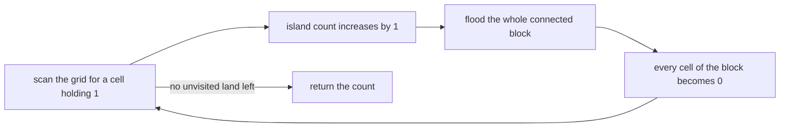
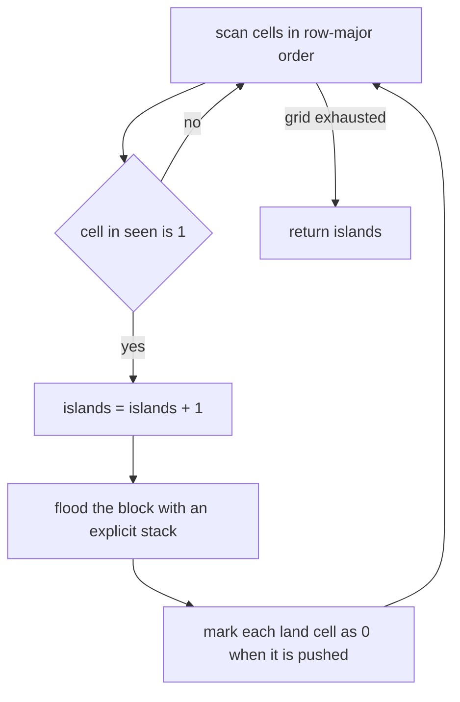
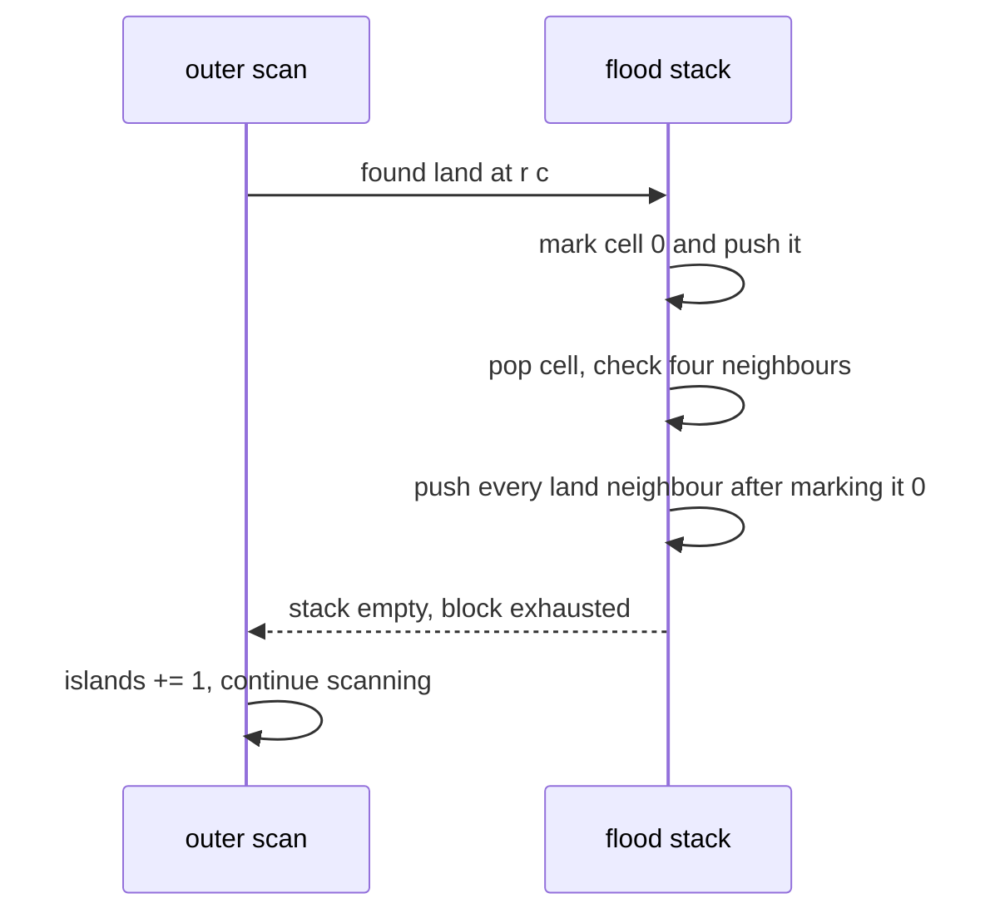

# 101 — Count islands in boolean grid (DFS).

> **Tier:** Beginner · **CTCI chapter:** Ch 4 — Trees and Graphs
> **Task spec:** [101-count-islands-in-boolean-grid-dfs.md](../../../tasks/beginner/101-count-islands-in-boolean-grid-dfs.md)
> **Solutions:** [Python](../../../solutions/python/beginner/101-count-islands-in-boolean-grid-dfs/solution.py) ·
> [Java](../../../solutions/java/beginner/101-count-islands-in-boolean-grid-dfs/Solution.java) ·
> [JavaScript](../../../solutions/javascript/beginner/101-count-islands-in-boolean-grid-dfs/solution.js) ·
> [C#](../../../solutions/csharp/beginner/101-count-islands-in-boolean-grid-dfs/Solution.cs)

## 1. Problem restatement

**Input:** a grid of `0` (water) and `1` (land) values, given as a sequence of rows. Cells are
connected **4-directionally** — up, down, left, right — and diagonal neighbours do not count as
connected. The grid may be empty or may contain an empty row.

**Output:** the number of maximal connected blocks of land. Formally, the number of connected
components of the graph whose vertices are the land cells and whose edges join land cells that
share an edge.

The grid is a *boolean* grid, so a component is a set of 1-cells; the solutions colour each
component as they find it and never revisit it.

| Call | Result | Why |
| --- | --- | --- |
| `count_islands([])` | `0` | no cells at all |
| `count_islands([[]])` | `0` | one row with no columns |
| `count_islands([[0, 0], [0, 0]])` | `0` | all water |
| `count_islands([[1, 1], [1, 1]])` | `1` | all land, one component |
| `count_islands([[1, 0], [0, 1]])` | `2` | the two 1s touch only diagonally |
| `count_islands([[1]])` | `1` | a single land cell |
| `count_islands([[0]])` | `0` | a single water cell |

The mixed 5×5 grid in the solution files is the real test: it contains seven 1s arranged as a
2×2 block, a two-cell vertical domino, a horizontal run of 1s plus a lone diagonal neighbour
below it, and three isolated single cells in the bottom row. The assertions expect **5**
components for it, and they also assert `mixed[0][0] == 1` afterwards — the input must come back
unchanged.

## 2. Intuition

The naive approach is to count cells that "start" an island: a land cell whose upper neighbour and
left neighbour are both water. That works for rectangles of land, but it is a local rule, and it
breaks as soon as a component bends — the cell at the inner corner of an L-shaped island has land
above and to the left, yet it is not a new island. Local counting cannot distinguish a corner from
a junction.

The key insight is that "island" is a **connectivity** question, and connectivity is answered by
traversal. Pick any unvisited land cell, walk to every land cell reachable from it, and mark them
all as visited; that whole walk is exactly one island. Repeat until no unvisited land remains.



The second decision is *how* to walk. Depth-first search over an explicit stack is what the
Python, C# and JavaScript files use; the Java file uses an `int` stack of encoded cells. Because
the walk immediately marks each cell as it is pushed, no cell can ever be pushed twice, and the
recursive-explosion problem of naive DFS on a large grid is avoided — the frontier holds each cell
at most once.

The third decision is what to mutate. The solutions copy the grid once
(`seen = [row[:] for row in grid]`, `grid[r].clone()`, `grid.map((row) => row.slice())`,
`(int[])grid[r].Clone()`) and flood the copy, setting visited cells to `0`. That single copy is
what lets them assert the input is untouched while still keeping the traversal cheap: a separate
`visited` array would serve the same purpose but would be a second structure of the same size.

## 3. Algorithm

1. If the grid has no rows, or its first row has no columns, return `0`.
2. Copy the grid into `seen`, so the caller's grid is never modified.
3. Iterate over every cell in row-major order. When `seen[r][c]` is `1`:
   1. Increment the island count.
   2. Flood the component: mark the cell `0`, push it on a stack, and while the stack is not
      empty, pop a cell, examine its four neighbours, and for every neighbour that is inside the
      grid and still `1`, mark it `0` and push it.
4. Return the island count.

```text
procedure count_islands(grid)
    if grid is empty or grid[0] is empty then
        return 0
    end
    rows ← length(grid)
    cols ← length(grid[0])
    seen ← copy of grid
    islands ← 0
    for r ← 0 to rows - 1 do
        for c ← 0 to cols - 1 do
            if seen[r][c] = 1 then
                islands ← islands + 1
                flood(seen, rows, cols, r, c)
            end
        end
    end
    return islands
end

procedure flood(grid, rows, cols, sr, sc)
    stack ← empty stack
    grid[sr][sc] ← 0
    push (sr, sc) onto stack
    while stack is not empty do
        (r, c) ← pop from stack
        for each (nr, nc) in right left down up neighbours of (r, c) do
            if 0 ≤ nr &lt; rows and 0 ≤ nc &lt; cols and grid[nr][nc] = 1 then
                grid[nr][nc] ← 0
                push (nr, nc) onto stack
            end
        end
    end
end
```

Marking a cell the moment it is *pushed* — rather than when it is popped — is what keeps the stack
free of duplicates. It also means the flood never needs to check "have I been here before"; the
grid itself is the visited set.



## 4. Worked example

Trace the small diagonal case `count_islands([[1, 0], [0, 1]])`, which must return `2`:

| Step | Scan position | `seen[r][c]` | Action | `islands` | Grid after the step |
| --- | --- | --- | --- | --- | --- |
| 1 | (0, 0) | `1` | flood from (0, 0): mark it `0`, push it; its neighbours (1, 0), (0, 1) are water; stack empties | 1 | `[[0, 0], [0, 1]]` |
| 2 | (0, 1) | `0` | skip | 1 | unchanged |
| 3 | (1, 0) | `0` | skip | 1 | unchanged |
| 4 | (1, 1) | `1` | flood from (1, 1): mark it `0`, push it; its neighbours are water; stack empties | 2 | `[[0, 0], [0, 0]]` |

The result is `2`, and the diagonal adjacency never enters the picture because the neighbour list
contains only the four orthogonal offsets.

Now trace the interesting part of the 5×5 grid, which is the top two rows:

```text
1 1 0 0 0
1 1 0 0 1
```

| Step | Scan position | Action | `islands` |
| --- | --- | --- | --- |
| 1 | (0, 0) | flood the 2×2 block: it spreads to (0, 1), (1, 0), (1, 1); the neighbour (2, 0) is water, so it stops | 1 |
| 2 | (1, 4) | the top-right `1` is a single-cell island: its neighbours (1, 3), (0, 4) and (2, 4) are all water | 2 |



The remaining three islands in the mixed grid come from the same two rows of logic: the vertical
domino in the middle, the horizontal run in row 2 with its diagonal neighbour in row 3, and the
three isolated singletons in the last row. The total is 5, exactly as asserted.

## 5. Complexity

Let `R` be the number of rows and `C` the number of columns, so `R·C` cells.

| Measure | Bound | Why it holds |
| --- | --- | --- |
| Time, best | O(R·C) | the shape check and the copy already touch every cell, so even an all-water grid costs Θ(R·C) |
| Time, average | O(R·C) | each cell is inspected once by the outer scan and at most once as a neighbour, because a cell becomes `0` when it is first pushed |
| Time, worst | O(R·C) | the constant per cell is bounded: four neighbour checks, one mark, at most one push |
| Space, output | O(1) | one integer |
| Space, extra (copy) | O(R·C) | `seen` holds the same number of cells as the grid |
| Space, extra (stack) | O(R·C) worst case | a spiral snake of land can leave O(R·C) cells pending in the frontier |
| Time of the naive corner-counting approach | O(R·C) but incorrect | it cannot tell an inner corner from a junction, so it over-counts bent islands |

Copying the grid is what makes the "input is not modified" assertion cheap to satisfy; an
alternative would be a separate boolean `visited` array of the same size, giving the same O(R·C)
extra space. Both choices pay one full grid of memory to protect the caller's data.

## 6. Pitfalls and edge cases

- **Empty grid and empty row.** `[]` and `[[]]` both return `0`. Both Python and JavaScript guard
  with `if not grid or not grid[0]`, and Java and C# check `length == 0 || grid[0].length == 0`, so
  no cell is ever indexed for these inputs.
- **Diagonal adjacency does not connect.** `[[1, 0], [0, 1]]` is asserted to be `2`. Dropping the
  diagonal offsets is a deliberate part of the contract; adding them would make the answer `1`.
- **All land, all water.** `[[1, 1], [1, 1]]` is a single component (`1`) and `[[0, 0], [0, 0]]` is
  `0`. The flood must handle the case where the very first cell is land *and* the case where it is
  water.
- **Mark before pushing, not when popping.** If a cell is only marked when it is popped, the same
  cell can enter the stack several times through different neighbours, and the frontier can grow
  far past the size of the component.
- **Do not mutate the caller's grid.** All four solutions copy first, and the Python file asserts
  `mixed[0][0] == 1` after the call. Flooding the input directly would be a visible, breaking
  side effect.
- **Bounds checks come first.** The condition order in the solutions is
  `0 <= nr < rows and 0 <= nc < cols and grid[nr][nc] == 1`; short-circuit evaluation is what
  prevents the neighbour read from escaping the grid.
- **Recursion depth.** The Python file's comment ("DFS over an explicit stack") is the reason the
  walk is iterative: a fully land-filled 1000×1000 grid would need a million-deep recursion in the
  worst case, which real interpreters and runtimes refuse.
- **Stack size in Java.** The Java solution allocates `new int[rows * cols]` and pushes encoded
  cell indices, so the frontier is bounded by the number of cells and never reallocates.
- **Ragged rows are not supported.** The solutions read `cols` from row 0 and index every row with
  it, so ragged input is out of contract, exactly as in the matrix tasks.
- **Every cell is counted exactly once.** The outer scan increments only when it sees a `1`, and
  the flood clears every cell of that component before the scan reaches it, so no component is
  counted twice.

## 7. Variants and follow-ups

- **Flood fill as a paint operation.** The same traversal, but instead of counting components it
  rewrites every cell of one component:
  [102-flood-fill-algorithm-dfs-bfs.md](../../../tasks/beginner/102-flood-fill-algorithm-dfs-bfs.md).
- **Breadth-first instead of depth-first.** Swapping the stack for a queue gives identical island
  counts; the frontier order changes, and that order is precisely what makes
  [103-shortest-path-in-unweighted-grid-bfs.md](../../../tasks/beginner/103-shortest-path-in-unweighted-grid-bfs.md)
  produce shortest distances.
- **The same traversal on a general graph.** An island is a connected component of a grid graph
  with four edges per interior vertex; the adjacency-list version is
  [104-implement-bfs-on-adjacency-list-graph.md](../../../tasks/beginner/104-implement-bfs-on-adjacency-list-graph.md).
- **Counting shapes instead of components.** Asking for the largest island, or for the number of
  islands of each size, needs the flood to report its own size rather than to increment a counter.
- The chapter walkthrough [Trees and Graphs](../../ctci/04-trees-and-graphs.md) introduces
  component counting as the first graph exercise after traversal itself.

## 8. Check yourself

1. Why is `[[1, 0], [0, 1]]` counted as two islands?

<details><summary>Show answer</summary>

Because the neighbour list contains only the four orthogonal offsets. The two 1s are diagonal to
each other, so there is no edge between them and each forms its own connected component.

</details>

2. What is the cost of copying the grid, and why do the solutions pay it?

<details><summary>Show answer</summary>

O(R·C) time and O(R·C) space. It buys two things: the traversal gets a writable visited marker for
free (a cell becomes `0` when it is flooded), and the caller's grid is guaranteed unchanged, which
the Python assertions check explicitly.

</details>

3. Why must a cell be marked `0` when it is pushed rather than when it is popped?

<details><summary>Show answer</summary>

If it is only marked on pop, several neighbours can push the same cell before it is ever processed,
so the stack can hold duplicates and the frontier can exceed the size of the component. Marking on
push makes the grid itself the visited set and guarantees at most one stack entry per cell.

</details>

4. The mixed 5×5 grid has seven 1s in its top two rows plus more elsewhere. How many islands do the
   solutions report for it?

<details><summary>Show answer</summary>

`5` — the assertion in every solution file. The components are the 2×2 block, the two-cell domino,
the horizontal run plus its diagonal neighbour, and the three singletons in the last row.

</details>

5. Would adding the four diagonal offsets change the complexity of the algorithm?

<details><summary>Show answer</summary>

No: the neighbour loop would examine eight offsets instead of four, which is still a constant, so
the time stays O(R·C) and the space stays O(R·C) for the copy. Only the answers change — bent
chains that meet at corners would merge into single components.

</details>
