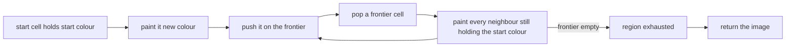
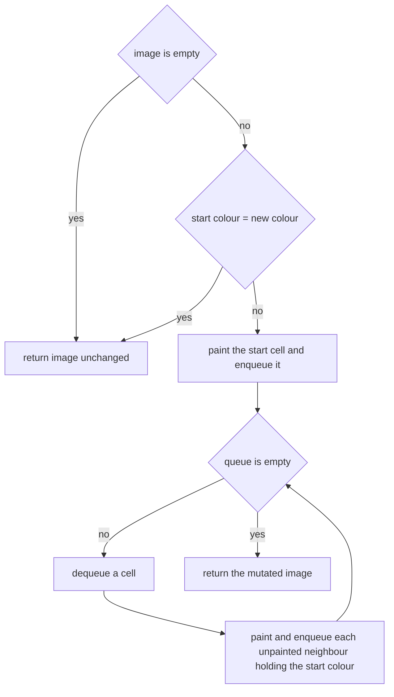
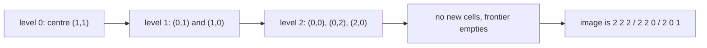

# 102 — Flood fill algorithm (DFS/BFS).

> **Tier:** Beginner · **CTCI chapter:** Ch 4 — Trees and Graphs
> **Task spec:** [102-flood-fill-algorithm-dfs-bfs.md](../../../tasks/beginner/102-flood-fill-algorithm-dfs-bfs.md)
> **Solutions:** [Python](../../../solutions/python/beginner/102-flood-fill-algorithm-dfs-bfs/solution.py) ·
> [Java](../../../solutions/java/beginner/102-flood-fill-algorithm-dfs-bfs/Solution.java) ·
> [JavaScript](../../../solutions/javascript/beginner/102-flood-fill-algorithm-dfs-bfs/solution.js) ·
> [C#](../../../solutions/csharp/beginner/102-flood-fill-algorithm-dfs-bfs/Solution.cs)

## 1. Problem restatement

**Input:** an image as a grid of integer colour codes, a start cell `(sr, sc)`, and a new colour
`new_color`. The start cell is assumed to be inside the grid — the solutions index `image[sr][sc]`
without a bounds check.

**Output:** the same image object, after every cell that is 4-directionally connected to the start
cell **through cells of the start colour** has been repainted with `new_color`. The mutation is the
point of the task: the solutions paint `image` in place and return it.

| Call | Result | Why |
| --- | --- | --- |
| `flood_fill([[1, 1, 1], [1, 1, 0], [1, 0, 1]], 1, 1, 2)` | `[[2, 2, 2], [2, 2, 0], [2, 0, 1]]` | the 1-region is repainted; the far `1` at (2, 2) is separated by the `0` at (2, 1) |
| `flood_fill([[0, 0], [0, 0]], 0, 0, 0)` | `[[0, 0], [0, 0]]` | filling with the colour the cell already has is a no-op |
| `flood_fill([[1, 1, 0], [0, 1, 0]], 0, 0, 5)` | `[[5, 5, 0], [0, 5, 0]]` | an L-shaped region |
| `flood_fill([[7]], 0, 0, 9)` | `[[9]]` | a single cell |
| `flood_fill([], 0, 0, 1)` | `[]` | empty image |
| `flood_fill([[1, 1], [1, 0]], 0, 0, 0)` | `[[0, 0], [0, 0]]` | zero is a legal colour, not a sentinel |

The last row matters: `0` is a perfectly ordinary colour code here, so an implementation that uses
`0` to mark "already painted" would corrupt the image rather than fill it.

## 2. Intuition

The naive idea is the recursive one: paint the start cell, then recursively paint each of its four
neighbours if they still hold the start colour. It is short and it is correct — but it commits two
sins at once. First, if `new_color` equals the colour the cell already has, the recursive call
repaints the cell with the same colour, the neighbour check stays true forever, and the program
recurses until the stack dies. Second, the recursion depth is proportional to the size of the
region, which on a large image is far beyond what most runtimes allow.

Both problems disappear with one observation each:

- **Recolouring is self-marking.** A cell stops matching "still has the start colour" the instant
  it is painted, so no separate visited set is needed — a cell can never be processed twice.
- **The self-loop needs an explicit guard.** When `start_color == new_color`, painting changes
  nothing, the cell keeps matching, and the frontier can never shrink. Returning immediately in
  that case is not an optimisation; it is what makes the algorithm terminate.

With those two facts, the traversal can be written as a queue-based sweep: paint the start cell,
push it, and while the frontier is non-empty, pop a cell and paint every unpainted neighbour that
still holds the start colour, pushing each one. Every cell of the region is painted exactly once.



Because a painted cell no longer matches the start colour, the "already visited" test costs nothing
extra — the image itself remembers. That is why the solution files carry no `visited` grid at all,
unlike the island counter, which needs the grid copy for a different reason (protecting the
caller's data).

## 3. Algorithm

1. If the image has no rows, or its first row has no columns, return the image unchanged.
2. Read `start_color = image[sr][sc]`. If it equals `new_color`, return the image unchanged.
3. Paint `image[sr][sc]` with `new_color` and enqueue `(sr, sc)`.
4. While the queue is not empty:
   1. Dequeue a cell.
   2. For each of the four orthogonal neighbours, if it is inside the grid and still holds
      `start_color`, paint it `new_color` and enqueue it.
5. Return the image.

```text
procedure flood_fill(image, sr, sc, new_color)
    if image is empty or image[0] is empty then
        return image
    end
    rows ← length(image)
    cols ← length(image[0])
    start_color ← image[sr][sc]
    if start_color = new_color then
        return image
    end
    image[sr][sc] ← new_color
    queue ← empty queue
    enqueue (sr, sc)
    while queue is not empty do
        (r, c) ← dequeue
        for each (nr, nc) in right left down up neighbours of (r, c) do
            if 0 ≤ nr &lt; rows and 0 ≤ nc &lt; cols and image[nr][nc] = start_color then
                image[nr][nc] ← new_color
                enqueue (nr, nc)
            end
        end
    end
    return image
end
```

The order in the neighbour condition is the same defensive order as in the island counter: bounds
first, colour test second. Because the colour of a painted cell changes immediately, the enqueue
happens at most once per cell, and the frontier never exceeds the number of cells in the region.



## 4. Worked example

Trace `flood_fill([[1, 1, 1], [1, 1, 0], [1, 0, 1]], 1, 1, 2)`. The start colour is `1` at the
centre, and the new colour is `2`.

| Step | Dequeued | Neighbours that still hold `1` | Painted | Frontier after the step |
| --- | --- | --- | --- | --- |
| 0 | — | start cell painted before the loop | (1, 1) | [(1, 1)] |
| 1 | (1, 1) | (0, 1) and (1, 0) — (1, 2) holds `0`, (2, 1) holds `0` | (0, 1), (1, 0) | [(0, 1), (1, 0)] |
| 2 | (0, 1) | (0, 0) and (0, 2) | (0, 0), (0, 2) | [(1, 0), (0, 0), (0, 2)] |
| 3 | (1, 0) | (2, 0) | (2, 0) | [(0, 0), (0, 2), (2, 0)] |
| 4 | (0, 0) | none — all four neighbours are painted or water | — | [(0, 2), (2, 0)] |
| 5 | (0, 2) | none | — | [(2, 0)] |
| 6 | (2, 0) | none — (2, 1) holds `0` | — | [] |

Seven cells are painted, and the cell `(2, 2)` keeps its `1` because the only path to it from the
centre is blocked by the `0` at `(2, 1)`. The final image is `[[2, 2, 2], [2, 2, 0], [2, 0, 1]]`,
exactly as asserted.



The level structure also shows why a queue is safe here: each cell enters the queue once, and the
distance from the start cell only ever grows, so the sweep terminates after exactly one visit per
painted cell. A stack instead of a queue would paint the same set in a different order — the
L-shaped `[[1, 1, 0], [0, 1, 0]]` assertion would still yield `[[5, 5, 0], [0, 5, 0]]`.

## 5. Complexity

Let `R` and `C` be the image dimensions and `k` the number of cells that get painted.

| Measure | Bound | Why it holds |
| --- | --- | --- |
| Time, best | O(1) | when `start_color = new_color` the function returns after two comparisons |
| Time, average | O(R·C) | each painted cell is dequeued once and checks four neighbours, so the work is proportional to the region plus its boundary |
| Time, worst | O(R·C) | a single-colour image paints every cell, giving 4 checks per cell |
| Space, output | O(1) | the image is mutated in place, and it is the same object the caller already owns |
| Space, extra | O(k) worst case | the frontier can hold every cell of the region, as in a checkerboard-free all-one image |
| Time of the recursive variant | O(R·C) | same work, but the call stack costs O(k) and can overflow |
| Space of a `visited` grid variant | O(R·C) | an alternative marking scheme that this task does not need |

The interesting comparison is not between DFS and BFS — both visit each cell once, so both are
O(k) — but between "mark by repainting" and "mark in a separate array". Repainting saves a whole
`R × C` structure, at the price of one early-return guard; that trade is the reason the shipped
solutions are as short as they are.

## 6. Pitfalls and edge cases

- **`start_color = new_color` must return immediately.** All four solutions guard it. Without the
  guard the traversal never terminates, because a repainted cell still matches the colour test.
  The assertion `flood_fill([[0, 0], [0, 0]], 0, 0, 0)` covers it.
- **Zero is a colour.** `flood_fill([[1, 1], [1, 0]], 0, 0, 0)` must produce `[[0, 0], [0, 0]]`, so
  `0` cannot be used as a "not yet painted" sentinel. Painting is the only marker available.
- **Empty image.** `flood_fill([], 0, 0, 1)` returns `[]`; the guard is the same empty-shape check
  as in the island counter and the matrix tasks.
- **No bounds check on `(sr, sc)`.** The solutions trust the caller: `image[sr][sc]` is read
  before anything else, so an out-of-range start raises. That is a deliberate simplification, not
  an oversight — the assertions never pass a bad start.
- **The input is mutated on purpose.** This differs from
  [101-count-islands-in-boolean-grid-dfs.md](../../../tasks/beginner/101-count-islands-in-boolean-grid-dfs.md),
  which copies the grid to protect it. Here the mutation *is* the answer, so every solution writes
  through the caller's rows.
- **Frontier implementation.** Python uses `collections.deque` with `popleft`, Java uses
  `ArrayDeque`, C# uses `Queue<(int, int)>`, and JavaScript uses an array with a `head` index
  instead of `shift` — `shift` would be O(n) per dequeue and would make the whole fill quadratic.
- **Diagonal neighbours are not painted.** As in the island task, only the four orthogonal offsets
  are used; a diagonal-only connection leaves cells unpainted.
- **Ragged rows are out of contract.** `cols` is read from row 0, so all rows must have the same
  length.
- **Painting order within a level is unspecified.** The assertions compare the final image, never
  the visit order, so a DFS traversal satisfies them just as well as the shipped BFS traversal.

## 7. Variants and follow-ups

- **Counting components instead of painting one.** The identical traversal, used to count rather
  than to recolour, is
  [101-count-islands-in-boolean-grid-dfs.md](../../../tasks/beginner/101-count-islands-in-boolean-grid-dfs.md).
- **Distances instead of colours.** The same sweep, with a distance array in place of the paint,
  answers shortest-path queries:
  [103-shortest-path-in-unweighted-grid-bfs.md](../../../tasks/beginner/103-shortest-path-in-unweighted-grid-bfs.md).
- **The scanline variant.** Real paint programs fill horizontal runs and only queue the rows above
  and below, which keeps the frontier size proportional to the number of runs rather than to the
  number of cells.
- **8-connected filling.** Adding the four diagonal offsets turns the fill into a different
  region-growing rule; the asymptotics do not change, but the answers do.
- The chapter walkthrough [Trees and Graphs](../../ctci/04-trees-and-graphs.md) develops flood
  fill as the grid version of a depth-first sweep.

## 8. Check yourself

1. Why does the algorithm need an explicit guard for `start_color == new_color`?

<details><summary>Show answer</summary>

Because painting a cell with the colour it already has does not stop it from matching the colour
test. The frontier would keep refilling with the same neighbours forever. Returning early breaks
the self-loop and also matches the asserted result, which leaves such an image untouched.

</details>

2. How many cells does `flood_fill([[1, 1, 1], [1, 1, 0], [1, 0, 1]], 1, 1, 2)` paint, and why
   doesn't the `1` at `(2, 2)` get painted?

<details><summary>Show answer</summary>

Seven cells: the whole 1-region except the isolated one. The cell at `(2, 2)` is only diagonal to
painted land, and its orthogonal neighbours `(2, 1)` and `(1, 2)` both hold `0`, so the sweep can
never reach it.

</details>

3. What is the frontier's worst-case size?

<details><summary>Show answer</summary>

O(k), where `k` is the number of cells in the region: on an all-one image the sweep can hold a
large fraction of the region at once. The bounded case is not required for correctness, only for
memory — the marking-on-push rule caps the frontier at one entry per cell.

</details>

4. Would a DFS traversal produce a different final image for the shipped assertions?

<details><summary>Show answer</summary>

No. Both traversals paint exactly the set of cells reachable from the start through start-coloured
cells, and the assertions compare final images. The visit *order* differs, but nothing in the task
depends on it.

</details>

5. Why does the JavaScript solution keep a `head` index instead of calling `shift()`?

<details><summary>Show answer</summary>

Because `Array.prototype.shift` moves every remaining element, making each dequeue O(n) and the
whole fill O(n²). Tracking a `head` index makes dequeue O(1), which is what the C# `Queue`, Java
`ArrayDeque` and Python `deque` give natively.

</details>
