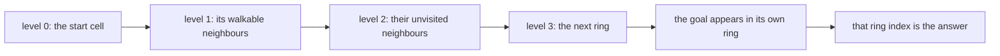
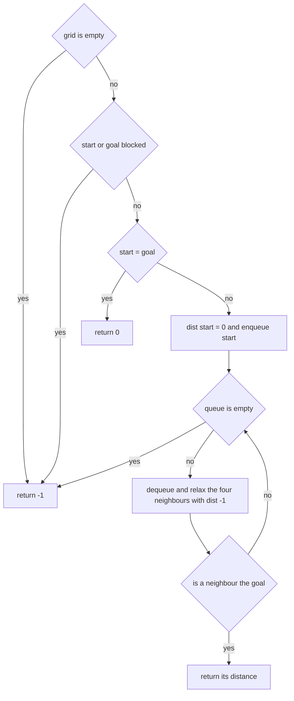

# 103 — Shortest path in unweighted grid (BFS).

> **Tier:** Beginner · **CTCI chapter:** Ch 11 — Testing
> **Task spec:** [103-shortest-path-in-unweighted-grid-bfs.md](../../../tasks/beginner/103-shortest-path-in-unweighted-grid-bfs.md)
> **Solutions:** [Python](../../../solutions/python/beginner/103-shortest-path-in-unweighted-grid-bfs/solution.py) ·
> [Java](../../../solutions/java/beginner/103-shortest-path-in-unweighted-grid-bfs/Solution.java) ·
> [JavaScript](../../../solutions/javascript/beginner/103-shortest-path-in-unweighted-grid-bfs/solution.js) ·
> [C#](../../../solutions/csharp/beginner/103-shortest-path-in-unweighted-grid-bfs/Solution.cs)

## 1. Problem restatement

**Input:** a grid where `0` means walkable and `1` means blocked, plus a start cell and a goal cell.
The solutions assume both coordinates are inside the grid.

**Output:** the minimum number of 4-directional moves needed to walk from start to goal through
walkable cells, or `-1` when no such walk exists. A walk that never leaves the start cell costs `0`
moves.

| Call | Result | Why |
| --- | --- | --- |
| `shortest_path([[0, 0, 0], [0, 0, 0], [0, 0, 0]], (0, 0), (2, 2))` | `4` | two moves right plus two down |
| `shortest_path([[0, 0, 0], [0, 0, 0], [0, 0, 0]], (0, 0), (0, 0))` | `0` | start equals goal |
| `shortest_path([[0]], (0, 0), (0, 0))` | `0` | a single walkable cell |
| `shortest_path([[0, 0, 0], [1, 1, 0], [0, 0, 0]], (0, 0), (2, 0))` | `6` | the wall forces a detour around the right end |
| `shortest_path([[0, 1], [1, 0]], (0, 0), (1, 1))` | `-1` | the two cells touch only diagonally |
| `shortest_path([[0, 1], [0, 0]], (0, 0), (0, 1))` | `-1` | the goal is blocked |
| `shortest_path([[0, 1], [0, 0]], (0, 1), (0, 0))` | `-1` | the start is blocked |
| `shortest_path([], (0, 0), (0, 0))` | `-1` | there is no grid |
| `shortest_path` on an open 4×4, `(0, 0)` to `(3, 3)` | `6` | the Manhattan distance, which is achievable with no obstacles |

The blocked-start and blocked-goal rows are part of the contract: both are checked before the
search begins, and both return `-1` rather than raising.

## 2. Intuition

The naive idea is depth-first: walk from the start, and whenever you reach the goal compare the
length of the walk with the best one so far. That is correct but exponential in the worst case,
because it enumerates walks rather than cells — and it wastes the one piece of structure the
problem hands you for free: **every move costs exactly one**.

The key insight is that BFS explores cells in non-decreasing order of their true distance from the
start. The start is at distance 0; its walkable neighbours are at distance 1; their unvisited
neighbours are at distance 2; and so on. Therefore the first time the goal is *discovered*, the
distance recorded for it is already the minimum. No comparison, no backtracking, no "best so
far".



Two details turn the insight into the shipped code:

- **The distance array doubles as the visited set.** `dist[r][c] = -1` means "not yet reached", so
  a cell is enqueued exactly when its distance is first assigned. There is no separate `visited`
  grid.
- **The answer is returned at discovery, not at dequeue.** The moment a neighbour of the current
  cell is the goal, its distance is `dist[current] + 1`, which is the minimum; returning then
  avoids processing the rest of that level.

Blocked start and blocked goal are checked *before* the search, because a blocked goal can never be
discovered (its `dist` stays `-1`) and a blocked start would be enqueued as if it were walkable.

## 3. Algorithm

1. If the grid has no rows, or its first row has no columns, return `-1`.
2. If the start cell or the goal cell is blocked (`1`), return `-1`.
3. If start equals goal, return `0`.
4. Create a `dist` grid with `-1` in every cell; set `dist[sr][sc] = 0` and enqueue `(sr, sc)`.
5. While the queue is not empty:
   1. Dequeue `(r, c)`.
   2. For each of the four orthogonal neighbours `(nr, nc)`: if it is inside the grid, walkable,
      and still marked `-1`, set `dist[nr][nc] = dist[r][c] + 1`. If it is the goal, return that
      distance; otherwise enqueue it.
6. If the queue empties without reaching the goal, return `-1`.

```text
procedure shortest_path(grid, start, goal)
    if grid is empty or grid[0] is empty then
        return -1
    end
    rows ← length(grid)
    cols ← length(grid[0])
    (sr, sc) ← start
    (gr, gc) ← goal
    if grid[sr][sc] = 1 or grid[gr][gc] = 1 then
        return -1
    end
    if start = goal then
        return 0
    end
    dist ← grid of rows by cols filled with -1
    dist[sr][sc] ← 0
    queue ← empty queue
    enqueue (sr, sc)
    while queue is not empty do
        (r, c) ← dequeue
        for each (nr, nc) in right left down up neighbours of (r, c) do
            if 0 ≤ nr &lt; rows and 0 ≤ nc &lt; cols and grid[nr][nc] = 0 and dist[nr][nc] = -1 then
                dist[nr][nc] ← dist[r][c] + 1
                if (nr, nc) = goal then
                    return dist[nr][nc]
                end
                enqueue (nr, nc)
            end
        end
    end
    return -1
end
```

The `dist[nr][nc] = -1` test is the visited test, and it is evaluated after the walkability test, so
a blocked neighbour is never assigned a distance. The goal test happens *inside* the relaxation
step, which is exactly why the returned value is the goal's true distance rather than "one more
than its parent's".



## 4. Worked example

Trace the forced-detour case, which is the assertion that separates BFS from greedy walking:

```text
0 0 0
1 1 0
0 0 0
```

Start `(0, 0)`, goal `(2, 0)`. Column 0 of the middle row is blocked, so the only way down is
through column 2.

| Step | Dequeued | Distance | Neighbours relaxed | `dist` after the step (rows top to bottom) |
| --- | --- | --- | --- | --- |
| 0 | — | — | start | `[0, -1, -1] / [-1, -1, -1] / [-1, -1, -1]` |
| 1 | (0, 0) | 0 | (0, 1) → 1 | `[0, 1, -1] / [-1, -1, -1] / [-1, -1, -1]` |
| 2 | (0, 1) | 1 | (0, 2) → 2 | `[0, 1, 2] / [-1, -1, -1] / [-1, -1, -1]` |
| 3 | (0, 2) | 2 | (1, 2) → 3 | `[0, 1, 2] / [-1, -1, 3] / [-1, -1, -1]` |
| 4 | (1, 2) | 3 | (2, 2) → 4 | `[0, 1, 2] / [-1, -1, 3] / [-1, -1, 4]` |
| 5 | (2, 2) | 4 | (2, 1) → 5 | `[0, 1, 2] / [-1, -1, 3] / [-1, -1, 4]` with (2, 1) = 5 |
| 6 | (2, 1) | 5 | (2, 0) → 6, which is the goal | return `6` |

Six moves: two right along the top, two down the right column, two left along the bottom. The
straight-down path of length 2 is blocked, and BFS proves that 6 is optimal by exhausting every
shorter possibility first.


Compare the open 4×4 case: start `(0, 0)`, goal `(3, 3)`, no obstacles. Every step can move either
right or down, so the answer is `3 + 3 = 6`, the Manhattan distance, and BFS reaches it after
exploring the cells within distance 5. The unreachable case `[[0, 1], [1, 0]]` shows the other
extreme: the goal is diagonal-only, `dist[1][1]` stays `-1`, the queue empties, and the function
returns `-1`.

## 5. Complexity

Let `R` and `C` be the grid dimensions, so `V = R·C` cells and at most `E = 4·V` edges.

| Measure | Bound | Why it holds |
| --- | --- | --- |
| Time, best | O(1) | start equal to goal returns after three checks; blocked start or goal returns even sooner |
| Time, average | O(V) | each cell is enqueued at most once and checks four neighbours, so the work is proportional to the reachable cells |
| Time, worst | O(V) | an all-open grid processes every cell before the queue empties, for 4 checks per cell |
| Space, output | O(1) | one integer |
| Space, extra | O(V) | the `dist` grid, plus a frontier holding at most one entry per cell |
| Time of exhaustive walk enumeration | exponential | every walk must be explored, because a walk is re-derived rather than a cell being marked |
| Time of Dijkstra on this grid | O(V log V) | correct but heavier: a heap is only needed once edge weights differ |

The `dist` grid is doing double duty: it stores the answer for the goal and acts as the visited set
for every other cell. That is why the space is O(V) rather than O(V) for distances plus O(V) for a
visited set — the two grids are the same grid.

## 6. Pitfalls and edge cases

- **Blocked start and blocked goal.** Both return `-1` before any search. `[[0, 1], [0, 0]]` with
  start `(0, 1)` is asserted, and so is the goal-blocked direction. A blocked goal can never be
  discovered, so without the pre-check the function would return `-1` anyway — but the pre-check
  makes the reason explicit.
- **Start equals goal returns `0`.** Both the open 3×3 and the single-cell grid assert this. A
  naive "relax neighbours, look for the goal" loop finds the goal only *after* one move and would
  wrongly answer `2` or fail.
- **Empty grid.** `[]` returns `-1` in all four solutions; the guard runs before `start` or `goal`
  is ever used for indexing.
- **Diagonal-only contact is unreachable.** `[[0, 1], [1, 0]]` is asserted as `-1`, the same
  4-connectivity rule as the island counter and the flood fill.
- **Marking on discovery, not on dequeue.** If a cell's distance were assigned when it is
  dequeued, the same cell could sit in the queue several times and the returned distance could
  depend on the queue order. Assigning at discovery gives both the visited flag and the exact
  distance, and it is what makes the early return safe.
- **Return `dist[nr][nc]`, not `dist[r][c] + 1` computed elsewhere.** The two are equal, but the
  goal test happens after the assignment, so the stored value is the authoritative one.
- **Walls are `1`, walkable is `0`.** This is the opposite convention from the island counter,
  where `1` is the interesting value. Mixing the two up turns every answer into `-1`.
- **Manhattan distance is only a lower bound.** The open 4×4 assertion happens to equal the
  Manhattan distance, but the detour assertion (`6` instead of `2`) is the proof that obstacles
  break the bound.
- **Frontier implementation.** Python uses `deque.popleft`, Java `ArrayDeque`, C# `Queue<T>`, and
  JavaScript an array with a `head` index — the same O(1)-dequeue arrangements as in the flood
  fill.
- **Unreachable regions leave `-1` markers.** Cells that the sweep never reaches keep their initial
  `-1`, which is indistinguishable from "not yet visited" — fine for this task, but a caller who
  wants the full distance map must remember that the two cases are conflated.

## 7. Variants and follow-ups

- **Painting instead of measuring.** The same sweep, replacing `dist` with a repaint, is the flood
  fill of [102-flood-fill-algorithm-dfs-bfs.md](../../../tasks/beginner/102-flood-fill-algorithm-dfs-bfs.md).
- **Returning the path, not its length.** Keep a parent pointer per cell and walk back from the
  goal; the search cost is unchanged.
- **Graph BFS.** The general form of the same level-order sweep over an adjacency list is
  [104-implement-bfs-on-adjacency-list-graph.md](../../../tasks/beginner/104-implement-bfs-on-adjacency-list-graph.md).
- **Weighted grids.** Once moves have different costs, the queue must become a priority queue —
  the continuation is
  [113-simple-dijkstra-s-algorithm-non-negative-weights.md](../../../tasks/beginner/113-simple-dijkstra-s-algorithm-non-negative-weights.md).
- The chapter walkthrough [Trees and Graphs](../../ctci/04-trees-and-graphs.md) presents BFS as
  the level-order traversal that makes "first visit is optimal" work.

## 8. Check yourself

1. Why does BFS not need to compare candidate paths?

<details><summary>Show answer</summary>

Because it dequeues cells in non-decreasing order of distance. When the goal is first discovered it
is discovered from a cell at distance `d`, and no later discovery can beat `d + 1`. The first
discovery is therefore optimal by construction.

</details>

2. What does the algorithm return for `[[0, 1], [1, 0]]` with start `(0, 0)` and goal `(1, 1)`, and
   why?

<details><summary>Show answer</summary>

`-1`. The only walkable cells are `(0, 0)` and `(1, 1)`, and they share no edge — the moves allowed
are the four orthogonal ones — so the goal is never discovered, the queue empties, and the final
return is `-1`.

</details>

3. Why is the start-equals-goal case checked before the search?

<details><summary>Show answer</summary>

Because a loop that only looks for the goal among *neighbours* would never produce distance 0 for
the start itself. The assertions require `0` for the 3×3 open grid and for the single-cell grid, so
the case has to be handled explicitly.

</details>

4. How much memory does the search use beyond the input?

<details><summary>Show answer</summary>

O(V) for the `dist` grid and O(V) worst case for the frontier, so O(V) overall. The `dist` grid is
also the visited set, so no third structure is needed.

</details>

5. The detour assertion expects `6` while the straight-line distance is `2`. What does that tell you
   about using Manhattan distance as an answer?

<details><summary>Show answer</summary>

That it is only a lower bound on the true shortest walk and can be arbitrarily loose. It is exactly
right when the grid is open (the 4×4 assertion) and wrong as soon as walls force a detour, which is
why the search has to actually expand cells.

</details>
