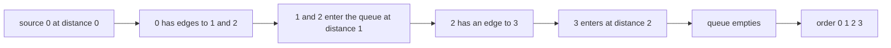
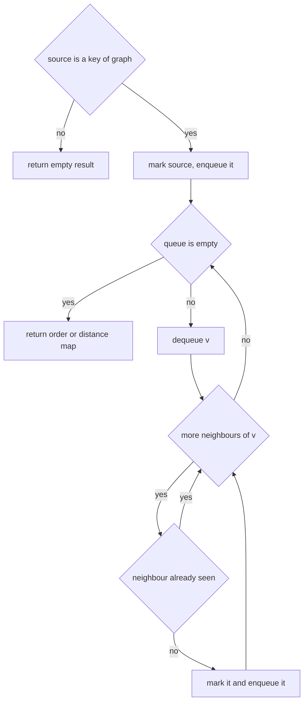
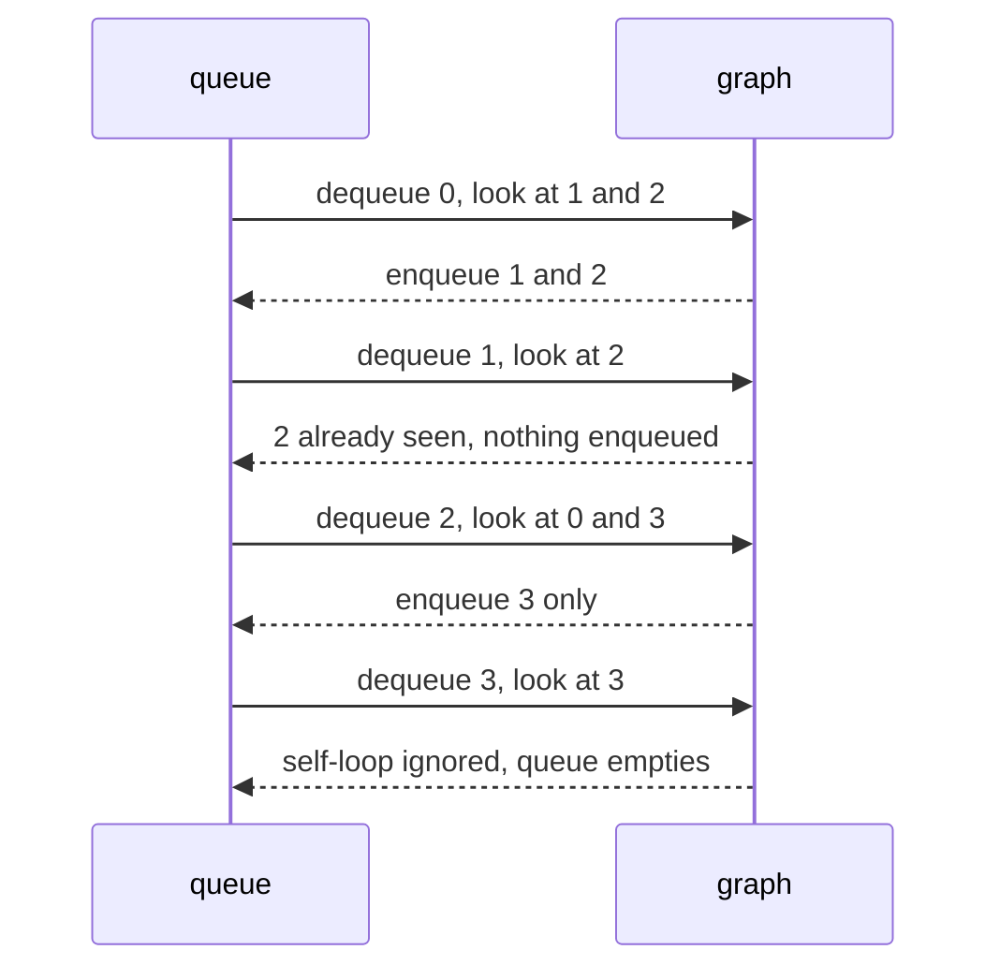

# 104 — Implement BFS on adjacency list graph.

> **Tier:** Beginner · **CTCI chapter:** Ch 4 — Trees and Graphs
> **Task spec:** [104-implement-bfs-on-adjacency-list-graph.md](../../../tasks/beginner/104-implement-bfs-on-adjacency-list-graph.md)
> **Solutions:** [Python](../../../solutions/python/beginner/104-implement-bfs-on-adjacency-list-graph/solution.py) ·
> [Java](../../../solutions/java/beginner/104-implement-bfs-on-adjacency-list-graph/Solution.java) ·
> [JavaScript](../../../solutions/javascript/beginner/104-implement-bfs-on-adjacency-list-graph/solution.js) ·
> [C#](../../../solutions/csharp/beginner/104-implement-bfs-on-adjacency-list-graph/Solution.cs)

## 1. Problem restatement

**Input:** a directed graph as an adjacency list — a map from a vertex to the list of vertices it
points at — and a source vertex. A vertex that appears only as a neighbour of another vertex is
allowed to have no entry of its own, in which case it has no outgoing edges.

**Output:** two things, from two functions:

- **`bfs_order(graph, source)`** — the list of vertices in the order BFS dequeues them, i.e. level
  order. A vertex is listed exactly once even if many edges lead to it. Vertices in other
  components are never listed; a source that is not a key of the map produces an empty list.
- **`bfs_distances(graph, source)`** — a map from each reachable vertex to its number of edges
  from the source. The source itself maps to `0`. Unreachable vertices are simply absent.

| Call | Result | Why |
| --- | --- | --- |
| `bfs_order({0: [1, 2], 1: [2], 2: [0, 3], 3: [3]}, 0)` | `[0, 1, 2, 3]` | the cycle back to `0` is visited once |
| `bfs_distances({0: [1, 2], 1: [2], 2: [0, 3], 3: [3]}, 0)` | `{0: 0, 1: 1, 2: 1, 3: 2}` | `3` is two edges away |
| `bfs_order({0: [1], 1: [0], 2: [3], 3: [2], 4: []}, 0)` | `[0, 1]` | the second component is unreachable |
| `bfs_distances({0: [1], 1: [0], 2: [3], 3: [2], 4: []}, 0)` | `{0: 0, 1: 1}` | unreachable vertices are missing, not `-1` |
| `bfs_order({0: [1], 1: [0], 2: [3], 3: [2], 4: []}, 4)` | `[4]` | a vertex with no edges is its own component |
| `bfs_order({0: [1], 1: [0], 2: [3], 3: [2], 4: []}, 99)` | `[]` | the source is not in the graph |
| `bfs_order({5: [6], 6: [5, 7], 7: [5]}, 5)` | `[5, 6, 7]` | a three-vertex cycle is traversed once each |
| `bfs_order({}, 0)` | `[]` | the empty graph has nothing to visit |

## 2. Intuition

The naive idea is to walk the graph by recursion and collect whatever order falls out. On a graph
that is not a tree that approach has two failure modes: a cycle makes it recurse forever, and a
vertex with two parents is reported twice. "Visited" is not bookkeeping you can add at the end —
it is the thing that makes traversal terminate.

The key insight is that a queue turns "visited" into a *schedule*. A vertex that is already
enqueued does not need to be enqueued again, so the frontier holds each vertex at most once, and
the order in which vertices leave the queue is exactly increasing distance from the source:

- the source is at distance 0 and enters first;
- its neighbours are discovered while it is processed and enter next, all at distance 1;
- their unvisited neighbours enter after them, all at distance 2.

Because a queue is FIFO, everything at distance `d` is dequeued before anything at distance
`d + 1`. That single property makes the traversal both terminating and level-ordered, and it is
what lets `bfs_distances` record `dist[v] + 1` without ever having to correct a value.



Note that `bfs_order` and `bfs_distances` are the same sweep carrying different luggage: the first
appends each dequeued vertex to a list, the second records the distance of each *discovered*
vertex. In both cases the visited test is the structure itself — a hash set in `bfs_order`, the
distance map's keys in `bfs_distances`.

## 3. Algorithm

`bfs_order`:

1. If the source is not a key of the graph, return an empty list.
2. Put the source in the seen set and enqueue it.
3. While the queue is not empty: dequeue a vertex, append it to the order, and for each neighbour
   that is not in the seen set, add it to the set and enqueue it.
4. Return the order.

```text
procedure bfs_order(graph, source)
    if source is not a key of graph then
        return empty list
    end
    seen ← set containing source
    order ← empty list
    queue ← empty queue
    enqueue source
    while queue is not empty do
        v ← dequeue
        append v to order
        for each w in neighbours of v do
            if w is not in seen then
                add w to seen
                enqueue w
            end
        end
    end
    return order
end
```

`bfs_distances` replaces the seen set with the distance map: a vertex is "seen" precisely when it
has an entry, and the entry is written at the moment the vertex is enqueued.

```text
procedure bfs_distances(graph, source)
    if source is not a key of graph then
        return empty map
    end
    dist ← map with source mapped to 0
    queue ← empty queue
    enqueue source
    while queue is not empty do
        v ← dequeue
        for each w in neighbours of v do
            if w is not a key of dist then
                dist[w] ← dist[v] + 1
                enqueue w
            end
        end
    end
    return dist
end
```

Marking at enqueue time — in both functions — is what guarantees at most one queue entry per
vertex. Marking at dequeue time would let the frontier collect duplicates and, in `bfs_distances`,
would let a longer distance overwrite a shorter one.



## 4. Worked example

Trace `bfs_order({0: [1, 2], 1: [2], 2: [0, 3], 3: [3]}, 0)`. The graph has a cycle `0 → 2 → 0`
and a self-loop `3 → 3`, so both guards are exercised.

| Step | Dequeued | Neighbours examined | Newly seen | Queue after the step | Order so far |
| --- | --- | --- | --- | --- | --- |
| 0 | — | — | `0` (at enqueue time) | `[0]` | `[]` |
| 1 | `0` | `1`, `2` | `1`, `2` | `[1, 2]` | `[0]` |
| 2 | `1` | `2` | none — `2` is already seen | `[2]` | `[0, 1]` |
| 3 | `2` | `0`, `3` | `3` — `0` is already seen | `[3]` | `[0, 1, 2]` |
| 4 | `3` | `3` | none — self-loop | `[]` | `[0, 1, 2, 3]` |

The order is `[0, 1, 2, 3]`, and the distances are `{0: 0, 1: 1, 2: 1, 3: 2}`: `3` was discovered
from `2`, which is at distance 1. Both assertions match.



Now consider the disconnected graph `{0: [1], 1: [0], 2: [3], 3: [2], 4: []}` with source `0`. The
sweep reaches `1` and stops: vertices `2`, `3` and `4` are never visited, so the order is `[0, 1]`
and the distance map is `{0: 0, 1: 1}`. With source `4` the sweep produces `[4]` and `{4: 0}` — a
vertex with no edges is a component of size one. This is the visible difference from the DFS
variant, which offers an explicit `dfs_all` for the whole graph; the BFS task deliberately keeps
the single-source shape.

## 5. Complexity

Let `V` be the number of vertices in the map and `E` the total number of adjacency entries.

| Measure | Bound | Why it holds |
| --- | --- | --- |
| Time, best | O(1) | a missing source returns immediately; a source with no edges dequeues once |
| Time, average | O(V + E) | each vertex is enqueued at most once (the seen test) and each adjacency entry is examined exactly once |
| Time, worst | O(V + E) | an all-reachable graph with duplicate edges still examines every entry once |
| Space, output | O(V) | the order list or the distance map holds one entry per reachable vertex |
| Space, extra | O(V) | the seen set and the frontier, each holding at most one entry per vertex |
| Time of the recursive variant | O(V + E) | same work, but recursion depth reaches V and a cycle needs an explicit guard |
| Time of a queue that scans for duplicates | O(V² + E) | using a list with linear membership tests instead of a hash structure costs a factor of V |

The traversal is optimal for its purpose: `V + E` is the size of the input, so the algorithm cannot
do better than reading the graph once. The only implementation choice that changes the bound is the
membership test — the solutions use a hash set (or a map's keys), which is why the seen check is
O(1) expected rather than O(V).

## 6. Pitfalls and edge cases

- **Cycles must terminate.** The `0 → 2 → 0` cycle and the `3 → 3` self-loop are both in the
  assertions. The seen-on-enqueue rule is what stops the sweep; the cycle does not change the
  order because the second mention of `0` is filtered out.
- **Disconnected components are not visited.** `bfs_order` and `bfs_distances` reach only the
  source's component, and the assertions check that the other component's vertices are absent from
  the distance map rather than present with `-1` or infinity.
- **A source that is not a key.** `bfs_order(parts, 99)` is `[]` and `bfs_distances(parts, 99)` is
  `{}`. Neighbours that have no entry of their own are still valid *targets*, so the source test is
  about the key, not about being mentioned anywhere.
- **Empty graph.** `bfs_order({}, 0)` is `[]` and `bfs_distances({}, 0)` is `{}` — the same code
  path as the missing source.
- **A vertex with no outgoing edges.** `4: []` is enqueued and dequeued normally; the neighbour loop
  simply has nothing to iterate.
- **Duplicate edges.** The seen test makes duplicates harmless: the second mention of the same
  neighbour is filtered out, so both the order and the distances are unaffected.
- **Level order is not sorted order.** `bfs_order` reflects the adjacency lists, so a vertex at
  distance 1 can have a larger label than one at distance 2. The assertions are written against the
  actual list order, not against sorted order.
- **Distance is edges, not vertices.** `dist[source] = 0`, and each hop adds one. Reporting 1 for
  the source, or counting hops as steps, is the classic off-by-one here.
- **Queue discipline matters.** A stack would produce the same *set* of reachable vertices but a
  different order and, if distances were assigned from whatever parent popped next, could assign
  non-minimal values.
- **Frontier implementation.** Python uses `deque.popleft`, Java `ArrayDeque` with `HashMap` /
  `LinkedHashMap`, C# `Queue<int>` with `Dictionary<int, int>`, and JavaScript an array with a
  `head` index — the same arrangements used by the grid BFS tasks.
- **Neighbour lists that mutate during the walk.** The Java and C# solutions read neighbours with
  `getOrDefault` / `TryGetValue`, so a vertex whose list is missing is treated as having none. A
  concurrent modification would break the iterator; the solutions assume a static graph.

## 7. Variants and follow-ups

- **Depth-first instead of breadth-first.** The recursive variant reports a different order for the
  same graph and adds a whole-graph entry point:
  [105-implement-dfs-recursive-on-graph.md](../../../tasks/beginner/105-implement-dfs-recursive-on-graph.md).
- **Ordering by dependency instead of by level.** Postorder DFS, reversed, gives a topological
  order: [106-topological-sort-using-dfs-dag.md](../../../tasks/beginner/106-topological-sort-using-dfs-dag.md).
- **Cycle detection.** BFS does not detect directed cycles by itself; the colouring method that
  does is
  [107-detect-cycle-in-directed-graph-dfs-coloring.md](../../../tasks/beginner/107-detect-cycle-in-directed-graph-dfs-coloring.md).
- **Grid BFS as a special case.** A grid is a graph whose adjacency list is implicit; the
  distances-only version is
  [103-shortest-path-in-unweighted-grid-bfs.md](../../../tasks/beginner/103-shortest-path-in-unweighted-grid-bfs.md).
- The chapter walkthrough [Trees and Graphs](../../ctci/04-trees-and-graphs.md) uses BFS and DFS
  as the two reference traversals for every later graph problem.

## 8. Check yourself

1. Why must the source be checked against the graph's keys rather than against the set of all
   mentioned vertices?

<details><summary>Show answer</summary>

Because the two functions start by marking the source and reading its neighbours. The shipped
assertions define "source not in the graph" as "not a key", returning `[]` / `{}`, even though the
same vertex may appear as someone else's neighbour and therefore be a perfectly valid traversal
target.

</details>

2. In `bfs_distances({0: [1, 2], 1: [2], 2: [0, 3], 3: [3]}, 0)`, why is `dist[3] = 2` and not `1`?

<details><summary>Show answer</summary>

Because `3` is only reachable from `2`, and `2` is at distance 1 from the source only through `0`
and `2`'s edge to `0`. So the path is `0 → 2 → 3`, two edges, giving `dist[3] = dist[2] + 1 = 2`.
The map is `{0: 0, 1: 1, 2: 1, 3: 2}`.

</details>

3. What happens if a vertex marks itself as seen when it is dequeued rather than when it is
   enqueued?

<details><summary>Show answer</summary>

Two things. The queue can hold the same vertex several times, because several parents may enqueue
it before the first copy is processed, inflating the frontier; and in `bfs_distances` a later,
larger `dist[v] + 1` can overwrite a smaller value already recorded. Marking at enqueue time makes
both impossible.

</details>

4. Vertex `4` in the disconnected example has an empty adjacency list. Why is `bfs_order(parts, 4)`
   `[4]` and not `[]`?

<details><summary>Show answer</summary>

Because `4` *is* a key of the map, so the source check passes. It is enqueued, dequeued once,
appended to the order, and its empty neighbour list contributes nothing. A vertex with no edges is
a complete component of size one.

</details>

5. What is the cost of the traversal in terms of the input size?

<details><summary>Show answer</summary>

O(V + E): every vertex enters the queue at most once and every adjacency entry is read at most
once, which is proportional to the size of the adjacency list. The extra space is O(V) for the seen
structure plus O(V) for the queue.

</details>
