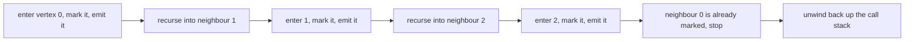
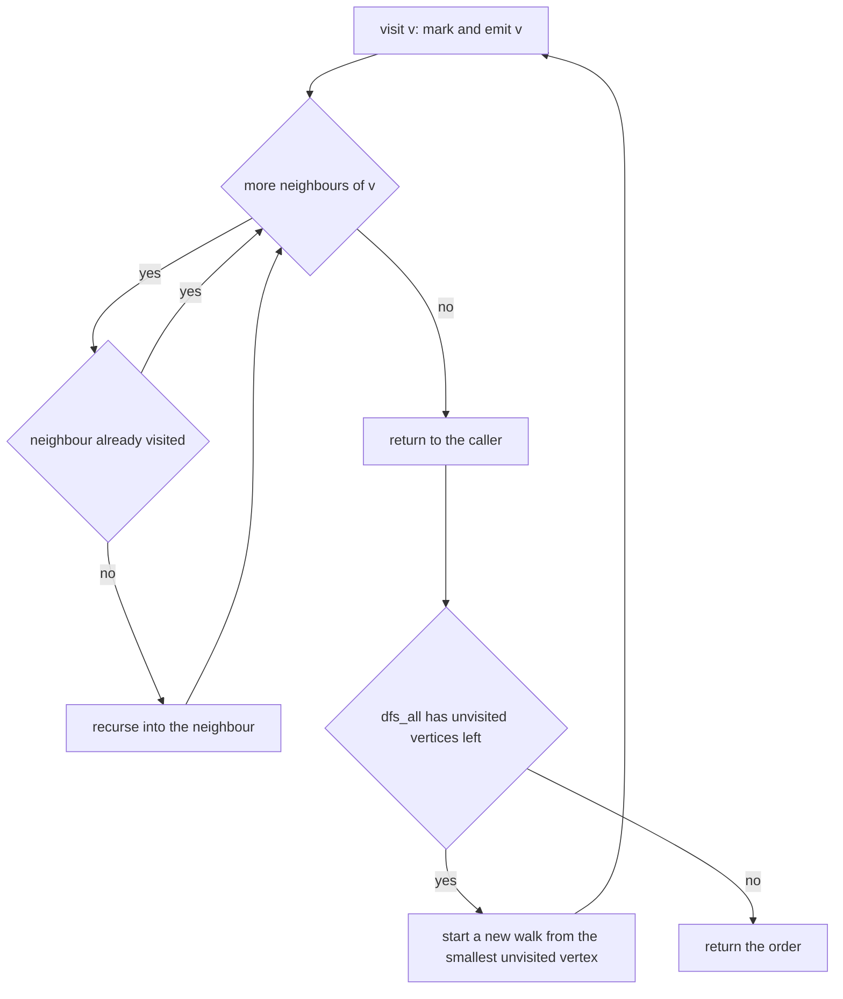
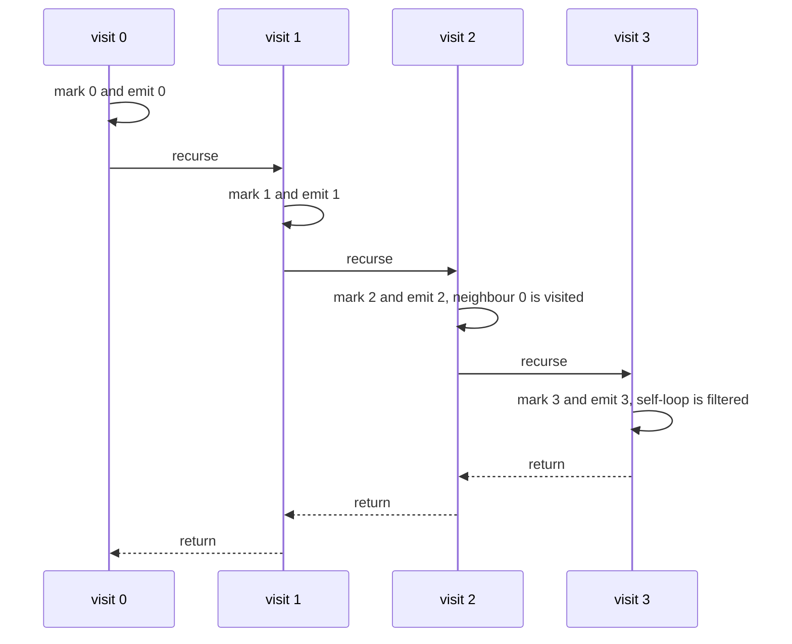

# 105 — Implement DFS (recursive) on graph.

> **Tier:** Beginner · **CTCI chapter:** Ch 8 — Recursion and Dynamic Programming
> **Task spec:** [105-implement-dfs-recursive-on-graph.md](../../../tasks/beginner/105-implement-dfs-recursive-on-graph.md)
> **Solutions:** [Python](../../../solutions/python/beginner/105-implement-dfs-recursive-on-graph/solution.py) ·
> [Java](../../../solutions/java/beginner/105-implement-dfs-recursive-on-graph/Solution.java) ·
> [JavaScript](../../../solutions/javascript/beginner/105-implement-dfs-recursive-on-graph/solution.js) ·
> [C#](../../../solutions/csharp/beginner/105-implement-dfs-recursive-on-graph/Solution.cs)

## 1. Problem restatement

**Input:** a directed graph as an adjacency list — a map from a vertex to the list of its
neighbours — plus, for one of the two functions, a source vertex.

**Output:** two functions, both returning traversal orders:

- **`dfs_order(graph, source)`** — the vertices reachable from the source, listed in preorder: a
  vertex is emitted when it is first entered, before any of its neighbours is explored. A source
  that is not a key of the graph yields an empty order.
- **`dfs_all(graph)`** — the same preorder walk, but restarted for every component, so the result
  covers the whole graph. The starts are visited in **sorted vertex order**, which makes the output
  deterministic regardless of how the map was built.

| Call | Result | Why |
| --- | --- | --- |
| `dfs_order({0: [1, 2], 1: [2], 2: [0, 3], 3: [3]}, 0)` | `[0, 1, 2, 3]` | the cycle `0 → 2 → 0` and the self-loop `3 → 3` are guarded |
| `dfs_order({0: [1], 1: [0], 2: [3], 3: [2]}, 0)` | `[0, 1]` | the other component is untouched |
| `dfs_all({0: [1], 1: [0], 2: [3], 3: [2]})` | `[0, 1, 2, 3]` | the restart covers the second component |
| `dfs_order({5: []}, 5)` | `[5]` | a single vertex with no edges |
| `dfs_order({}, 0)` | `[]` | empty graph |
| `dfs_order(cyclic, 99)` | `[]` | the source is not a key |
| `dfs_all({})` | `[]` | nothing to start from |
| `dfs_all({7: []})` | `[7]` | one component of size one |
| `dfs_order(chain, 0)` for a 51-vertex chain | 51 vertices | a deep chain produces no repeats |

The last row is the depth test: the chain `0 → 1 → … → 50` is 51 vertices deep, and the assertion
is that the length of the order is exactly 51, which is only true if every vertex is visited once.

## 2. Intuition

Preorder DFS is the simplest traversal in the book: enter a vertex, emit it, then recurse into each
neighbour. Written like that, on a graph with a cycle it never returns, and on a vertex with two
parents it emits the vertex twice.

The key insight is that the recursion *is* the traversal, and the visited set is what turns it into
a walk over a finite structure. Two rules make it work:

- **Mark on entry, not on exit.** The moment a vertex is entered it is added to `visited` and
  appended to the order. When a cycle leads back to it, the membership test fails immediately, so
  the recursion unwinds instead of looping.
- **Restart per component for whole-graph coverage.** `dfs_order` deliberately stops at the
  reachable set. `dfs_all` re-runs the same walk for every vertex that the previous walks did not
  touch, which is what makes disconnected graphs (and graphs with isolated vertices) complete.



The choice between the two entry points is a modelling decision, not an algorithmic one: the
walk itself is identical. `dfs_all` just wraps it in a loop over the keys, sorted so the output
does not depend on insertion order.

An iterative implementation would use an explicit stack, and the order would then depend on
whether neighbours are pushed in list order or in reverse. The recursive version has no such
ambiguity: neighbours are explored left to right, which is why the orders in the assertions follow
the adjacency lists exactly.

## 3. Algorithm

`dfs_order`:

1. If the source is not a key of the graph, return an empty order.
2. Create an empty visited set and an empty order list.
3. Call `visit(source)`.
4. Return the order.

`dfs_all`:

1. Create an empty visited set and an empty order list.
2. For each vertex `v` of the graph, in sorted order: if `v` is not visited, call `visit(v)`.
3. Return the order.

`visit(v)`:

1. Add `v` to the visited set and append `v` to the order.
2. For each neighbour `w` of `v`, in list order: if `w` is not visited, call `visit(w)`.

```text
procedure dfs_order(graph, source)
    if source is not a key of graph then
        return empty list
    end
    visited ← empty set
    order ← empty list
    visit(graph, source, visited, order)
    return order
end

procedure dfs_all(graph)
    visited ← empty set
    order ← empty list
    for each v in sorted keys of graph do
        if v is not in visited then
            visit(graph, v, visited, order)
        end
    end
    return order
end

procedure visit(graph, v, visited, order)
    add v to visited
    append v to order
    for each w in neighbours of v do
        if w is not in visited then
            visit(graph, w, visited, order)
        end
    end
end
```

Marking before recursing (rather than after returning) is the whole safety argument. A vertex that
is on the current recursion stack is already marked, so a back edge to it is filtered out by the
same test that filters out a cross edge to a finished vertex. This is exactly the distinction the
cycle detector later refines into three colours — see
[107-detect-cycle-in-directed-graph-dfs-coloring.md](../../../tasks/beginner/107-detect-cycle-in-directed-graph-dfs-coloring.md).



## 4. Worked example

Trace `dfs_order({0: [1, 2], 1: [2], 2: [0, 3], 3: [3]}, 0)`. The call stack grows down the chain
`0 → 1 → 2 → 3`, and each level stops when its neighbour list is exhausted.

| Step | Call | Neighbours examined | Action | Order so far |
| --- | --- | --- | --- | --- |
| 1 | `visit(0)` | `1` | mark `0`, emit `0`, recurse into `1` | `[0]` |
| 2 | `visit(1)` | `2` | mark `1`, emit `1`, recurse into `2` | `[0, 1]` |
| 3 | `visit(2)` | `0`, `3` | mark `2`, emit `2`; `0` is visited, so recurse into `3` | `[0, 1, 2]` |
| 4 | `visit(3)` | `3` | mark `3`, emit `3`; `3` is visited, so return | `[0, 1, 2, 3]` |
| 5 | back in `visit(2)` | `3` done | return | `[0, 1, 2, 3]` |
| 6 | back in `visit(1)` | list exhausted | return | `[0, 1, 2, 3]` |
| 7 | back in `visit(0)` | `2` is visited | return | `[0, 1, 2, 3]` |

Both cycles (`0 → 2 → 0` and `3 → 3`) are stopped by the visited test rather than by special-case
code.



Now trace `dfs_all({0: [1], 1: [0], 2: [3], 3: [2]})`, the two-cycle graph with no isolated
vertices:

| Step | Start | Walk | Order after the walk |
| --- | --- | --- | --- |
| 1 | `0` (smallest key) | `0 → 1`, `1`'s only neighbour `0` is visited | `[0, 1]` |
| 2 | `1` | already visited, skipped | `[0, 1]` |
| 3 | `2` | `2 → 3`, `3`'s only neighbour `2` is visited | `[0, 1, 2, 3]` |
| 4 | `3` | already visited, skipped | `[0, 1, 2, 3]` |

Four vertices in the order, from two independent walks. Sorting the starts is what makes this
deterministic: without the sort, a hash map could enumerate `2` before `0` and produce
`[2, 3, 0, 1]`, which is a valid DFS order but not the asserted one.

## 5. Complexity

Let `V` be the number of vertices in the map and `E` the total number of adjacency entries.

| Measure | Bound | Why it holds |
| --- | --- | --- |
| Time, best | O(1) | a missing source returns immediately; a source with no edges performs one call |
| Time, average | O(V + E) | each vertex is entered at most once and each adjacency entry is examined exactly once |
| Time, worst | O(V + E) | duplicates and self-loops are filtered by the visited test without extra cost |
| Space, output | O(V) | each reachable vertex appears once |
| Space, extra, `dfs_order` | O(V) | the visited set plus O(V) recursion depth in the worst case, as the 51-vertex chain shows |
| Space, extra, `dfs_all` | O(V) | the same set, shared across the restarts, so components do not multiply the cost |
| Time of BFS on the same graph | O(V + E) | the same asymptotics; only the emitted order differs |

The space bound has a hidden risk that the asymptotics do not show. The recursion depth is bounded
by V, and V is the 51 vertices of the chain test here, but a production graph with a million-vertex
path would need a million stack frames. That is the reason the grid DFS tasks in this repository
use an explicit stack, while this task — whose tiers call for recursion — keeps the recursive
shape.

## 6. Pitfalls and edge cases

- **Cycles need no special case.** The guard is the visited set, checked before recursing. The
  assertions include a two-cycle, a longer cycle and a self-loop, and all three terminate because
  the vertex is marked on entry.
- **Disconnected graphs need `dfs_all`.** `dfs_order` on the two-cycle graph returns `[0, 1]` only;
  the assertion for the second component is written against `dfs_all`, which produces
  `[0, 1, 2, 3]`.
- **Sorted starts make the output deterministic.** Python iterates `sorted(graph)`, Java uses a
  `TreeSet`, and JavaScript and C# sort the key list. Without that, the whole-graph order depends on
  hash iteration order and the assertion becomes flaky.
- **Mark on entry, not on exit.** Marking after the recursive calls return would let a cycle
  re-enter a vertex that is still on the stack, and the order would contain duplicates.
- **A source that is not a key.** `dfs_order(cyclic, 99)` is `[]`, and `dfs_order({}, 0)` is `[]`
  as well: the same guard covers both.
- **Neighbours that are not keys.** A neighbour may have no adjacency list of its own; the
  solutions read it with a default (`graph.get(v, [])`, `getOrDefault`, `graph[v] || []`,
  `TryGetValue`), so it simply contributes no outgoing edges while still being emitted.
- **A vertex with no edges.** `{5: []}` gives `[5]` and `{7: []}` gives `[7]` under `dfs_all` —
  a component of size one is a perfectly good walk.
- **Output order equals list order, not sorted order.** `dfs_order` on the cyclic graph emits
  `2` before `3` because `2` is `2`'s first *unvisited* neighbour; no sorting happens inside a
  walk.
- **Recursion depth.** The 51-vertex chain is the visible boundary of the recursion budget in the
  assertions; anything relying on much deeper chains should switch to an explicit stack, as
  [101-count-islands-in-boolean-grid-dfs.md](../../../tasks/beginner/101-count-islands-in-boolean-grid-dfs.md)
  does.
- **Preorder is not the only order.** Emitting on exit yields postorder, which is the basis of the
  topological sort; emitting on entry is what this task's assertions expect.
- **Mutating the neighbour lists during the walk** would invalidate the iteration; the solutions
  assume the graph is static.

## 7. Variants and follow-ups

- **Breadth-first order.** The queue-based sibling that reports levels instead of depth-first
  paths is
  [104-implement-bfs-on-adjacency-list-graph.md](../../../tasks/beginner/104-implement-bfs-on-adjacency-list-graph.md).
- **Postorder instead of preorder.** Emitting on exit, then reversing, gives a topological order of
  a DAG: [106-topological-sort-using-dfs-dag.md](../../../tasks/beginner/106-topological-sort-using-dfs-dag.md).
- **Three colours instead of two.** Distinguishing "on the stack" from "finished" is what turns
  this walk into a directed-cycle test:
  [107-detect-cycle-in-directed-graph-dfs-coloring.md](../../../tasks/beginner/107-detect-cycle-in-directed-graph-dfs-coloring.md).
- **Grid DFS with an explicit stack.** The same traversal where the graph is implicit and the
  stack is manual:
  [101-count-islands-in-boolean-grid-dfs.md](../../../tasks/beginner/101-count-islands-in-boolean-grid-dfs.md).
- The chapter walkthrough [Recursion and DP](../../ctci/08-recursion-and-dp.md) treats graph
  recursion as the first place where the recursion budget itself has to be reasoned about.

## 8. Check yourself

1. Why is `dfs_order` on the two-cycle graph `[0, 1]` while `dfs_all` is `[0, 1, 2, 3]`?

<details><summary>Show answer</summary>

`dfs_order` walks only the component reachable from the source, and `0`'s component is `{0, 1}`.
`dfs_all` restarts the walk from the smallest unvisited key after each component finishes, so it
also covers `{2, 3}`.

</details>

2. Where exactly is the visited mark placed, and why does that position matter?

<details><summary>Show answer</summary>

It is placed on entry, before the neighbour loop and before any recursive call. That guarantees a
vertex on the current recursion stack is already marked, so a back edge to it is filtered out and a
cycle cannot recurse forever. Marking on exit would allow re-entry and duplicate output.

</details>

3. What does the 51-vertex chain assertion prove?

<details><summary>Show answer</summary>

That the walk visits every vertex of a deep chain exactly once — 51 vertices for 51 vertices — and
that the recursion depth reaches 51 without a repeat. It is the depth test for the recursive
implementation and the reason an explicit stack is the safer choice at very large sizes.

</details>

4. Why are the `dfs_all` starts sorted?

<details><summary>Show answer</summary>

Because a hash map's iteration order is unspecified. Sorting the starts makes the whole-graph order
a function of the graph alone, so the asserted `[0, 1, 2, 3]` holds in every language and every run.

</details>

5. What happens if a neighbour of `v` has no entry of its own in the map?

<details><summary>Show answer</summary>

It is still a valid vertex: it is marked, emitted, and then its neighbour loop reads the default
empty list, so the recursion returns immediately. It behaves exactly like a vertex whose only entry
is `[]`, which is why the source check is based on keys while neighbour lookups are allowed to
default.

</details>
