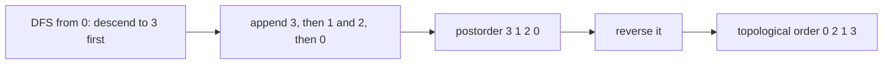
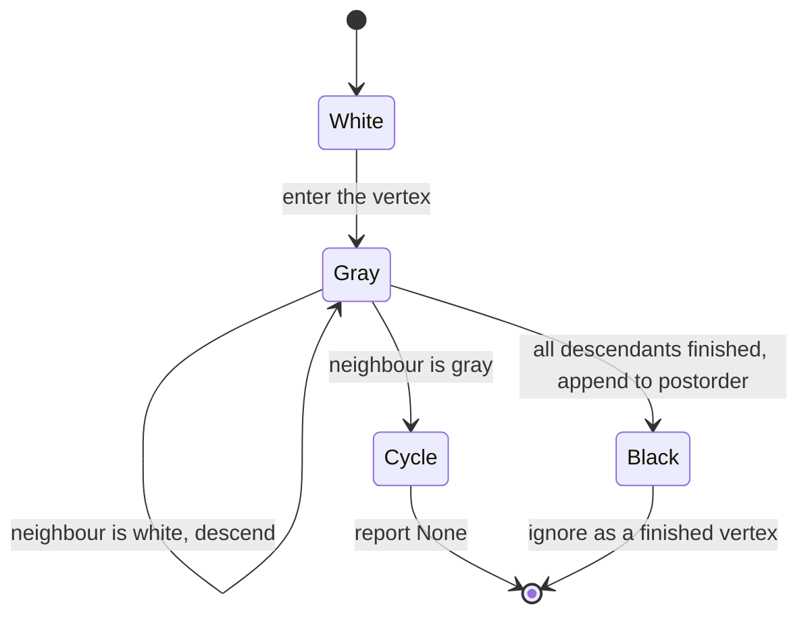
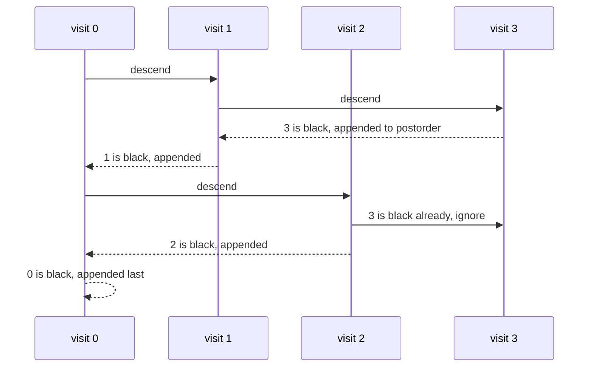

# 106 — Topological sort using DFS (DAG).

> **Tier:** Beginner · **CTCI chapter:** Ch 4 — Trees and Graphs
> **Task spec:** [106-topological-sort-using-dfs-dag.md](../../../tasks/beginner/106-topological-sort-using-dfs-dag.md)
> **Solutions:** [Python](../../../solutions/python/beginner/106-topological-sort-using-dfs-dag/solution.py) ·
> [Java](../../../solutions/java/beginner/106-topological-sort-using-dfs-dag/Solution.java) ·
> [JavaScript](../../../solutions/javascript/beginner/106-topological-sort-using-dfs-dag/solution.js) ·
> [C#](../../../solutions/csharp/beginner/106-topological-sort-using-dfs-dag/Solution.cs)

## 1. Problem restatement

**Input:** a directed graph as an adjacency list, where an edge `u → v` means "`u` must come
before `v`". The task is defined for a DAG, but the input may contain a cycle, and the function
must say so rather than loop.

**Output:** a list of **all** vertices such that every edge points from an earlier position to a
later one — or `None` (Python) / `null` (JavaScript, C#) if the graph contains a directed cycle,
because no such order exists. An empty graph produces an empty list.

| Call | Result | Why |
| --- | --- | --- |
| `topo_sort({0: [1, 2], 1: [3], 2: [3], 3: []})` | `[0, 2, 1, 3]` | a valid order: `0` before both, `2` before `1` is allowed since they are incomparable |
| `topo_sort({0: [1], 1: [2], 2: [0]})` | `None` | a three-cycle has no valid order |
| `topo_sort({0: [0]})` | `None` | a self-loop is a cycle |
| `topo_sort({})` | `[]` | nothing to order |
| `topo_sort({9: []})` | `[9]` | a single vertex |
| `topo_sort({0: [1], 1: [], 2: [3], 3: []})` | 4 vertices | a forest, all four vertices present |
| `topo_sort({0: [], 1: [0], 2: [1], 3: [2]})` | `[3, 2, 1, 0]` | a chain of prerequisites |

The course-prerequisite graph in the solution files is `[[1, 0], [2, 0], [3, 1], [3, 2]]` — three
pairs of "course needs prerequisite" — and the asserted order is `[0, 2, 1, 3]`. The Python file
also ships a validator, `is_valid_topo(graph, order)`, which checks that the order contains every
vertex exactly once and that every edge points forward; the assertions call it on each successful
result.

## 2. Intuition

The naive idea is to repeatedly scan for a vertex with no incoming edges, emit it, remove it, and
repeat. That works, and it is Kahn's algorithm, but the removal step is the awkward part: it
mutates the degree counts of every neighbour, so the algorithm needs an extra structure and a
rebuild after every emission.

The DFS route avoids the mutation. Run the ordinary depth-first walk from
[105-implement-dfs-recursive-on-graph.md](../../../tasks/beginner/105-implement-dfs-recursive-on-graph.md),
but emit a vertex **after** all of its descendants have been emitted — postorder. What does
postorder mean for edges? Every edge `u → v` is explored by the call for `u` before `u` is
emitted, so `v` is always appended to the postorder list *before* `u`. Reversing the postorder list
therefore gives an order in which every edge points forward. That is a topological order.



The second insight is how cycle detection falls out of the same walk. A visited set with two
states ("seen" and "not seen") cannot tell an edge to an *ancestor* from an edge to a
*finished* vertex. Splitting it into three colours fixes that:

| Colour | Meaning | An edge to this vertex means |
| --- | --- | --- |
| white | not yet visited | keep descending |
| gray | on the current recursion stack | a back edge — the graph has a cycle |
| black | fully processed, already in the postorder list | a harmless cross edge; ignore |

So a single DFS both orders the vertices and proves the graph is a DAG. The three colours are
constants `WHITE, GRAY, BLACK = 0, 1, 2` (or `White, Gray, Black` in C#), and the check is
`colour == GRAY → fail`.

## 3. Algorithm

1. Create an empty colour map and an empty postorder list.
2. For each vertex of the graph: if its colour is white, run `visit(v)`; if that call reports a
   cycle, return `None` immediately.
3. Reverse the postorder list and return it.

`visit(v)`:

1. Colour `v` gray.
2. For each neighbour `w`:
   - if `w` is gray, return "cycle" — the walk is inside a path that leads back to `w`;
   - if `w` is white, recurse into `w` and propagate a cycle upward if the recursion finds one;
   - if `w` is black, ignore it, because `w` is already ordered.
3. Colour `v` black and append `v` to the postorder list.
4. Return "no cycle".

```text
procedure topo_sort(graph)
    colour ← empty map, every vertex treated as WHITE
    post ← empty list
    for each v in graph do
        if colour(v) = WHITE then
            if visit(graph, v, colour, post) = failure then
                return None
            end
        end
    end
    reverse post
    return post
end

procedure visit(graph, v, colour, post)
    colour[v] ← GRAY
    for each w in neighbours of v do
        if colour(w) = GRAY then
            return failure
        end
        if colour(w) = WHITE then
            if visit(graph, w, colour, post) = failure then
                return failure
            end
        end
    end
    colour[v] ← BLACK
    append v to post
    return success
end
```

The order in which the outer loop visits the starts matches the adjacency list's key order, and the
inverse order in which vertices are greyed out is what determines the exact order produced. The
asserted `[0, 2, 1, 3]` is one valid order among several: `[0, 1, 2, 3]` would also satisfy every
edge, and the Python validator deliberately accepts any valid order even though the shipped
assertion pins the DFS-specific one.



## 4. Worked example

Trace the course-prerequisite graph. The edges `prereq → course` are `0 → 1`, `0 → 2`, `1 → 3`,
`2 → 3`, so the adjacency list is `{0: [1, 2], 1: [3], 2: [3], 3: []}`.

| Step | Call | Colour state | Neighbours | Postorder after the step |
| --- | --- | --- | --- | --- |
| 1 | `visit(0)` | `0` gray | `1`, `2` | `[]` |
| 2 | `visit(1)` | `1` gray | `3` | `[]` |
| 3 | `visit(3)` | `3` gray, then black — no neighbours | none | `[3]`, `3` is black |
| 4 | back in `visit(1)` | `1` black | `3` is black, ignored | `[3, 1]` |
| 5 | `visit(2)` | `2` gray | `3` | `[3, 1]` |
| 6 | back in `visit(2)` | `2` black, `3` black | — | `[3, 1, 2]` |
| 7 | back in `visit(0)` | `0` black | `1`, `2` black | `[3, 1, 2, 0]` |
| 8 | reverse | — | — | `[0, 2, 1, 3]` |

The result is exactly the asserted order. Notice step 4: `1` was emitted before `2` even though
both depend on `0`, because `1` was reached first — the order among incomparable vertices is an
artefact of the traversal, not a requirement.



Now trace the cycle case `{0: [1], 1: [2], 2: [0]}`:

| Step | Call | Colour state after the step | Result |
| --- | --- | --- | --- |
| 1 | `visit(0)` | `0` gray | descend |
| 2 | `visit(1)` | `0` gray, `1` gray | descend |
| 3 | `visit(2)` | `0` gray, `1` gray, `2` gray | neighbour `0` is gray, so fail |
| 4 | unwind | colours abandoned | `None` |

The failure propagates up through every `if … = failure then return failure` check, so no partial
order is returned. The self-loop `{0: [0]}` fails at step 1 for the same reason: `0` is gray when
its own neighbour is examined.

## 5. Complexity

Let `V` be the number of vertices and `E` the number of adjacency entries.

| Measure | Bound | Why it holds |
| --- | --- | --- |
| Time, best | O(V) | a graph with no edges still colours every vertex once and reverses the list |
| Time, average | O(V + E) | each vertex is entered once and each adjacency entry is examined once |
| Time, worst | O(V + E) | cycles are detected on the edge that closes them, without extra passes |
| Space, output | O(V) | the order holds every vertex exactly once |
| Space, extra | O(V) | the colour map plus O(V) recursion depth for a long chain |
| Time of Kahn's algorithm | O(V + E) | the same bound, with an in-degree array and a queue instead of colours |
| Time of the `is_valid_topo` check | O(V + E) | it builds a position map and then verifies every edge once |

The reverse at the end is O(V) and cannot be folded away, because postorder is exactly the
opposite of what topological order requires. That reversal is also the cheapest way to *test* the
result in the Python file: `is_valid_topo` builds an index map and then asserts
`index[u] < index[w]` for every edge `u → w`.

## 6. Pitfalls and edge cases

- **Cycles must be reported, not ignored.** A graph with a cycle has no topological order, so
  returning a partial list would be a silent lie. All four solutions return a null result
  (`None` / `null`) and the assertions check the three-cycle and the self-loop.
- **Gray means "on the stack", black means "done".** Treating every visited vertex as an obstacle
  would be right for ordering but wrong for cycle detection — the diamond
  `{0: [1, 2], 1: [3], 2: [3], 3: []}` reaches `3` twice, and only the colour distinction keeps it
  a valid DAG.
- **A self-loop is a cycle of length one.** `{0: [0]}` returns `None`; the neighbour `0` is gray at
  the moment it is examined.
- **Disconnected DAGs must be covered.** The outer loop starts a new walk at every white vertex, so
  a forest like `{0: [1], 1: [], 2: [3], 3: []}` yields all four vertices. Starting from a single
  source would drop a component.
- **The order is not unique, but the assertion is.** The Python file asserts `order == [0, 2, 1, 3]`
  for the prerequisite graph, which is the order this particular DFS produces, and separately
  validates that any produced order respects the edges. A different but valid order satisfies the
  validator and fails the exact comparison — worth knowing when porting.
- **Empty graph.** `topo_sort({})` is `[]`, and `{9: []}` is `[9]`; nothing in the loop requires an
  edge to exist.
- **Vertices mentioned only as neighbours.** A neighbour with no entry of its own gets a default
  white colour and no outgoing edges, which is safe; the colour map handles missing keys through
  the `get(w, WHITE)` / `getOrDefault` / `TryGetValue` pattern.
- **Postorder, then reverse — not preorder.** Emitting on entry would produce an order in which
  edges point backwards, which fails `is_valid_topo` on the first multi-edge graph.
- **Recursion depth.** The chain assertion `{0: [], 1: [0], 2: [1], 3: [2]}` is shallow, but the
  algorithm's depth is O(V); long prerequisite chains are the practical limit of the recursive
  form.
- **Mutating the adjacency lists during the walk** would break the iteration; the graph is assumed
  static.

## 7. Variants and follow-ups

- **Kahn's algorithm.** Repeatedly emit a vertex with in-degree 0 and decrement its neighbours'
  counts; same O(V + E), no colours, and the failure signal is "vertices remain but no source".
- **Detecting a cycle without ordering.** The colour walk without the postorder list is
  [107-detect-cycle-in-directed-graph-dfs-coloring.md](../../../tasks/beginner/107-detect-cycle-in-directed-graph-dfs-coloring.md).
- **Plain DFS.** The two-state version of the same recursion, without colouring, is
  [105-implement-dfs-recursive-on-graph.md](../../../tasks/beginner/105-implement-dfs-recursive-on-graph.md).
- **Connectivity instead of order.** When components rather than dependencies are what matters, use
  the union-find tools:
  [109-implement-union-find-disjoint-set-basic.md](../../../tasks/beginner/109-implement-union-find-disjoint-set-basic.md).
- The chapter walkthrough [Trees and Graphs](../../ctci/04-trees-and-graphs.md) introduces
  topological order as the first "ordering constraint" problem after plain traversal.

## 8. Check yourself

1. Why is `[0, 2, 1, 3]` a valid order for `{0: [1, 2], 1: [3], 2: [3], 3: []}`, and why is
   `[0, 1, 2, 3]` also valid?

<details><summary>Show answer</summary>

Both put `0` before `1` and `2`, and both put `1` and `2` before `3`, so every edge points forward.
`1` and `2` are incomparable — there is no path between them — so swapping them produces another
valid order. The DFS happens to emit `2` before `1` after the reversal.

</details>

2. Why does the algorithm need three colours rather than a visited set?

<details><summary>Show answer</summary>

Because "visited" conflates two very different situations. An edge to a vertex that is still on the
recursion stack proves a cycle, while an edge to a finished vertex (the diamond case, where `3` is
reached from both `1` and `2`) is harmless. Gray marks the stack, black marks completion.

</details>

3. What does the self-loop `{0: [0]}` return, and at which step does it fail?

<details><summary>Show answer</summary>

`None`. The walk colours `0` gray and then examines its neighbour `0`, which is already gray, so the
cycle check fails immediately and the failure propagates out of the outer loop.

</details>

4. Why is the postorder list reversed at the end?

<details><summary>Show answer</summary>

Because postorder appends a vertex after all of its descendants, so every edge `u → v` puts `v`
before `u`. Topological order needs the opposite, so reversing the list turns "descendants first"
into "prerequisites first".

</details>

5. Does starting the outer loop at a different key change whether the result is valid?

<details><summary>Show answer</summary>

No. Any DFS start order produces *some* valid topological order of a DAG, because the invariant
"every descendant is appended before its ancestor" holds regardless of which vertex begins a walk.
Only the specific list differs, which is why the Python file validates rather than trusts the
exact sequence.

</details>
