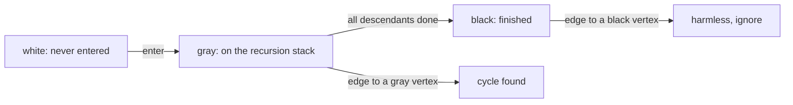
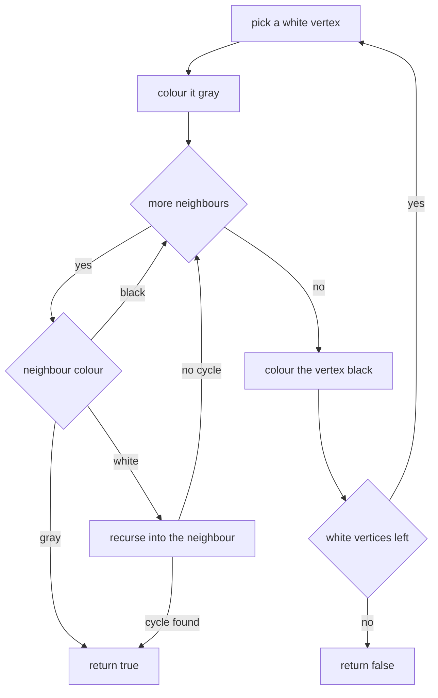
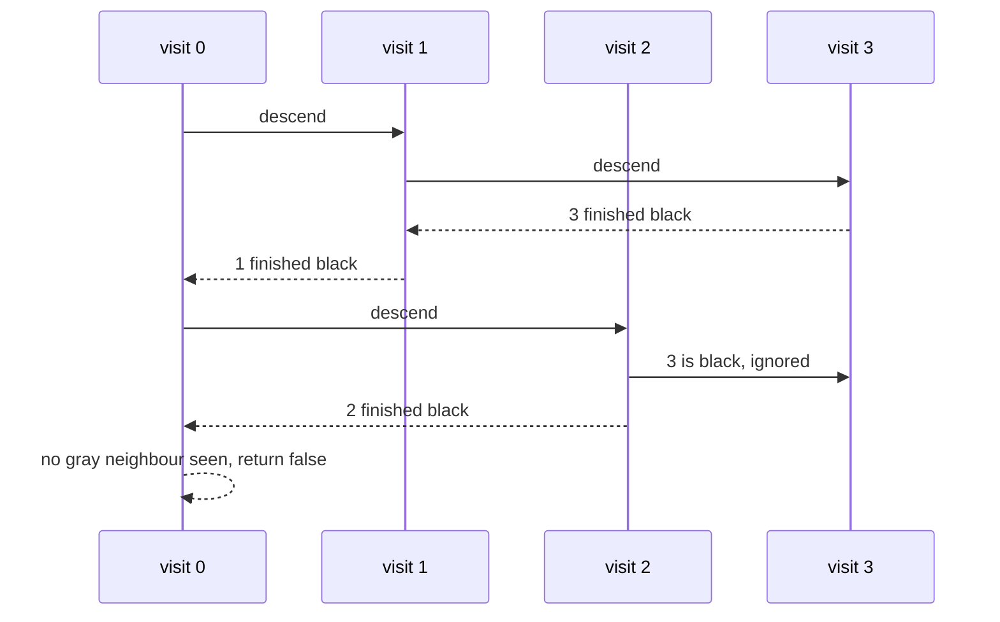

# 107 — Detect cycle in directed graph (DFS coloring).

> **Tier:** Beginner · **CTCI chapter:** Ch 4 — Trees and Graphs
> **Task spec:** [107-detect-cycle-in-directed-graph-dfs-coloring.md](../../../tasks/beginner/107-detect-cycle-in-directed-graph-dfs-coloring.md)
> **Solutions:** [Python](../../../solutions/python/beginner/107-detect-cycle-in-directed-graph-dfs-coloring/solution.py) ·
> [Java](../../../solutions/java/beginner/107-detect-cycle-in-directed-graph-dfs-coloring/Solution.java) ·
> [JavaScript](../../../solutions/javascript/beginner/107-detect-cycle-in-directed-graph-dfs-coloring/solution.js) ·
> [C#](../../../solutions/csharp/beginner/107-detect-cycle-in-directed-graph-dfs-coloring/Solution.cs)

## 1. Problem restatement

**Input:** a directed graph as an adjacency list. The graph may be disconnected, may contain a
self-loop, and may be empty.

**Output:** a boolean — `true` exactly when the graph contains at least one directed cycle.

| Call | Result | Why |
| --- | --- | --- |
| `has_cycle({0: [1, 2], 1: [3], 2: [3], 3: []})` | `false` | the diamond reaches `3` twice but from two different paths |
| `has_cycle({0: [1], 1: [2], 2: [0]})` | `true` | a three-vertex cycle |
| `has_cycle({0: [0]})` | `true` | a self-loop is a cycle of length 1 |
| `has_cycle({0: [1], 1: [2], 2: [1]})` | `true` | a back edge into a vertex still on the stack |
| `has_cycle({0: [1], 1: [], 2: [3], 3: [2]})` | `true` | the cycle lives in the second component |
| `has_cycle({0: [1], 1: [], 2: [3], 3: []})` | `false` | two acyclic components |
| `has_cycle({})` | `false` | nothing to traverse |
| `has_cycle({7: []})` | `false` | a single vertex with no edges |

The diamond case is the one that separates a correct solution from a plausible wrong one: `3` is
reached from both `1` and `2`, so `3` is "visited twice" in a naive sense, yet the graph is
acyclic.

## 2. Intuition

A two-state visited set cannot answer this question. "Has this vertex been seen before?" is true
for `3` in the diamond, and it is also true when the traversal comes back to a vertex still on the
current path — but only the second situation proves a cycle. The naive approach therefore reports
false positives on diamonds and any other DAG with converging paths.

The key insight is that a directed cycle exists exactly when some edge leads to a vertex that is
**currently being explored** — that is, a vertex that is on the recursion stack. Everything else is
harmless:

- an edge to an unvisited vertex extends the walk;
- an edge to a vertex that is off the stack but not yet fully explored under a *different* path is
  still inside the current walk and therefore proves a cycle;
- an edge to a vertex that is completely finished is either a cross edge or a forward edge, and
  those exist in perfectly good DAGs.

That "on the stack" state is what gray captures. The three colours in the solution files are
`WHITE = 0` (unvisited), `GRAY = 1` (on the stack) and `BLACK = 2` (finished: this vertex and all
of its descendants have been explored).



The rest of the algorithm is the DFS from
[105-implement-dfs-recursive-on-graph.md](../../../tasks/beginner/105-implement-dfs-recursive-on-graph.md)
plus a second colour. The result is that the same traversal answers "is there a cycle?" and would
also report the topological order if it did not find one — which is exactly what
[106-topological-sort-using-dfs-dag.md](../../../tasks/beginner/106-topological-sort-using-dfs-dag.md)
does with its postorder list.

## 3. Algorithm

1. Give every vertex the colour white. The solutions populate a colour map from the graph's keys
   and treat any missing neighbour as white through a default lookup.
2. For each vertex of the graph: if it is white, run `visit(v)`; if that call reports a cycle,
   return `true` immediately.
3. If the loop finishes without a cycle, return `false`.

`visit(v)`:

1. Colour `v` gray — it is now on the stack.
2. For each neighbour `w`:
   - if `w` is gray, return `true` — the edge closes a cycle;
   - if `w` is white, recurse into `w` and propagate `true` upward if the recursion finds a cycle;
   - if `w` is black, ignore it.
3. Colour `v` black — it is finished.
4. Return `false`.

```text
procedure has_cycle(graph)
    colour ← empty map, every vertex white
    for each v in graph do
        if colour(v) = WHITE then
            if visit(graph, v, colour) = true then
                return true
            end
        end
    end
    return false
end

procedure visit(graph, v, colour)
    colour[v] ← GRAY
    for each w in neighbours of v do
        if colour(w) = GRAY then
            return true
        end
        if colour(w) = WHITE then
            if visit(graph, w, colour) = true then
                return true
            end
        end
    end
    colour[v] ← BLACK
    return false
end
```

The outer loop matters as much as the inner one: a cycle can sit in a component that the first
walk never reaches, which is exactly the `{0: [1], 1: [], 2: [3], 3: [2]}` assertion. Restarting at
every white vertex keeps the cost linear and the answer complete.



## 4. Worked example

Trace the diamond `{0: [1, 2], 1: [3], 2: [3], 3: []}`, which must return `false`:

| Step | Call | Colour after the step | Neighbours | Decision |
| --- | --- | --- | --- | --- |
| 1 | `visit(0)` | `0` gray | `1`, `2` | descend into `1` |
| 2 | `visit(1)` | `0` gray, `1` gray | `3` | descend into `3` |
| 3 | `visit(3)` | `3` gray then black | none | no cycle; `3` is finished |
| 4 | back in `visit(1)` | `1` black | `3` is black | ignore, no cycle |
| 5 | back in `visit(0)` | `0` gray | `2` | descend into `2` |
| 6 | `visit(2)` | `2` gray | `3` | `3` is black, ignore |
| 7 | back in `visit(2)` | `2` black | — | no cycle |
| 8 | back in `visit(0)` | `0` black | — | no cycle; return `false` |

Step 6 is the whole point: `3` is reached a second time, and the answer is still "no cycle",
because `3` was black when it was revisited. Had `3` still been gray, the same code would have
returned `true`.



Now trace the back-edge case `{0: [1], 1: [2], 2: [1]}`:

| Step | Call | Colours | Neighbours | Decision |
| --- | --- | --- | --- | --- |
| 1 | `visit(0)` | `0` gray | `1` | descend |
| 2 | `visit(1)` | `0`, `1` gray | `2` | descend |
| 3 | `visit(2)` | `0`, `1`, `2` gray | `1` | `1` is gray, so return `true` |
| 4 | unwinding | — | — | `true` propagates through both callers |

The cycle is `1 → 2 → 1`, and it is found without ever leaving the stack: all three vertices are
gray at the moment of the discovery. This is what "back edge" means, and it is the only edge
pattern that proves a cycle in a directed graph.

## 5. Complexity

Let `V` be the number of vertices and `E` the number of adjacency entries.

| Measure | Bound | Why it holds |
| --- | --- | --- |
| Time, best | O(1) | the empty graph and `{7: []}` return after a single colouring step; a self-loop fails on its first neighbour |
| Time, average | O(V + E) | every vertex is entered once and every adjacency entry is examined once |
| Time, worst | O(V + E) | a cycle is found on the edge that closes it; no second pass is needed |
| Space, output | O(1) | one boolean |
| Space, extra | O(V) | the colour map plus O(V) recursion depth for a long path |
| Time of the transitive-closure approach | O(V·E) or worse | reachability tables answer the same question by computing every path, far beyond what is needed |
| Time of the Kahn-style in-degree approach | O(V + E) | equally good, and it fails when vertices remain with positive in-degree |

The colour map is the only auxiliary structure, and it holds two bits of information per vertex.
That is the cheapest possible certificate: the algorithm never stores a path, a parent, or a
visited order — it only remembers, at any instant, which vertices are on the stack.

## 6. Pitfalls and edge cases

- **A diamond is not a cycle.** `{0: [1, 2], 1: [3], 2: [3], 3: []}` returns `false`; the annotations
  in the solution files call it out explicitly. A two-colour implementation reports `true` here.
- **Self-loops.** `{0: [0]}` returns `true`: the vertex is gray when its own neighbour is examined,
  so no special case is needed.
- **Cycles in a later component.** The outer loop over all vertices is essential —
  `{0: [1], 1: [], 2: [3], 3: [2]}` is `true` even though the first walk finds nothing.
- **Self-loops and back edges are different edge cases for a two-colour version.** The three-colour
  version handles both with exactly the same test.
- **Black edges must be ignored, not failed.** An edge to a black vertex means the target was
  already fully explored, which happens in every DAG with a converging path. Failing there is the
  most common bug in this task.
- **Empty graph and single vertex.** `{}` is `false` and `{7: []}` is `false`; both are asserted.
- **Neighbours without their own entry.** A vertex mentioned only as a neighbour is white by
  default and has no outgoing edges; the colour lookup must tolerate a missing key.
- **The outer loop's start order does not change the answer.** Whether the walks start with the
  smallest key or the largest, `true` and `false` are stable; only the internal sequence differs.
- **Recursion depth.** The algorithm's depth is O(V) in the worst case (a long path). The assertions
  are shallow, but production graphs with very long paths need an explicit stack.
- **Directed, not undirected.** A back edge in an undirected graph is normal — every tree edge is
  traversed twice — which is why undirected cycle detection uses union-find instead:
  [108-detect-cycle-in-undirected-graph-union-find.md](../../../tasks/beginner/108-detect-cycle-in-undirected-graph-union-find.md).
- **A DAG may still be cyclic in spirit.** Two edges `u → v` and `v → u` are a cycle even if they
  are not a self-loop, and the algorithm catches them at the second edge.

## 7. Variants and follow-ups

- **Producing the order instead of the verdict.** If the graph is acyclic, the same walk can emit a
  postorder and reverse it:
  [106-topological-sort-using-dfs-dag.md](../../../tasks/beginner/106-topological-sort-using-dfs-dag.md).
- **Undirected graphs.** Union-find detects the same property where the DFS colouring would report
  false positives: [108-detect-cycle-in-undirected-graph-union-find.md](../../../tasks/beginner/108-detect-cycle-in-undirected-graph-union-find.md).
- **Two states, no colours.** The plain recursive DFS used as a building block is
  [105-implement-dfs-recursive-on-graph.md](../../../tasks/beginner/105-implement-dfs-recursive-on-graph.md).
- **Kahn's algorithm.** Repeatedly removing in-degree-0 vertices detects a cycle as "vertices
  remain after the queue empties", with the same O(V + E) cost.
- The chapter walkthrough [Trees and Graphs](../../ctci/04-trees-and-graphs.md) presents cycle
  detection as the first problem where a plain visited set is provably insufficient.

## 8. Check yourself

1. Why is the diamond `{0: [1, 2], 1: [3], 2: [3], 3: []}` acyclic even though `3` is reachable
   from `0` by two paths?

<details><summary>Show answer</summary>

Because both paths converge from different branches rather than returning to a vertex on the
current stack. When `2` examines `3`, `3` is already black — it was fully explored via `1` — so the
edge is a cross edge, which is harmless in a DAG.

</details>

2. Which single comparison decides the answer?

<details><summary>Show answer</summary>

`colour(neighbour) = GRAY`. Gray means the neighbour is currently on the recursion stack, so an edge
to it closes a cycle. A white neighbour continues the walk, and a black neighbour is ignored.

</details>

3. Why does the algorithm need an outer loop over all vertices?

<details><summary>Show answer</summary>

Because the graph may be disconnected. `{0: [1], 1: [], 2: [3], 3: [2]}` has its cycle entirely
inside the second component; a single walk from `0` would never see it and would wrongly return
`false`.

</details>

4. What does `{0: [0]}` return, and why is no special case needed?

<details><summary>Show answer</summary>

`true`. The walk colours `0` gray and then examines the neighbour `0`, which is gray, so the
ordinary back-edge test fires. A self-loop is just the shortest possible cycle.

</details>

5. Would the algorithm still be correct if it coloured a vertex black *before* exploring its
   neighbours?

<details><summary>Show answer</summary>

No. Colouring black means "finished and harmless to revisit", so a back edge into a vertex whose
neighbours are still being explored would be silently ignored, and cycles would go undetected. Black
must only be assigned after the neighbour loop completes.

</details>
