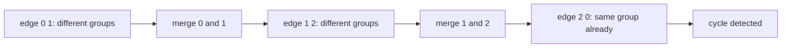
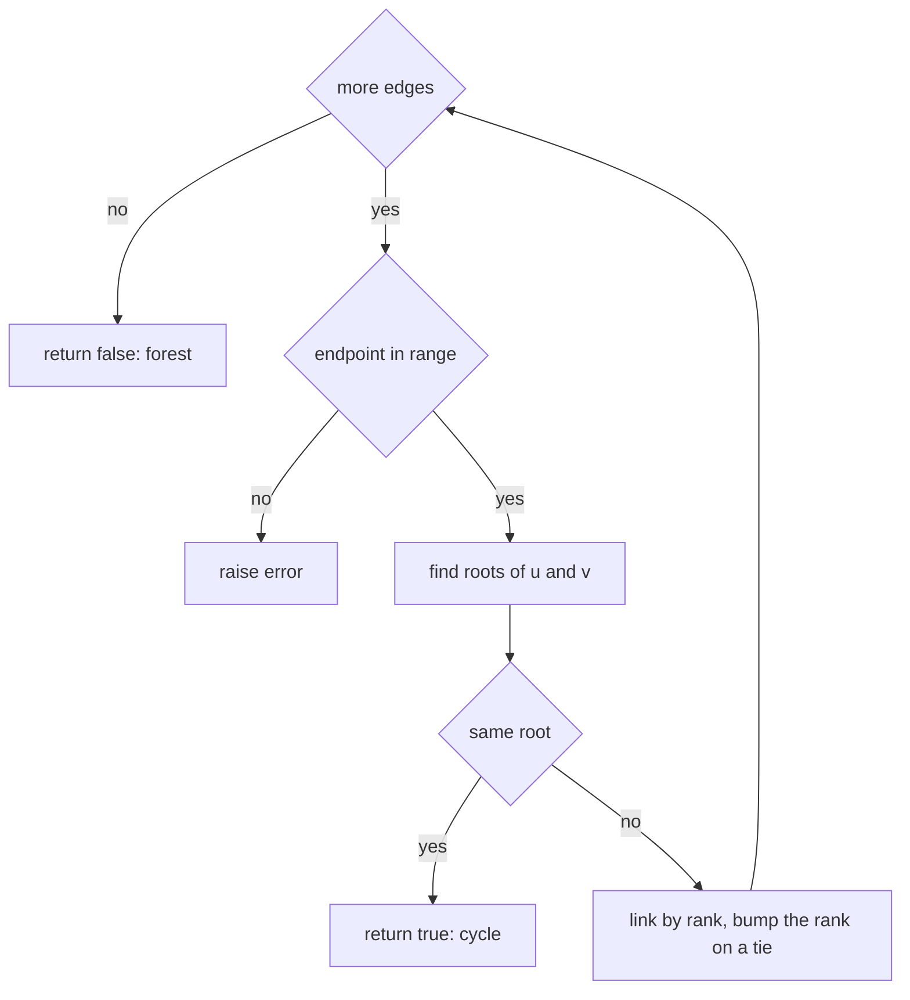
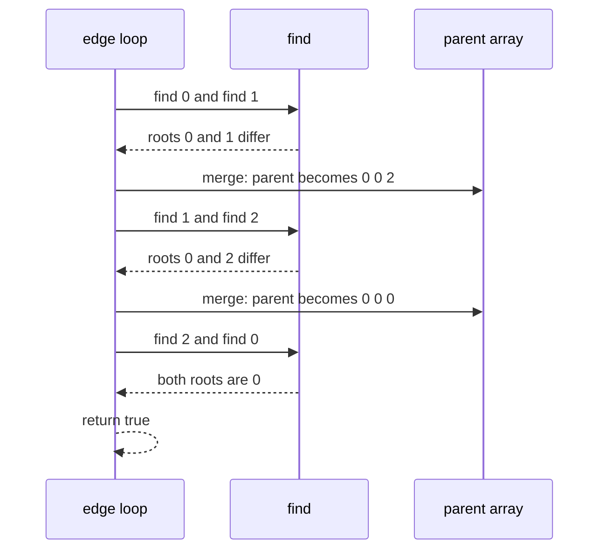

# 108 — Detect cycle in undirected graph (union-find).

> **Tier:** Beginner · **CTCI chapter:** Ch 4 — Trees and Graphs
> **Task spec:** [108-detect-cycle-in-undirected-graph-union-find.md](../../../tasks/beginner/108-detect-cycle-in-undirected-graph-union-find.md)
> **Solutions:** [Python](../../../solutions/python/beginner/108-detect-cycle-in-undirected-graph-union-find/solution.py) ·
> [Java](../../../solutions/java/beginner/108-detect-cycle-in-undirected-graph-union-find/Solution.java) ·
> [JavaScript](../../../solutions/javascript/beginner/108-detect-cycle-in-undirected-graph-union-find/solution.js) ·
> [C#](../../../solutions/csharp/beginner/108-detect-cycle-in-undirected-graph-union-find/Solution.cs)

## 1. Problem restatement

**Input:** `n`, the number of vertices numbered `0 … n - 1`, and a list of undirected edges given as
`(u, v)` pairs. Self-loops and parallel edges are legal inputs. Every endpoint must be inside the
range, and an out-of-range endpoint is an error rather than an answer.

**Output:** `true` if the graph contains a cycle, `false` if it is a forest. A self-loop is always a
cycle, and two edges between the same pair of vertices also form a cycle.

| Call | Result | Why |
| --- | --- | --- |
| `has_cycle_undirected(5, [(0, 1), (0, 2), (1, 3), (1, 4)])` | `false` | a tree with 5 vertices and 4 edges |
| `has_cycle_undirected(3, [(0, 1), (1, 2), (2, 0)])` | `true` | a triangle |
| `has_cycle_undirected(6, [(0, 1), (2, 3), (3, 4), (4, 5)])` | `false` | a forest of two trees |
| `has_cycle_undirected(6, [(0, 1), (2, 3), (3, 4), (4, 5), (5, 2)])` | `true` | the second tree gains a cycle |
| `has_cycle_undirected(1, [])` | `false` | a single vertex, no edges |
| `has_cycle_undirected(2, [(0, 0)])` | `true` | a self-loop |
| `has_cycle_undirected(2, [(0, 1), (1, 0)])` | `true` | parallel edges |
| `has_cycle_undirected(2, [(0, 5)])` | raises | vertex `5` does not exist |

The counter-intuitive rows are the self-loop and the parallel edges: neither is a "cycle" in the
picture-drawing sense, but both create a closed walk, and the union-find test detects both without
any special handling.

## 2. Intuition

The first idea is to reuse the DFS colouring from
[107-detect-cycle-in-directed-graph-dfs-coloring.md](../../../tasks/beginner/107-detect-cycle-in-directed-graph-dfs-coloring.md).
It breaks immediately: in an undirected graph every edge is traversed twice, once in each
direction, so walking `0 → 1` and then seeing the edge `1 → 0` looks like a back edge even though
it is the same edge. To fix that you must track the parent of each vertex and ignore the edge you
arrived through — and that fix has its own trap: a parallel edge to the parent is then wrongly
ignored. Undirected cycle detection wants a different tool.

The tool is union-find, and the insight behind it is simpler than traversal. Imagine adding the
edges one at a time, maintaining a partition of the vertices into connected groups:

- The first edge between two groups **merges** them. Merging cannot create a cycle, because the two
  endpoints were not connected before.
- An edge whose endpoints are **already in the same group** closes a loop: there is already a path
  between them, and this edge is a second path. That is a cycle.

So no traversal is needed at all — just one pass over the edge list, a "find the group" query per
endpoint, and a merge whenever the groups differ.



The structure that implements the partition is the disjoint-set union, or DSU. The version embedded
in this task's solution files is the classic pair of optimisations: **path halving** inside `find`
(`parent[x] = parent[parent[x]]` while walking) and **union by rank** when linking two roots. Path
halving keeps the walk to the root short, and union by rank keeps the trees shallow, so each
operation is effectively constant time.

## 3. Algorithm

1. Create a DSU over `n` vertices: `parent[i] = i` and `rank[i] = 0` for every vertex.
2. For each edge `(u, v)` in order:
   1. If `u` or `v` is outside `0 … n - 1`, raise an error.
   2. Find the root of `u` and the root of `v`, halving the path as you walk.
   3. If the two roots are equal, the endpoints are already connected: return `true`.
   4. Otherwise link the smaller-rank root under the larger-rank root and increment the rank when
      both ranks are equal.
3. If every edge merged two distinct groups, the graph is a forest: return `false`.

```text
procedure has_cycle_undirected(n, edges)
    parent ← array 0 to n - 1
    rank ← array of n zeros
    for each (u, v) in edges do
        if u &lt; 0 or u ≥ n or v &lt; 0 or v ≥ n then
            raise error "edge endpoint out of range"
        end
        ru ← find(parent, u)
        rv ← find(parent, v)
        if ru = rv then
            return true
        end
        if rank[ru] &lt; rank[rv] then
            swap ru and rv
        end
        parent[rv] ← ru
        if rank[ru] = rank[rv] then
            rank[ru] ← rank[ru] + 1
        end
    end
    return false
end

procedure find(parent, x)
    while parent[x] ≠ x do
        parent[x] ← parent[parent[x]]       // path halving
        x ← parent[x]
    end
    return x
end
```

Two rows of the assertion table deserve a second look. A self-loop `(0, 0)` finds the same root
twice, so the `ru = rv` test fires and the answer is `true` — no special case. Parallel edges
`(0, 1)` and `(1, 0)` are two different edges in the list; the first merges `0` and `1`, and the
second finds them already connected, so it too reports a cycle.



## 4. Worked example

Trace the triangle `has_cycle_undirected(3, [(0, 1), (1, 2), (2, 0)])`, which must return `true`.
Start with `parent = [0, 1, 2]` and `rank = [0, 0, 0]`.

| Step | Edge | `find(u)` | `find(v)` | Same root? | `parent` after the step | `rank` after the step |
| --- | --- | --- | --- | --- | --- | --- |
| 1 | (0, 1) | 0 | 1 | no | `[0, 1, 2]` → `[0, 0, 2]` (`0` stays root, `1` links up) | `[1, 0, 0]` |
| 2 | (1, 2) | 0 | 2 | no | `[0, 0, 0]` (`2` links under root `0`) | `[1, 0, 0]` |
| 3 | (2, 0) | 0 | 0 | **yes** | unchanged | unchanged |

Step 3 is the detection: both endpoints resolve to root `0`, so the edge closes the triangle. The
return happens immediately, and the remaining edges (there are none here) would never be examined.



Now trace the forest `has_cycle_undirected(6, [(0, 1), (2, 3), (3, 4), (4, 5)])`, which must return
`false`:

| Step | Edge | Roots | Action | Components |
| --- | --- | --- | --- | --- |
| 1 | (0, 1) | 0, 1 | merge | `{0, 1}` `{2}` `{3}` `{4}` `{5}` |
| 2 | (2, 3) | 2, 3 | merge | `{0, 1}` `{2, 3}` `{4}` `{5}` |
| 3 | (3, 4) | 2, 4 | merge | `{0, 1}` `{2, 3, 4}` `{5}` |
| 4 | (4, 5) | 2, 5 | merge | `{0, 1}` `{2, 3, 4, 5}` |

Four merges, zero same-root hits, so the answer is `false`. Adding the fifth edge `(5, 2)` to the
same graph would find roots `2` and `2` on step 5 and return `true` — which is exactly the asserted
variation of this input.

## 5. Complexity

Let `V = n` be the number of vertices and `E` the number of edges.

| Measure | Bound | Why it holds |
| --- | --- | --- |
| Time, best | O(1) | a self-loop as the first edge finds the same root immediately; `n = 1` with no edges also finishes at once |
| Time, average | O(E · α(V)) | each edge performs two finds and at most one union, and α is the inverse Ackermann function, practically a small constant |
| Time, worst | O(E · α(V)) | path halving plus union by rank keep the trees shallow, so no find degenerates to a linear walk |
| Space, output | O(1) | one boolean |
| Space, extra | O(V) | the parent and rank arrays, two integers per vertex |
| Time of the naive "check for a path" approach | O(E · (V + E)) | re-running a traversal per edge is correct but far more expensive |
| Space of a DFS colouring approach | O(V) | the same space, but the parent-edge special case makes it harder to get right |

The `α(V)` factor is why the solutions can afford to process edges one at a time: the union and
find operations are so close to constant that the whole pass is effectively linear in the edge
list. Removing either optimisation would change the practical behaviour — plain linking alone can
build a chain of depth O(V), turning each find into a linear walk.

## 6. Pitfalls and edge cases

- **Out-of-range endpoints raise.** `has_cycle_undirected(2, [(0, 5)])` throws a `ValueError` in
  Python, `IllegalArgumentException` in Java, `Error` in JavaScript and `ArgumentException` in C#.
  The check happens *before* any array access, so the DSU is never indexed out of bounds.
- **Self-loops are cycles.** `(0, 0)` finds the same root twice. This is the same code path as any
  other same-root edge, which is why no special case appears in the solutions.
- **Parallel edges are cycles.** `(0, 1)` followed by `(1, 0)` reports `true` on the second edge,
  because those are two distinct entries in the edge list — the DSU partitions vertices, not edges.
- **A forest is not a cycle.** `n = 1` with no edges is `false`, and so is the two-tree forest with
  five edges over six vertices. A graph with `V` vertices and fewer than `V` useful edges cannot
  be cyclic.
- **Edge order does not change the answer.** Whichever edge closes a loop is reported as the
  culprit, but the boolean is the same: union-find is order-insensitive.
- **Plain linking without rank still detects cycles** — the rank is about speed, not correctness.
  The repository's basic union-find task makes that distinction explicit:
  [109-implement-union-find-disjoint-set-basic.md](../../../tasks/beginner/109-implement-union-find-disjoint-set-basic.md).
- **This is the undirected tool.** A directed three-cycle `0 → 1 → 2 → 0` looks like three pairs to
  union-find and would be reported as a forest, which is why directed graphs use the colouring
  method of
  [107-detect-cycle-in-directed-graph-dfs-coloring.md](../../../tasks/beginner/107-detect-cycle-in-directed-graph-dfs-coloring.md).
- **Vertices with no edges still exist.** `n` defines the vertex set even if some vertices never
  appear in the edge list; they simply stay singletons.
- **Duplicate edges in a multigraph.** Two copies of the same pair are parallel edges and are
  reported as a cycle. If the caller's data forbids multigraphs, deduplicate before calling.
- **Cycle versus closed walk.** The test answers "is there a cycle?", not "how many cycles?", and
  certainly not "how long is the shortest cycle?". Those are different problems; see the
  follow-ups.

## 7. Variants and follow-ups

- **Building union-find from scratch.** The methods used here — `find`, `union`, `connected`,
  `count` — are developed step by step in
  [109-implement-union-find-disjoint-set-basic.md](../../../tasks/beginner/109-implement-union-find-disjoint-set-basic.md).
- **Faster finds.** Replacing path halving with full two-pass compression is
  [110-path-compression-in-union-find.md](../../../tasks/beginner/110-path-compression-in-union-find.md).
- **Minimum spanning trees.** Kruskal's algorithm is this same loop, keeping the edges that merge
  two components:
  [111-kruskal-s-mst-using-union-find.md](../../../tasks/beginner/111-kruskal-s-mst-using-union-find.md).
- **Directed cycles.** The three-colour DFS handles graphs where "connected" is not symmetric:
  [107-detect-cycle-in-directed-graph-dfs-coloring.md](../../../tasks/beginner/107-detect-cycle-in-directed-graph-dfs-coloring.md).
- The chapter walkthrough [Trees and Graphs](../../ctci/04-trees-and-graphs.md) introduces
  union-find as the incremental alternative to traversal-based connectivity.

## 8. Check yourself

1. Why is the same-root test exactly the cycle test, with no traversal needed?

<details><summary>Show answer</summary>

Because the DSU maintains the transitive closure of connectivity as edges are added. If `u` and `v`
are already in the same set, some path between them exists using the edges processed so far, so the
new edge plus that path forms a closed walk — a cycle. If they are in different sets, no path
exists yet, and merging cannot create one.

</details>

2. What does `has_cycle_undirected(2, [(0, 0)])` return, and why does it need no special case?

<details><summary>Show answer</summary>

`true`. `find(0)` and `find(0)` obviously return the same root, so the ordinary same-root branch
fires. A self-loop is a cycle whose two endpoints happen to be the same vertex.

</details>

3. Why are the two edges `(0, 1)` and `(1, 0)` treated as a cycle?

<details><summary>Show answer</summary>

Because they are two separate entries in the edge list, so the second one is a parallel edge. The
first merges `{0}` and `{1}`; the second then finds both endpoints in the same set and reports a
cycle. The direction written in the pair is irrelevant for an undirected graph.

</details>

4. What is the cost per edge, and what would it be without the two optimisations?

<details><summary>Show answer</summary>

O(α(V)) per edge with path halving and union by rank, where α is effectively a small constant.
Without union by rank, plain linking can build a chain of depth O(V), and each find becomes an
O(V) walk, so the pass degrades to O(E·V).

</details>

5. The input `(0, 5)` on a 2-vertex graph raises. Where is the check, and why does the position
   matter?

<details><summary>Show answer</summary>

The check is the first thing done for each edge, before `find` is called on either endpoint. If it
were placed after the find, the array access would already have gone out of bounds and the caller
would see an index error or a crash instead of the intended, catchable error.

</details>
