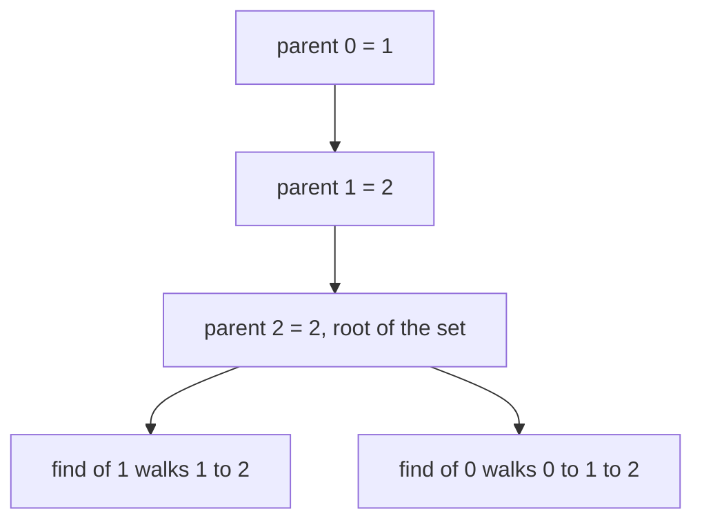
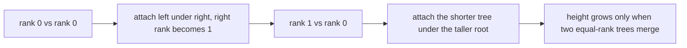
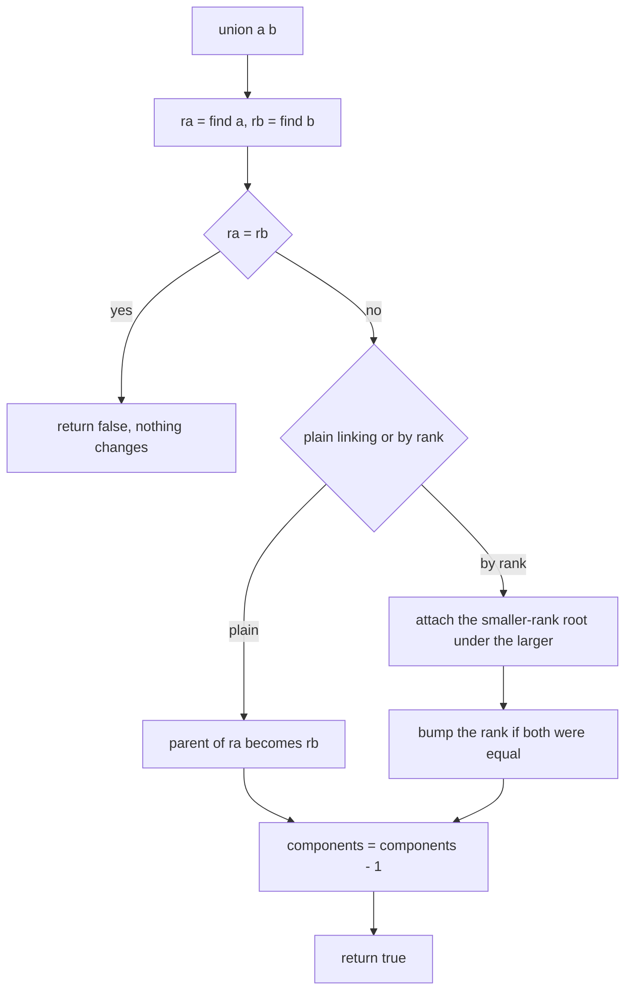
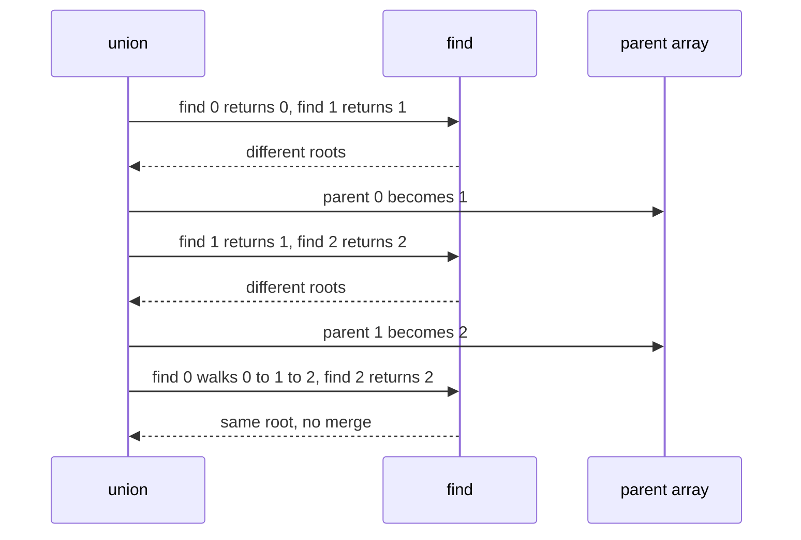

# 109 — Implement union-find / disjoint set (basic).

> **Tier:** Beginner · **CTCI chapter:** Ch 4 — Trees and Graphs
> **Task spec:** [109-implement-union-find-disjoint-set-basic.md](../../../tasks/beginner/109-implement-union-find-disjoint-set-basic.md)
> **Solutions:** [Python](../../../solutions/python/beginner/109-implement-union-find-disjoint-set-basic/solution.py) ·
> [Java](../../../solutions/java/beginner/109-implement-union-find-disjoint-set-basic/Solution.java) ·
> [JavaScript](../../../solutions/javascript/beginner/109-implement-union-find-disjoint-set-basic/solution.js) ·
> [C#](../../../solutions/csharp/beginner/109-implement-union-find-disjoint-set-basic/Solution.cs)

## 1. Problem restatement

**Input:** `n`, the number of elements `0 … n - 1`. Nothing else — this task is about the data
structure, not about a graph.

**Output:** a disjoint-set structure with these operations:

| Operation | Meaning |
| --- | --- |
| `find(x)` | the representative (root) of the set containing `x` |
| `union(a, b)` | merge the sets of `a` and `b` by **plain linking**: hang the root of `a` under the root of `b` |
| `union_by_rank(a, b)` | merge the sets of `a` and `b`, attaching the lower-rank root under the higher-rank root |
| `connected(a, b)` | whether `a` and `b` are in the same set |
| `count()` | how many sets remain |
| `depth(x)` | the number of parent steps from `x` to its root, used to inspect the tree shape |

Both union variants return a boolean: `true` when a merge happened, `false` when the two elements
were already in the same set — including the `union(5, 5)` self-union, which is a no-op.

| Call | Result | Why |
| --- | --- | --- |
| `Dsu(6).count()` | `6` | every element starts as its own root |
| `d.find(3)` on a fresh structure | `3` | each element is its own representative |
| `d.union(0, 1)`, `d.union(1, 2)` | `true`, `true` | two merges, `count()` drops from 6 to 4 |
| `d.depth(0)` after those merges | `2` | plain linking built the chain `0 → 1 → 2` |
| `d.union(0, 2)` | `false` | they are already connected, so no merge and no count change |
| `d.union(5, 5)` | `false` | a self-union merges a set with itself |
| `r.union_by_rank(i, i + 1)` for `i = 0 … 6` on `Dsu(8)` | all `true` | one component, `count() == 1` |
| `max(depth(i))` on that structure | `≤ 1` | union by rank keeps the trees flat |

The last row is the reason both variants exist. They compute the same partition, but plain linking
can produce a chain of depth `V`, whereas union by rank bounds the depth logarithmically.

## 2. Intuition

The naive way to represent "which set is this element in" is to store a set label per element and
relabel one of the two sets on every merge. That is O(V) work per merge, because the whole smaller
side has to be rewritten — with V merges the total becomes O(V²).

The key insight is to stop storing the label and store only a **parent pointer**. Each element
points to another element in the same set, and the set's identity is the unique element that points
to itself: the **root**. A query becomes "walk the parent chain to the root", and a merge becomes
"make one root point at the other" — a single assignment, regardless of how many elements are
involved.



That one change gives a forest of parent pointers whose trees encode the sets. It also exposes the
trade-off that this task is built around: a merge is now O(1), but a find costs the height of its
tree, and nothing yet prevents the height from growing linearly. Plain linking is the naive merge —
it always hangs the first root under the second, so a sequence of unions can produce a chain:

```text
union(0, 1)  →  parent[0] = 1
union(1, 2)  →  parent[1] = 2
union(2, 3)  →  parent[2] = 3
```

The depth after those three merges is 3, and `find(0)` walks three steps. **Union by rank** fixes
this with one extra array: each root carries a rank (an upper bound on the height of its tree), and
the merge always attaches the smaller rank under the larger one, incrementing the rank only when
both sides are equal. That single rule is enough to keep the height logarithmic in the number of
elements.



## 3. Algorithm

Construction:

1. Set `parent[i] = i` for every element.
2. Set `rank[i] = 0` for every element.
3. Set `components = n`.

`find(x)` (the basic version, with no compression):

1. While `parent[x] ≠ x`, set `x = parent[x]`.
2. Return `x`.

`union(a, b)` — plain linking:

1. Find the roots `ra` and `rb`.
2. If they are equal, return `false` (already the same set).
3. Set `parent[ra] = rb` and decrement the component count.
4. Return `true`.

`union_by_rank(a, b)`:

1. Find the roots `ra` and `rb`.
2. If they are equal, return `false`.
3. If `rank[ra] < rank[rb]`, swap them so `ra` is the taller root.
4. Set `parent[rb] = ra`.
5. If `rank[ra] == rank[rb]`, increment `rank[ra]` — the only case in which a tree grows taller.
6. Decrement the component count and return `true`.

```text
procedure find(parent, x)
    while parent[x] ≠ x do
        x ← parent[x]
    end
    return x
end

procedure union(parent, components, a, b)
    ra ← find(parent, a)
    rb ← find(parent, b)
    if ra = rb then
        return false
    end
    parent[ra] ← rb
    components ← components - 1
    return true
end

procedure union_by_rank(parent, rank, components, a, b)
    ra ← find(parent, a)
    rb ← find(parent, b)
    if ra = rb then
        return false
    end
    if rank[ra] &lt; rank[rb] then
        swap ra and rb
    end
    parent[rb] ← ra
    if rank[ra] = rank[rb] then
        rank[ra] ← rank[ra] + 1
    end
    components ← components - 1
    return true
end
```

Both variants share the same `find`, and both decrement the count in exactly the same place — only
when a merge actually happens. That is why the redundant-union assertions check `count()` afterwards:
a no-op must leave the count untouched.



## 4. Worked example

Trace `Dsu(6)` through the assertions, comparing the two merge styles.

| Step | Operation | Roots found | Action | `parent` | `components` | `depth(0)` |
| --- | --- | --- | --- | --- | --- | --- |
| 0 | — | — | initial | `[0, 1, 2, 3, 4, 5]` | 6 | 0 |
| 1 | `union(0, 1)` | 0, 1 | `parent[0] = 1` | `[1, 1, 2, 3, 4, 5]` | 5 | 1 |
| 2 | `union(1, 2)` | 1, 2 | `parent[1] = 2` | `[1, 2, 2, 3, 4, 5]` | 4 | 2 |
| 3 | `union(0, 2)` | 2, 2 | already connected | unchanged | 4 | 2 |
| 4 | `union(5, 5)` | 5, 5 | self-union | unchanged | 4 | 2 |
| 5 | `union_by_rank(3, 4)` | 3, 4 | equal ranks, `parent[4] = 3`, `rank[3] = 1` | `[1, 2, 2, 3, 3, 5]` | 3 | 2 |
| 6 | `union_by_rank(4, 5)` | 3, 5 | rank 1 beats rank 0, `parent[5] = 3` | `[1, 2, 2, 3, 3, 3]` | 2 | 2 |

After step 2 the plain-linked set is a chain `0 → 1 → 2`, which is why `depth(0)` reaches 2 on a
structure with only three elements. Steps 5 and 6 use rank and produce a flat tree: `4` and `5` are
both children of `3`, so `connected(3, 5)` holds while `connected(2, 3)` does not.



The `Dsu(8)` rank case is the contrast. Running `union_by_rank(i, i + 1)` for `i = 0 … 6`:

| Step | Merge | Ranks before | Action | Resulting shape |
| --- | --- | --- | --- | --- |
| 1 | (0, 1) | 0, 0 | `parent[1] = 0`, `rank[0] = 1` | `0` is root of `{0, 1}` |
| 2 | (1, 2) | 1, 0 | rank 1 beats rank 0, `parent[2] = 0` | `0` is root of `{0, 1, 2}` |
| 3 | (2, 3) | 1, 0 | `parent[3] = 0` | `0` is root of four elements |
| … | … | … | every later merge attaches the singleton under `0` | still depth 1 |

Seven merges leave `count() == 1` and every element at depth ≤ 1, which is the asserted invariant.

## 5. Complexity

Let `V` be the number of elements and `M` the number of merges performed.

| Measure | Bound | Why it holds |
| --- | --- | --- |
| Time, `find` best | O(1) | the element is a root |
| Time, `find` worst, plain linking | O(V) | a chain of length `V` can be built, as `union(0,1), union(1,2), …` demonstrates |
| Time, `find` worst, union by rank | O(log V) | a tree's height only grows when two equal-rank trees merge, which doubles the size |
| Time, `union` | one `find` per endpoint plus O(1) | the link itself is a single assignment |
| Space, extra | O(V) | the parent array and, for the rank variant, a second array of the same size |
| Time of the naive relabel-a-set approach | O(V) per merge, O(V²) overall | every element of the relocated set must be rewritten |
| Effect of path compression | O(α(V)) amortised | the improvement left for task 110 |

The two-array cost is the whole price of union by rank. In exchange, the depth bound drops from O(V)
to O(log V), and that bound is what makes the structure usable inside Kruskal's algorithm, where
`find` is called twice per edge.

## 6. Pitfalls and edge cases

- **A redundant union is a no-op.** `union(0, 2)` after `union(0, 1), union(1, 2)` returns `false`
  and leaves `count()` at 4. Decrementing the count unconditionally is the classic bug.
- **A self-union is also a no-op.** `union(5, 5)` finds the same root twice, returns `false`, and
  changes nothing. The assertions check it explicitly.
- **Steps must be counted from the top of the tree, not from the element.** `depth(x)` walks parent
  pointers, so a root has depth 0 — the `Dsu(1)` assertions require `depth(0) == 0`.
- **Plain linking leaves chains.** The asserted `depth(0) == 2` after two unions is the documentation
  of that weakness, not a bug. It is the motivation for `union_by_rank` in the same class.
- **Rank is an upper bound on height, not the height itself.** It is incremented only when two roots
  have equal rank, and it is never decremented. Comparing ranks is therefore a valid tie-break even
  after lazy, uncompressed finds.
- **Never compare `parent` values when you mean "same set".** `connected(a, b)` compares
  `find(a)` with `find(b)`, because two elements can be siblings or in unrelated subtrees and still
  share a root.
- **`n = 1` is legal.** `Dsu(1)` has `count() == 1`, `find(0) == 0` and `depth(0) == 0`; there is
  nothing to merge.
- **Out-of-range elements are the caller's problem.** None of the operations validate the index, so
  `find(n)` reads past the array. The task spec's assertions never do this.
- **The two union variants can coexist.** They operate on the same `parent` array; mixing them is
  legal, because `union_by_rank`'s rank comparison simply starts from whatever ranks exist.
- **This basic version has no path compression.** `find` is a bare pointer walk, so repeated finds
  of the same deep element keep paying the full cost. That is task 110's subject, and the
  intermediate `Dsu` in the cycle-detection task already demonstrates the halving variant.
- **Union by rank is not union by size.** Both give the same O(log V) bound; rank uses height, size
  uses element count. The solution files use rank, so `rank[i]` is not the set size.

## 7. Variants and follow-ups

- **Path compression.** Making `find` flatten the walked path, and how it changes the measured
  depths, is [110-path-compression-in-union-find.md](../../../tasks/beginner/110-path-compression-in-union-find.md).
- **First application: cycle detection.** Adding edges and reporting a same-root pair detects
  undirected cycles: [108-detect-cycle-in-undirected-graph-union-find.md](../../../tasks/beginner/108-detect-cycle-in-undirected-graph-union-find.md).
- **Merging with weights.** Kruskal's algorithm sorts edges and keeps the merging ones:
  [111-kruskal-s-mst-using-union-find.md](../../../tasks/beginner/111-kruskal-s-mst-using-union-find.md).
- **Union by size.** An alternative tie-break that stores element counts instead of heights, with
  the same O(log V) bound.
- The chapter walkthrough [Trees and Graphs](../../ctci/04-trees-and-graphs.md) develops
  disjoint sets from the "relabel the set" baseline, exactly as the two union variants here do.

## 8. Check yourself

1. After `union(0, 1)` and `union(1, 2)` on a fresh `Dsu(6)`, what is `depth(0)` and why?

<details><summary>Show answer</summary>

`2`. Plain linking sets `parent[0] = 1` and then `parent[1] = 2`, so the chain is `0 → 1 → 2` and
the walk to the root takes two steps. `find(0)` returns `2`.

</details>

2. Why does `union(0, 2)` return `false` in that state?

<details><summary>Show answer</summary>

Because `find(0)` and `find(2)` both return `2`. The elements are already in the same set, so there
is nothing to merge; the method returns `false` and leaves the component count unchanged.

</details>

3. What does `union_by_rank` do differently, and what does it buy?

<details><summary>Show answer</summary>

It attaches the root with the smaller rank under the root with the larger rank, and bumps the rank
only when both are equal. That keeps the tree height O(log V) instead of O(V), so `find` — the
expensive operation — stays cheap even without path compression. The asserted
`max(depth(i)) <= 1` after seven rank merges on `Dsu(8)` is the visible effect.

</details>

4. Why does `Dsu(1).depth(0)` equal `0`?

<details><summary>Show answer</summary>

Because the single element points to itself, so it is the root, and the definition of depth counts
parent steps to the root. A root has depth 0, and there is no parent to follow.

</details>

5. Why is `connected(a, b)` implemented with two `find` calls rather than by comparing parents?

<details><summary>Show answer</summary>

Because "same set" means "same root". Two elements can point at different parents — or be many
levels apart — and still belong to the same set. Only comparing roots decides membership, and with
plain linking a sibling pair like `(0, 1)` in the chain above illustrates the difference.

</details>
