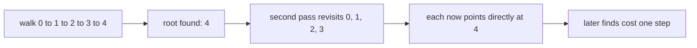
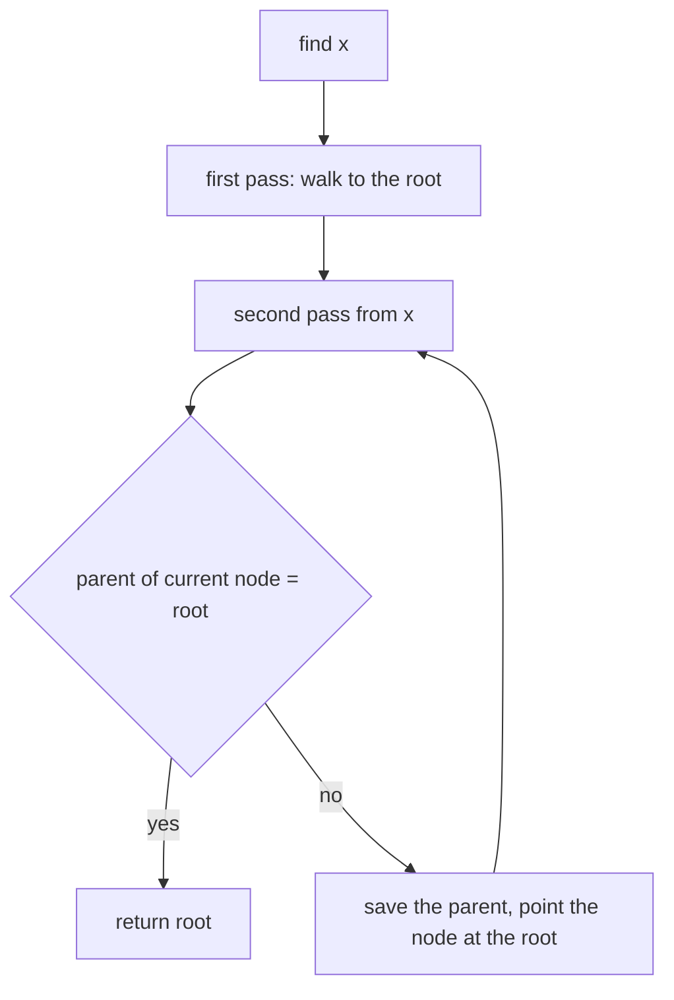
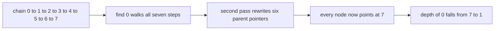

# 110 — Path compression in union-find.

> **Tier:** Beginner · **CTCI chapter:** Ch 4 — Trees and Graphs
> **Task spec:** [110-path-compression-in-union-find.md](../../../tasks/beginner/110-path-compression-in-union-find.md)
> **Solutions:** [Python](../../../solutions/python/beginner/110-path-compression-in-union-find/solution.py) ·
> [Java](../../../solutions/java/beginner/110-path-compression-in-union-find/Solution.java) ·
> [JavaScript](../../../solutions/javascript/beginner/110-path-compression-in-union-find/solution.js) ·
> [C#](../../../solutions/csharp/beginner/110-path-compression-in-union-find/Solution.cs)

## 1. Problem restatement

**Input:** `n`, the number of elements `0 … n - 1`. As in
[109-implement-union-find-disjoint-set-basic.md](../../../tasks/beginner/109-implement-union-find-disjoint-set-basic.md),
this task is about the data structure itself.

**Output:** a disjoint-set structure whose `find` performs **path compression**, plus the same
`union`, `connected`, `count` and `depth` operations as the basic version :

| Operation | Meaning |
| --- | --- |
| `find(x)` | the root of the tree containing `x`, after re-pointing every node on the walked path straight at that root |
| `union(a, b)` | merge, deliberately using **plain linking**, so deep chains can form and the compression has something to flatten |
| `connected(a, b)` | whether `find(a)` equals `find(b)` |
| `count()` | the number of remaining sets |
| `depth(x)` | the number of parent steps from `x` to its root — the measurement that makes the effect visible |

The chain assertions are the heart of the task:

| Call | Result | Why |
| --- | --- | --- |
| `Dsu(9).count()` | `9` | every element starts alone |
| after `union(i, i + 1)` for `i = 0 … 6` | `count() == 2` | one chain of eight plus the loner `8` |
| `d.depth(0)` before any find | `7` | plain linking built the chain `0 → 1 → … → 7` |
| `d.find(0)` | `7` | the root of the chain |
| `d.depth(0)` after that find | `1` | the whole path now points at the root |
| `d.depth(i)` for `i = 1 … 6` | `1` each | every node on the walked path was compressed |
| `d.depth(7)` | `0` | a root has depth 0 |
| `d.union(7, 8)`, then `d.find(0)` and `d.depth(0)` | `count() == 1`, root `8`, depth `1` | the compressed tree follows the next merge |
| `max(d.depth(i))` over all nine elements | `≤ 2` | near-constant depth after one find |

The flat `Dsu(3)` case shows the same effect on a small scale: `union(0, 1)` and `union(1, 2)` build
a chain of depth 2, and a single `find(0)` flattens both `0` and `1` to depth 1.

## 2. Intuition

The previous task's `find` is a bare pointer walk to the root. It is correct, and on a chain of
`V` elements it costs `V` steps — the worst case union by rank was designed to avoid. But there is
a cheaper observation available: if you had to walk the path to find the root, you already know the
root, and you can **tell every node you passed about it**.

```text
before:  0 → 1 → 2 → 3 → 4        (find(0) walks four steps)
after:   0 → 4, 1 → 4, 2 → 4, 3 → 4, 4 is root
```

That is path compression, and it is why the task's `depth` assertions move from `7` to `1` between
two consecutive lines. No merge happened in between; the walk itself reshaped the tree.

The implementation is a **two-pass** find:

1. **First pass — find the root.** Walk `parent` pointers from `x` until a node points to itself.
   Keep that node as `root`; do not change anything yet.
2. **Second pass — flatten the path.** Walk the same path again from `x`, and for every node that
   does not yet point at `root`, save its current parent, overwrite it with `root`, and continue
   from the saved parent. The loop stops as soon as it reaches a node that already points at the
   root.



The second pass is where the care is needed: the loop condition is `parent[x] ≠ root`, not
`x ≠ root`, and the advance step must save `parent[x]` *before* overwriting it. Getting that wrong
either skips nodes or walks off the path.

The second deliberate choice is that `union` keeps **plain linking** ("plain linking on purpose",
as the solution comments put it). The task wants deep chains to be buildable so that the
compression can be observed and asserted; mixing in union by rank would hide the effect behind
already-shallow trees. In production you would use both, and the improvement compounds.

## 3. Algorithm

Construction:

1. Set `parent[i] = i` for every element.
2. Set `components = n`.

`find(x)` with two-pass compression:

1. Set `root = x`, then walk `root` up the parent chain until `parent[root] = root`.
2. Set `x` back to the original argument, then while `parent[x] ≠ root`: save `next = parent[x]`,
   set `parent[x] = root`, and continue with `x = next`.
3. Return `root`.

`union(a, b)` — plain linking, on purpose:

1. Find the roots `ra` and `rb`.
2. If equal, return `false`.
3. Set `parent[ra] = rb`, decrement the component count, return `true`.

```text
procedure find(parent, x)
    root ← x
    while parent[root] ≠ root do
        root ← parent[root]
    end
    while parent[x] ≠ root do
        next ← parent[x]
        parent[x] ← root
        x ← next
    end
    return root
end

procedure union(parent, components, a, b)
    ra ← find(parent, a)
    rb ← find(parent, b)
    if ra = rb then
        return false
    end
    parent[ra] ← rb
    components ← components - 1
    return true
end
```

Notice the ordering inside `union`: `find(a)` runs first and compresses the path to `ra`, then
`find(b)` compresses its own path. Both merges and queries therefore leave the forest a little
flatter than they found it, which is what makes the amortised cost per operation approach a
constant.



## 4. Worked example

Build the chain asserted in the solution files: `Dsu(9)` and `union(i, i + 1)` for `i = 0 … 6`.

| Step | Operation | `parent` | `depth(0)` | `count()` |
| --- | --- | --- | --- | --- |
| 0 | initial | `[0, 1, 2, 3, 4, 5, 6, 7, 8]` | 0 | 9 |
| 1 | `union(0, 1)` | `[1, 1, 2, 3, 4, 5, 6, 7, 8]` | 1 | 8 |
| 2 | `union(1, 2)` | `[1, 2, 2, 3, 4, 5, 6, 7, 8]` | 2 | 7 |
| 3 | `union(2, 3)` | `[1, 2, 3, 3, 4, 5, 6, 7, 8]` | 3 | 6 |
| 4–7 | `union(3, 4) … union(6, 7)` | `[1, 2, 3, 4, 5, 6, 7, 7, 8]` | 7 | 2 |

The chain is complete: `0 → 1 → 2 → 3 → 4 → 5 → 6 → 7`, and element `8` is untouched, giving
`count() == 2`. Now the single `find(0)`:

| Pass | Pointer | Path walked | Action |
| --- | --- | --- | --- |
| first | `root = 0` | `0 → 1 → 2 → 3 → 4 → 5 → 6 → 7` | `root` ends at `7` |
| second | `x = 0` | `parent[0] = 1 ≠ 7` | save `next = 1`, set `parent[0] = 7`, move to `1` |
| second | `x = 1` | `parent[1] = 2 ≠ 7` | save `next = 2`, set `parent[1] = 7`, move to `2` |
| second | `x = 2` | `parent[2] = 3 ≠ 7` | save `next = 3`, set `parent[2] = 7`, move to `3` |
| second | … | the same for `3`, `4`, `5`, `6` | each now points at `7` |
| second | `x = 7` | `parent[7] = 7 = root` | loop ends |

After the call, `parent = [7, 7, 7, 7, 7, 7, 7, 7, 8]`: every element that was on the path has depth
1 and the root has depth 0, so `depth(0) == 1` and `depth(i) == 1` for `i = 1 … 6`, exactly as
asserted. A second `find(0)` costs one step and leaves the depths unchanged — the idempotence
assertion.



The final merge in the assertions, `union(7, 8)`, shows that compression is not a one-off. Plain
linking finds roots `7` and `8` and sets `parent[7] = 8`; the tree of eight elements now hangs
directly under `8`, so `find(0)` returns `8` after one step, `depth(0)` is at most 2, and a further
`find(0)` compresses that last edge so that `depth(0) == 1` again. Note that `find(0)` inside
`union(7, 8)` was itself the call that flattened `7`'s subtree, which is why the depth after the
merge is at most 2 rather than 2 for the whole subtree.

## 5. Complexity

Let `V` be the number of elements and `M` the number of operations.

| Measure | Bound | Why it holds |
| --- | --- | --- |
| Time, `find` best | O(1) | the element is a root, or already points directly at one |
| Time, `find` worst, single call | O(V) | a freshly built chain must be walked once — the asserted depth of 7 before the find |
| Time, `find` amortised | nearly O(1) | each node on a path is re-pointed at the root, so it cannot appear on a long path again until a merge puts it back |
| Time, `union` | two finds plus O(1) | the link is one assignment |
| Space, output | O(1) | the operations return roots, booleans and counts |
| Space, extra | O(V) | one parent array — the rank array of task 109 is deliberately absent |
| Time of plain linking plus bare finds | O(V) per find | the chain assertion is the demonstration: depth 7 before, depth 1 after |
| Time of union by rank without compression | O(log V) per find | the earlier task's guarantee, achieved with a second array instead of a rewrite |

The comparison that matters is not "compression versus rank" but "both". Compression flattens
paths that have already been walked; union by rank prevents the merges from rebuilding tall trees
in the first place. This task isolates the first half — which is why its `union` is explicitly
documented as plain linking — and the cycle-detection and MST tasks pair the two.

## 6. Pitfalls and edge cases

- **Two passes, not one.** A single-pass walk cannot compress, because the root is unknown until
  the walk ends. The first pass discovers it; the second pass rewrites what the first pass saw.
- **The second pass must save the parent before overwriting it.** `next = parent[x]` followed by
  `parent[x] = root` and `x = next` is the safe order; overwriting first loses the path.
- **The first pass must not mutate.** If the walk re-points nodes as it goes, it cannot reach the
  root, and the "path" it compresses is not the real one.
- **The loop condition uses the root, not the node.** `while parent[x] ≠ root` stops at the node
  that already points at the root, which is the correct stopping point; comparing `x` with `root`
  would skip the last hop.
- **Idempotence.** A second `find(0)` on the compressed chain costs one step and changes nothing,
  which the assertions check (`d.find(0) == d.find(0)` and `depth(0) == 1` afterwards).
- **Plain linking builds chains on purpose.** The asserted `depth(0) == 7` is a feature of this
  task's design; replacing `union` with `union_by_rank` would keep the answers correct but would
  hide the compression effect the assertions look for.
- **Merging after compression can deepen a path once.** `union(7, 8)` re-attaches the whole
  compressed subtree under `8`, so `depth(0)` becomes 2 until the next find flattens it. The
  assertions allow exactly that (`depth(0) <= 2`), and then require the following find to bring it
  back to 1.
- **The depth bound after compression is not a hard invariant.** Any merge may add one level; the
  assertions therefore use `<= 2` for "bounded depth overall" rather than an exact value.
- **`n = 1`.** `Dsu(1)` has `count() == 1`, `find(0) == 0` and `depth(0) == 0`: the first pass
  returns immediately because the element is its own root, and the second pass has nothing to do.
- **The flat `Dsu(3)` case.** `union(0, 1)` and `union(1, 2)` build a chain of depth 2; `find(0)`
  returns `2` and leaves both `0` and `1` at depth 1 — the smallest complete demonstration of the
  transformation.
- **No index validation.** As in the basic version, out-of-range elements are the caller's
  responsibility; the assertions never exercise them.
- **`connected` inherits the compression.** Each `connected` call runs two finds, so it flattens
  the paths it touches — a query that is not read-only, which matters if a caller measures depths.

## 7. Variants and follow-ups

- **The uncompressed baseline.** The bare-walk `find` and the two union variants are
  [109-implement-union-find-disjoint-set-basic.md](../../../tasks/beginner/109-implement-union-find-disjoint-set-basic.md).
- **Path halving.** A single-pass variant that re-points every *other* node
  (`parent[x] = parent[parent[x]]`), used in
  [108-detect-cycle-in-undirected-graph-union-find.md](../../../tasks/beginner/108-detect-cycle-in-undirected-graph-union-find.md);
  it compresses less per call but needs no second pass.
- **Full recursion.** Returning from the recursion with `parent[x] = find(parent[x])` compresses
  the path on the way back up, at the cost of O(V) stack depth.
- **Merging with compression.** Kruskal's algorithm combines this `find` with union by rank:
  [111-kruskal-s-mst-using-union-find.md](../../../tasks/beginner/111-kruskal-s-mst-using-union-find.md).
- The chapter walkthrough [Trees and Graphs](../../ctci/04-trees-and-graphs.md) presents
  compression as the amortisation trick that turns a linked-structure query into near-constant
  work.

## 8. Check yourself

1. How many parent pointers does `find(0)` rewrite on the asserted chain of eight elements?

<details><summary>Show answer</summary>

Six: `parent[0]` through `parent[5]`. The node `6` already points at the root `7`, so the second
pass stops there, and `7` is the root itself. Before the call the depth of `0` is 7; afterwards it
is 1.

</details>

2. Why does the compression not make the structure permanently flat?

<details><summary>Show answer</summary>

Because a later `union` can attach a flattened subtree under a different root, which adds one level
to every node in it. The assertions capture exactly that: after `union(7, 8)` the depth of `0` is at
most 2, and the next `find(0)` brings it back to 1.

</details>

3. Why is `union` left as plain linking instead of using union by rank?

<details><summary>Show answer</summary>

So the chains the assertions measure are actually buildable. Union by rank would keep every tree
shallow by construction, and `depth(0) == 7` before the find — the line that makes the effect
visible — would be impossible. Correctness does not depend on the choice; the demonstration does.

</details>

4. What goes wrong if the first pass in `find` also re-points nodes as it walks?

<details><summary>Show answer</summary>

The walk would re-point a node before knowing the root, so it could not reach the actual root — it
would stop early or follow a modified chain. The root must be discovered first, and only then can
the path be rewritten to point at it.

</details>

5. What is the cost of the second `find(0)` after the compression, and of a `depth(0)` measurement
   that follows it?

<details><summary>Show answer</summary>

Both are O(1) steps: `parent[0]` is the root `7` (or `8` after the final merge), so the pass walks
one edge and the second pass stops immediately. `depth` is O(1) for the same reason.

</details>
