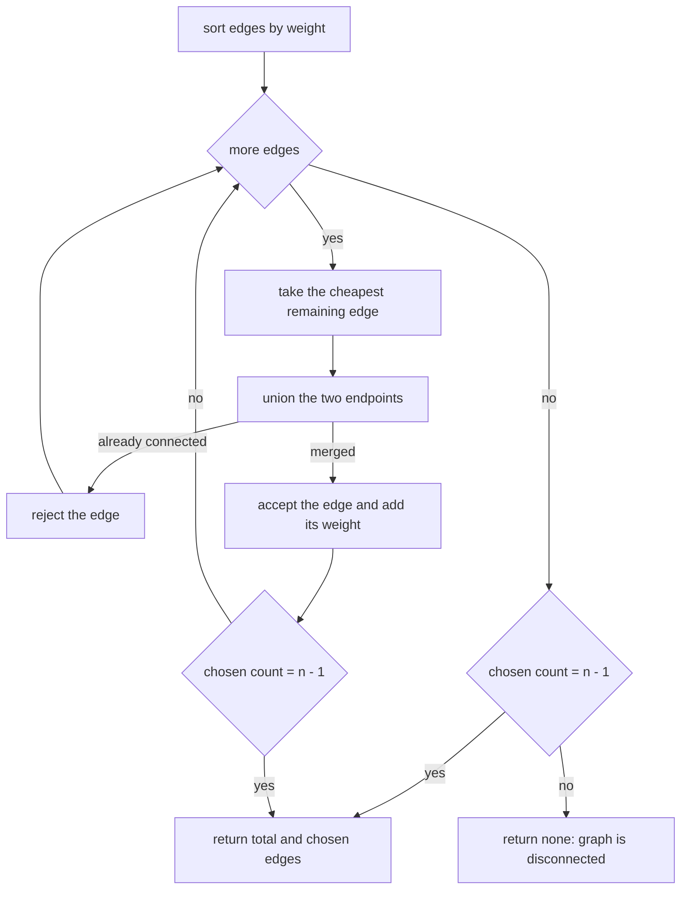
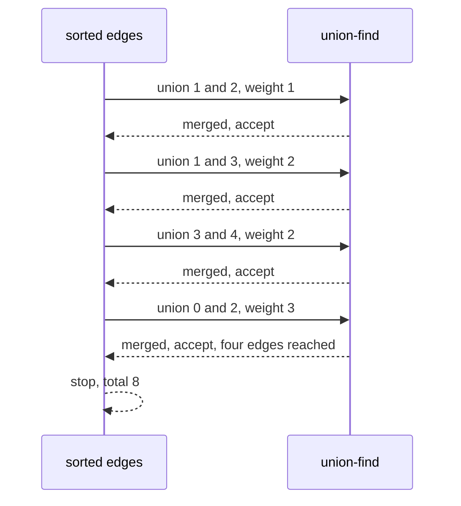

# 111 — Kruskal's MST using union-find.

> **Tier:** Beginner · **CTCI chapter:** Ch 4 — Trees and Graphs
> **Task spec:** [111-kruskal-s-mst-using-union-find.md](../../../tasks/beginner/111-kruskal-s-mst-using-union-find.md)
> **Solutions:** [Python](../../../solutions/python/beginner/111-kruskal-s-mst-using-union-find/solution.py) ·
> [Java](../../../solutions/java/beginner/111-kruskal-s-mst-using-union-find/Solution.java) ·
> [JavaScript](../../../solutions/javascript/beginner/111-kruskal-s-mst-using-union-find/solution.js) ·
> [C#](../../../solutions/csharp/beginner/111-kruskal-s-mst-using-union-find/Solution.cs)

## 1. Problem restatement

**Input:** `n`, the number of vertices `0 … n - 1`, and a list of weighted undirected edges given as
`(u, v, weight)` triples. Weights may repeat, and the edge order is arbitrary.

**Output:** a minimum spanning tree — the cheapest set of `n - 1` edges that connects all `n`
vertices — reported as the total weight and the chosen edge list. If no spanning tree exists
because the graph is disconnected, the answer is "none": `None` in Python, `null` in Java,
JavaScript and C#.

| Call | Result | Why |
| --- | --- | --- |
| `kruskal(5, edges)` on the classic graph | total `8`, `4` edges | `8 = 1 + 2 + 2 + 3`, and `n - 1 = 4` |
| `kruskal(1, [])` | total `0`, no edges | a single vertex is already connected |
| `kruskal(3, [(0, 1, 1)])` | `None` | vertex `2` is unreachable |

The classic graph's seven edges are `(0, 1, 4)`, `(0, 2, 3)`, `(1, 2, 1)`, `(1, 3, 2)`, `(2, 3, 4)`,
`(3, 4, 2)` and `(2, 4, 5)`. The Python file asserts the total as `8` and the number of chosen
edges as `4`, and the comments spell out the arithmetic: `1 + 2 + 2 + 3`.

## 2. Intuition

An exhaustive search over all `n - 1`-edge subsets is out of the question: even for small graphs the
count is astronomical. The naive improvement — grow a tree greedily from one vertex — is Prim's
algorithm, and it needs a priority queue to decide what to add next. Kruskal's insight removes the
"from where" question entirely.

The key insight has two halves:

- **Sort the edges by weight and consider them cheapest first.** If the cheapest edge anywhere in
  the graph can join two currently separate groups of vertices, there is no reason to skip it: any
  spanning tree must pay at least that much to connect those two groups.
- **An edge that joins two vertices already in the same group must be rejected.** Adding it would
  create a cycle, and a spanning tree cannot contain one. This is exactly the cycle test from
  [108-detect-cycle-in-undirected-graph-union-find.md](../../../tasks/beginner/108-detect-cycle-in-undirected-graph-union-find.md),
  run edge by edge.

That combination means Kruskal's algorithm never needs to know the shape of the tree being built —
only which vertices are already connected. Union-find answers that question in near-constant time,
which is why it is the classic partner of this algorithm.


Two details make the implementation exactly as long as it is:

- **The stopping rule.** A spanning tree has exactly `n - 1` edges, so the loop can break as soon
  as that many are accepted, without looking at the remaining edges.
- **The disconnected signal.** If the loop ends with fewer than `n - 1` accepted edges, the graph
  never connected, and the function returns "none" instead of a partial tree. The Java and C#
  solutions express the same guard as `Math.Max(0, n - 1)`, which also keeps `n = 1` from
  demanding `0` edges from an empty edge list.

## 3. Algorithm

1. Sort a copy of the edge list by weight, ascending.
2. Create a DSU over `n` vertices — the same structure as in the cycle-detection task, with path
   halving in `find` and union by rank in `union`.
3. For each edge `(u, v, w)` in sorted order: if `union(u, v)` reports that a merge happened, accept
   the edge, add `w` to the total, and stop early once `n - 1` edges have been accepted.
4. If the accepted count is `n - 1`, return the total and the chosen edges; otherwise return none.

```text
procedure kruskal(n, edges)
    sorted ← edges sorted by weight ascending
    parent ← array 0 to n - 1
    rank ← array of n zeros
    total ← 0
    chosen ← empty list
    for each (u, v, w) in sorted do
        if union(parent, rank, u, v) = true then
            append (u, v, w) to chosen
            total ← total + w
            if length(chosen) = n - 1 then
                break
            end
        end
    end
    if length(chosen) = n - 1 then
        return (total, chosen)
    end
    return none
end
```

The union call does double duty: it answers "do these two vertices belong to different groups?" and
performs the merge if the answer is yes. That is why the loop body contains no explicit cycle test —
the `false` return of `union` *is* the cycle test.



## 4. Worked example

Trace the classic graph. Sort by weight first:

| Sorted position | Edge | Weight |
| --- | --- | --- |
| 1 | (1, 2, 1) | 1 |
| 2 | (1, 3, 2) | 2 |
| 3 | (3, 4, 2) | 2 |
| 4 | (0, 2, 3) | 3 |
| 5 | (0, 1, 4) | 4 |
| 6 | (2, 3, 4) | 4 |
| 7 | (2, 4, 5) | 5 |

Now process them:

| Step | Edge | Weight | Roots before | Same group? | Action | Total | Chosen |
| --- | --- | --- | --- | --- | --- | --- | --- |
| 1 | (1, 2) | 1 | 1, 2 | no | merge | 1 | 1 |
| 2 | (1, 3) | 2 | 1, 3 | no | merge | 3 | 2 |
| 3 | (3, 4) | 2 | 1, 4 | no | merge | 5 | 3 |
| 4 | (0, 2) | 3 | 0, 1 | no | merge | 8 | 4 |
| 5 | — | — | — | — | `chosen = 4 = n - 1`, break | 8 | 4 |

The first three accepted edges connect `{1, 2, 3, 4}` for a cost of `1 + 2 + 2 = 5`, and the fourth
attaches vertex `0` for another `3`. The total is `8`, exactly as asserted, and the remaining three
edges — weights 4, 4 and 5 — are never examined because the early break fires.



The disconnected assertion shows the other ending. For `kruskal(3, [(0, 1, 1)])` the single edge is
accepted, the loop ends with `chosen = 1` while `n - 1 = 2`, and the function returns none. Vertex
`2` was never touched by any edge, so it remains a singleton and no spanning tree exists.

The `n = 1` case is the boundary: with an empty edge list and `n - 1 = 0`, `chosen` is already the
right size, so the result is a total of `0` with no edges — an MST of a single vertex.

## 5. Complexity

Let `V = n` be the number of vertices and `E` the number of edges.

| Measure | Bound | Why it holds |
| --- | --- | --- |
| Time, best | O(1) | `n = 1` with no edges accepts nothing and returns `(0, [])` immediately |
| Time, average | O(E log E) | sorting dominates; the union-find pass is O(E·α(V)) |
| Time, worst | O(E log E) | the sort is the bottleneck, and the early break can only help |
| Space, output | O(V) | the chosen edge list holds `n - 1` edges |
| Space, extra | O(V + E) | the DSU arrays plus the sorted copy of the edge list |
| Time of Prim's algorithm | O(E log V) with a binary heap | a different greedy order, same answer; see task 112 |
| Time of exhaustive subset search | exponential | the reason greedy works at all is the exchange argument behind the sorted scan |

Sorting is unavoidable in this formulation: Kruskal's correctness argument depends on considering
edges in non-decreasing weight, so no comparison-free shortcut exists in general. The union-find
pass is what makes the rest of the algorithm cheap enough to be dominated by the sort.

## 6. Pitfalls and edge cases

- **Disconnected graphs return none, not a partial tree.** `kruskal(3, [(0, 1, 1)])` is asserted to
  return `None` / `null`; returning `(1, [(0, 1, 1)])` would claim a tree that spans only two of
  the three vertices.
- **`n = 1` is a valid instance.** The result is total `0` with an empty edge list. The Java, C# and
  JavaScript solutions write the target as `Math.Max(0, n - 1)` (or its equivalent) so the loop
  condition and the final check both work at `n = 1`.
- **The early break is safe.** Once `n - 1` edges are accepted the tree is complete: no set of
  `n - 1` edges can connect `n` vertices with fewer, and the union-find invariant guarantees there
  are no cycles. The classic example stops after four of the seven edges.
- **Ties need no tie-break.** Two edges of equal weight may be accepted in either order; the total
  weight is the same. The classic graph has two weight-`2` edges and two weight-`4` edges, and the
  assertions check the total, not the chosen order.
- **A rejected edge is not an error.** `union` returning `false` is the normal, expected outcome for
  the remaining edges of a connected graph; it means the two endpoints are already connected.
- **The input edge list may or may not be copied.** Python sorts a new list with `sorted`, C# uses
  `OrderBy(...).ToArray()` and JavaScript spreads first (`[...edges].sort(...)`), while the Java
  solution sorts the caller's array in place with `Arrays.sort`. A caller who needs the original
  order must copy it before calling the Java version.
- **Weights are summed in a wide type.** Java and C# accumulate into a `long`; Python and
  JavaScript have no fixed-width integer for this. With many large weights, that difference is the
  one a port can break.
- **Parallel edges and self-loops.** A self-loop always finds the same root, so it is always
  rejected — correct, since a self-loop can never be part of a spanning tree. Parallel edges are
  simply two candidates, and only the cheaper one can be accepted.
- **Negative weights.** Nothing in the algorithm requires positive weights; sorting still orders
  them correctly, and the total may be negative. The assertions do not cover this, but the code
  handles it.
- **A complete graph's edge count.** The loop is O(E) after sorting, so dense graphs cost
  O(V² log V) in total, which is the expected behaviour for dense inputs.

## 7. Variants and follow-ups

- **Prim's algorithm.** Growing a single tree from a starting vertex with a heap instead of sorting
  globally: [112-prim-s-mst-using-heap.md](../../../tasks/beginner/112-prim-s-mst-using-heap.md)
  produces the same total weight for the classic graph, and its comment notes as much.
- **The union-find underneath.** Both the path halving and the rank merge used here come from
  [109-implement-union-find-disjoint-set-basic.md](../../../tasks/beginner/109-implement-union-find-disjoint-set-basic.md)
  and [110-path-compression-in-union-find.md](../../../tasks/beginner/110-path-compression-in-union-find.md).
- **The cycle test as a standalone question.**
  [108-detect-cycle-in-undirected-graph-union-find.md](../../../tasks/beginner/108-detect-cycle-in-undirected-graph-union-find.md)
  is this algorithm stopped at the first rejected edge.
- **Maximum spanning trees.** Sort descending instead of ascending; every other line is unchanged.
- The chapter walkthrough [Trees and Graphs](../../ctci/04-trees-and-graphs.md) uses the MST as the
  first greedy algorithm whose proof needs an exchange argument.

## 8. Check yourself

1. Why does Kruskal's algorithm never need to inspect the tree it is building?

<details><summary>Show answer</summary>

Because the only question it asks about a candidate edge is whether its endpoints are already
connected. Union-find answers that from the partition alone, so the algorithm never needs to look at
edges it has already accepted, nor at the shape of the resulting forest.

</details>

2. On the classic graph, which edges are accepted and what is the total?

<details><summary>Show answer</summary>

In sorted order the accepted edges are `(1, 2, 1)`, `(1, 3, 2)`, `(3, 4, 2)` and `(0, 2, 3)`, for a
total of `1 + 2 + 2 + 3 = 8`. The loop breaks as soon as the fourth edge is accepted, so the
weight-`4` and weight-`5` edges are never considered.

</details>

3. What does `kruskal(3, [(0, 1, 1)])` return?

<details><summary>Show answer</summary>

`None` (or `null`). Only one edge is accepted while a spanning tree of three vertices needs two, so
the graph is disconnected — vertex `2` has no incident edge at all. Returning the single edge would
misrepresent the result as a spanning tree.

</details>

4. Why can the loop stop early once `n - 1` edges are accepted?

<details><summary>Show answer</summary>

Because `n - 1` acyclic edges over `n` vertices always form a spanning tree. Each accepted edge
merged two previously separate groups, so the accepted set can have no cycle, and once it has
`n - 1` edges it must connect all `n` vertices.

</details>

5. Does the algorithm's answer depend on which of two equal-weight edges is considered first?

<details><summary>Show answer</summary>

No. The chosen edge set may differ, but the total weight is always the same minimum value. That is
why the assertions check the total (`8`) and the edge count (`4`) rather than a specific edge list.

</details>
