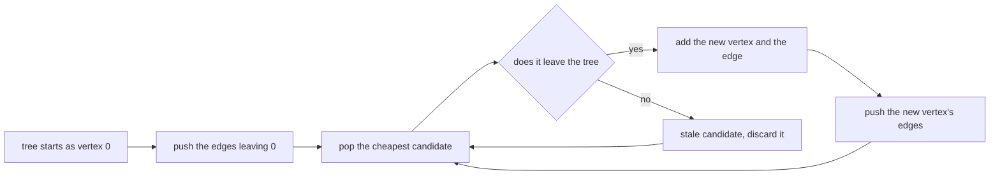
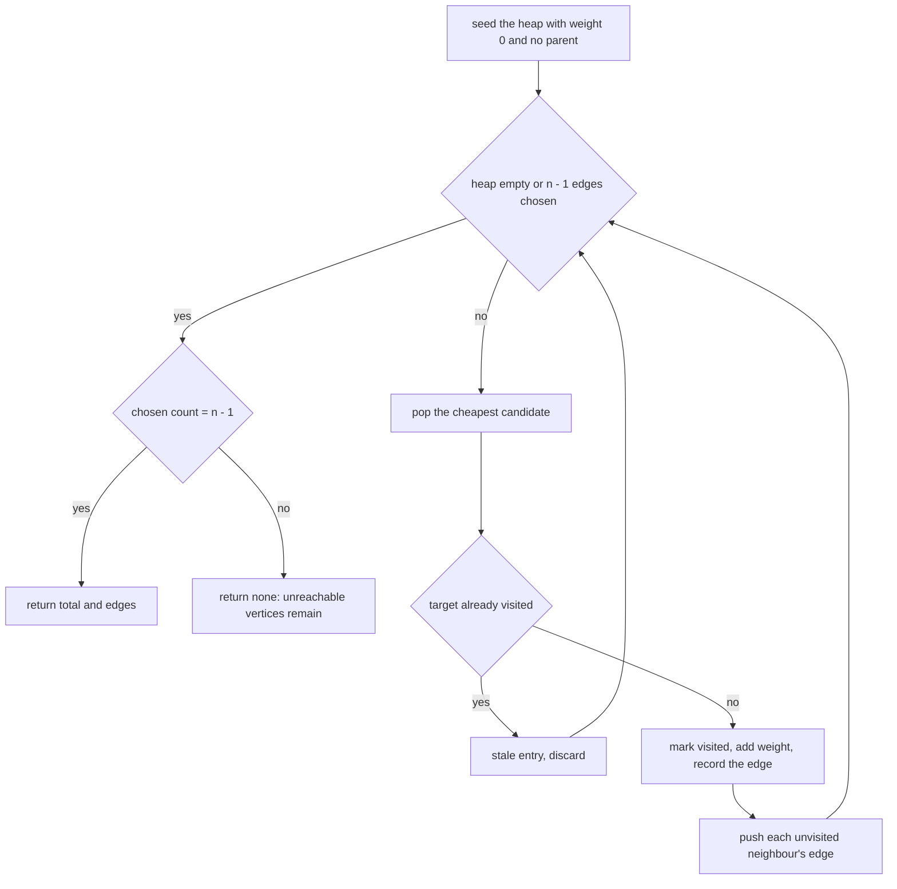
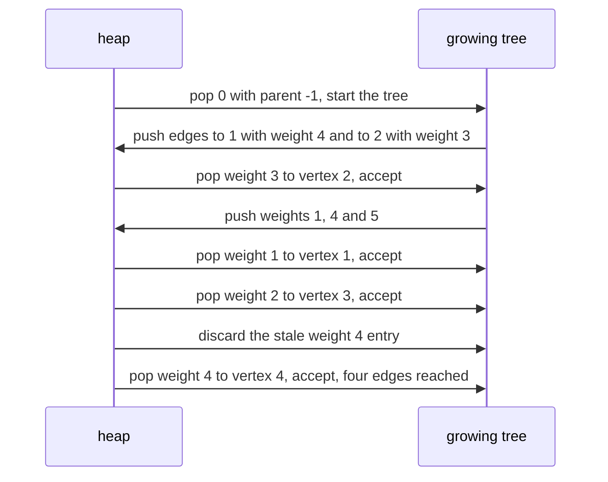

# 112 — Prim's MST using heap.

> **Tier:** Beginner · **CTCI chapter:** Ch 4 — Trees and Graphs
> **Task spec:** [112-prim-s-mst-using-heap.md](../../../tasks/beginner/112-prim-s-mst-using-heap.md)
> **Solutions:** [Python](../../../solutions/python/beginner/112-prim-s-mst-using-heap/solution.py) ·
> [Java](../../../solutions/java/beginner/112-prim-s-mst-using-heap/Solution.java) ·
> [JavaScript](../../../solutions/javascript/beginner/112-prim-s-mst-using-heap/solution.js) ·
> [C#](../../../solutions/csharp/beginner/112-prim-s-mst-using-heap/Solution.cs)

## 1. Problem restatement

**Input:** `n`, the number of vertices `0 … n - 1`, and an **adjacency list** where `adj[u]` is the
list of `(neighbour, weight)` pairs for vertex `u`. The graph is undirected, so every edge appears
in both lists. A start vertex may be supplied; it defaults to `0`.

**Output:** the same thing Kruskal's algorithm returns — the total weight of a minimum spanning tree
and the edges that make it up, where each chosen edge is reported as `(parent, vertex, weight)`.
A disconnected graph yields "none": `None` in Python, `null` in Java, JavaScript and C#.

| Call | Result | Why |
| --- | --- | --- |
| `prim(5, adj)` on the classic graph | total `8`, `4` edges | the same minimum weight as Kruskal in task 111 |
| `prim(1, [[]])` | total `0`, no edges | a single vertex is already a spanning tree |
| `prim(3, [[(1, 1)], [(0, 1)], []])` | `None` | vertex `2` has no edges, so it can never be reached |

The classic adjacency list is `adj[0] = [(1, 4), (2, 3)]`, `adj[1] = [(0, 4), (2, 1), (3, 2)]`,
`adj[2] = [(0, 3), (1, 1), (3, 4), (4, 5)]`, `adj[3] = [(1, 2), (2, 4), (4, 2)]` and
`adj[4] = [(3, 2), (2, 5)]` — the same seven weighted edges that Kruskal's algorithm sorts, with
weight `8` and four chosen edges asserted in the Python file's comment as the matching result.

## 2. Intuition

Kruskal's algorithm looks at the whole graph at once and sorts every edge. Prim's algorithm looks
from the inside out: start with one vertex, and repeatedly add the cheapest edge that leaves the
growing tree. Both are greedy, and both are correct by the same exchange argument — the difference
is the order in which candidates are considered.

The naive way to grow the tree is to rescan every edge for each addition: for each new vertex, walk
the whole edge list looking for the cheapest edge from inside the tree to outside it. That is O(V·E)
and easy to write badly.

The key insight is that the frontier of candidate edges never needs to be recomputed from scratch.
When you add a vertex, the only new candidates are that vertex's own incident edges — everything
already in the frontier is still a valid candidate. So maintain a **priority queue of candidate
edges** keyed by weight, and each time a vertex joins the tree, push that vertex's edges onto the
queue. The next cheapest edge is then always at the top.



Two consequences shape the implemented loop:

- **Stale candidates are discarded lazily.** An edge that was the cheapest at the time it was
  pushed may lead to a vertex that has since joined the tree. Instead of removing such entries from
  the queue — which would need a decrease-key operation — the loop simply pops them, notices the
  target is already visited, and continues. This is why the queue is a plain min-heap of triples.
- **The starting vertex's own "edge" is a sentinel.** The heap is seeded with `(0, start, -1)`: a
  zero-weight, parentless entry. Popping it marks the start as visited and adds nothing to the
  total, which is what makes the loop uniform instead of needing a special first step.

The chosen edges are recorded as `(parent, vertex, weight)` — the parent is the vertex that was
already in the tree when the edge was popped, which is why the heap tuples carry three fields.

## 3. Algorithm

1. Create a `visited` array of `n` false values, set `total = 0`, and create an empty list of
   chosen edges.
2. Push `(0, start, -1)` onto a min-heap keyed by weight.
3. While the heap is not empty and fewer than `n - 1` edges have been chosen:
   1. Pop the cheapest entry `(weight, u, parent)`.
   2. If `u` is already visited, discard the entry and continue — it is a stale candidate.
   3. Mark `u` visited and add `weight` to the total.
   4. If `parent` is not `-1`, append `(parent, u, weight)` to the chosen list.
   5. For each `(v, w)` in `adj[u]`: if `v` is not visited, push `(w, v, u)`.
4. If exactly `n - 1` edges were chosen, return the total and the edges; otherwise return none.

```text
procedure prim(n, adj, start)
    visited ← array of n false values
    total ← 0
    chosen ← empty list
    heap ← min-heap containing (0, start, -1)
    while heap is not empty and length(chosen) &lt; n - 1 do
        (weight, u, parent) ← pop the cheapest entry
        if visited[u] = true then
            continue
        end
        visited[u] ← true
        total ← total + weight
        if parent ≠ -1 then
            append (parent, u, weight) to chosen
        end
        for each (v, w) in adj[u] do
            if visited[v] = false then
                push (w, v, u) onto heap
            end
        end
    end
    if length(chosen) = n - 1 then
        return (total, chosen)
    end
    return none
end
```

The loop condition stops once the chosen list reaches the required size, and the four solutions
spell that bound in two equivalent ways: Python and Java test for fewer than `n` chosen entries,
while JavaScript and C# test for fewer than `n - 1` explicitly (with `Math.Max(0, n - 1)` guarding
the `n = 1` boundary). Both are correct because a spanning tree never has more than `n - 1` edges.
Since the sentinel entry has no parent, it contributes to the visited count without contributing an
edge, which is exactly the `n`-vertices-versus-`n - 1`-edges bookkeeping the algorithm requires.



## 4. Worked example

Trace the classic graph from vertex `0`. The heap starts as `[(0, 0, -1)]`.

| Step | Popped | Visited? | Action | Total | Chosen edges | Heap additions |
| --- | --- | --- | --- | --- | --- | --- |
| 1 | (0, 0, −1) | no | mark `0`, no edge (parent −1) | 0 | — | (4, 1, 0), (3, 2, 0) |
| 2 | (3, 2, 0) | no | mark `2`, add edge `(0, 2, 3)` | 3 | 1 | (1, 1, 2), (4, 3, 2), (5, 4, 2) |
| 3 | (1, 1, 2) | no | mark `1`, add edge `(2, 1, 1)` | 4 | 2 | (2, 3, 1) — `0` is visited, so `(4, 0, 1)` is skipped |
| 4 | (2, 3, 1) | no | mark `3`, add edge `(1, 3, 2)` | 6 | 3 | (4, 4, 3) — `2` is visited, so `(4, 2, 3)` is skipped |
| 5 | (4, 3, 2) | yes | stale entry, discarded | 6 | 3 | — |
| 6 | (4, 4, 3) | no | mark `4`, add edge `(3, 4, 2)` | 8 | 4 | (5, 2, 4) |
| 7 | — | — | `chosen = 4 = n - 1`, so the loop condition fails; `(4, 1, 0)` and `(5, 2, 4)` are never popped | 8 | 4 | — |

Step 5 is the lazy deletion in action: `(4, 3, 2)` was pushed when `2` was processed, but `3`
had already joined the tree through `(2, 3, 1)`, so the entry is worthless and is thrown away.
The final answer is a total of `8` with four edges — the same minimum weight Kruskal's algorithm
found in task 111, which the Python comment calls out explicitly.



The disconnected assertion `prim(3, [[(1, 1)], [(0, 1)], []])` shows the other exit. Vertices `0`
and `1` are connected by a weight-`1` edge, vertex `2` is isolated, and the heap empties after two
pops. Only one edge was chosen while `n - 1 = 2` are needed, so the function returns none. The
`prim(1, [[]])` case is the boundary: one vertex, no edges, `n - 1 = 0` edges already chosen, total
`0`.

## 5. Complexity

Let `V = n` be the number of vertices and `E` the number of edges, so the adjacency list holds `2E`
entries for an undirected graph.

| Measure | Bound | Why it holds |
| --- | --- | --- |
| Time, best | O(1) | `n = 1` pops the sentinel and stops, because no edges are required |
| Time, average | O(E log E) | each directed adjacency entry is pushed once, and each heap operation is logarithmic |
| Time, worst | O(E log E) | stale entries are popped and discarded, and each entry can be pushed only once, so the extra work is proportional to `E` |
| Space, output | O(V) | the chosen edge list holds at most `n - 1` edges |
| Space, extra | O(V + E) | the visited array, the chosen list, and a heap that can hold every pushed entry |
| Time of the rescanning variant | O(V·E) | re-scanning the whole edge list per added vertex, instead of maintaining a frontier |
| Time of Kruskal's algorithm | O(E log E) | dominated by sorting every edge instead of growing one frontier |

The heap can hold more entries than the number of remaining edges because a vertex may be pushed
several times before it is visited. Each such entry is popped at most once, which is why the total
heap work stays O(E log E) even though lazy deletion looks wasteful. The memory bound is the price:
the frontier is not deduplicated, so the heap's worst-case size is O(E) rather than O(V).

## 6. Pitfalls and edge cases

- **Unreachable vertices return none.** `prim(3, [[(1, 1)], [(0, 1)], []])` is asserted to return
  `None` / `null`: after the heap empties, only one edge has been chosen and two are needed. A
  partial tree must never be returned as if it spanned the graph.
- **`n = 1` must work.** The target `n - 1` is 0, so no edge is required; the sentinel pop marks the
  single vertex visited and the total stays `0`. The Java, C# and JavaScript solutions write the
  target as `Math.Max(0, n - 1)` so the boundary does not produce a negative count.
- **Stale entries are normal.** The same vertex can be pushed once per neighbour, so it may appear
  several times in the heap. Popping an entry whose target is already visited is the intended
  discard path, not an error — step 5 of the worked example is exactly that case.
- **The sentinel entry.** Seeding with `(0, start, -1)` keeps the loop uniform, but it means the
  "edge count" and the "visited count" differ by one. The chosen list must skip the sentinel, which
  is what the `parent ≠ -1` test does.
- **Undirected adjacency lists must be symmetric.** Every edge has to appear in both endpoints'
  lists, or the tree may fail to reach part of the graph and the function will report none even
  though the graph is connected.
- **Weights are summed in a wide type.** Java and C# accumulate into a `long` and return `long[]`;
  Python and JavaScript use their own numeric types. As in Kruskal, that is the porting detail that
  bites when weights are large.
- **Edge weights may tie.** Ties are broken by heap order, so the chosen edge set can differ between
  languages while the total weight stays minimal. The assertions check the total (`8`) and the edge
  count (`4`), not a specific edge list — the same convention as task 111.
- **The chosen edges are reported as `(parent, vertex, weight)`.** The parent is the tree vertex that
  was already present when the edge was popped, so the triple is oriented — unlike the undirected
  `(u, v, w)` triples Kruskal records.
- **Starting vertex choice does not change the total.** `start` defaults to `0`, and the asserted
  results are the minimum weight; any start reachable from the rest of the graph yields the same
  total, though possibly a different edge set.
- **Multiple components must be detected by the edge count.** There is no explicit connectivity
  check: `length(chosen) = n - 1` is the certificate, and any shortfall means unreached vertices.
- **Parallel edges and self-loops.** A self-loop leads to an already-visited vertex and is discarded
  like any stale entry; parallel edges are just two candidates, and only the cheaper one matters.
- **The JavaScript heap is hand-written.** That solution implements `push` and `pop` over an array
  instead of relying on a library, so the sift-up and sift-down loops are part of the algorithm
  there. The other three use `heapq`, `PriorityQueue` and `PriorityQueue` respectively.

## 7. Variants and follow-ups

- **Kruskal's algorithm.** Global edge sorting instead of a growing frontier, with the same minimum
  total: [111-kruskal-s-mst-using-union-find.md](../../../tasks/beginner/111-kruskal-s-mst-using-union-find.md).
- **The heap itself.** The push/pop operations used here are the subject of
  [065-implement-priority-queue-using-built-in-heap.md](../../../tasks/beginner/065-implement-priority-queue-using-built-in-heap.md),
  and the hand-written variant in the JavaScript solution mirrors them.
- **Dense graphs.** An O(V²) array-based frontier — scanning for the cheapest crossing edge each
  time — beats the heap when `E` approaches `V²`; the heap wins on sparse graphs.
- **Shortest paths instead of minimum trees.** Dijkstra's algorithm uses the same heap-driven
  frontier but accumulates path distances rather than edge weights:
  [113-simple-dijkstra-s-algorithm-non-negative-weights.md](../../../tasks/beginner/113-simple-dijkstra-s-algorithm-non-negative-weights.md).
- The chapter walkthrough [Trees and Graphs](../../ctci/04-trees-and-graphs.md) contrasts the two
  MST algorithms as the two ways to be greedy about a connected graph.

## 8. Check yourself

1. Why does the algorithm push a vertex's edges when the vertex joins the tree, rather than
   pre-computing all candidate edges up front?

<details><summary>Show answer</summary>

Because the frontier only changes when a vertex joins the tree, and then only by that vertex's own
incident edges. Pushing them lazily keeps each adjacency entry pushed exactly once and avoids
re-scanning the whole edge list, which is what turns an O(V·E) idea into O(E log E).

</details>

2. What is a stale heap entry, and what happens to it?

<details><summary>Show answer</summary>

An entry whose target vertex joined the tree through an earlier, cheaper edge. It is popped later,
the `visited` test fails, and the loop discards it with `continue`. The worked example's step 5 is
such an entry: `(4, 3, 2)` after `3` was already reached at weight 2.

</details>

3. Why is the heap seeded with `(0, start, -1)`?

<details><summary>Show answer</summary>

So the start vertex is processed by the same loop body as every other vertex: the zero weight adds
nothing to the total, and the `-1` parent marks the entry as having no edge, which is why it is not
recorded in the chosen list. Without the sentinel the loop would need a separate initialisation
step.

</details>

4. How does the algorithm know the graph is disconnected?

<details><summary>Show answer</summary>

By the edge count. A spanning tree of `n` vertices has exactly `n - 1` edges; if the loop ends with
fewer, some vertices were never reachable. The assertion `prim(3, [[(1, 1)], [(0, 1)], []])` returns
none for exactly that reason.

</details>

5. The heap can hold more entries than there are edges remaining. Does that break the complexity
   bound?

<details><summary>Show answer</summary>

No. Each adjacency entry is pushed at most once, so the total number of pushes is O(E) and the total
number of pops is the same, even though the heap's *size* at any moment can be O(E). Each heap
operation is O(log E), giving O(E log E) overall.

</details>
