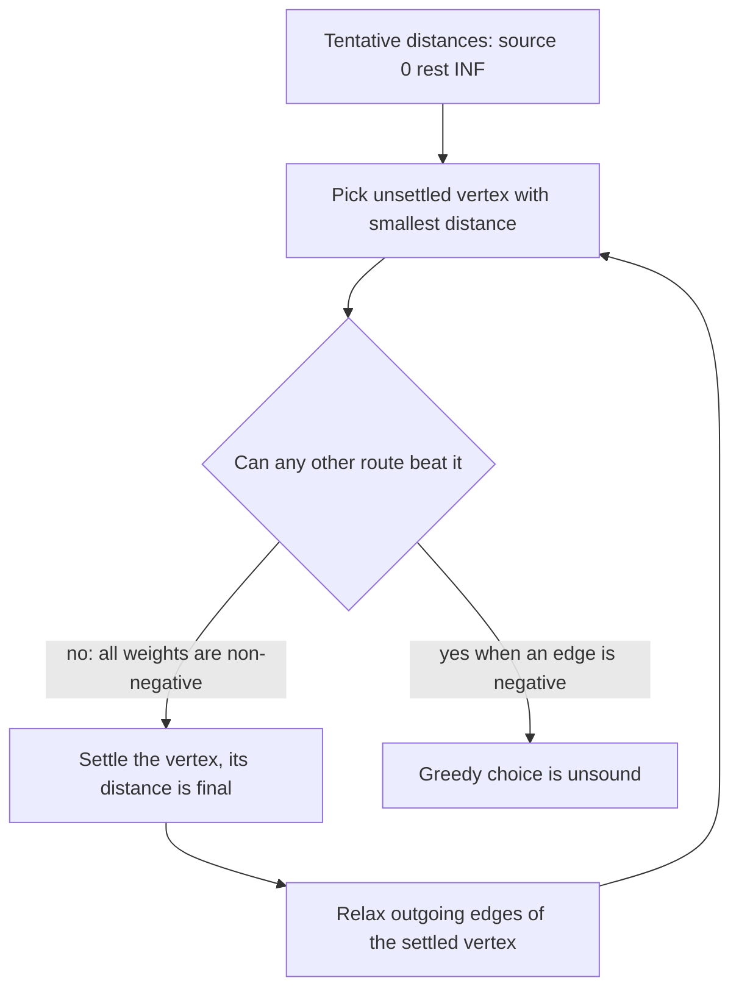
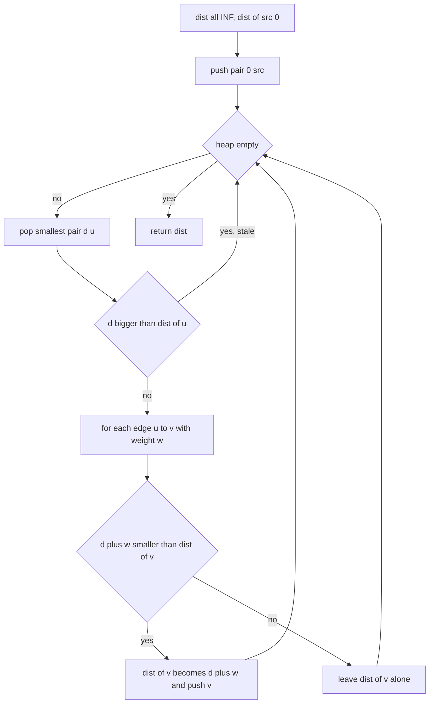
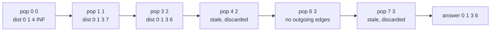

# 113 — Simple Dijkstra’s algorithm (non-negative weights).

> **Tier:** Beginner · **CTCI chapter:** Ch 4 — Trees and Graphs
> **Task spec:** [113-simple-dijkstra-s-algorithm-non-negative-weights.md](../../../tasks/beginner/113-simple-dijkstra-s-algorithm-non-negative-weights.md)
> **Solutions:** [Python](../../../solutions/python/beginner/113-simple-dijkstra-s-algorithm-non-negative-weights/solution.py) ·
> [Java](../../../solutions/java/beginner/113-simple-dijkstra-s-algorithm-non-negative-weights/Solution.java) ·
> [JavaScript](../../../solutions/javascript/beginner/113-simple-dijkstra-s-algorithm-non-negative-weights/solution.js) ·
> [C#](../../../solutions/csharp/beginner/113-simple-dijkstra-s-algorithm-non-negative-weights/Solution.cs)

## 1. Problem restatement

**Input:** a vertex count `n`, an adjacency list `adj` where `adj[u]` holds pairs
`(v, weight)` meaning "there is an edge from `u` to `v` costing `weight`", every `weight >= 0`,
and a source vertex `src`.

**Output:** an array `dist` of length `n` where `dist[i]` is the smallest total edge weight of
any path from `src` to `i`. Vertices that cannot be reached keep a sentinel meaning "infinity":
`float("inf")` in Python, `Infinity` in JavaScript, `Long.MAX_VALUE / 4` in Java and
`long.MaxValue / 4` in C#.

The spec is one line long, so the contract is pinned by the assertions the four solution files
ship with:

| Call | Result | Why |
| --- | --- | --- |
| `dijkstra(4, [[(1,1),(2,4)],[(2,2),(3,6)],[(3,3)],[]], 0)` | `[0, 1, 3, 6]` | the direct `0 → 2` edge costs 4, but `0 → 1 → 2` costs 3 |
| `dijkstra(3, [[(1,5)],[(0,5)],[]], 0)` | `[0, 5, inf]` | vertex 2 has no edge at all |
| `dijkstra(4, [[(1,2),(2,5)],[(2,1),(3,4)],[(3,1)],[]], 0)` | `[0, 2, 3, 4]` | a DAG where the same answer must appear as in Bellman-Ford (task 114) |

Edges are directed; the undirected case is expressed by adding both directions. `src` is
assumed to be a valid index, weights fit in the language's integer type, and the graph may be
disconnected.

## 2. Intuition

The naive idea is to grow paths outward level by level, the way BFS does. That works when every
edge costs the same, because then "fewer edges" means "cheaper". With weights it breaks: the
direct edge `0 → 2` costs 4 while the two-edge route `0 → 1 → 2` costs 1 + 2 = 3, so the path
with *more* edges is cheaper. Counting hops is the wrong measure.

The key insight is a greedy one. Keep a tentative distance for every vertex, initially `0` for
the source and infinity elsewhere. Repeatedly pick the unsettled vertex `u` with the **smallest**
tentative distance and declare it final. Why is that allowed? Any other route to `u` must leave
the settled set through some edge and then reach `u`, and because every weight is non-negative,
such a route is already at least as expensive as the smallest tentative distance on the
frontier. With negative weights the argument collapses — that is exactly why task 114 exists.



`relax` means: for every edge `(u, v, w)` leaving a settled vertex, compute `d + w` and, if it
is smaller than the current `dist[v]`, lower `dist[v]` and remember that `v` is now a
candidate. The classic implementation keeps candidates in a **min-heap** ordered by distance.
Java and C# `PriorityQueue` have no decrease-key operation, so the solutions never update a
heap entry: each improvement pushes a *new* pair and leaves the old one in place to be
discarded later. That is why the loop begins with a staleness test.

## 3. Algorithm

1. Create `dist` with `n` entries, all infinity, and set `dist[src] = 0`.
2. Push the pair `(0, src)` onto a min-heap keyed by distance.
3. While the heap is not empty, pop the pair with the smallest key.
4. If the popped distance is larger than the current `dist[u]`, the entry is stale — skip it.
5. Otherwise relax every edge `(v, w)` in `adj[u]`: if `d + w` is smaller than `dist[v]`, store
   it and push `(d + w, v)`.
6. When the heap drains, return `dist`.

```text
procedure dijkstra(n, adj, src)
    dist ← array of n entries, each INF
    dist[src] ← 0
    heap ← min-heap containing the pair (0, src)
    while heap is not empty do
        (d, u) ← pop the pair with the smallest distance
        if d > dist[u] then
            continue                    # stale entry from an earlier improvement
        end
        for each (v, w) in adj[u] do
            nd ← d + w
            if nd < dist[v] then
                dist[v] ← nd
                push (nd, v) onto heap
            end
        end
    end
    return dist
end
```

The staleness test is what makes the heap-only design correct: a distance is written into `dist`
first and only then pushed, so a pair that is no longer minimal can simply be dropped when it
surfaces. Each popped pair is either used once or discarded once, so no work is repeated.



## 4. Worked example

Trace the first assertion, `n = 4`, `adj = [[(1,1),(2,4)], [(2,2),(3,6)], [(3,3)], []]`,
`src = 0`. Distances start as `[0, INF, INF, INF]`.

| Step | Popped pair | Stale? | Edge relaxed | Effect | `dist` after the step |
| --- | --- | --- | --- | --- | --- |
| 1 | `(0, 0)` | no | `0 → 1`, `0 → 2` | `dist[1] = 1`, `dist[2] = 4` | `[0, 1, 4, INF]` |
| 2 | `(1, 1)` | no | `1 → 2`, `1 → 3` | `dist[2] = 3`, `dist[3] = 7` | `[0, 1, 3, 7]` |
| 3 | `(3, 2)` | no | `2 → 3` | `dist[3] = 6` | `[0, 1, 3, 6]` |
| 4 | `(4, 2)` | yes, `4 > 3` | — | entry discarded | `[0, 1, 3, 6]` |
| 5 | `(6, 3)` | no | none, `adj[3]` is empty | nothing changes | `[0, 1, 3, 6]` |
| 6 | `(7, 3)` | yes, `7 > 6` | — | entry discarded, heap empty | `[0, 1, 3, 6]` |

The heap held `(4, 2)` and `(7, 3)` only because step 1 and step 2 pushed them before a cheaper
route was discovered. Step 3 is the interesting one: it improves vertex 3 from 7 to 6 through
`0 → 1 → 2 → 3`, exactly the relaxation the direct comparison in step 1 could not see.



The second assertion is the disconnect probe: with `adj = [[(1,5)], [(0,5)], []]` and `src = 0`,
vertex 2 never enters the heap, so `dist[2]` keeps the infinity sentinel and the loop ends after
two pops. The third assertion reuses a DAG to show that the heap order (`0`, `1`, `2`, `3`) and
the final distances `[0, 2, 3, 4]` agree with what the Bellman-Ford solution of task 114
produces on the same edges.

## 5. Complexity

Let `V = n` be the vertex count and `E` the number of directed edges.

| Measure | Bound | Why it holds |
| --- | --- | --- |
| Time, best | O(E log E) | even a straight chain needs every edge relaxed once; each improvement pushes a pair |
| Time, average | O((V + E) log V) | at most `V` pops that survive the staleness test and at most `E` pushes, each heap operation `log` of the heap size |
| Time, worst | O((V + E) log V) | each edge is examined exactly once, from the settled endpoint; stale pairs add at most `E` more pops |
| Space | O(V + E) | `dist` has `V` entries, the heap holds at most `E + 1` pairs, and the adjacency list itself is `E` pairs |
| Naive scan of the frontier | O(V² + E) | `V` rounds, each scanning all `V` distances to find the minimum; better only on dense graphs |

The staleness mechanism is what keeps the worst case at `O((V + E) log V)` instead of growing
with the number of improvements: a pair that is popped and rejected costs one `log` comparison
and nothing else. There is no decrease-key, so the heap can hold up to `E` pairs — still linear
in the input size. Bellman-Ford needs `O(V · E)`, which is why it is only reached for when
negative edges force it.

## 6. Pitfalls and edge cases

- **Negative weights.** One negative edge breaks the greedy argument in section 2 and Dijkstra
  can return a wrong answer. The spec explicitly says non-negative; negative edges belong to
  [114-bellman-ford-algorithm-with-negative-edges.md](../../../tasks/beginner/114-bellman-ford-algorithm-with-negative-edges.md).
- **Stale heap entries.** Forgetting `if d > dist[u] continue` is the classic bug: the algorithm
  then relaxes from an outdated distance and can report a value that is too small. All four
  solutions guard the pop.
- **Infinity sentinel arithmetic.** Java and C# avoid `Long.MAX_VALUE` and use
  `Long.MAX_VALUE / 4` so that `d + w` cannot overflow while still exceeding any real path.
  Python's `float("inf")` and JavaScript's `Infinity` propagate naturally, and a zero-weight
  path through infinity stays infinity (`INF + 0 == INF`), which is correct because the
  `nd < dist[v]` test is strict.
- **Unreachable is not `-1`.** The assertions check `dist2[2] == INF`, not a negative marker. A
  caller that wants "no path" must test against the sentinel the language uses.
- **Zero-weight edges.** They are allowed and harmless: the strict `nd < dist[v]` comparison
  prevents a self-reinforcing push, and a zero-weight cycle cannot lower anything.
- **Parallel edges and self loops.** Both are fine. A cheaper parallel edge simply wins the
  comparison; a self loop with `w > 0` fails `nd < dist[u]` and a self loop with `w == 0` fails
  the strict test too, so neither can loop forever.
- **Directed by default.** `adj` holds outgoing edges only. An undirected graph must be encoded
  with two entries, as the second assertion does with `(0, 5)` and `(1, 5)`.
- **Empty graph.** `n = 0` never pushes anything and returns an empty array; `src` out of range
  is the caller's error and is not validated.

## 7. Variants and follow-ups

- **Negative edges allowed.** Bellman-Ford relaxes all edges `V - 1` times instead of settling
  vertices greedily and reports a reachable negative cycle as `None` / `null`:
  [114-bellman-ford-algorithm-with-negative-edges.md](../../../tasks/beginner/114-bellman-ford-algorithm-with-negative-edges.md).
- **A* search.** The same settle-relax loop with a heuristic added to the heap key; the staleness
  guard and the infinity sentinel carry over unchanged.
- **Same skeleton, different goal.** Prim's algorithm for minimum spanning trees pushes the
  cheapest edge leaving the grown tree instead of the cheapest path to a vertex:
  [112-prim-s-mst-using-heap.md](../../../tasks/beginner/112-prim-s-mst-using-heap.md).
- **All-pairs distances.** Running this `V` times from every source is the Floyd-Warshall
  alternative; the union-find structures of
  [110-path-compression-in-union-find.md](../../../tasks/beginner/110-path-compression-in-union-find.md)
  answer a strictly weaker "is it reachable" question in near-constant time.
- The chapter walkthrough in [Trees and Graphs](../../ctci/04-trees-and-graphs.md) places this
  beside BFS and DFS as the three traversal shapes.

## 8. Check yourself

1. Why can the algorithm settle a vertex as soon as it pops it, but only when all weights are
   non-negative?

<details><summary>Show answer</summary>

Any unsettled route to that vertex must first leave the settled set through some edge, and since
no edge can decrease the total, that route is already at least as expensive as the smallest
tentative distance on the frontier. A negative edge would allow a longer route to become
cheaper, so the greedy choice would no longer be forced.

</details>

2. How many pairs can the heap contain at once, and why does Java and C# need the staleness check
   at all?

<details><summary>Show answer</summary>

Up to one pair per successful improvement, so at most `E + 1` pairs. Neither `PriorityQueue`
supports decrease-key, so the solutions push a fresh pair for every improvement and leave the
outdated one behind; when it is popped later its distance is larger than `dist[u]` and it is
skipped. Python `heapq` and JavaScript's hand-written heap work the same way.

</details>

3. For the first assertion, `dist[3]` ends at 6. Which path produced it and which table row shows
   the wrong answer being corrected?

<details><summary>Show answer</summary>

The path `0 → 1 → 2 → 3` with total weight `1 + 2 + 3 = 6`. Step 2 set `dist[3] = 7` through
`0 → 1 → 3`, and step 3 lowered it to 6 after vertex 2 was settled and relaxed.

</details>

4. What is returned for a vertex with no incoming edge?

<details><summary>Show answer</summary>

The infinity sentinel: `float("inf")`, `Infinity`, `Long.MAX_VALUE / 4` or `long.MaxValue / 4`.
The second assertion checks exactly this with `dist2[2] == INF`.

</details>

5. Why is the naive `O(V² + E)` frontier scan sometimes the better implementation?

<details><summary>Show answer</summary>

On a dense graph `E` is close to `V²`, so the heap's `log V` factor works against it while the
simple scan's inner loop is a tight comparison over an array. The heap version wins on sparse
graphs, which is the common case.

</details>
