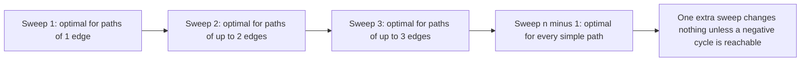
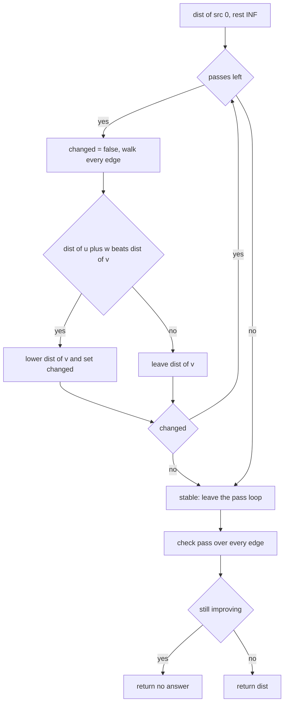
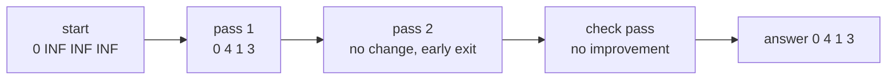
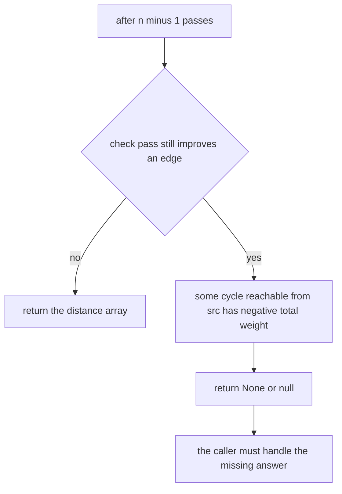

# 114 — Bellman-Ford algorithm (with negative edges).

> **Tier:** Beginner · **CTCI chapter:** Ch 4 — Trees and Graphs
> **Task spec:** [114-bellman-ford-algorithm-with-negative-edges.md](../../../tasks/beginner/114-bellman-ford-algorithm-with-negative-edges.md)
> **Solutions:** [Python](../../../solutions/python/beginner/114-bellman-ford-algorithm-with-negative-edges/solution.py) ·
> [Java](../../../solutions/java/beginner/114-bellman-ford-algorithm-with-negative-edges/Solution.java) ·
> [JavaScript](../../../solutions/javascript/beginner/114-bellman-ford-algorithm-with-negative-edges/solution.js) ·
> [C#](../../../solutions/csharp/beginner/114-bellman-ford-algorithm-with-negative-edges/Solution.cs)

## 1. Problem restatement

**Input:** a vertex count `n`, an edge list where each row is a triple `(u, v, w)` meaning "an
edge from `u` to `v` of weight `w`", the weights may be negative, and a source vertex `src`.

**Output:** an array `dist` of length `n` with the smallest total weight of a path from `src` to
each vertex, infinity for unreachable vertices — or a "no answer" marker (`None` in Python and
JavaScript, `null` in Java and C#) when a negative cycle is reachable from `src`, because then
some distances are unbounded below.

The spec line is short, so the contract is fixed by the assertions in the four solution files:

| `n` | Edges | `src` | Result | Why |
| --- | --- | --- | --- | --- |
| 4 | `(0,1,4) (0,2,5) (1,2,-3) (2,3,2)` | 0 | `[0, 4, 1, 3]` | the negative edge `1 → 2` makes the two-edge path to 2 cheaper than the direct one |
| 3 | `(0,1,1) (1,2,2) (0,2,4)` | 0 | `[0, 1, 3]` | no negative weights: agrees with Dijkstra (task 113) |
| 3 | `(0,1,1) (1,2,-2) (2,1,-2)` | 0 | `None` / `null` | the cycle `1 → 2 → 1` has total weight `-4` |
| 3 | `(1,2,1)` | 0 | `[0, inf, inf]` | vertex 0 has no outgoing edge at all |

Edges are directed and reported as triples rather than adjacency lists, so the algorithm never
needs the graph structure — it only needs to keep sweeping the edge list.

## 2. Intuition

Dijkstra's greedy choice (task 113) is unsound here because a negative edge can make a longer
route cheaper, so "settle the closest vertex" is no longer forced. Bellman-Ford swaps the greedy
step for brute-force breadth with a twist.

The key insight is a counting argument. Every shortest path that deserves the name is *simple* —
if it revisited a vertex, the cycle in the middle could be removed (a non-negative cycle never
helps) or would reveal a negative cycle (a decreasing cycle must be removed). Therefore a
shortest path uses at most `n - 1` edges, one per vertex. Now observe that one full sweep over
all edges extends every known path by at most one edge. So after `k` sweeps the distances are
correct for all paths with at most `k` edges, and after `n - 1` sweeps every simple shortest path
has been discovered.



The second half of the insight is the detector. A negative cycle keeps lowering distances
forever, so a sweep after the `n - 1` allowed sweeps would still find an improvement. Running one
final check sweep and reporting "no answer" if anything still improves turns the numbering
argument into a cycle test.

## 3. Algorithm

1. Set `dist[src] = 0` and every other entry to infinity.
2. Repeat at most `n - 1` times: for every edge `(u, v, w)`, if `dist[u]` is not infinity and
   `dist[u] + w < dist[v]`, lower `dist[v]`.
3. If a whole sweep changed nothing, stop early — the distances are already stable.
4. Run one more sweep. If any edge still improves, a reachable negative cycle exists: return
   the "no answer" marker.
5. Otherwise return `dist`.

```text
procedure bellman_ford(n, edges, src)
    dist ← array of n entries, each INF
    dist[src] ← 0
    for pass ← 1 to n - 1 do
        changed ← false
        for each (u, v, w) in edges do
            if dist[u] ≠ INF and dist[u] + w < dist[v] then
                dist[v] ← dist[u] + w
                changed ← true
            end
        end
        if not changed then
            break                       # distances are stable, stop sweeping
        end
    end
    for each (u, v, w) in edges do
        if dist[u] ≠ INF and dist[u] + w < dist[v] then
            return no answer            # reachable negative cycle
        end
    end
    return dist
end
```

Two details in that pseudocode carry the whole implementation. The `dist[u] ≠ INF` guard keeps
the infinity sentinel out of the arithmetic: Java and C# use `Long.MAX_VALUE / 4` rather than
the maximum value precisely so the test can be written safely. The `changed` flag is the early
exit, and the two solution files that assert it (the Python and Java runs below) show that it
fires on the very first sample.



## 4. Worked example

Trace the first assertion: `n = 4`, edges `(0,1,4) (0,2,5) (1,2,-3) (2,3,2)`, `src = 0`.

Pass 1, walking the edges in the order they are listed:

| Edge | `dist[u]` | Candidate | `dist[v]` before | `dist[v]` after | Changed |
| --- | --- | --- | --- | --- | --- |
| start | — | — | — | `[0, INF, INF, INF]` | — |
| `(0,1,4)` | 0 | 4 | `INF` | 4 | yes |
| `(0,2,5)` | 0 | 5 | `INF` | 5 | yes |
| `(1,2,-3)` | 4 | 1 | 5 | 1 | yes |
| `(2,3,2)` | 1 | 3 | `INF` | 3 | yes |

After pass 1 the distances are `[0, 4, 1, 3]`, and `changed` is true, so pass 2 runs. Every edge
now fails its test: `0 + 4` is not below 4, `0 + 5` is not below 1, `4 - 3` is not below 1 and
`1 + 2` is not below 3. `changed` stays false, the loop breaks after two of the three allowed
passes, and the check pass finds nothing, so the answer is `[0, 4, 1, 3]`.



This sample does not by itself break the greedy algorithm of task 113: the negative edge
`1 → 2` leaves vertex 1, whose tentative distance of 4 is smaller than vertex 2's 5, so a
heap-based Dijkstra settles vertex 1 first and lowers vertex 2 while it is still unsettled. The
sample's job is to pin the *values* `[0, 4, 1, 3]`; the failure mode of greedy settling needs a
negative edge that points back into the settled set.

The third assertion is the cycle case with `n = 3` and edges `(0,1,1) (1,2,-2) (2,1,-2)`. Pass 1
produces `[0, 1, -1]`, pass 2 lowers vertex 2 to `-5` and vertex 1 to `-7`, and because
`n - 1 = 2` passes are exhausted the check pass runs: `-7 + (-2) = -9 < -5`, so an improvement
still exists and the function returns `None`.



## 5. Complexity

Let `V = n` and `E` be the number of edges.

| Measure | Bound | Why it holds |
| --- | --- | --- |
| Time, best | O(E) | one sweep with no improvement anywhere, then the exit flag and the check pass, both O(E) |
| Time, average | O(V · E) | the `changed` flag usually fires only after a few sweeps, but the bound must assume the loop runs |
| Time, worst | O(V · E) | `V - 1` sweeps of `E` edge tests plus one check sweep |
| Space | O(V) | only `dist`, the `changed` flag and the shared edge list are stored |
| Dijkstra (task 113) | O((V + E) log V) | faster but only correct for non-negative weights |
| Floyd-Warshall | O(V³) | all-pairs distances, still able to detect negative cycles |

The trade is explicit: Bellman-Ford pays a `V` factor for the right to handle negative edges, and
it buys back the negative-cycle verdict, which Dijkstra cannot give at all. In the shipped
implementation the early exit is not a micro-optimisation — the first sample finishes after two
sweeps out of three, and a graph whose edges are already in shortest-path order finishes after
one.

## 6. Pitfalls and edge cases

- **Overflow at the sentinel.** `INF + w` overflows a fixed-width integer. Java and C# avoid
  `Long.MAX_VALUE` and use `Long.MAX_VALUE / 4`, and all four solutions test `dist[u] != INF`
  before adding. Python's `float("inf")` and JavaScript's `Infinity` would absorb the addition,
  but the guard is kept for symmetry.
- **Forgetting the check pass.** Without one extra sweep after the `n - 1` allowed passes the
  third assertion returns `[0, -7, -9]`-style nonsense instead of `None`. The check pass is not
  part of the distance computation, it is the cycle witness.
- **Reporting a negative cycle that is unreachable.** The guard `dist[u] != INF` also means a
  negative cycle in a disconnected component is *not* reported, because no distance in it is
  finite. The assertion only exercises a cycle that is reachable from `src`.
- **Unreachable is a sentinel, not a flag.** As in task 113, "no path" is infinity; the fourth
  assertion checks `dist2[2] == INF` for a graph where `src = 0` has no outgoing edge.
- **Zero-weight edges and self loops.** Harmless: a zero-weight cycle never satisfies the strict
  `dist[u] + w < dist[v]`, so it cannot trigger a false "no answer".
- **Edge count versus vertex count.** The pass limit is `n - 1`, derived from the vertex count,
  not from the number of edges. Passing `len(edges) - 1` is a common and silent bug.
- **The `changed` flag must be per pass.** Resetting it inside the edge loop would exit after the
  first edge that does not improve, which happens constantly.
- **Empty inputs.** `n = 0` returns an empty array; an empty edge list with `n >= 1` returns the
  initial array unchanged (source 0, everything else infinity).

## 7. Variants and follow-ups

- **Non-negative weights only.** Use the heap-based greedy version instead and drop the `V` factor:
  [113-simple-dijkstra-s-algorithm-non-negative-weights.md](../../../tasks/beginner/113-simple-dijkstra-s-algorithm-non-negative-weights.md).
- **Shortest path in a DAG.** With a topological order one sweep over the edges in that order is
  enough, giving O(V + E) and no cycle handling at all; the same sweep is the basis of the
  longest-path relaxation used in
  [119-longest-increasing-subsequence-naive-dp-o-n-2.md](../../../tasks/beginner/119-longest-increasing-subsequence-naive-dp-o-n-2.md)
  and its patience-sorting successor
  [120-implement-lis-using-patience-sorting-idea-o-n-log-n-outline.md](../../../tasks/beginner/120-implement-lis-using-patience-sorting-idea-o-n-log-n-outline.md).
- **Connectivity instead of distance.** When the question is only "can `src` reach `v`", the
  union-find structure of
  [110-path-compression-in-union-find.md](../../../tasks/beginner/110-path-compression-in-union-find.md)
  answers it without any weight bookkeeping.
- **Same sweep, different invariant.** Kruskal's MST also scans an edge list in bulk, but sorts it
  first: [111-kruskal-s-mst-using-union-find.md](../../../tasks/beginner/111-kruskal-s-mst-using-union-find.md).
- The chapter walkthrough in [Trees and Graphs](../../ctci/04-trees-and-graphs.md) groups this with
  Dijkstra, Prim and Kruskal as the four graph-sweep algorithms.

## 8. Check yourself

1. Why is `n - 1` the right number of sweeps?

<details><summary>Show answer</summary>

A shortest path can be assumed simple, so it uses at most `n - 1` edges. Each sweep extends the
reach of correct distances by one edge, so after `n - 1` sweeps every simple path has been
considered.

</details>

2. On the first sample, how many sweeps actually run and how do you know?

<details><summary>Show answer</summary>

Two. Pass 1 changes four distances; pass 2 changes none, so the `changed` flag stays false and
the loop breaks before the third allowed pass. The check pass then finds no improvement and
returns `[0, 4, 1, 3]`.

</details>

3. What exact condition distinguishes "no negative cycle" from "reachable negative cycle"?

<details><summary>Show answer</summary>

After the `n - 1` distance passes, run one more sweep with the same relaxation test. If some edge
with finite `dist[u]` still satisfies `dist[u] + w < dist[v]`, a negative cycle reachable from
`src` exists; otherwise the distances are final.

</details>

4. Why does the code test `dist[u] != INF` before computing `dist[u] + w`?

<details><summary>Show answer</summary>

Because `INF` is a finite placeholder in Java and C# (`Long.MAX_VALUE / 4`), adding a weight to
it risks overflow or, worse, producing a value that compares like a real distance. Skipping the
edge keeps unreachable vertices from ever being "improved".

</details>

5. The first sample contains a negative edge, yet a heap-based Dijkstra returns the same
   distances. Does that contradict the rule that Dijkstra needs non-negative weights?

<details><summary>Show answer</summary>

No. The rule is about guarantee, not about every single sample. Here the negative edge leaves
vertex 1, whose tentative distance of 4 is smaller than vertex 2's 5, so vertex 1 is settled
first and the cheaper route to vertex 2 is found while vertex 2 is still unsettled. Greedy
settling breaks when a negative edge points back into the settled set, and it has no verdict at
all for the negative cycle of the third assertion — an unbounded answer cannot be represented by
any finite distance array.

</details>
