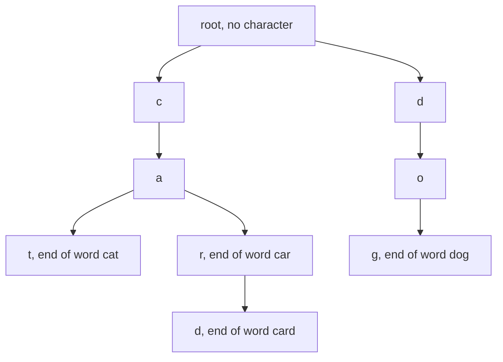
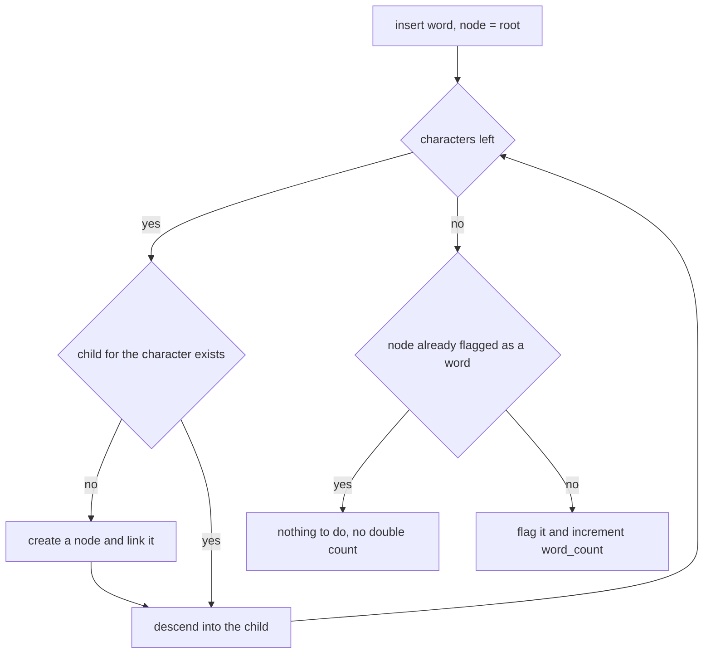
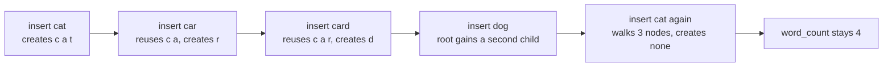
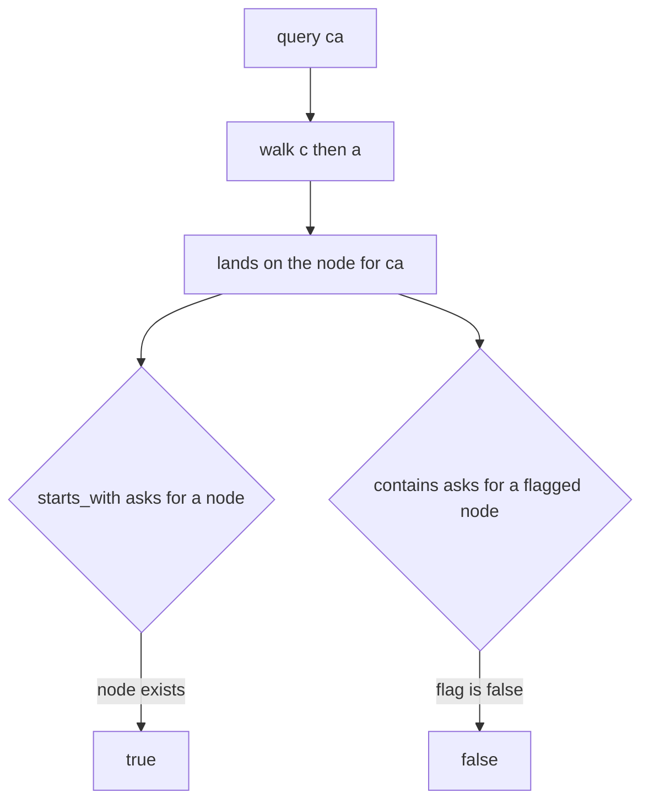

# 115 — Implement a basic trie for lowercase words.

> **Tier:** Beginner · **CTCI chapter:** Ch 4 — Trees and Graphs
> **Task spec:** [115-implement-a-basic-trie-for-lowercase-words.md](../../../tasks/beginner/115-implement-a-basic-trie-for-lowercase-words.md)
> **Solutions:** [Python](../../../solutions/python/beginner/115-implement-a-basic-trie-for-lowercase-words/solution.py) ·
> [Java](../../../solutions/java/beginner/115-implement-a-basic-trie-for-lowercase-words/Solution.java) ·
> [JavaScript](../../../solutions/javascript/beginner/115-implement-a-basic-trie-for-lowercase-words/solution.js) ·
> [C#](../../../solutions/csharp/beginner/115-implement-a-basic-trie-for-lowercase-words/Solution.cs)

## 1. Problem restatement

**Input:** a stream of lowercase words handed to `insert`, plus the queries `contains(word)` and
`starts_with(prefix)`.

**Output:** a `Trie` object that supports three operations and one counter:

| Operation | Meaning |
| --- | --- |
| `insert(word)` | add `word`; inserting a word twice must not change the state |
| `contains(word)` | `True` only when `word` was inserted earlier in full |
| `starts_with(prefix)` | `True` when some inserted word begins with `prefix` |
| `word_count` | the number of *distinct* inserted words |

The `TrieNode` holds a child map keyed by character plus an `is_word` flag; Python uses a plain
`dict`, Java and C# a `HashMap` / `Dictionary`, JavaScript a `Map`. The node sets stay sparse:
a node only ever materialises the children it actually needs, so the memory is proportional to
the number of characters stored rather than to `26 · length`.

The spec is one line, so the contract is fixed by the assertions. After inserting
`"cat"`, `"car"`, `"card"`, `"dog"`:

| Call | Result | Why |
| --- | --- | --- |
| `word_count` | `4` | four distinct words |
| `insert("cat")`, then `word_count` | `4` | the flag was already set, so no double count |
| `contains("cat")`, `contains("card")` | `true` | both are words |
| `contains("ca")` | `false` | a prefix that is not itself a word |
| `contains("care")` | `false` | the walk falls off the tree at `e` |
| `starts_with("ca")`, `starts_with("")` | `true` | the empty prefix is a prefix of everything |
| `starts_with("z")` | `false` | no child `z` exists under the root |

Input is assumed to be lowercase ASCII with no empty words; nothing in the solutions validates
that.

## 2. Intuition

A hash set solves `contains` in expected O(len) but throws away every relationship between words.
`starts_with` would have to scan all stored words, and "how many words start with `ca`" becomes a
full traversal of the dictionary. The key insight of a trie is to make the *shared prefix* a
shared path: one node per distinct prefix, and words are paths from the root.



Reading the picture explains both queries at once. `contains("card")` is "walk `c`, `a`, `r`, `d`
and check that the landing node is flagged as a word"; `starts_with("ca")` is the identical walk
without the flag check. The two words `car` and `card` share the node `car`, which is exactly why
`car` must carry a flag: a node can be a valid end and an intermediate step at the same time.

The second half of the insight is that `insert` never overwrites anything. Walking down creates
missing nodes and stops; only the very last node gets `is_word = true`. That is what makes a
duplicate insert a no-op — and it is also why a naive `word_count` that increments on every
insert would report 5 instead of 4. The solutions therefore increment only when the flag was
false, i.e. only for a genuinely new word.

## 3. Algorithm

1. `insert(word)`: start at the root. For each character, follow the child if it exists and
   otherwise create a fresh node and link it in. Mark the final node with `is_word = true`, and
   if it was not already marked, increment `word_count`.
2. `walk(text)`: start at the root, follow the child for each character, and return the landing
   node — or "not found" as soon as a child is missing.
3. `contains(word)`: `walk(word)` found a node **and** that node has `is_word` set.
4. `starts_with(prefix)`: `walk(prefix)` found a node. Because the empty prefix walks zero
   characters, it returns the root and is therefore always true.
5. An empty `walk` result must be distinguished from a real node; the solutions return `None` /
   `null` and test it explicitly.

```text
procedure insert(word)
    node ← root
    for each ch in word do
        if node.children has no key ch then
            node.children[ch] ← a new node
        end
        node ← node.children[ch]
    end
    if node.is_word is false then
        node.is_word ← true
        word_count ← word_count + 1
    end
end

function walk(text)
    node ← root
    for each ch in text do
        if node.children has no key ch then
            return not found
        end
        node ← node.children[ch]
    end
    return node
end

function contains(word)
    node ← walk(word)
    return node is not not-found and node.is_word is true
end

function starts_with(prefix)
    return walk(prefix) is not not-found
end
```

The asymmetry between the last two functions is the entire API: one extra flag test. Note that
`contains` short-circuits on the missing node before looking at `is_word`, which is what makes
`contains("care")` false without any error.



## 4. Worked example

Insert `"cat"`, `"car"`, `"card"`, `"dog"` in that order and watch what each walk creates. The
root starts with an empty child map.

| Call | Path taken | Nodes created | Flagged at the end | `word_count` |
| --- | --- | --- | --- | --- |
| `insert("cat")` | root `c` `a` `t` | `c`, `a`, `t` | `t` | 1 |
| `insert("car")` | root `c`, `a` reused, then `r` | `r` | `r` | 2 |
| `insert("card")` | root `c`, `a`, `r` reused, then `d` | `d` | `d` | 3 |
| `insert("dog")` | root has no `d`, so `d`, `o`, `g` | `d`, `o`, `g` | `g` | 4 |
| `insert("cat")` | root `c`, `a`, `t`, all reused | none | already set | 4 |

The second insert is the interesting one: it reuses the two nodes `c` and `a` and only branches
at the third character, where `t` and `r` are different children of the same node. That single
fact is why the trie uses less memory than four independent strings would.



Now the queries against that finished tree:

| Query | Walk | Landing node | `is_word` | Result |
| --- | --- | --- | --- | --- |
| `contains("cat")` | `c` `a` `t` | `t` | true | `true` |
| `contains("card")` | `c` `a` `r` `d` | `d` | true | `true` |
| `contains("ca")` | `c` `a` | `a` | false | `false` |
| `contains("care")` | `c` `a` `r`, then no `e` | not found | — | `false` |
| `starts_with("ca")` | `c` `a` | `a` | false | `true` |
| `starts_with("")` | no characters | root | false | `true` |
| `starts_with("z")` | root has no `z` | not found | — | `false` |

Rows three and five use the *same* walk and the same landing node, and still disagree: `ca` is a
prefix but not a word, which is precisely the distinction the `is_word` flag encodes.



## 5. Complexity

Let `L` be the length of a word, `P` the length of a prefix, and `W` the total number of
characters stored across all inserted words.

| Measure | Bound | Why it holds |
| --- | --- | --- |
| `insert` time | O(L) | one map lookup and at most one node creation per character |
| `contains` / `starts_with` time | O(L) / O(P) | the walk visits exactly one node per character, no branching |
| Space | O(W) | one node per distinct prefix, so at most `W + 1` nodes and one child entry per stored character |
| Space per node | O(1) amortised | the child map is sparse, so a node with a single child pays for a single entry |
| Hash-set alternative | O(L) membership, O(total text) for a prefix query | no shared structure, so every `starts_with` scan walks all words |
| Sorted-array alternative | O(L log n) with binary search | only supports prefix ranges over the raw strings, not subtree counting |

The `O(W)` space is what separates a trie from `n` independent strings: the prefixes `c`, `ca`,
`car` are stored once each no matter how many words pass through them. The price is hidden in the
constant factor — a sparse map lookup is slower than a single array index, which is the trade
that task 116 deliberately reverses.

## 6. Pitfalls and edge cases

- **Duplicate insert.** The second `insert("cat")` must not increment `word_count`; all four
  solutions assert `word_count == 4` after it. Incrementing unconditionally is the classic bug.
- **Prefix versus word.** `contains("ca")` is false while `starts_with("ca")` is true. If a node
  had no `is_word` flag, the two queries would be indistinguishable.
- **Empty prefix.** `starts_with("")` walks zero characters and returns the root, so it is true.
  `contains("")` would be false unless an empty word was inserted — nothing in the solutions
  inserts one.
- **A word can be a prefix of another.** `car` and `card` share the node `car`; the flag lives on
  the node, not on the edges, so this is handled automatically.
- **Missing child mid-walk.** `contains("care")` must return false rather than raise. The walk
  returns "not found" and `contains` tests it before touching `is_word`.
- **Character domain.** The child map is keyed by character, so anything outside the lowercase
  range simply becomes another key; no validation or normalisation happens. Task 116 hard-codes
  `26` slots and therefore *does* require lowercase input.
- **Unicode.** A character map handles Python and JavaScript code points naturally, but Java iterates
  `charAt` / `toCharArray` (UTF-16 code units) and C# iterates `char`, so an astral character is
  split into two surrogate keys — harmless for a keyed map, but not a match for a code-point
  definition of "character".
- **Mutability of the returned nodes.** `walk` is private in every solution; exposing it would let
  a caller corrupt `is_word` flags. The public surface is only `insert`, `contains`,
  `starts_with`.
- **No deletions.** Removing a word needs either reference counts per node or upward pruning of
  childless nodes; the task does not ask for it.

## 7. Variants and follow-ups

- **Dense children array.** Replace the map with a fixed 26-slot array for lowercase words, then
  add subtree counting and word collection:
  [116-insert-and-search-in-trie.md](../../../tasks/beginner/116-insert-and-search-in-trie.md).
- **Ranked suggestions.** Attach a popularity weight to each node and return the `k` best words
  under a prefix: [117-autocomplete-top-k-prefix-suggestions-trie.md](../../../tasks/beginner/117-autocomplete-top-k-prefix-suggestions-trie.md).
- **Trie used by another algorithm.** The word-break DP of
  [124-word-break-dp.md](../../../tasks/beginner/124-word-break-dp.md) tests dictionary membership
  inside a quadratic loop; the note in its solution file points at exactly this trie as the way to
  replace each slice test with a walk.
- **Ordered-map alternative.** A balanced search tree keyed by the whole word answers `contains`
  in O(L log n) and prefix queries with a range scan, with no shared nodes at all.
- The chapter walkthrough in [Trees and Graphs](../../ctci/04-trees-and-graphs.md) introduces the
  trie as the fourth tree shape after binary trees, heaps and tries over bit patterns.

## 8. Check yourself

1. Why does the trie need an `is_word` flag instead of treating every node as a word?

<details><summary>Show answer</summary>

Because `ca` is a node in the tree once `cat` and `car` are inserted, but `ca` was never inserted
as a word. The flag distinguishes "a prefix that exists" from "a word that ends here", which is
the difference between `starts_with` and `contains`.

</details>

2. What happens on `insert("cat")` the second time, and how many nodes does it create?

<details><summary>Show answer</summary>

Zero. The walk for `c`, `a`, `t` finds every child already present, the final node already has
`is_word` set, so neither the tree nor `word_count` changes.

</details>

3. `starts_with("")` is asserted true. Why does that follow from the implementation rather than
   from a special case?

<details><summary>Show answer</summary>

Because `walk` iterates over the characters of its argument. With no characters the loop body
never runs and the root is returned, and the root always exists. There is no explicit empty-string
branch in any of the four solutions.

</details>

4. How many nodes does the tree hold after inserting `cat`, `car`, `card`, `dog`, and what is the
   node count in terms of the characters stored?

<details><summary>Show answer</summary>

Nine: the eight distinct prefixes `c`, `ca`, `cat`, `car`, `card`, `d`, `do`, `dog`, plus the root.
In general there is one node per distinct prefix, so the tree never exceeds `W + 1` nodes for `W`
characters stored across all words.

</details>

5. What would `starts_with("caz")` do in the map-based trie and in the array-based trie of task
   116, and does either raise?

<details><summary>Show answer</summary>

Neither raises. The map version fails the `has no key z` test and returns not-found. The array
version indexes `kids['z' - 'a']`, gets `null`, and also returns not-found. Both return false for
the query, and both are the place where an out-of-range character would break the array version.

</details>
