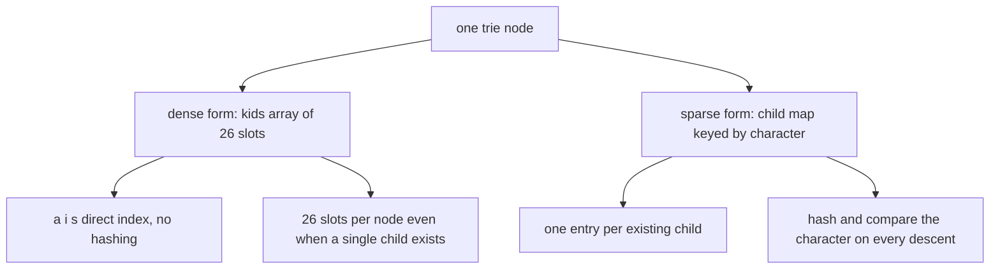
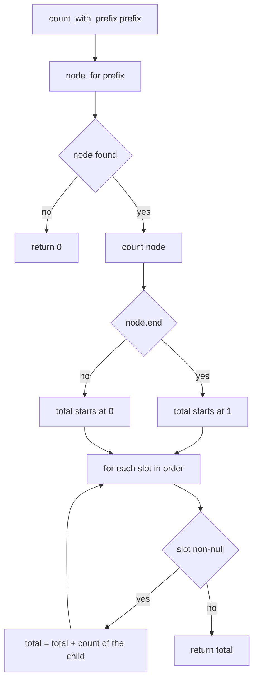
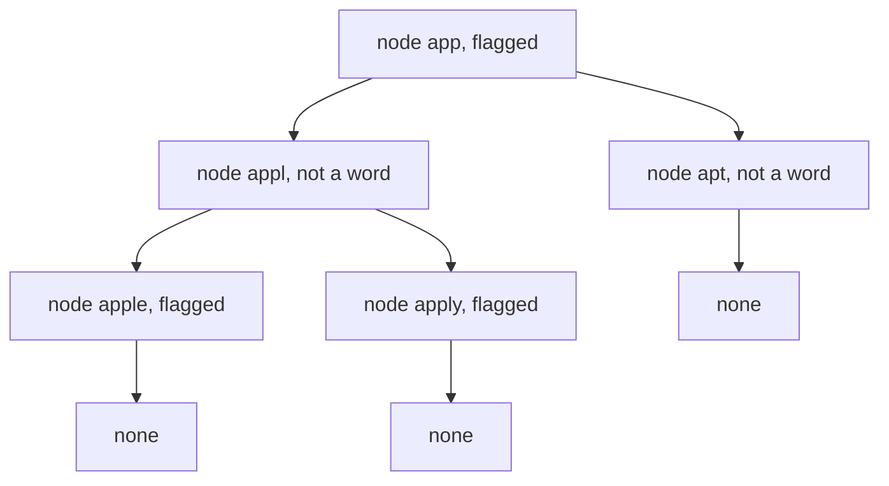
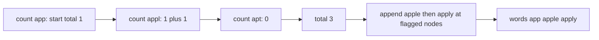

# 116 — Insert and search in trie.

> **Tier:** Beginner · **CTCI chapter:** Ch 4 — Trees and Graphs
> **Task spec:** [116-insert-and-search-in-trie.md](../../../tasks/beginner/116-insert-and-search-in-trie.md)
> **Solutions:** [Python](../../../solutions/python/beginner/116-insert-and-search-in-trie/solution.py) ·
> [Java](../../../solutions/java/beginner/116-insert-and-search-in-trie/Solution.java) ·
> [JavaScript](../../../solutions/javascript/beginner/116-insert-and-search-in-trie/solution.js) ·
> [C#](../../../solutions/csharp/beginner/116-insert-and-search-in-trie/Solution.cs)

## 1. Problem restatement

**Input:** lowercase words `app`, `apple`, `apply`, `apt`, `banana` are inserted, then the queries
`search`, `count_with_prefix` and `words_with_prefix` run against the tree.

**Output:** a `WordTrie` supporting four operations:

| Operation | Meaning |
| --- | --- |
| `insert(word)` | add `word`, creating nodes as needed |
| `search(word)` | true only when `word` itself was inserted |
| `count_with_prefix(prefix)` | how many stored words start with `prefix` |
| `words_with_prefix(prefix)` | those words, in lexicographic order |

Structurally this is the same trie as task 115 with two deliberate changes, both stated in the
Python module docstring: the children live in a **dense array of 26 slots** rather than a map,
and every node can enumerate its whole subtree. Each node is `kids[26]` plus an `end` flag; index
`i` means the character `chr(i + 97)` (or `'a' + i`), so an out-of-range character is simply not
expressible — the dense layout requires lowercase letters as an input contract.

| Call | Result | Why |
| --- | --- | --- |
| `search("app")` | `true` | `app` is a word and also a prefix of two others |
| `search("apply")` | `true` | it was inserted |
| `search("ap")` | `false` | walk lands on a real node whose `end` flag is false |
| `search("apples")` | `false` | the walk falls off at `s` |
| `count_with_prefix("app")` | `3` | `app`, `apple`, `apply` |
| `count_with_prefix("b")` | `1` | `banana` |
| `count_with_prefix("z")` | `0` | no node for `z` under the root |
| `words_with_prefix("app")` | `["app", "apple", "apply"]` | depth-first order over slots `0..25` |
| `count_with_prefix("")` | `5` | every stored word lives under the root |

## 2. Intuition

The map-based trie of task 115 answers membership in O(L) time and stays sparse. It has two
weaknesses this task addresses. A hash-map lookup is a constant factor more expensive than an
array index, and "how many words live under this prefix" cannot be answered from the map without
walking the subtree anyway. Replacing the map with a 26-slot array makes each descent a single
indexed read, and once the slots are in alphabetical order the subtree walk visits children in
lexicographic order *for free*.



The second insight is that a subtree walk answers both prefix queries with the same traversal.
`count_with_prefix` walks to the prefix node and then counts flagged nodes beneath it;
`words_with_prefix` walks to the same node and then appends the word whenever it meets a flagged
node, rebuilding the string from the path. Two different outputs, one shared recursion. Because the
recursion tries slots `0, 1, 2, ...` in order, the collected words come out lexicographically sorted
without a separate sort step — the assertion `words_with_prefix("app") == ["app", "apple", "apply"]`
is a consequence of the slot order, not of an explicit comparison.

## 3. Algorithm

1. `insert(word)`: start at the root, and for each character index `i` descend into `kids[i]`,
   creating an empty node when the slot is null. Mark the final node's `end` flag.
2. `node_for(text)`: the shared walk. Follow slots down and return the landing node, or a
   not-found marker as soon as a slot is null.
3. `search(word)`: `node_for(word)` is found **and** its `end` flag is set.
4. `count_with_prefix(prefix)`: find the prefix node and recursively count `1` for every flagged
   node plus the counts of all non-null children. A missing prefix contributes `0`.
5. `words_with_prefix(prefix)`: find the prefix node, then recursively append the current path at
   every flagged node, descending slots in order. A missing prefix yields an empty list.

```text
procedure insert(word)
    node ← root
    for each ch in word do
        i ← position of ch in the lowercase alphabet
        if node.kids[i] is null then
            node.kids[i] ← a new node
        end
        node ← node.kids[i]
    end
    node.end ← true
end

function node_for(text)
    node ← root
    for each ch in text do
        node ← node.kids[position of ch]
        if node is null then
            return not found
        end
    end
    return node
end

function count(node)
    total ← 1 if node.end is true, otherwise 0
    for i ← 0 to 25 do
        if node.kids[i] is not null then
            total ← total + count(node.kids[i])
        end
    end
    return total
end

procedure collect(node, path, out)
    if node.end is true then
        append the string built from path to out
    end
    for i ← 0 to 25 do
        if node.kids[i] is not null then
            push the character for i onto path
            collect(node.kids[i], path, out)
            pop the last character off path
        end
    end
end

function count_with_prefix(prefix)
    node ← node_for(prefix)
    return 0 if node is not found, otherwise count(node)
end

function words_with_prefix(prefix)
    node ← node_for(prefix)
    out ← an empty list
    if node is found then
        collect(node, characters of prefix, out)
    end
    return out
end
```

`count` counts the prefix node itself when it is flagged, which is why `count_with_prefix("app")`
is 3 rather than 2 — `app` is the shortest of the three words and lives on the prefix node. The
`collect` variant keeps a single mutable path: one push before the recursive call and one pop
after it, so no string is rebuilt for the internal nodes.



## 4. Worked example

Insert the five words in order. Because `app` is inserted first, the nodes for `a`, `p`, `p`
already exist when `apple` arrives; only `l`, `e` are new.

| Call | Slots followed | New nodes | Flag set | Resulting word set |
| --- | --- | --- | --- | --- |
| `insert("app")` | `a`, `p`, `p` | `a`, `p`, `p` | node after `app` | `{app}` |
| `insert("apple")` | `a`, `p`, `p`, `l`, `e` | `l`, `e` | node after `apple` | `{app, apple}` |
| `insert("apply")` | `a`, `p`, `p`, `l`, `y` | `y` | node after `apply` | `{app, apple, apply}` |
| `insert("apt")` | `a`, `p`, `t` | `t` | node after `apt` | `+ apt` |
| `insert("banana")` | `b`, `a`, `n`, `a`, `n`, `a` | six new nodes under `b` | node after `banana` | `+ banana` |

The subtree under the node for `app` therefore holds three flagged nodes: the `app` node itself,
and the nodes reached through `l` (which forks into `e` and `y`).



`count_with_prefix("app")` walks `a`, `p`, `p` and calls `count` on the flagged `app` node: `1` for
itself, plus `count(appl)` = `1 + 1` from its two flagged children, plus `count(apt)` = `0`.
Total `3`. `count_with_prefix("b")` walks the single character `b` and finds a node with exactly
one flagged descendant, giving `1`. `count_with_prefix("z")` finds no node at all, so the
short-circuit returns `0` without any traversal.



For `words_with_prefix("app")` the same recursion does the collecting: the path starts as the
characters of the prefix, `app` is appended immediately because the root of the subtree is
flagged, then `l` is pushed, `e` gives `apple`, `y` gives `apply`, and the last branch `apt` is
not flagged so nothing is appended for it. Slot order guarantees the output order.

## 5. Complexity

Let `L` be a word or prefix length, `S` the number of nodes in the queried subtree, `M` the
number of words in it, and `N` the total number of trie nodes.

| Measure | Bound | Why it holds |
| --- | --- | --- |
| `insert` time | O(L) | one slot read and at most one node creation per character |
| `search` time | O(L) | the walk is a single descent, no backtracking |
| `count_with_prefix` time | O(L + S) | the prefix walk plus a full visit of the subtree, each node touched once |
| `words_with_prefix` time | O(L + S + M·L) | the traversal plus building one string per reported word |
| Space, tree | O(26 · N) | every node owns a 26-slot array, including the empty slots |
| Space, sparse alternative | O(total characters) | the map-based trie of task 115 allocates only the children that exist |
| Space, traversal | O(L) | the recursion depth is bounded by the deepest word and the path buffer by its length |

The dense layout is a constant-factor trade: `26 · N` slots instead of one entry per stored
character. The sample tree has 14 nodes including the root, so it allocates 364 slots to make
every descent a single indexed read. It also buys the lexicographic enumeration, since a hash map
has no defined iteration order and would need an explicit sort.

## 6. Pitfalls and edge cases

- **Prefix that is itself a word.** `count_with_prefix("app")` is `3` and not `2` because the
  count starts at `1` when the subtree root is flagged. Subtracting one from the count is wrong
  for every other prefix.
- **`search` versus a successful walk.** `search("ap")` must be false: the walk succeeds, the
  `end` flag is false. Testing only the walk's success would return true.
- **Falling off mid-walk.** `search("apples")` must return false, not raise. `node_for` returns
  the not-found marker and `search` tests it before touching `end`.
- **Unknown prefix with a count query.** `count_with_prefix("z")` is asserted `0`, so the missing
  node must short-circuit *before* the recursion; calling `count` on a not-found marker would
  crash.
- **Lowercase only.** The slot index is `character - 'a'`, so an uppercase letter or a digit
  produces a negative or out-of-range index. Task 115's map-based node tolerates that input; this
  one does not, which is the documented price of the dense array.
- **Order of the collected words.** The output is lexicographic because the descent walks slots in
  order and stops at a flagged node before continuing. Reversing the loop order silently changes
  the assertion for `words_with_prefix`.
- **Path buffer aliasing.** The solutions push a character, recurse, then pop. Forgetting the pop
  corrupts every sibling branch, which shows up as over-long words rather than as a crash.
- **Duplicate inserts.** `insert("app")` twice leaves the tree unchanged; the `end` flag is
  idempotent and there is no counter to double here. The duplicate guard lives in task 115.
- **Memory on long words.** A deep chain of nodes with 26 slots each is expensive; a radix or
  compressed trie or the sparse map of task 115 is the usual answer.

## 7. Variants and follow-ups

- **Ranked suggestions.** Add a popularity weight per node and return the best `k` words instead
  of all of them: [117-autocomplete-top-k-prefix-suggestions-trie.md](../../../tasks/beginner/117-autocomplete-top-k-prefix-suggestions-trie.md).
- **Sparse children.** The same API with a character map instead of 26 slots, cheaper in memory
  and more general in input: [115-implement-a-basic-trie-for-lowercase-words.md](../../../tasks/beginner/115-implement-a-basic-trie-for-lowercase-words.md).
- **Trie inside a DP.** Word break tests dictionary membership for every substring; replacing a
  hash-set test with a descent through this structure is the optimisation noted in
  [124-word-break-dp.md](../../../tasks/beginner/124-word-break-dp.md).
- **Prefix counting without a trie.** A sorted array of the words answers `count_with_prefix` with
  two binary searches (lower and upper bound, the same technique as
  [120-implement-lis-using-patience-sorting-idea-o-n-log-n-outline.md](../../../tasks/beginner/120-implement-lis-using-patience-sorting-idea-o-n-log-n-outline.md)),
  but cannot answer it incrementally as words arrive.
- The chapter walkthrough in [Trees and Graphs](../../ctci/04-trees-and-graphs.md) compares the
  trie with the heap as the two trees whose shape is dictated by stored keys rather than sorted
  order.

## 8. Check yourself

1. Why does `count_with_prefix("app")` return 3 and not 2?

<details><summary>Show answer</summary>

Because `count` starts at `1` when the node it is given is flagged, and the node for `app` is
itself a stored word. The subtree contributes `app` plus `apple` and `apply`.

</details>

2. What single change would turn `search` into `starts_with`?

<details><summary>Show answer</summary>

Dropping the `end` flag test: return whether `node_for(word)` found a node. That is exactly how
task 115's `starts_with` is written, and it is the difference asserted by `search("ap") == false`
against a prefix query.

</details>

3. Where does the lexicographic order of `words_with_prefix` come from?

<details><summary>Show answer</summary>

From iterating the slots `0..25` in order, which is alphabetical order for lowercase letters. A
flagged node is reported before its descendants, so `app` precedes `apple`, and the `l` branch
(`apple`, `apply`) is reported before the `t` branch (`apt`).

</details>

4. How much memory does one node cost, and when is the sparse map from task 115 the better
   choice?

<details><summary>Show answer</summary>

26 slots plus one flag, regardless of how many children exist. The sparse map wins whenever the
tree is deep and thin, when most nodes have one child, or when the alphabet is not a fixed small
range, because it allocates one entry per stored character instead of 26 per node.

</details>

5. What happens to `insert("Cat")` in this implementation?

<details><summary>Show answer</summary>

It indexes the slot `'C' - 'a'`, which is negative for an uppercase letter, so the behaviour is
undefined and typically an indexing error — the dense layout silently requires lowercase input.
The map-based node of task 115 would accept `Cat` as two additional children instead.

</details>
