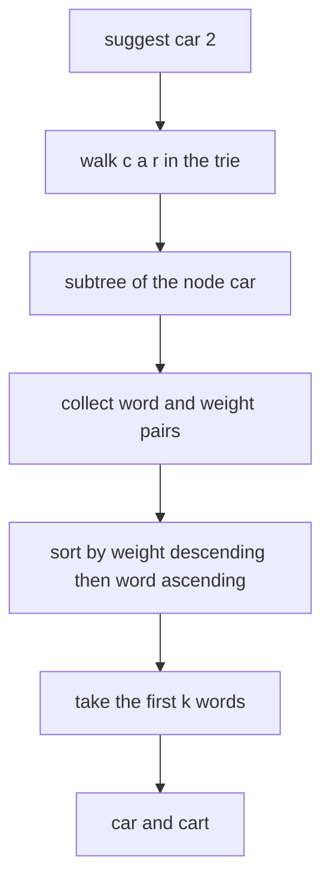
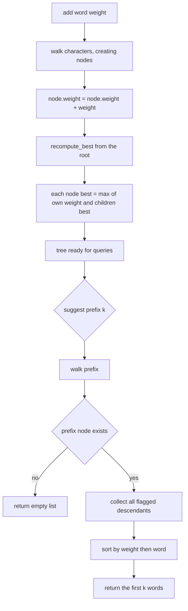
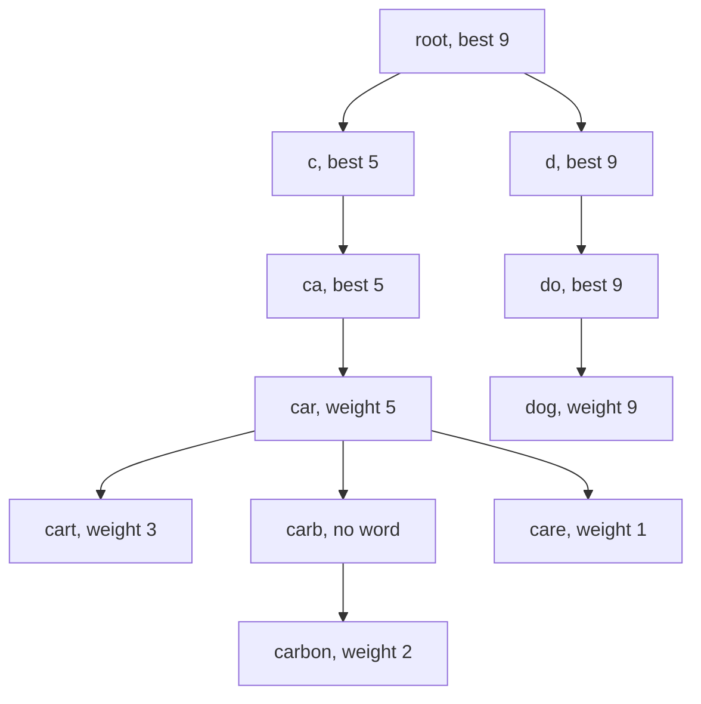
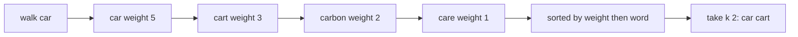

# 117 — Autocomplete top-k prefix suggestions (trie).

> **Tier:** Beginner · **CTCI chapter:** Ch 4 — Trees and Graphs
> **Task spec:** [117-autocomplete-top-k-prefix-suggestions-trie.md](../../../tasks/beginner/117-autocomplete-top-k-prefix-suggestions-trie.md)
> **Solutions:** [Python](../../../solutions/python/beginner/117-autocomplete-top-k-prefix-suggestions-trie/solution.py) ·
> [Java](../../../solutions/java/beginner/117-autocomplete-top-k-prefix-suggestions-trie/Solution.java) ·
> [JavaScript](../../../solutions/javascript/beginner/117-autocomplete-top-k-prefix-suggestions-trie/solution.js) ·
> [C#](../../../solutions/csharp/beginner/117-autocomplete-top-k-prefix-suggestions-trie/Solution.cs)

## 1. Problem restatement

**Input:** words with a popularity weight, added one at a time with `add(word, weight)`, then
queries `suggest(prefix, k)`.

**Output:** the `k` most popular stored words that start with `prefix`, as a list. Missing
prefixes and `k` larger than the number of candidates are both normal: a missing prefix yields an
empty list, and a large `k` yields every candidate.

This is the trie of tasks 115 and 116 with two extra fields per node — `weight`, the popularity of
the word ending exactly here (`0` means "not a word"), and `best`, the largest popularity anywhere
in the node's subtree. The Python module docstring states the intent for `best` explicitly: it is
the field that makes pruning possible, and the ranking rule is popularity first, then
alphabetical order so that ties are deterministic.

After `add("car", 5)`, `add("cart", 3)`, `add("carbon", 2)`, `add("care", 1)`, `add("dog", 9)`:

| Call | Result | Why |
| --- | --- | --- |
| `suggest("car", 2)` | `["car", "cart"]` | popularities 5 and 3 beat 2 and 1 |
| `suggest("car", 10)` | `["car", "cart", "carbon", "care"]` | all four candidates, ranked |
| `suggest("do", 5)` | `["dog"]` | one candidate, missing the final character is fine |
| `suggest("z", 3)` | `[]` | the walk finds no node |
| `suggest("", 1)` | `["dog"]` | the empty prefix means "all words", and `dog` has weight 9 |

The `weight` of a node is *accumulated*, not overwritten, so adding the same word twice with
weights 2 and 3 leaves a total popularity of 5.

## 2. Intuition

The two halves of this problem want different structures. "Which words start with `x`" is a
subtree question — a trie answers it by walking `x` and then enumerating the subtree, exactly as
`words_with_prefix` does in task 116. "Which of them are the most popular `k`" is a ranking
question — that needs a key, and the trie's shape says nothing about popularity.

The key insight is that both halves can live in the *same* node. Store the popularity of the word
that ends at a node in that node, and store the maximum popularity of the whole subtree in an
extra field. The walk to the prefix narrows the candidate set in `O(length)`, and the subtree scan
collects `(word, weight)` pairs, which a single sort turns into the answer. Keeping the ranking
rule as the composite key "higher weight first, then smaller word" removes every ambiguity when
two candidates share a weight.



The `best` field is the hook for a stronger algorithm. If a branch's `best` is smaller than the
weight of the `k`-th best candidate found so far, no word in that branch can enter the answer and
the whole branch can be skipped, which turns the query into a bounded search instead of a full
subtree scan. The four shipped solutions maintain `best` (every `add` recomputes it over the tree)
but their `suggest` still enumerates the entire subtree and sorts; the pruning is described in the
docstring as the reason the field exists, not as code that runs.

## 3. Algorithm

1. `add(word, weight)`: walk the characters, creating missing nodes, then add `weight` to the
   landing node's `weight` field, which marks it as a word as well.
2. Still inside `add`, recompute `best` for the whole tree: a node's `best` is the maximum of its
   own `weight` and the `best` of each child.
3. `suggest(prefix, k)`: walk the prefix; if a character has no child, return an empty list.
4. Collect `(word, weight)` for every node with `weight > 0` in the subtree, tracking the path.
5. Sort the pairs by descending weight, breaking ties by ascending word.
6. Return the words of the first `min(k, candidates)` pairs.

```text
procedure add(word, weight)
    node ← root
    for each ch in word do
        if node.kids has no key ch then
            node.kids[ch] ← a new node with weight 0 and best 0
        end
        node ← node.kids[ch]
    end
    node.weight ← node.weight + weight
    recompute_best(root)
end

function recompute_best(node)
    best ← node.weight
    for each child in node.kids do
        best ← the larger of best and recompute_best(child)
    end
    node.best ← best
    return best
end

procedure collect(node, path, out)
    if node.weight > 0 then
        append the pair of the string built from path and node.weight to out
    end
    for each key ch and child in node.kids do
        push ch onto path
        collect(child, path, out)
        pop the last character off path
    end
end

function suggest(prefix, k)
    node ← root
    for each ch in prefix do
        node ← node.kids[ch] if present, otherwise
        if node is missing then
            return an empty list
        end
    end
    found ← an empty list
    collect(node, characters of prefix, found)
    sort found by descending weight and then ascending word
    return the words of the first min(k, size of found) pairs
end
```

Two details of `add` matter for the assertions. `recompute_best` is called *after every* add
rather than being maintained incrementally, so a single call costs a full tree walk. And the
recomputation always starts at the root, so no stale `best` value can survive an update.



## 4. Worked example

Insert the five words and read the tree that comes out. Every node on the path exists exactly
once, so `car` and `care` share three of their four nodes.

| Call | Path | Node weights touched | Values of `best` after the recompute |
| --- | --- | --- | --- |
| `add("car", 5)` | `c`, `a`, `r` | `car` 0 to 5 | `car` 5, ancestors 5, root 5 |
| `add("cart", 3)` | `c`, `a`, `r`, `t` | `cart` 0 to 3 | root 5, `car` subtree 5 |
| `add("carbon", 2)` | `c`, `a`, `r`, `b`, `o`, `n` | `carbon` 0 to 2 | root 5 unchanged |
| `add("care", 1)` | `c`, `a`, `r`, `e` | `care` 0 to 1 | root 5 unchanged |
| `add("dog", 9)` | `d`, `o`, `g` | `dog` 0 to 9 | root 9, `d` subtree 9 |

The tree now has two top-level children under the root, and the `car` branch carries four flagged
nodes:



`suggest("car", 2)` walks `c`, `a`, `r` and then collects the subtree: the flagged nodes are
`car` (5), `cart` (3), `carbon` (2) and `care` (1) — note that the path buffer is what turns each
flagged node back into a word.

| Step | Candidate pair | Sorted order so far |
| --- | --- | --- |
| start | — | `[]` |
| at `car` | `("car", 5)` | `[car 5]` |
| at `cart` | `("cart", 3)` | `[car 5, cart 3]` |
| at `carbon` | `("carbon", 2)` | `[car 5, cart 3, carbon 2]` |
| at `care` | `("care", 1)` | `[car 5, cart 3, carbon 2, care 1]` |
| take 2 | — | `["car", "cart"]` |



`suggest("", 1)` takes the same path with an empty prefix, so the walk stops at the root and the
collection covers the whole tree: `dog` at 9 wins over `car` at 5. Because the prefix is empty the
path buffer starts empty and every collected word is spelled out from the root down.

## 5. Complexity

Let `W` be a word length, `P` a prefix length, `N` the number of trie nodes, `S` the number of
nodes in the queried subtree and `F` the number of flagged nodes in it.

| Measure | Bound | Why it holds |
| --- | --- | --- |
| `add` time | O(W + N) | the character walk plus `recompute_best` over the entire tree |
| `add` time, incremental alternative | O(W · depth) | updating only the ancestors of the new node needs one pass up the path per level, and the path length is bounded by the deepest word |
| `suggest` time | O(P + S + F log F) | prefix walk, full subtree scan, then a comparison sort of the candidates |
| Space, tree | O(N) nodes with one map entry per character | unchanged from task 115, plus two integers per node |
| Space, candidates | O(F) | one pair per flagged node in the subtree, and one path buffer of depth at most the deepest word |
| Pruned search, if `best` were used | O(P + k log k) typical | descending only into branches whose `best` can still beat the running `k`-th candidate |

The `F log F` term is the practical cost of `suggest`: on a prefix matching many words, the sort
dominates the traversal. This is the price the shipped outline pays for a simple, obviously
correct ranking step, and it is exactly what the `best` field is designed to remove — a heap of
the current best `k` candidates plus a subtree descent that skips hopeless branches replaces the
full collection and the global sort.

## 6. Pitfalls and edge cases

- **`weight == 0` means "not a word".** There is no separate boolean flag: a node is reported only
  when `weight > 0`. A word added with weight `0` would therefore be invisible, which the
  signature `add(word, weight=1)` in Python makes easy to trigger by accident.
- **Weights accumulate.** `node.weight += weight` means repeated adds sum up; overwriting would
  silently lose popularity. A negative weight also pushes a node below the reporting threshold.
- **Ties need a second key.** Two candidates with equal weight are ordered alphabetically, because
  the sort key is the pair "descending weight, ascending word". Without the tie-breaker the output
  order would depend on map iteration order and stop being deterministic.
- **Unknown prefix.** `suggest("z", 3)` is asserted `[]`, so the walk must return before the
  collection starts; passing a missing node into the recursion crashes.
- **Prefix longer than any word.** Same as an unknown prefix: the walk fails partway through the
  characters and the empty list comes back.
- **Empty prefix.** `suggest("", 1)` is asserted `["dog"]`; the empty prefix is not an error, it
  means "rank everything". The path buffer starts empty, so every word is rebuilt from the root.
- **`k` bigger than the candidate count.** `suggest("car", 10)` must return four words, not ten and
  not an error, so the slice has to clamp to the number of candidates.
- **`k <= 0`.** Not asserted anywhere. Slicing with a non-positive `k` yields an empty list, which
  is the sane reading; a caller-visible error is not part of the contract.
- **Stale `best` values.** Because `best` is recomputed from the root on every `add`, it is never
  stale in this implementation. A version that updated only the new node's ancestors would need
  care with a decreasing weight.
- **Map iteration order.** The collection order differs between Python, Java, JavaScript and C#,
  which is invisible only because the sort runs afterwards. The pruning variant that must stop
  early is far more sensitive to this order.

## 7. Variants and follow-ups

- **Enumerate without ranking.** Return every candidate in lexicographic order, which the dense
  slot array of task 116 gives for free:
  [116-insert-and-search-in-trie.md](../../../tasks/beginner/116-insert-and-search-in-trie.md).
- **The sparse base structure.** The same node with a character map instead of slots, and no
  weights at all: [115-implement-a-basic-trie-for-lowercase-words.md](../../../tasks/beginner/115-implement-a-basic-trie-for-lowercase-words.md).
- **Top-k by a different key.** Replace the weight with any comparable score; the ranking step
  becomes a bounded heap of size `k` instead of a full sort, the technique used for the `k`-th
  element in [120-implement-lis-using-patience-sorting-idea-o-n-log-n-outline.md](../../../tasks/beginner/120-implement-lis-using-patience-sorting-idea-o-n-log-n-outline.md).
- **Ranking without a trie.** Keep a hash map of words to weights and filter by prefix with a
  linear scan: correct, O(total characters) per query, and the baseline this task improves on.
- The chapter walkthrough in [Trees and Graphs](../../ctci/04-trees-and-graphs.md) uses this task
  to show that a trie can carry aggregate information per subtree, the same trick as the
  subtree-maximum in a heap.

## 8. Check yourself

1. Where exactly does the popularity ranking happen: during the walk, during the collection, or
   after it?

<details><summary>Show answer</summary>

After it. The walk finds the subtree, the collection reads every flagged node's `weight`, and a
single sort by descending weight then ascending word produces the order. The walk itself is only
about the prefix.

</details>

2. What is the `best` field for, and does it change the answer in the shipped solutions?

<details><summary>Show answer</summary>

It holds the maximum popularity in a subtree, which lets a search skip a branch whose best is
below the current `k`-th candidate. In the shipped solutions it is maintained by
`recompute_best` on every `add` but never consulted by `suggest`, so the answer would be the same
without it; it exists so the outline can be extended into a pruned search.

</details>

3. How would the ranking change if two words had the same weight?

<details><summary>Show answer</summary>

The alphabetical tie-breaker decides. With the key "descending weight, ascending word" the
lexicographically smaller word comes first, which keeps the output deterministic across the four
implementations instead of following each language's map iteration order.

</details>

4. Why is `add` the more expensive operation here, and what would a real autocomplete do instead?

<details><summary>Show answer</summary>

Because it calls `recompute_best(root)`, which walks every node of the tree, so a single insert
costs O(N) regardless of the word length. A production implementation would update the `best`
values only along the inserted word's path, which costs the depth of the path rather than the
size of the tree, or skip the field and keep a heap of candidates at query time.

</details>

5. What does `suggest("", 1)` return, and why is it not an error?

<details><summary>Show answer</summary>

`["dog"]`. The empty prefix is a valid prefix of every word: the walk consumes no characters, the
subtree is the whole tree, and the ranking puts `dog` at weight 9 on top. The same code path is
why `starts_with("")` is true in task 115.

</details>
