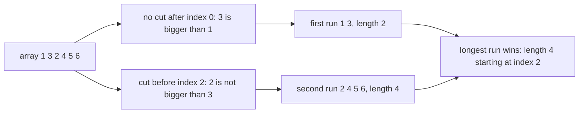
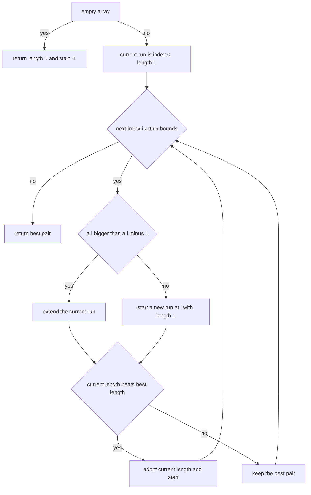
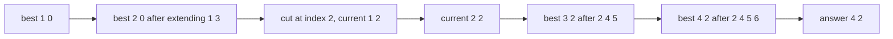

# 118 — Longest increasing subarray (contiguous).

> **Tier:** Beginner · **CTCI chapter:** Ch 6 — Math and Logic Puzzles
> **Task spec:** [118-longest-increasing-subarray-contiguous.md](../../../tasks/beginner/118-longest-increasing-subarray-contiguous.md)
> **Solutions:** [Python](../../../solutions/python/beginner/118-longest-increasing-subarray-contiguous/solution.py) ·
> [Java](../../../solutions/java/beginner/118-longest-increasing-subarray-contiguous/Solution.java) ·
> [JavaScript](../../../solutions/javascript/beginner/118-longest-increasing-subarray-contiguous/solution.js) ·
> [C#](../../../solutions/csharp/beginner/118-longest-increasing-subarray-contiguous/Solution.cs)

## 1. Problem restatement

**Input:** an integer array `a`, possibly empty. The array may contain duplicates and negative
values.

**Output:** a pair — the length of the longest **contiguous** run of strictly increasing values,
and the index where that run starts. An empty array is the only case with no start at all, and it
reports `-1`; every non-empty array has a start because a single element is a run of length 1.

The Python function returns the tuple `(length, start)`, the JavaScript one returns the array
`[length, start]`, Java returns `int[]{length, start}` and C# returns `int[]`. The assertions fix
the contract:

| Call | Result | Why |
| --- | --- | --- |
| `longest_increasing_subarray([1, 2, 3, 1, 2])` | `(3, 0)` | the run at index 0 is longer than the tail run `1, 2` |
| `longest_increasing_subarray([5, 4, 3])` | `(1, 0)` | nothing increases, so every element is its own run and the first wins |
| `longest_increasing_subarray([1, 3, 2, 4, 5, 6])` | `(4, 2)` | the run `2, 4, 5, 6` lives in the middle |
| `longest_increasing_subarray([])` | `(0, -1)` | no elements, no start |
| `longest_increasing_subarray([7])` | `(1, 0)` | a single element is a run |

The docstring of every solution names the target complexity outright: `O(n)` single pass, extend
the current run while strictly increasing.

## 2. Intuition

The naive idea is to try every start index and walk forward until the sequence stops increasing,
keeping the best pair. That is correct and it is O(n²): on `1, 2, 3, 4, ..., n` the start at 0
alone scans the whole array, and every later start rescans a suffix of it. Copying subarrays is
even worse, because the copy itself is O(n) and turns the loop into O(n³).

The key insight is that the runs *partition* the array. Cut the array wherever the strictly
increasing relation fails, i.e. between `i - 1` and `i` whenever `a[i] <= a[i - 1]`. Every element
then belongs to exactly one maximal run, and the answer is the longest of those runs. Because a
run only ever grows at its right end while you scan left to right, there is no reason to revisit
anything: the scan can carry two numbers — the length of the run currently open, and where it
began — and update the best pair whenever a run overtakes the record.



Equality counts as a break, not as an increase: the comparison is strict (`a[i] > a[i - 1]`), so
`2, 2, 3` splits into the run `2` and the run `2, 3`. This is a definitional choice, and the
solutions consistently make it, which is what makes the answer to `[5, 4, 3]` a length of 1 and
not 0.

The second half of the insight is the tie rule. `cur_len > best_len` is a strict comparison, so
the *first* of several equally long runs is the one reported. That is why `[5, 4, 3]` returns
start 0 even though starts 1 and 2 are equally good, and it is a promise the caller can rely on.

## 3. Algorithm

1. If the array is empty, return length 0 and start -1 immediately.
2. Otherwise start a run at index 0 with length 1, and record it as the best so far.
3. For each index `i` from 1 to `n - 1`: if `a[i] > a[i - 1]`, extend the open run by one. If not,
   close it and open a new run at `i` with length 1.
4. Whenever the open run's length exceeds the best length, adopt both its length and its start.
5. Return the best pair.

```text
function longest_increasing_subarray(a)
    if a is empty then
        return (length 0, start -1)
    end
    best_length ← 1
    best_start ← 0
    current_length ← 1
    current_start ← 0
    for i ← 1 to length(a) - 1 do
        if a[i] > a[i - 1] then
            current_length ← current_length + 1
        else
            current_length ← 1
            current_start ← i
        end
        if current_length > best_length then
            best_length ← current_length
            best_start ← current_start
        end
    end
    return (best_length, best_start)
end
```

The comparison is always against the *previous* element, never against the start of the run, which
is what makes the whole pass O(n) and lets the algorithm forget the run's contents entirely. Only
two integers describe it: how long it is and where it starts. Note also that the update of the
best pair happens on the same iteration as the extension, so a run that ends at the last element
is still recorded — there is no separate "close the run at the end" step.



## 4. Worked example

Trace `[1, 3, 2, 4, 5, 6]`, the third assertion. The run starts at index 0 with length 1.

| Step | `i` | `a[i - 1]` → `a[i]` | Increasing? | `current` (length, start) | `best` (length, start) |
| --- | --- | --- | --- | --- | --- |
| start | — | — | — | `(1, 0)` | `(1, 0)` |
| 1 | 1 | 1 → 3 | yes | `(2, 0)` | `(2, 0)` |
| 2 | 2 | 3 → 2 | no | `(1, 2)` | `(2, 0)` |
| 3 | 3 | 2 → 4 | yes | `(2, 2)` | `(2, 0)` |
| 4 | 4 | 4 → 5 | yes | `(3, 2)` | `(3, 2)` |
| 5 | 5 | 5 → 6 | yes | `(4, 2)` | `(4, 2)` |

The answer is `(4, 2)`: the run `2, 4, 5, 6`. Step 2 is where the array is cut, and the two
integers `(1, 2)` are all that survives the first run — the values `1` and `3` are never examined
again.



The first assertion, `[1, 2, 3, 1, 2]`, ends the scan with the trailing run at `(2, 3)`, which
never beats the `(3, 0)` recorded at step 2. That is the strict comparison in action: the tail run
would have tied nothing, but if it had been equally long it would still have lost because ties go
to the earlier run. The second assertion `[5, 4, 3]` never extends at all: `current` is reset to
`(1, i)` twice, both resets tie the best length of 1, and the strict comparison leaves the
original `(1, 0)` in place.

## 5. Complexity

Let `n` be the length of the array.

| Measure | Bound | Why it holds |
| --- | --- | --- |
| Time, best | O(n) | every element is compared exactly once, including on an already sorted array |
| Time, average | O(n) | one comparison and a constant number of assignments per index |
| Time, worst | O(n) | no branch does more work than any other; there is no nested scan |
| Space | O(1) | four integers: best length, best start, current length, current start |
| Brute force over all starts | O(n²) | each start scans forward independently, so a sorted array is scanned `n` times over |
| Brute force with subarray copies | O(n³) | the forward scan copies the candidate run, so each extension costs O(n) |
| Non-contiguous variant (task 119) | O(n²), or O(n log n) in task 120 | allowing gaps removes the "runs partition the array" property and needs a DP |

The O(1) space is the honest way to state how little state a run needs: the run's values are
already in the array, and the only missing information is where it starts and how long it has
grown. A solution that stored the run itself would still be O(n) time but would pay O(n) space for
no benefit.

## 6. Pitfalls and edge cases

- **Empty array.** Returned as `(0, -1)` and asserted in Python and JavaScript; Java and C# assert
  the same `-1` start. Returning `0` as the start, or throwing, breaks the contract.
- **Single element.** `[7]` yields `(1, 0)`: the initialisation already covers it and the loop body
  never runs. Python asserts this case explicitly.
- **Strictness.** `a[i] > a[i - 1]` means equal neighbours break the run. `[2, 2, 3]` gives the
  pair `(2, 1)` — the run `2, 3` starting at index 1 — not the length 3 that a "non-decreasing"
  reading would produce.
- **Ties.** The first equally long run wins because the comparison is strict. `[5, 4, 3]` reports
  start 0 even though a run of length 1 also starts at 1 and at 2.
- **Reporting the start, not the values.** The function returns indices, so a caller that wants
  the subarray must slice `a[start : start + length]`. For the empty case the pair `(0, -1)` cannot
  be sliced and must be handled by the caller.
- **Negatives and zero.** The algorithm only compares neighbours, so negative values and zeros are
  ordinary; `[-3, -2, -1]` is a run of 3.
- **Long runs at the end.** The best pair is updated inside the loop, so a run that reaches the
  last element is recorded. Moving the update into the "else" branch only — a common refactoring
  mistake — would miss it.
- **Resetting the length without the start.** The two assignments `current_length ← 1` and
  `current_start ← i` must happen together; forgetting the second reports the wrong start.
- **Types.** Java and C# return a fixed-size pair array, so the caller indexes `[0]` and `[1]`
  rather than destructuring. The values fit comfortably in `int` for this problem; no overflow is
  possible from additions because no arithmetic is done on the elements.
- **The non-contiguous trap.** Dropping "contiguous" changes the answer: for `[1, 5, 2, 3, 4]` the
  longest increasing *subarray* is `2, 3, 4` of length 3, while the longest increasing
  *subsequence* is `1, 2, 3, 4` of length 4, which is the problem of task 119.

## 7. Variants and follow-ups

- **Allow gaps.** The same question without the contiguity requirement is the longest increasing
  subsequence: [119-longest-increasing-subsequence-naive-dp-o-n-2.md](../../../tasks/beginner/119-longest-increasing-subsequence-naive-dp-o-n-2.md).
- **Faster LIS.** Once gaps are allowed, the run-partition trick is gone and the choice is between
  the quadratic DP and the patience-sorting sweep:
  [120-implement-lis-using-patience-sorting-idea-o-n-log-n-outline.md](../../../tasks/beginner/120-implement-lis-using-patience-sorting-idea-o-n-log-n-outline.md).
- **Non-decreasing runs.** Swap the strict comparison for `>=` and the equal-neighbour case merges
  into one run; the loop structure and the tie rule do not change at all.
- **Sum instead of length.** Kadane's maximum-subarray algorithm has exactly the same shape — one
  running quantity, one best-so-far, one reset rule — but resets on a negative partial sum rather
  than on a decrease.
- **Longest run in a sorted array.** The same pass on a sorted array answers "how long is the
  longest block of duplicates" once the comparison is flipped to equality.
- The chapter walkthrough in [Math and Logic](../../ctci/06-math-and-logic.md) uses this task as the
  simplest example of an invariant that is maintained in a single pass.

## 8. Check yourself

1. Why is one running run enough, instead of keeping all runs found so far?

<details><summary>Show answer</summary>

Because a run only grows at its right end as the scan moves forward, and once the scan leaves a
run it can never be extended again. The only information worth keeping is the best pair seen so
far, so the state reduces to four integers.

</details>

2. What does `[5, 4, 3]` return, and which line of the algorithm decides the start index?

<details><summary>Show answer</summary>

`(1, 0)`. Each element opens a run of length 1, but the update uses the strict test
`current_length > best_length`, so the first run keeps its place; resetting the start index
happens in the `else` branch that opens the new run.

</details>

3. Does the algorithm handle `[2, 2, 3]` as a run of length 3?

<details><summary>Show answer</summary>

No. The comparison is `a[i] > a[i - 1]`, and `2 > 2` is false, so a new run starts at index 1 and
the answer is `(2, 1)` — the run `2, 3`. A non-decreasing variant would need `>=` instead.

</details>

4. What would change for `[1, 5, 2, 3, 4]` if contiguity were dropped?

<details><summary>Show answer</summary>

The contiguous answer is `(3, 2)`: the run `2, 3, 4`. Without contiguity the subsequence
`1, 2, 3, 4` has length 4, and the run-partition property this single pass relies on disappears —
that is why the subsequence version needs the DP of task 119.

</details>

5. Where is the best pair updated, and why does it matter that it is not only in the `else`
   branch?

<details><summary>Show answer</summary>

It is updated on every iteration, right after the extend-or-reset choice. If the update lived only
in the reset branch, a run that is still growing when the array ends — for instance the run in
`[1, 2, 3]` — would never be compared with the record.

</details>
