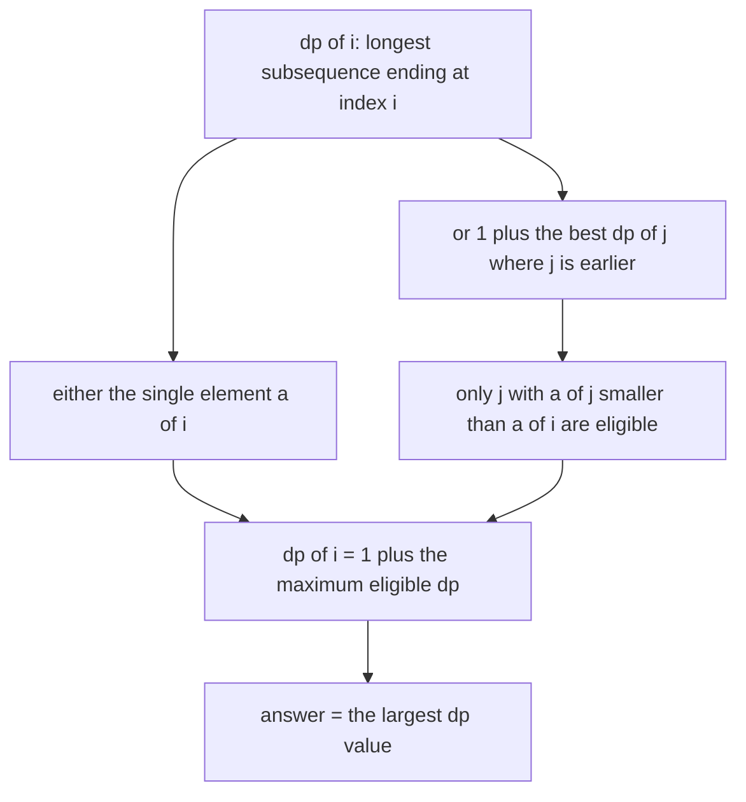
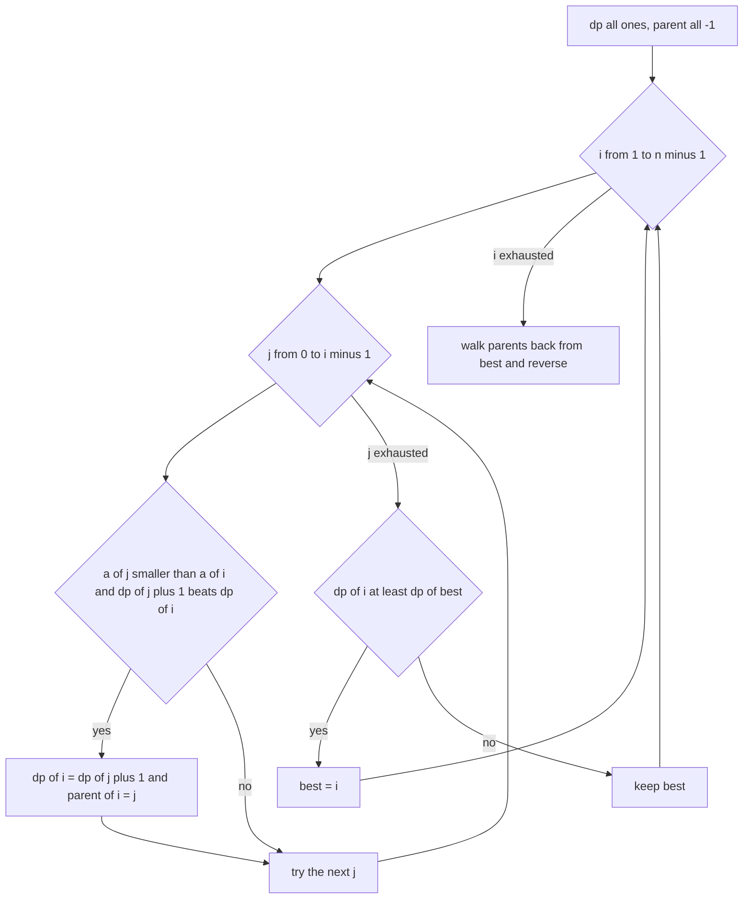
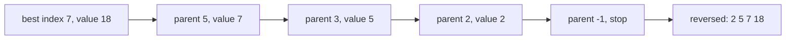
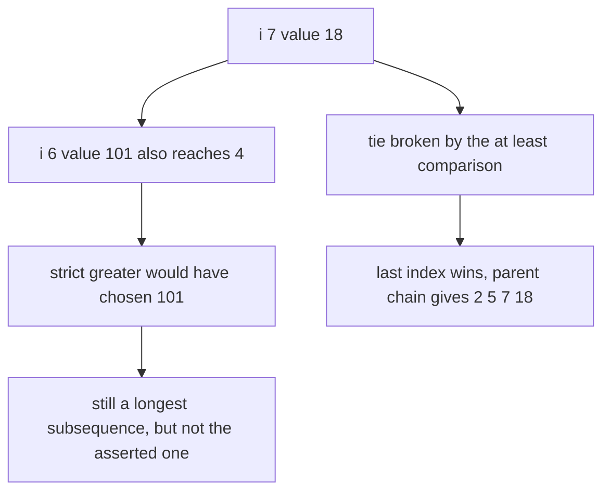

# 119 — Longest increasing subsequence (naive DP O(n^2)).

> **Tier:** Beginner · **CTCI chapter:** Ch 6 — Math and Logic Puzzles
> **Task spec:** [119-longest-increasing-subsequence-naive-dp-o-n-2.md](../../../tasks/beginner/119-longest-increasing-subsequence-naive-dp-o-n-2.md)
> **Solutions:** [Python](../../../solutions/python/beginner/119-longest-increasing-subsequence-naive-dp-o-n-2/solution.py) ·
> [Java](../../../solutions/java/beginner/119-longest-increasing-subsequence-naive-dp-o-n-2/Solution.java) ·
> [JavaScript](../../../solutions/javascript/beginner/119-longest-increasing-subsequence-naive-dp-o-n-2/solution.js) ·
> [C#](../../../solutions/csharp/beginner/119-longest-increasing-subsequence-naive-dp-o-n-2/Solution.cs)

## 1. Problem restatement

**Input:** an integer array `a`, possibly empty. Values may repeat, be negative, or arrive in any
order.

**Output:** `lis_length(a)` returns just the length of the longest strictly increasing
**subsequence** — elements taken in order but not necessarily adjacent. `lis_with_sequence(a)`
returns one concrete subsequence that achieves that length, as a list of values.

The Python module docstring names the recurrence the solutions implement:
`dp[i] = 1 + max(dp[j] for j < i with a[j] < a[i])`.

| Call | Result | Why |
| --- | --- | --- |
| `lis_length([10, 9, 2, 5, 3, 7, 101, 18])` | `4` | `2, 3, 7, 18`, or `2, 5, 7, 101` — several sequences reach 4 |
| `lis_length([])` | `0` | nothing to take |
| `lis_length([3, 2, 1])` | `1` | no pair is increasing, so any single element is best |
| `lis_length([1, 2, 3, 4])` | `4` | the whole array |
| `lis_with_sequence([10, 9, 2, 5, 3, 7, 101, 18])` | `[2, 5, 7, 18]` | the reconstruction rule picks this one of the tied answers |

Because subsequences may skip elements, the answer is never simply "the longest adjacent run" —
that contiguous question is task 118. Comparing `[1, 5, 2, 3, 4]` shows the difference: the longest
increasing run is `2, 3, 4` of length 3, while the longest increasing subsequence is `1, 2, 3, 4`
of length 4.

## 2. Intuition

The naive recursive idea is to ask, at each index, "extend or skip" and take the maximum of the
two branches. That enumerates every subsequence and runs in O(2ⁿ); with overlapping subproblems it
can be memoised, but the branching factor still hides a nested structure that a bottom-up table
can flatten.

The key insight is to make the *last* element of the subsequence part of the state. Define `dp[i]`
as the length of the longest increasing subsequence that **ends exactly at index `i`**. Then any
such subsequence either is the single element `a[i]`, or it extends a subsequence ending at some
earlier index `j` with `a[j] < a[i]`. That gives `dp[i] = 1 + max(dp[j])` over the eligible `j`,
and `1` when no eligible `j` exists. The answer is `max(dp)`, because the longest subsequence ends
somewhere.



Two properties of that definition do the heavy lifting. Because `dp[i]` is pinned to index `i`,
the eligible predecessors are a plain prefix `0 .. i - 1`, so the transition is one inner loop and
no graph search. And because the comparison is strict (`a[j] < a[i]`), duplicates never extend each
other: `[2, 2, 2]` has `dp = [1, 1, 1]` and the answer 1.

The reconstruction needs a second array. Store `parent[i] = j` whenever the transition through `j`
is the one that set `dp[i]`, then walk back from the index that achieved the maximum. This is the
standard "DP with parent pointers" pattern: one extra integer per index turns an optimal *value*
into an optimal *witness*.

## 3. Algorithm

1. If the array is empty, return 0 (and, for the reconstruction variant, an empty list).
2. Create `dp` with every entry 1 — each element is a subsequence of length 1 by itself.
3. For every `i` from 1 to `n - 1`, loop over every `j` from 0 to `i - 1`. If `a[j] < a[i]` and
   `dp[j] + 1 > dp[i]`, set `dp[i] = dp[j] + 1` and, in the reconstruction variant, `parent[i] = j`.
4. Return `max(dp)` for the length. For the reconstruction, track the best index and follow the
   parent chain backwards.

```text
function lis_length(a)
    if a is empty then
        return 0
    end
    dp ← array of length(a) entries, each 1
    for i ← 1 to length(a) - 1 do
        for j ← 0 to i - 1 do
            if a[j] < a[i] and dp[j] + 1 > dp[i] then
                dp[i] ← dp[j] + 1
            end
        end
    end
    return the largest value in dp
end

function lis_with_sequence(a)
    if a is empty then
        return an empty list
    end
    dp ← array of length(a) entries, each 1
    parent ← array of length(a) entries, each -1
    best ← 0
    for i ← 1 to length(a) - 1 do
        for j ← 0 to i - 1 do
            if a[j] < a[i] and dp[j] + 1 > dp[i] then
                dp[i] ← dp[j] + 1
                parent[i] ← j
            end
        end
        if dp[i] ≥ dp[best] then
            best ← i
        end
    end
    sequence ← an empty list
    node ← best
    while node is not -1 do
        append a[node] to sequence
        node ← parent[node]
    end
    return the reverse of sequence
end
```

The relaxed comparison `dp[i] ≥ dp[best]` in the second function is deliberate and carries a
comment in every solution: with `≥` the *last* index reaching the maximum wins, which is what makes
the expected output `[2, 5, 7, 18]` reproducible. With a strict `>` the earlier index 101 would win
the tie and the reconstructed sequence would be `[2, 5, 7, 101]` — equally valid as a longest
increasing subsequence, but not the asserted one.



## 4. Worked example

Trace `[10, 9, 2, 5, 3, 7, 101, 18]`, the array used by every assertion. Indices run 0 to 7.

| `i` | `a[i]` | Eligible `j` (with `a[j] < a[i]`) | Best transition | `dp[i]` | `parent[i]` | `best` after the row |
| --- | --- | --- | --- | --- | --- | --- |
| 0 | 10 | — | none, base case | 1 | -1 | 0 |
| 1 | 9 | none | none | 1 | -1 | 0 |
| 2 | 2 | none | none | 1 | -1 | 0 |
| 3 | 5 | 2 | `dp[2] + 1 = 2` | 2 | 2 | 3 |
| 4 | 3 | 2 | `dp[2] + 1 = 2` | 2 | 2 | 4 |
| 5 | 7 | 2, 5, 3 | `dp[3] + 1 = 3` | 3 | 3 | 5 |
| 6 | 101 | 10, 9, 2, 5, 3, 7 | `dp[5] + 1 = 4` | 4 | 5 | 6 |
| 7 | 18 | 10, 9, 2, 5, 3, 7 | `dp[5] + 1 = 4` | 4 | 5 | 7 |

After the last row `dp` is `[1, 1, 1, 2, 2, 3, 4, 4]`, so `lis_length` returns `max(dp) = 4`.
The `best` column shows the tie being resolved: row 6 sets `best = 6` with `dp = 4`, and row 7
satisfies `dp[7] ≥ dp[6]` because `4 ≥ 4`, so `best` moves to 7.

Walking the parent chain from index 7 gives the asserted sequence:



Row 5 is worth reading closely: through index 3 (the value 5) `dp` becomes 3, but through index 4
(the value 3) the candidate is `dp[4] + 1 = 3`, which is *not* greater than the current 3, so
`parent[5]` keeps pointing at 3. The strict `>` inside the transition is what keeps the parent
pointer consistent with the first index that achieved the value.



## 5. Complexity

Let `n` be the length of the array.

| Measure | Bound | Why it holds |
| --- | --- | --- |
| Time, best | O(n²) | even a sorted array runs both loops fully; `[1, 2, 3, 4]` is asserted to give 4 but the inner loop never ends early |
| Time, average | O(n²) | exactly `n(n - 1) / 2` comparisons |
| Time, worst | O(n²) | the comparison count is fixed by the loop bounds, independent of the data |
| Space | O(n) | `dp`, plus `parent` for the reconstruction variant, both one entry per element |
| Naive recursion over subsequences | O(2ⁿ) | every subset decision is explored, with the same subproblems recomputed |
| Patience sorting (task 120) | O(n log n) | replaces the inner scan with a binary search in a `tails` array |
| Contiguous variant (task 118) | O(n) and O(1) space | the run partition makes a scan enough, but it answers a different question |

The quadratic bound is not an accident of the implementation: the transition genuinely asks "which
of all earlier elements should I extend", and the naive answer examines all of them. Task 120 keeps
the same recurrence but notices that the inner maximum can be answered by a binary search over a
monotonically maintained array.

## 6. Pitfalls and edge cases

- **Subsequence versus subarray.** `[1, 5, 2, 3, 4]` gives 4 here and 3 for the contiguous problem
  of task 118. Reusing a run-scan implementation for this task silently under-reports.
- **Strictness.** `a[j] < a[i]` means duplicates cannot extend each other; `[2, 2, 2]` has answer
  1 and `[1, 1, 2]` has answer 2. A non-decreasing variant would need `<=`.
- **Empty array.** `lis_length([])` is asserted `0` and `lis_with_sequence([])` must return an
  empty list; the guard has to come before the `max(dp)` call, which would otherwise raise on an
  empty sequence (Python) or need an explicit sentinel (Java, JavaScript, C#).
- **Single element.** `dp` is `[1]`, `max` is 1, no inner loop runs.
- **Every element equal.** `[3, 3, 3]` returns 1, and the reconstruction returns a single value,
  not three.
- **Tie-breaking in the reconstruction.** The `>=` comparison selects the last index that reaches
  the maximum, which is what produces `[2, 5, 7, 18]` instead of `[2, 5, 7, 101]`. Both are valid
  longest subsequences; only one is asserted, and the comment in the solutions records why.
- **Parent pointers and the `>=` interaction.** Moving `best` while keeping the old `parent`
  values is safe because the chain from the new `best` follows *its* own parents; the two arrays
  are written on the same iteration.
- **`dp` must be initialised to 1, not 0.** A zero initialisation loses the single-element case and
  reports 0 for `[3, 2, 1]`.
- **Descending input.** `[3, 2, 1]` is asserted `1`: the answer is never 0 for a non-empty array.
- **Reconstruction order.** The parent walk produces the sequence backwards, so it must be reversed;
  forgetting the reversal returns `[18, 7, 5, 2]`, which is decreasing and obviously wrong.
- **Overflow.** Not a concern here: the DP values are bounded by `n`, and no element arithmetic
  beyond comparisons is performed.

## 7. Variants and follow-ups

- **Faster algorithm, same answer.** The patience-sorting sweep replaces the inner scan with a
  binary search and drops the time to O(n log n):
  [120-implement-lis-using-patience-sorting-idea-o-n-log-n-outline.md](../../../tasks/beginner/120-implement-lis-using-patience-sorting-idea-o-n-log-n-outline.md).
- **Contiguous instead of subsequence.** Requiring adjacent elements makes a single O(n) pass
  enough: [118-longest-increasing-subarray-contiguous.md](../../../tasks/beginner/118-longest-increasing-subarray-contiguous.md).
- **Longest common subsequence.** The same "state is the position where a best answer ends"
  idea generalises to two strings:
  [121-longest-common-subsequence-lcs-dp.md](../../../tasks/beginner/121-longest-common-subsequence-lcs-dp.md).
- **Memoised recursion instead of a table.** Caching the recursive definition by index gives the
  same O(n²) time with O(n) extra space for the cache; task 128 shows the generic wrapper used for
  that style of solution.
- **Other order statistics.** Counting or reporting the k-th longest increasing subsequence needs
  more state than `dp[i]`, since one index can belong to many subsequences of the same length.
- The chapter walkthrough in [Recursion and Dynamic Programming](../../ctci/08-recursion-and-dp.md)
  uses this as the first one-dimensional DP with a non-trivial transition.

## 8. Check yourself

1. Why does `dp[i]` mean "longest subsequence ending at `i`" rather than "longest subsequence in
   `a[0..i]`"?

<details><summary>Show answer</summary>

Because the transition needs to know whether `a[i]` can extend a previous subsequence, and that
depends only on the value that subsequence ends with. Pinning the state to the ending index makes
the predecessors a simple prefix `0 .. i - 1` and the recurrence `dp[i] = 1 + max(dp[j])` over
eligible `j`; the global answer is then `max(dp)`.

</details>

2. What is `dp` for `[10, 9, 2, 5, 3, 7, 101, 18]`, and which values in it are tied?

<details><summary>Show answer</summary>

`[1, 1, 1, 2, 2, 3, 4, 4]`. Indices 6 (the value 101) and 7 (the value 18) are tied at 4, which is
why the reconstruction needs a documented tie rule.

</details>

3. Why does the reconstruction prefer index 7 over index 6?

<details><summary>Show answer</summary>

Because the best index is updated with `dp[i] >= dp[best]`, so a later index that ties the maximum
replaces the earlier one. With a strict `>` the answer would be `[2, 5, 7, 101]`, which is also a
longest increasing subsequence but is not the sequence the solution files assert.

</details>

4. What does the algorithm return for `[1, 1, 2]` and why?

<details><summary>Show answer</summary>

2, for the subsequence `1, 2`. The duplicate `1` cannot extend the first `1` because the
comparison is strict, so `dp` is `[1, 1, 2]`; index 2 extends index 0 or index 1 equally well.

</details>

5. Where exactly does the O(n²) come from, and what property of `dp` does task 120 exploit to
   avoid it?

<details><summary>Show answer</summary>

From the inner loop that scans all earlier indices for the best eligible `dp[j]`. Task 120 observes
that the array of smallest tails of length `k + 1` is sorted, so that maximum can be answered by a
binary search instead of a scan, at the cost of not keeping the DP table around.

</details>
