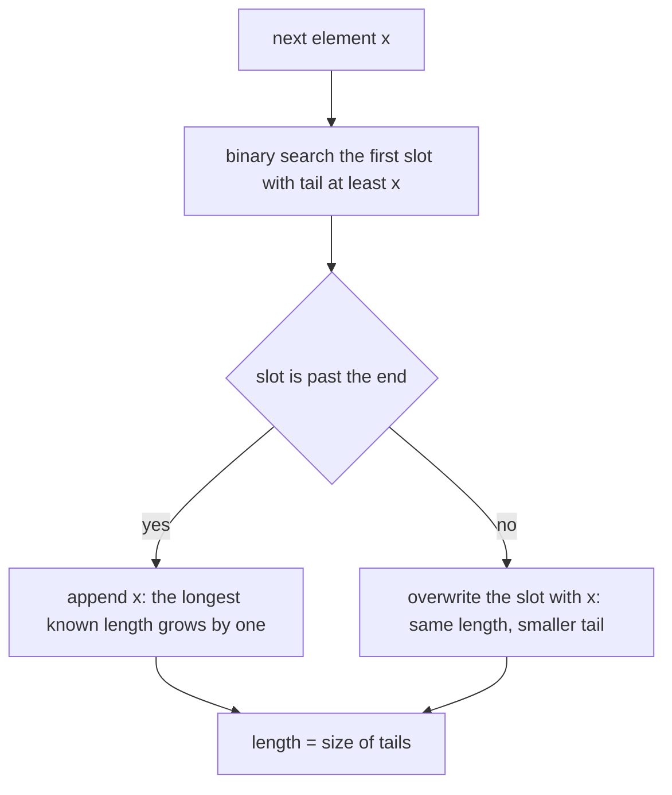
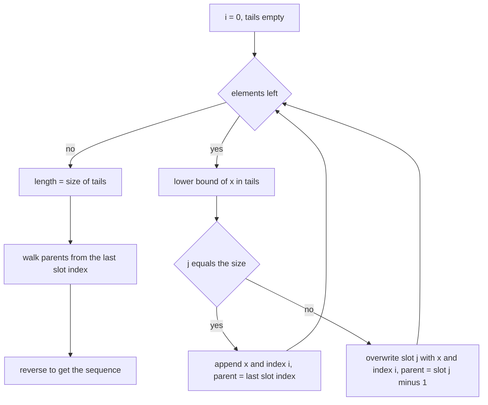
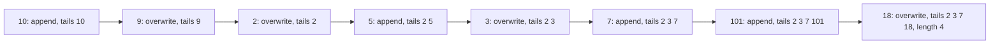
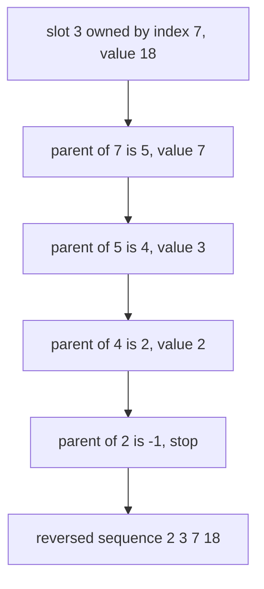

# 120 — Implement LIS using patience sorting idea (O(n log n) outline).

> **Tier:** Beginner · **CTCI chapter:** Ch 10 — Sorting and Searching
> **Task spec:** [120-implement-lis-using-patience-sorting-idea-o-n-log-n-outline.md](../../../tasks/beginner/120-implement-lis-using-patience-sorting-idea-o-n-log-n-outline.md)
> **Solutions:** [Python](../../../solutions/python/beginner/120-implement-lis-using-patience-sorting-idea-o-n-log-n-outline/solution.py) ·
> [Java](../../../solutions/java/beginner/120-implement-lis-using-patience-sorting-idea-o-n-log-n-outline/Solution.java) ·
> [JavaScript](../../../solutions/javascript/beginner/120-implement-lis-using-patience-sorting-idea-o-n-log-n-outline/solution.js) ·
> [C#](../../../solutions/csharp/beginner/120-implement-lis-using-patience-sorting-idea-o-n-log-n-outline/Solution.cs)

## 1. Problem restatement

**Input:** an integer array `a`, possibly empty, with duplicates and negatives allowed.

**Output:** the length of the longest strictly increasing subsequence, and optionally one concrete
subsequence of that length.

The interface is deliberately narrow: `lis_length(a)` returns the number, `lis_length_reconstructed(a)`
in Python and `lis_reconstructed(a)` / `lisReconstructed(a)` / `LisReconstructed(a)` in the other
three languages return the length together with one valid witness.

The module docstring is unusually explicit about the data structure and its limitation, and the
tutorial follows it literally:

> Maintain `tails`: `tails[i] =` smallest possible tail of an increasing subsequence of length
> `i+1`. Binary search find place to overwrite/append. Length is exact; the `tails` array itself is
> NOT necessarily a valid subsequence (documented caveat).

| Call | Result | Why |
| --- | --- | --- |
| `lis_length([10, 9, 2, 5, 3, 7, 101, 18])` | `4` | the same sample as task 119, so the two algorithms are directly comparable |
| `lis_length([])` | `0` | the `tails` array never grows |
| `lis_length([3, 2, 1])` | `1` | each element overwrites the first slot, never appends |
| `lis_length([1, 2, 3, 4])` | `4` | every element appends |
| `lis_reconstructed([10, 9, 2, 5, 3, 7, 101, 18])` | `[2, 3, 7, 18]` | asserted exactly in Java, JavaScript and C#; Python asserts it is increasing with length 4 |

The Python and Java solutions also cross-check themselves against the quadratic DP of task 119 on
`[1, 3, 2]`, `[5, 1, 2, 3, 4]`, `[2, 2, 2]` and `[-1, -2, -3]`, which is the strongest possible
statement that the fast algorithm computes the same quantity as the slow, obviously correct one.

## 2. Intuition

Task 119 spends O(n) work per element asking "which earlier element should I extend". That scan is
the bottleneck, and the question it answers is a maximum over a prefix of values. The key insight
is to maintain a compact summary in which that maximum is a *binary search* instead.

The summary is the array `tails`, where `tails[k]` holds the smallest possible tail of an
increasing subsequence of length `k + 1` that has been seen so far. Smaller tails are strictly
better: if a subsequence of length `k + 1` can end at 3 instead of 7, every future element that
could extend the 7 version can also extend the 3 version, and more besides. Processing one element
`x` is one of two moves, decided by a single binary search for the first slot that is not smaller
than `x`:

- if `x` lands at or past the end of `tails`, it starts a new, longer subsequence — append it and
  the length grows by one;
- otherwise it lands on a slot whose current tail is `>= x`, so `x` is a strictly better tail for
  that length — overwrite the slot and the length does not change.



Two consequences follow, and both are worth stating plainly. First, the length of `tails` at the
end is the answer, because a slot only exists when some subsequence of that length exists. Second,
the *contents* of `tails` need not form a subsequence of the input — the overwrite move puts a
value in a slot that no earlier element can legally follow. The Python docstring flags this as the
documented caveat, and the worked example below shows a concrete counterexample: for
`[3, 4, 1, 2, 0]` the final `tails` is `[0, 2]`, which is not a subsequence of the array, while the
correct length 2 is still reported.

Reconstruction therefore needs extra bookkeeping, not just the `tails` values: remember the input
index that produced each slot, and record a parent pointer for each element pointing at the index
that was the best predecessor at insertion time. Walking those parent pointers from the last slot's
index produces a genuine subsequence of the right length.

## 3. Algorithm

1. Keep `tails`, the array of best tails, empty.
2. For each element `x` of the input, binary search for the first index `j` with `tails[j] >= x`.
   With `bisect_left` in Python, with a manual lower-bound loop in Java, JavaScript and C#, this
   is the same search.
3. If `j` equals the current size, append `x`; otherwise overwrite `tails[j]` with `x`.
4. Update the size: appending grows it by one, overwriting leaves it alone.
5. Return the size as the length. In the reconstructing variant, also write `tail_index[j] = i`
   and set `parent[i] = tail_index[j - 1]`, or `-1` when `j` is 0.
6. For the witness, start from `tail_index[size - 1]` and follow `parent` down to `-1`, then
   reverse the collected values.

```text
function lis_length(a)
    tails ← an empty array
    for each x in a do
        j ← the first index with tails[j] ≥ x, or the size if there is none
        if j equals the size of tails then
            append x to tails
        else
            tails[j] ← x
        end
    end
    return the size of tails
end

function lis_reconstructed(a)
    if a is empty then
        return (length 0, an empty sequence)
    end
    tails ← an empty array
    tail_index ← an empty array
    parent ← array of length(a) entries, each -1
    for i ← 0 to length(a) - 1 do
        x ← a[i]
        j ← the first index with tails[j] ≥ x, or the size if there is none
        if j equals the size of tails then
            append x to tails and append i to tail_index
        else
            tails[j] ← x
            tail_index[j] ← i
        end
        if j > 0 then
            parent[i] ← tail_index[j - 1]
        end
    end
    sequence ← an empty list
    node ← the last entry of tail_index
    while node is not -1 do
        append a[node] to sequence
        node ← parent[node]
    end
    return (size of tails, the reverse of sequence)
end
```

The lower-bound search is the whole reason the algorithm is fast, and its exact form matters. Using
"first slot strictly greater than `x`" (an upper bound) instead of "first slot at least `x`" would
let equal values extend each other and compute the longest *non-decreasing* subsequence, which is
why the Python solution comments `strict increase: use bisect_left` at that line.



## 4. Worked example

Trace `[10, 9, 2, 5, 3, 7, 101, 18]`, the array shared with task 119. The `tails` contents after
each element, and the `tail_index` slot that tracks which input index owns each slot:

| `i` | `x` | Lower bound `j` | Move | `tails` after | `tail_index` after | `parent[i]` |
| --- | --- | --- | --- | --- | --- | --- |
| 0 | 10 | 0 (empty) | append | `[10]` | `[0]` | -1 |
| 1 | 9 | 0, `10 >= 9` | overwrite | `[9]` | `[1]` | -1 |
| 2 | 2 | 0, `9 >= 2` | overwrite | `[2]` | `[2]` | -1 |
| 3 | 5 | 1 = size | append | `[2, 5]` | `[2, 3]` | 2 |
| 4 | 3 | 1, `5 >= 3` | overwrite | `[2, 3]` | `[2, 4]` | 2 |
| 5 | 7 | 2 = size | append | `[2, 3, 7]` | `[2, 4, 5]` | 4 |
| 6 | 101 | 3 = size | append | `[2, 3, 7, 101]` | `[2, 4, 5, 6]` | 5 |
| 7 | 18 | 3, `101 >= 18` | overwrite | `[2, 3, 7, 18]` | `[2, 4, 5, 7]` | 5 |

The final size is 4, which is the answer. Note that rows 4 and 7 are overwrites: row 4 replaces
the tail 5 with 3, and row 7 replaces 101 with 18. Neither changes the length, and both lower a
tail so that later elements have a better chance of extending it.



Now the reconstruction. The last slot is index 3, owned by input index 7, so the walk starts there:



The chain `2, 3, 7, 18` uses input indices 2, 4, 5, 7 — genuinely increasing in both position and
value, which is why the parent pointers are needed even though `tails` happens to end up as
exactly those values here. The counterexample mentioned in section 2 shows what can go wrong if
you skip the parent pointers: for `[3, 4, 1, 2, 0]` the sweep ends with `tails = [0, 2]` and size
2, and the length is right, but `0` sits after `2` in the input, so `tails` is not a subsequence;
the parent pointers instead yield `[1, 2]`.

## 5. Complexity

Let `n` be the length of the array.

| Measure | Bound | Why it holds |
| --- | --- | --- |
| Time, best | O(n log n) | even on a sorted array every element performs a full lower-bound search before appending |
| Time, average | O(n log n) | one binary search per element over an array of size at most `n`, plus O(1) overwrite work |
| Time, worst | O(n log n) | the search is `O(log n)` and no other step depends on the data |
| Space | O(n) | `tails` and, in the reconstructing variant, `tail_index` and `parent` |
| Space, length only | O(n) | `tails` alone; the size is the answer, so a bounded variant could keep only the array |
| Task 119 quadratic DP | O(n²) time, O(n) space | same recurrence, inner scan instead of a binary search |
| Task 118 contiguous run | O(n) time, O(1) space | answers a different (easier) question |

The reconstruction does not change any bound: the parent array is one integer per element, and the
final walk visits at most `n` nodes. That is the usual price of turning an optimal value into an
optimal witness.

## 6. Pitfalls and edge cases

- **`tails` is not a subsequence.** The documented caveat, and the reason the reconstructing
  variant exists at all. Reporting `tails` directly is correct in the sample by coincidence and
  wrong in general — `[3, 4, 1, 2, 0]` is the counterexample: length 2, `tails = [0, 2]`, witness
  `[1, 2]`.
- **Lower bound versus upper bound.** The search must find the first slot `>= x` so that equal
  values overwrite rather than append. An upper-bound search computes the longest **non-decreasing**
  subsequence and turns `[2, 2, 2]` from 1 into 3.
- **Empty array.** `lis_length([])` is asserted `0`; the `tails` array stays empty, so no special
  case is needed for the length. The reconstructing variant guards the empty input because it has
  to read the last slot.
- **Single element.** Row 0 of the table: one append, size 1. The length is never 0 for a
  non-empty input.
- **Descending input.** `[3, 2, 1]` produces three overwrites of slot 0 and returns 1, not 0.
- **Duplicates.** `[2, 2, 2]` overwrites slot 0 twice and returns 1; the cross-check against the
  quadratic DP in Python and Java covers this exact case.
- **Negative values.** `[-1, -2, -3]` is in the cross-check list; the algorithm compares values
  only, so signs are irrelevant.
- **Parent of the first slot.** `parent[i]` must be `-1` when `j == 0`; reading `tail_index[j - 1]`
  there underflows or wraps. Python guards with `if j > 0`, Java and C# with the same conditional
  expression.
- **Appending versus overwriting the index bookkeeping.** Both branches must write `tail_index[j]`.
  Forgetting the append branch's write makes the final walk start from a stale index.
- **Stale owners after an overwrite.** `tail_index[j]` deliberately points at the *newest* owner of
  the slot. An older subsequence of the same length can still be a prefix of the answer, which is
  exactly why the witness follows `parent` rather than `tails`.
- **Overflow.** The length is bounded by `n`; no value arithmetic happens other than comparisons.
- **Tie between two windows.** Two different witnesses of the same maximum length can exist; the
  solutions only pin the one Java, JavaScript and C# assert, and Python asserts the weaker property
  that the witness is increasing and has the right length.

## 7. Variants and follow-ups

- **The quadratic reference implementation.** The same answer with a nested scan, useful for
  cross-checking: [119-longest-increasing-subsequence-naive-dp-o-n-2.md](../../../tasks/beginner/119-longest-increasing-subsequence-naive-dp-o-n-2.md).
- **Contiguous runs.** If the subsequence must be a subarray, a single pass with two counters is
  enough: [118-longest-increasing-subarray-contiguous.md](../../../tasks/beginner/118-longest-increasing-subarray-contiguous.md).
- **Two sequences instead of one.** The longest common subsequence fills an `(n + 1) × (m + 1)`
  table instead of maintaining a sorted summary:
  [121-longest-common-subsequence-lcs-dp.md](../../../tasks/beginner/121-longest-common-subsequence-lcs-dp.md).
- **Non-decreasing instead of increasing.** Change the search from a lower bound to an upper bound
  and equal values merge into one run; the length grows accordingly.
- **The same summary in other problems.** `tails` is a "best value per length" array, the same
  shape as the patience piles in the card game, and the same pattern as the sorted summary used in
  step 1 of an O(n log n) longest common subsequence variant and in the `best` field of
  [117-autocomplete-top-k-prefix-suggestions-trie.md](../../../tasks/beginner/117-autocomplete-top-k-prefix-suggestions-trie.md).
- The chapter walkthrough in [Sorting and Searching](../../ctci/10-sorting-and-searching.md) places
  the binary search at the centre of the technique: the array is sorted by construction, and the
  search is what replaces the scan.

## 8. Check yourself

1. What exactly does `tails[k]` hold, and why is a smaller value always at least as good?

<details><summary>Show answer</summary>

It holds the smallest tail seen so far among increasing subsequences of length `k + 1`. A smaller
tail never hurts: any future element that could extend the larger tail can also extend the
smaller one, so smaller tails keep strictly more options open.

</details>

2. Why is `tails` not necessarily a valid subsequence, and what example shows it?

<details><summary>Show answer</summary>

Because the overwrite move replaces a slot with a value that may appear earlier in the input than
the value it replaced, so the surviving values can be out of order with respect to their input
positions. For `[3, 4, 1, 2, 0]` the sweep ends with `tails = [0, 2]` and length 2, but `0` occurs
after `2` in the array; the parent pointers give the real witness `[1, 2]`.

</details>

3. Why must the search be a lower bound rather than an upper bound?

<details><summary>Show answer</summary>

The problem asks for a strictly increasing subsequence, so an element equal to an existing tail must
not extend it. The lower bound finds the first slot with `tails[j] >= x`, which overwrites in that
case; an upper bound would find the first slot with `tails[j] > x`, append, and compute the longest
*non-decreasing* subsequence — for `[2, 2, 2]` that is 3 instead of 1.

</details>

4. On the sample array, which two rows of the trace are overwrites that do not change the length,
   and what do they buy?

<details><summary>Show answer</summary>

Row 4 replaces the tail 5 with 3, and row 7 replaces 101 with 18. Both keep the length at its
current value but lower a slot's tail, which is exactly what lets later elements extend that slot
instead of starting a new one.

</details>

5. What extra state does the reconstruction need, and what is its cost?

<details><summary>Show answer</summary>

Two arrays: `tail_index`, which records which input index currently owns each slot, and `parent`,
which records for each element the index of its best predecessor. Both are O(n), so the O(n log n)
time and O(n) space bounds are unchanged, and the final walk is a single O(n) pass.

</details>
