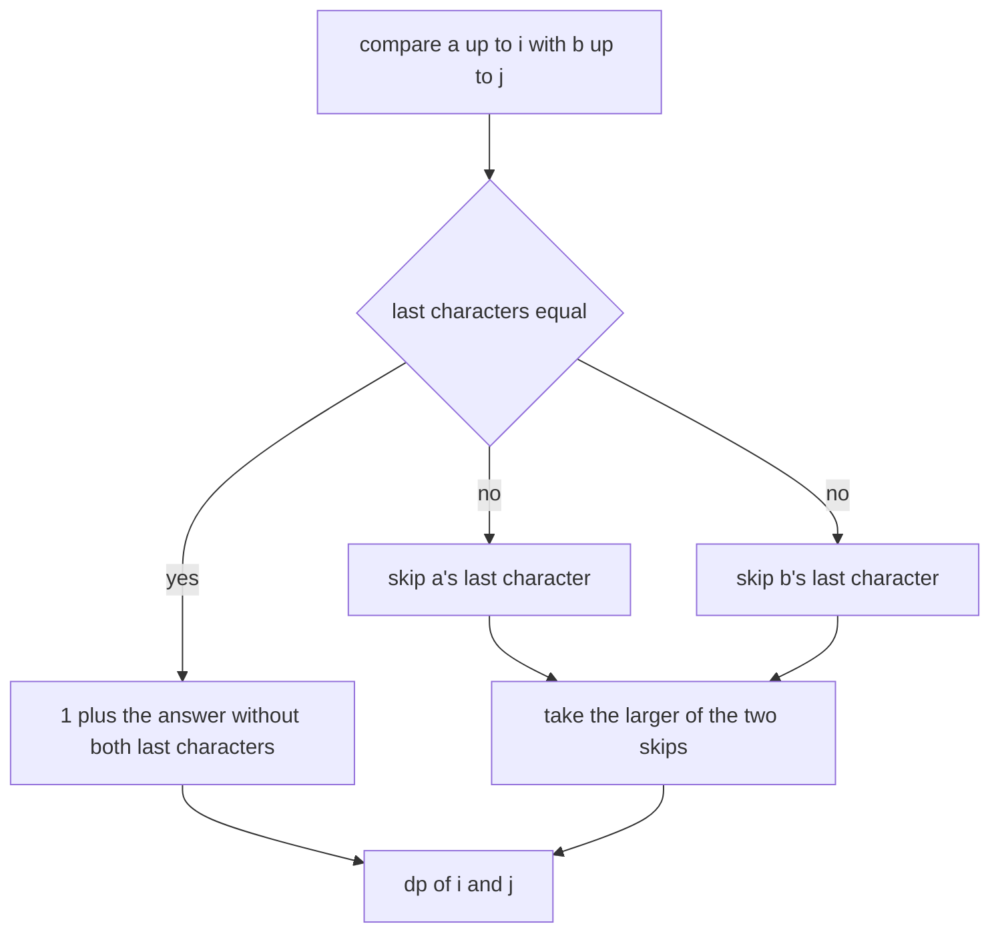
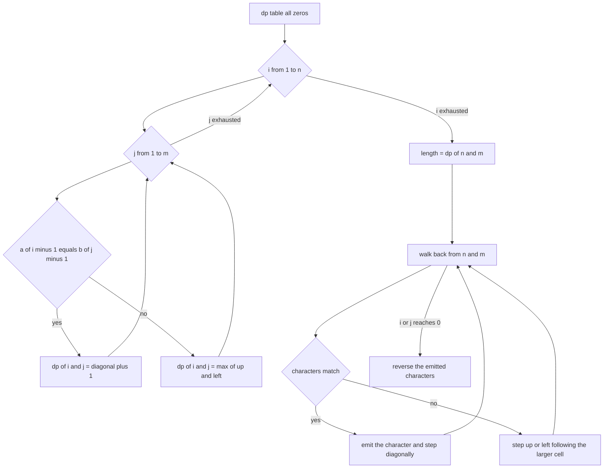
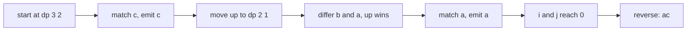

# 121 — Longest common subsequence (LCS) DP.

> **Tier:** Beginner · **CTCI chapter:** Ch 8 — Recursion and Dynamic Programming
> **Task spec:** [121-longest-common-subsequence-lcs-dp.md](../../../tasks/beginner/121-longest-common-subsequence-lcs-dp.md)
> **Solutions:** [Python](../../../solutions/python/beginner/121-longest-common-subsequence-lcs-dp/solution.py) ·
> [Java](../../../solutions/java/beginner/121-longest-common-subsequence-lcs-dp/Solution.java) ·
> [JavaScript](../../../solutions/javascript/beginner/121-longest-common-subsequence-lcs-dp/solution.js) ·
> [C#](../../../solutions/csharp/beginner/121-longest-common-subsequence-lcs-dp/Solution.cs)

## 1. Problem restatement

**Input:** two strings `a` of length `n` and `b` of length `m`. Either may be empty.

**Output:** `lcs_length(a, b)` returns the length of the longest string that is a subsequence of
both inputs. `lcs_string(a, b)` returns one such string.

The Python module docstring states the recurrence the solutions implement:
`dp[i][j] = LCS length of a[:i] and b[:j]; equal chars: 1 + dp[i-1][j-1]; else max(dp[i-1][j], dp[i][j-1])`.

| Call | Result | Why |
| --- | --- | --- |
| `lcs_length("ABCBDAB", "BDCABA")` | `4` | the standard sample; several strings reach 4 |
| `lcs_length("", "abc")` | `0` | one side is empty |
| `lcs_length("abc", "abc")` | `3` | identical strings |
| `lcs_length("abc", "def")` | `0` | no character is common |
| `lcs_string("ABCBDAB", "BDCABA")` | `"BCBA"` | the backtrack picks this one of the solutions of length 4 |

The reconstruction is asserted more weakly than the length, and deliberately so: the tests check
that the returned string has length 4 **and** is a subsequence of both inputs, using the shared
`is_subsequence` helper. Any correct witness passes; the trailing letters that could be `A` or `B`
in different orders are all valid.

## 2. Intuition

The brute-force reading is "generate every subsequence of `a` and test it against `b`", which is
O(2ⁿ · m) and hopeless. The key insight is that the answer depends only on the *suffixes* still
under consideration, not on the choices made so far. Comparing `a[:i]` with `b[:j]` is a
subproblem, and there are only `(n + 1)(m + 1)` of them.

For a single pair of positions there are just two cases. If the last characters `a[i - 1]` and
`b[j - 1]` are equal, some optimal solution uses them: no solution can do better than pairing them,
because any other match for that character would sit at the same relative position. That gives
`1 + dp[i - 1][j - 1]`. If they differ, at least one of them must be skipped, and trying both
gives `max(dp[i - 1][j], dp[i][j - 1])`.



The table is the algorithm's real object. Row `i` and column `j` hold the best length using the
first `i` characters of `a` and the first `j` of `b`, and every cell is filled from three already
computed neighbours: up-left, up and left. That dependency pattern is what makes the loops nest in
the natural order (increasing `i`, then increasing `j`) with no recursion at all.

Reconstruction inverts the same recurrence. Start at the bottom-right cell, the full answer, and
walk backwards: while the two characters being considered are equal, they are part of the witness,
so emit one and step diagonally; otherwise move in the direction the table says is at least as
good — up if `dp[i - 1][j] >= dp[i][j - 1]`, otherwise left. The tie goes to the up move in all four
solutions, which is what makes the sample reconstruct to `BCBA` rather than to another valid
witness.

## 3. Algorithm

1. Build a table `dp` with `n + 1` rows and `m + 1` columns, all zeros. Row 0 and column 0 are the
   empty-prefix bases.
2. For `i` from 1 to `n` and `j` from 1 to `m`: if `a[i - 1] == b[j - 1]`, set
   `dp[i][j] = dp[i - 1][j - 1] + 1`; otherwise set `dp[i][j] = max(dp[i - 1][j], dp[i][j - 1])`.
3. Return `dp[n][m]` for the length.
4. For the witness, start at `(i, j) = (n, m)` and repeat: if the characters match, prepend it and
   move diagonally; otherwise move up when `dp[i - 1][j] >= dp[i][j - 1]`, else move left.
5. Stop when `i` or `j` reaches 0 and reverse the collected characters.

```text
function lcs_length(a, b)
    n ← length(a)
    m ← length(b)
    dp ← table with n + 1 rows and m + 1 columns, all 0
    for i ← 1 to n do
        for j ← 1 to m do
            if a[i - 1] equals b[j - 1] then
                dp[i][j] ← dp[i - 1][j - 1] + 1
            else
                dp[i][j] ← the larger of dp[i - 1][j] and dp[i][j - 1]
            end
        end
    end
    return dp[n][m]
end

function lcs_string(a, b)
    dp ← the same table as above, filled the same way
    out ← an empty list
    i ← length(a)
    j ← length(b)
    while i > 0 and j > 0 do
        if a[i - 1] equals b[j - 1] then
            append a[i - 1] to out
            i ← i - 1
            j ← j - 1
        else if dp[i - 1][j] ≥ dp[i][j - 1] then
            i ← i - 1
        else
            j ← j - 1
        end
    end
    return the reverse of out
end
```

Both functions build the whole table, so the reconstructing variant costs the same as the length
variant; the extra work is one linear walk afterwards. The `≥` in the tie rule is the only
arbitrary choice in the algorithm, and it is what pins the reconstructed witness.



## 4. Worked example

Trace the reconstruction on the small pair `a = "abc"`, `b = "ac"`, where the whole table fits.

| `dp` | `j = 0` | `j = 1` (`a`) | `j = 2` (`c`) |
| --- | --- | --- | --- |
| `i = 0` | 0 | 0 | 0 |
| `i = 1` (`a`) | 0 | 1 | 1 |
| `i = 2` (`b`) | 0 | 1 | 1 |
| `i = 3` (`c`) | 0 | 1 | 2 |

Cell `(1, 1)` is the only match on the first row, so it becomes `dp[0][0] + 1 = 1`. Cell `(3, 2)`
matches the `c` in both strings, so it becomes `dp[2][1] + 1 = 2`. Every other cell copies the
better of its up and left neighbours, which is why the maximum never decreases along a row or a
column — a property the walk-back silently depends on.

| Step | `(i, j)` | `a[i - 1]` vs `b[j - 1]` | Decision | Output so far |
| --- | --- | --- | --- | --- |
| start | `(3, 2)` | `c` vs `c` | match: emit `c`, go diagonal | `["c"]` |
| 2 | `(2, 1)` | `b` vs `a` | differ: `dp[1][1] = 1 >= dp[2][0] = 0`, go up | `["c"]` |
| 3 | `(1, 1)` | `a` vs `a` | match: emit `a`, go diagonal | `["c", "a"]` |
| 4 | `(0, 0)` | loop condition fails | stop | `["c", "a"]` |

Reversing gives `"ac"`, the common subsequence of length 2.



On the asserted sample `lcs_length("ABCBDAB", "BDCABA")` the table ends at 4 and the same walk-back
produces `BCBA`. The string is a subsequence of `ABCBDAB` (positions 1, 2, 3, 5) and of `BDCABA`
(positions 0, 2, 4, 5), which is exactly the property the assertions check rather than comparing
against a hard-coded expectation.

## 5. Complexity

Let `n = len(a)` and `m = len(b)`.

| Measure | Bound | Why it holds |
| --- | --- | --- |
| Time, best | O(n · m) | every cell is filled regardless of the input; there is no early exit |
| Time, average | O(n · m) | one comparison and at most one addition per cell |
| Time, worst | O(n · m) | the loops are fixed |
| Space | O(n · m) | the full table; the length-only variant could keep two rows |
| Reconstruction | O(n + m) extra time | the walk-back moves strictly up, left or diagonally, so it ends within `n + m` steps |
| Naive enumeration | O(2ⁿ · m) | every subsequence of the shorter string tested against the longer |
| Two-row length only | O(min(n, m)) space | keeps just the previous row, at the cost of losing the witness |

The quadratic space is what the table buys: it lets the answer be reconstructed. If only the length
is wanted, the recurrence needs nothing but the previous row, and the space drops to one row —
losing the ability to walk back, which is why the length and witness functions are separate here.

## 6. Pitfalls and edge cases

- **Empty input.** `lcs_length("", "abc")` is asserted `0`. The table then has a single row, the
  loops never run and `dp[0][m]` is 0; no special case is needed.
- **Identical strings.** `lcs_length("abc", "abc")` is `3`, produced entirely by the diagonal moves
  of the first branch.
- **No common character.** `lcs_length("abc", "def")` is `0`; the reconstruction returns an empty
  string rather than a sentinel.
- **Several optimal witnesses.** `"BCBA"`, `"BCAB"`, `"BDAB"` and others all have length 4. The
  assertions check the length and the subsequence property, so no implementation is forced into a
  particular string — but a solution that returned a *non*-subsequence would fail.
- **Reconstruction tie.** When `dp[i - 1][j] == dp[i][j - 1]` both moves are optimal; the solutions
  prefer the up move with `>=`. A strict `>` would still produce a valid witness, just a different
  one.
- **Emitting in the wrong order.** The walk-back visits characters from the end to the start, so the
  result must be reversed. Java appends to a `StringBuilder` and calls `reverse()`; the Python and
  JavaScript versions collect a list and reverse it.
- **Subsequence versus substring.** Characters need not be adjacent. `"abc"` and `"ac"` share the
  subsequence `"ac"`, but the longest common *substring* is `"a"` — that is task 122.
- **Table index versus string index.** `dp[i][j]` talks about prefixes of length `i` and `j`, which
  are the characters `a[i - 1]` and `b[j - 1]`. Off-by-one here is the most common bug, and it
  usually manifests as an index error only on the empty string.
- **The base row and column must exist.** Dropping them makes the `i - 1` and `j - 1` neighbours
  unavailable for the first row and column.
- **Memory on long inputs.** A 1000 × 1000 table is a million cells, which is fine, but a
  10 000 × 10 000 one is not; the rolling-row variant is the standard answer.
- **Unicode.** Both implementations compare characters (code units in Java and C#), which is
  consistent for the ASCII samples. Astral characters in the inputs would compare by code unit, so
  a surrogate pair counts as two positions.

## 7. Variants and follow-ups

- **Contiguous matches instead of subsequences.** The same table with a reset to 0 instead of a
  maximum in the mismatch branch: [122-longest-common-substring-dp.md](../../../tasks/beginner/122-longest-common-substring-dp.md).
- **Three-way edit cost.** Turning the table into a cost table with insert, delete and substitute
  gives the edit distance: [123-edit-distance-levenshtein-dp.md](../../../tasks/beginner/123-edit-distance-levenshtein-dp.md).
- **One string against a dictionary.** Word break runs the same "can this prefix be covered"
  reasoning over a single string: [124-word-break-dp.md](../../../tasks/beginner/124-word-break-dp.md).
- **One sequence instead of two.** The longest increasing subsequence is the single-string
  counterpart, with a quadratic DP and a binary-search refinement:
  [119-longest-increasing-subsequence-naive-dp-o-n-2.md](../../../tasks/beginner/119-longest-increasing-subsequence-naive-dp-o-n-2.md)
  and [120-implement-lis-using-patience-sorting-idea-o-n-log-n-outline.md](../../../tasks/beginner/120-implement-lis-using-patience-sorting-idea-o-n-log-n-outline.md).
- The chapter walkthrough in [Recursion and Dynamic Programming](../../ctci/08-recursion-and-dp.md)
  presents this as the canonical two-dimensional table, the shape shared by all the DP tasks in this
  group.

## 8. Check yourself

1. Why does the equal-character branch take `1 + dp[i - 1][j - 1]` without considering the other
   two neighbours?

<details><summary>Show answer</summary>

Because if the last characters are equal there is always an optimal solution that pairs them. Any
solution that skipped one of them could be improved or matched by pairing them instead, so the
diagonal is never worse than the alternatives.

</details>

2. What does the mismatch branch compute, in words?

<details><summary>Show answer</summary>

The better of the two "skip one character" options: skip `a[i - 1]` and keep `dp[i - 1][j]`, or
skip `b[j - 1]` and keep `dp[i][j - 1]`. At least one of the two characters must be discarded
because they cannot both be matched at this position.

</details>

3. On `a = "abc"`, `b = "ac"`, what is `dp[3][2]` and how is it produced?

<details><summary>Show answer</summary>

`2`. The characters `c` and `c` match, so the cell is `dp[2][1] + 1` and `dp[2][1]` is `1`, carried
from the earlier match of the two `a`s.

</details>

4. Why is the reconstructed witness asserted with a helper instead of compared to a fixed string?

<details><summary>Show answer</summary>

Because the longest common subsequence is not unique — several strings of length 4 are valid for the
sample. Asserting the length plus "is a subsequence of both inputs" accepts every correct witness,
while a hard-coded comparison would reject a legitimate one produced by a different tie rule.

</details>

5. What is the space cost, and how would you reduce it if only the length were needed?

<details><summary>Show answer</summary>

O(n · m) for the full table. The recurrence only reads the current and previous rows, so keeping two
rows reduces the space to O(min(n, m)); the trade is that the witness can no longer be reconstructed,
which is why the reconstructing function keeps the whole table.

</details>
