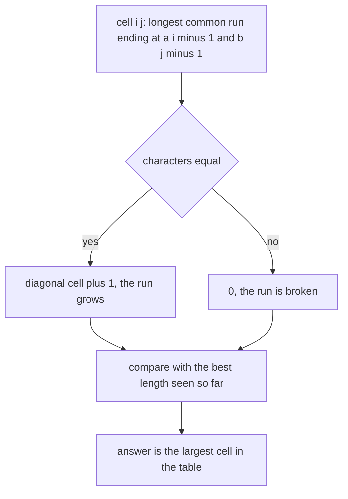
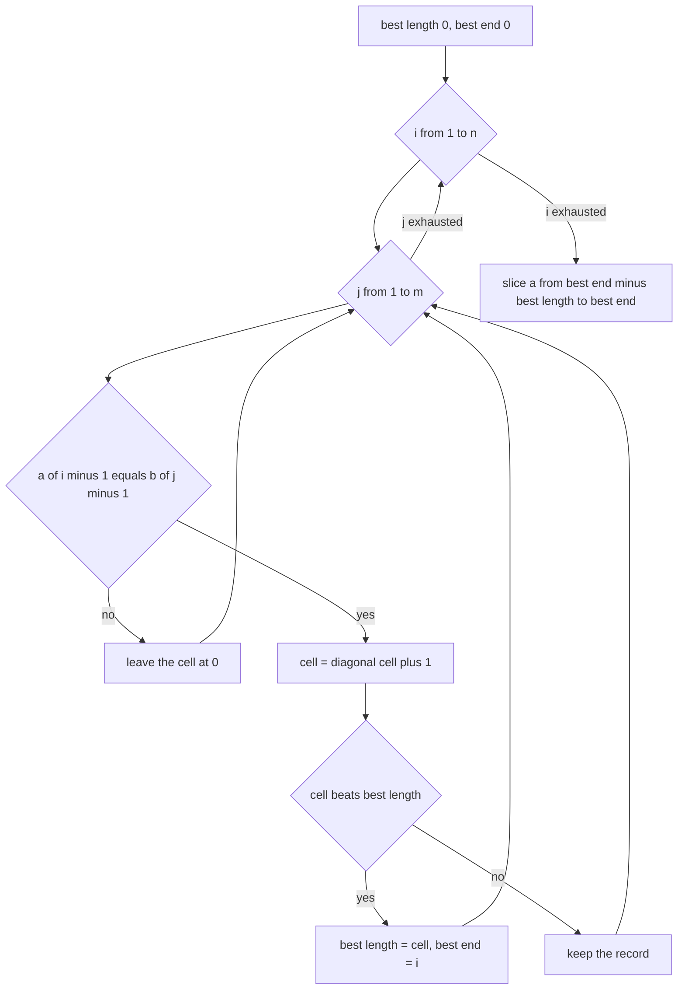
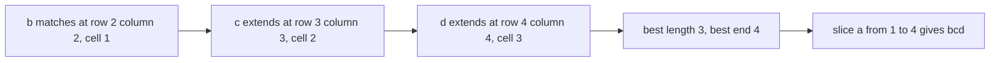
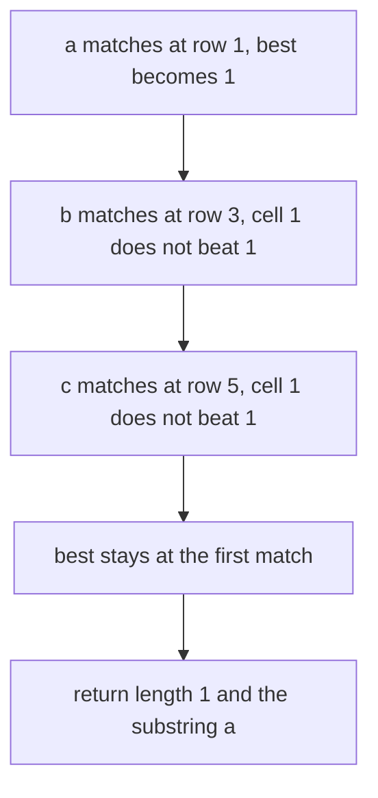

# 122 — Longest common substring (DP).

> **Tier:** Beginner · **CTCI chapter:** Ch 8 — Recursion and Dynamic Programming
> **Task spec:** [122-longest-common-substring-dp.md](../../../tasks/beginner/122-longest-common-substring-dp.md)
> **Solutions:** [Python](../../../solutions/python/beginner/122-longest-common-substring-dp/solution.py) ·
> [Java](../../../solutions/java/beginner/122-longest-common-substring-dp/Solution.java) ·
> [JavaScript](../../../solutions/javascript/beginner/122-longest-common-substring-dp/solution.js) ·
> [C#](../../../solutions/csharp/beginner/122-longest-common-substring-dp/Solution.cs)

## 1. Problem restatement

**Input:** two strings `a` of length `n` and `b` of length `m`. Either may be empty.

**Output:** a pair — the length of the longest string that occurs as a **contiguous** block in
both `a` and `b`, and that block itself. The block is taken from `a`, which is what makes the
returned value concrete when several blocks of the same length exist.

The Python docstring states the difference from task 121 in one line: *unlike LCS, substrings are
contiguous: `dp[i][j] = dp[i-1][j-1] + 1` when `a[i-1] == b[j-1]`, else `0`*.

| Call | Result | Why |
| --- | --- | --- |
| `longest_common_substring("abcdef", "zbcdf")` | `(3, "bcd")` | the diagonal run `b`, `c`, `d` |
| `longest_common_substring("abc", "abc")` | `(3, "abc")` | identical strings |
| `longest_common_substring("abc", "xyz")` | `(0, "")` | no common character |
| `longest_common_substring("", "abc")` | `(0, "")` | one side is empty |
| `longest_common_substring("axbxc", "abc")` | `(1, "a")` | only single characters are common, and the tie goes to the first match in row-major order |

The last row is the interesting contract. `axbxc` and `abc` share the characters `a`, `b` and `c`,
but never two of them adjacently, so every candidate has length 1. The Python comment records the
rule that decides between them: *ties resolve to the first row-major match*, which is the `a`.

## 2. Intuition

The LCS table of task 121 answers "how long a subsequence can end here", and a mismatch simply
carries the best value from a neighbour. That is exactly wrong for substrings, because a substring
cannot skip anything: the moment two characters differ, the run that was building is over.

The key insight is that the contiguity can be encoded in the meaning of a cell. Let `dp[i][j]` be
the length of the longest common substring that **ends at** `a[i - 1]` and `b[j - 1]`. With that
definition the recurrence has no maximum in it at all:

- if the two characters match, the run extends the run that ended one position earlier in both
  strings: `dp[i][j] = dp[i - 1][j - 1] + 1`;
- if they differ, no run can end here: `dp[i][j] = 0`.



Because a run grows along diagonals, the answer is the largest value anywhere in the table, not a
corner cell. That single change of definition is the whole difference between this task and task
121, and it also changes what a "neighbour" contributes: nothing. A cell can only be filled from its
diagonal predecessor.

Remembering *where* the maximum appeared gives the substring for free. When `dp[i][j]` becomes the
new best, the run of length `dp[i][j]` ends just before position `i` in `a`, so the block is
`a[i - dp[i][j] : i]`. Every solution stores `best_len` and `best_end` and slices once at the end,
which is why the returned block is always a slice of `a`.

## 3. Algorithm

1. Build a table `dp` with `n + 1` rows and `m + 1` columns, all zeros; row 0 and column 0 are never
   written after initialisation.
2. Track `best_len = 0` and `best_end = 0`, where `best_end` is an index into `a`.
3. For `i` from 1 to `n` and `j` from 1 to `m`: if `a[i - 1] == b[j - 1]`, set
   `dp[i][j] = dp[i - 1][j - 1] + 1`; when the new value beats `best_len`, record
   `best_len = dp[i][j]` and `best_end = i`. Otherwise leave the cell at 0.
4. Return the pair `(best_len, a[best_end - best_len : best_end])`.

```text
function longest_common_substring(a, b)
    n ← length(a)
    m ← length(b)
    dp ← table with n + 1 rows and m + 1 columns, all 0
    best_length ← 0
    best_end ← 0
    for i ← 1 to n do
        for j ← 1 to m do
            if a[i - 1] equals b[j - 1] then
                dp[i][j] ← dp[i - 1][j - 1] + 1
                if dp[i][j] > best_length then
                    best_length ← dp[i][j]
                    best_end ← i
                end
            end
        end
    end
    return (best_length, the slice of a from best_end - best_length to best_end)
end
```

Two details follow from the definition. The `else` branch is genuinely empty — leaving the cell at
zero *is* the "the run is broken" case, so no work happens on a mismatch. And the comparison
`dp[i][j] > best_length` is strict, so when two blocks of the same length exist the first one found
in row-major order wins; that is precisely the tie rule the `axbxc` / `abc` assertion depends on.



## 4. Worked example

Trace `a = "abcdef"`, `b = "zbcdf"` — the first assertion. The table has 7 rows and 6 columns; only
the non-zero cells are worth showing, because every other cell stays at 0.

| `dp[i][j]` | `j = 1` (`z`) | `j = 2` (`b`) | `j = 3` (`c`) | `j = 4` (`d`) | `j = 5` (`f`) |
| --- | --- | --- | --- | --- | --- |
| `i = 1` (`a`) | 0 | 0 | 0 | 0 | 0 |
| `i = 2` (`b`) | 0 | 1 | 0 | 0 | 0 |
| `i = 3` (`c`) | 0 | 0 | 2 | 0 | 0 |
| `i = 4` (`d`) | 0 | 0 | 0 | 3 | 0 |
| `i = 5` (`e`) | 0 | 0 | 0 | 0 | 0 |
| `i = 6` (`f`) | 0 | 0 | 0 | 0 | 1 |

The three non-zero diagonal cells form the run: `b` matches at `(2, 2)`, `c` extends it at
`(3, 3)` to 2, and `d` extends it again at `(4, 4)` to 3, which is the largest value in the table.

| Step | Cell | Characters | Diagonal value | Cell becomes | `best_len`, `best_end` |
| --- | --- | --- | --- | --- | --- |
| 1 | `(2, 2)` | `b` = `b` | `dp[1][1] = 0` | 1 | 1, 2 |
| 2 | `(3, 3)` | `c` = `c` | `dp[2][2] = 1` | 2 | 2, 3 |
| 3 | `(4, 4)` | `d` = `d` | `dp[3][3] = 2` | 3 | 3, 4 |
| 4 | `(6, 5)` | `f` = `f` | `dp[5][4] = 0` | 1 | 3, 4 (1 does not beat 3) |

With `best_len = 3` and `best_end = 4`, the slice is `a[4 - 3 : 4]`, which is `a[1:4] = "bcd"`.



The tie case is the fifth assertion. For `a = "axbxc"`, `b = "abc"` the `a` matches at `(1, 1)`,
giving `best_len = 1` and `best_end = 1`; the `b` matches later at `(3, 2)` and the `c` at
`(5, 3)`, and both produce a cell of 1, which does not beat the record because the comparison is
strict. The slice `a[1 - 1 : 1]` is `"a"`, the first row-major match.



## 5. Complexity

Let `n = len(a)` and `m = len(b)`.

| Measure | Bound | Why it holds |
| --- | --- | --- |
| Time, best | O(n · m) | every cell is visited; a mismatch does no work but is still visited |
| Time, average | O(n · m) | one comparison per cell and one addition for the cells that match |
| Time, worst | O(n · m) | the loops are fixed |
| Space | O(n · m) | the full table, although only the previous diagonal is ever read |
| Space, rolling diagonals | O(min(n, m)) | a two-row variant computes the same maximum, losing only the ability to say where the run started |
| Slicing the answer | O(best length) | one copy of the winning block |
| Naive comparison of all pairs of blocks | O(n · m · min(n, m)) | every start pair compared character by character |

The memory is worth a second look: the recurrence reads a single diagonal cell, so a rolling pair of
rows is enough for the *length*. The solutions keep the whole table for the same reason task 121
does — many implementations read better when the table is visible — and because the slice of `a`
already supplies the witness, the extra space buys nothing here. That makes the two-row variant the
natural optimisation.

## 6. Pitfalls and edge cases

- **Mismatch must reset to 0.** Carrying a maximum in from a neighbour — the LCS habit — silently
  turns this into task 121 and over-reports for inputs like `axbxc` / `abc`, where the answer
  should be 1 and not 3.
- **The answer is the table maximum, not the last cell.** `dp[n][m]` is only the longest run ending
  at the very last characters of both strings; for `abcdef` / `zbcdf` it is 1 while the answer is 3.
- **Ties.** The strict `dp[i][j] > best_len` keeps the first row-major maximum, which is asserted by
  `longest_common_substring("axbxc", "abc") == (1, "a")`. A `>=` comparison would return `"c"`.
- **Empty input.** `("", "abc")` is asserted `(0, "")`. With `best_len = 0` the slice
  `a[0 - 0 : 0]` is the empty string, so the same code path handles it — but only because the slice
  bounds are computed from the length, not from a stored start index that would be unset.
- **No common character.** `("abc", "xyz")` gives `(0, "")`; again the zero-length slice handles it
  without a special case.
- **The block comes from `a`.** When the same block occurs in both, the returned string is the
  occurrence in `a`; the Java docstring records this explicitly (*substring is taken from a*). If
  several equally long blocks exist, the choice follows `best_end` in `a`.
- **Identical strings.** `("abc", "abc")` gives `(3, "abc")`, the whole string, with the diagonal
  running from `(1, 1)` to `(3, 3)`.
- **Repeated patterns.** `"aaaa"` and `"aa"` give `(2, "aa")`: the diagonal grows as long as both
  strings keep matching, and the first maximum found is the earliest block.
- **Off-by-one in the slice.** `best_end` is the exclusive end index in `a`, so the slice starts at
  `best_end - best_len`. Using `best_end - best_len + 1` returns one character too many.
- **Memory on long inputs.** The full table is the same `(n + 1) × (m + 1)` cost as task 121; the
  two-row rolling variant is available precisely because the recurrence only reads one cell
  diagonally back.
- **Case sensitivity.** Characters are compared exactly; `"Abc"` and `"abc"` share only `"bc"` after
  the first character, and no folding happens anywhere.

## 7. Variants and follow-ups

- **Allow gaps.** Relaxing contiguity to subsequences replaces the reset with a maximum and gives the
  LCS table: [121-longest-common-subsequence-lcs-dp.md](../../../tasks/beginner/121-longest-common-subsequence-lcs-dp.md).
- **Cost instead of length.** The same table with insert, delete and substitute costs is the edit
  distance, where a mismatch costs 1 instead of forcing a reset:
  [123-edit-distance-levenshtein-dp.md](../../../tasks/beginner/123-edit-distance-levenshtein-dp.md).
- **One string instead of two.** The longest increasing subarray is the single-sequence analogue of
  a run, solved in one pass: [118-longest-increasing-subarray-contiguous.md](../../../tasks/beginner/118-longest-increasing-subarray-contiguous.md).
- **Many patterns at once.** Finding a longest common block across a set of strings, or many
  patterns in one text, is what a suffix automaton or trie-based structure is for — the trie of
  [115-implement-a-basic-trie-for-lowercase-words.md](../../../tasks/beginner/115-implement-a-basic-trie-for-lowercase-words.md)
  is the entry point to that family.
- The chapter walkthrough in [Recursion and Dynamic Programming](../../ctci/08-recursion-and-dp.md)
  places this next to LCS as the pair of tables that differ only in their mismatch branch.

## 8. Check yourself

1. What single line of the algorithm turns the LCS recurrence into the substring recurrence?

<details><summary>Show answer</summary>

The mismatch branch: LCS writes `max(dp[i - 1][j], dp[i][j - 1])` there, while the substring version
leaves the cell at 0, because a run that must stay contiguous cannot survive a mismatch.

</details>

2. Why is the answer the maximum of the table rather than `dp[n][m]`?

<details><summary>Show answer</summary>

Because `dp[n][m]` is only the longest run ending at the last characters of both strings. For
`abcdef` against `zbcdf` that cell is 1, while the run `bcd` ends in the middle of `a` and gives the
maximum 3.

</details>

3. On `"axbxc"` and `"abc"`, why is the returned block `"a"` and not `"b"` or `"c"`?

<details><summary>Show answer</summary>

All three are equally long, and the update uses a strict `dp[i][j] > best_len`, so the first match
in row-major order wins. The `a` matches at cell `(1, 1)`, before the `b` at `(3, 2)` and the `c` at
`(5, 3)`.

</details>

4. What exactly does `best_end` store, and how is the substring produced from it?

<details><summary>Show answer</summary>

It stores index `i` in `a` where the winning run ends, exclusive. The block is therefore the slice
`a[best_end - best_len : best_end]`; for `abcdef` / `zbcdf` that is `a[1:4] = "bcd"`.

</details>

5. What would a two-row rolling version of this algorithm lose?

<details><summary>Show answer</summary>

Nothing for the length: the recurrence reads only `dp[i - 1][j - 1]`, so two rows are enough to
compute the maximum. The witness does not need the table at all, because it is a slice of `a`, so
the rolling variant returns exactly the same pair with O(min(n, m)) space.

</details>
