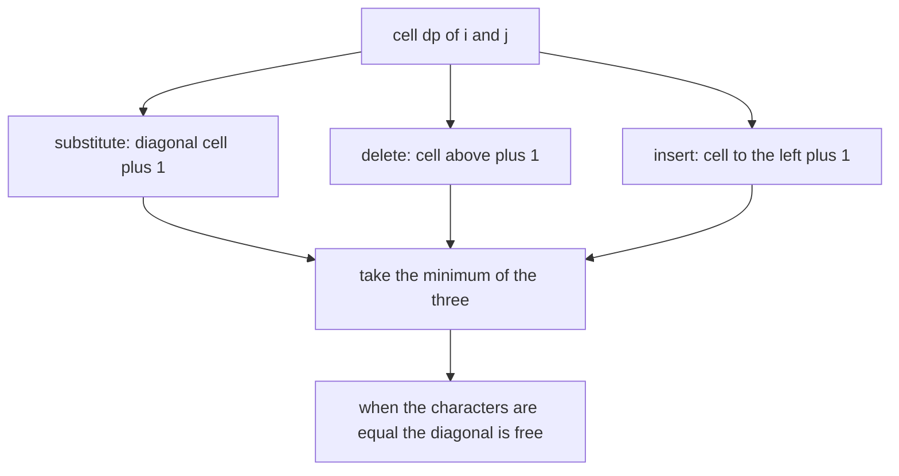
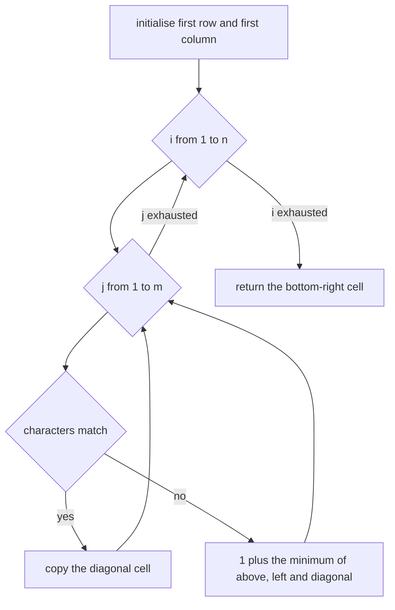
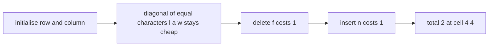

# 123 — Edit distance (Levenshtein) DP.

> **Tier:** Beginner · **CTCI chapter:** Ch 8 — Recursion and Dynamic Programming
> **Task spec:** [123-edit-distance-levenshtein-dp.md](../../../tasks/beginner/123-edit-distance-levenshtein-dp.md)
> **Solutions:** [Python](../../../solutions/python/beginner/123-edit-distance-levenshtein-dp/solution.py) ·
> [Java](../../../solutions/java/beginner/123-edit-distance-levenshtein-dp/Solution.java) ·
> [JavaScript](../../../solutions/javascript/beginner/123-edit-distance-levenshtein-dp/solution.js) ·
> [C#](../../../solutions/csharp/beginner/123-edit-distance-levenshtein-dp/Solution.cs)

## 1. Problem restatement

**Input:** two strings `a` of length `n` and `b` of length `m`. Either may be empty.

**Output:** the minimum number of single-character edits needed to turn `a` into `b`, where the
allowed operations are **delete** one character, **insert** one character, and **substitute** one
character for another. Each operation costs 1.

The Python module docstring gives the recurrence: `dp[i][j] = min(delete, insert, substitute);
substitution is free when chars match`. The tables are initialised with `dp[i][0] = i` (delete all
of `a`) and `dp[0][j] = j` (insert all of `b`).

| Call | Result | Why |
| --- | --- | --- |
| `edit_distance("kitten", "sitting")` | `3` | substitute `k`, substitute `e`, insert `g` |
| `edit_distance("", "abc")` | `3` | three insertions |
| `edit_distance("abc", "")` | `3` | three deletions |
| `edit_distance("same", "same")` | `0` | identical strings cost nothing |
| `edit_distance("flaw", "lawn")` | `2` | delete `f`, insert `n` |
| `edit_distance("abc", "yabd")` | `2` | the rolling-row version is checked to agree on this pair |

Every solution also ships a second function — `edit_distance_memory_optimized` in Python,
`editDistanceRollingRow` in Java, and similarly named functions in JavaScript and C# — that computes
the same value with two rolling rows. The Python assertions run both implementations over
`("kitten", "sitting")`, `("flaw", "lawn")`, `("", "")` and `("abc", "yabd")` and require them to
match.

## 2. Intuition

The recursive reading of the problem is simple: to transform the first `i` characters of `a` into
the first `j` of `b`, either the last characters are the same and nothing needs doing to them, or one
of three operations removes the mismatch. The trouble is that the branching multiplies — each level
tries three moves over two shorter prefixes, and the same subproblem reappears constantly (the
prefix pair `("kit", "sit")` can be reached by many different orders of operations).

The key insight is that the state is exactly the pair of prefix lengths, so there are only
`(n + 1)(m + 1)` distinct subproblems. Fix a cell `dp[i][j]` and look at the last characters:

- **Substitute** (or match): transform `a[:i-1]` into `b[:j-1]`, then deal with the final
  characters. That costs `dp[i - 1][j - 1]`, plus `1` only if the characters differ.
- **Delete** the last character of `a`: transform `a[:i-1]` into `b[:j]`, then drop one character.
  That costs `dp[i - 1][j] + 1`.
- **Insert** the last character of `b`: transform `a[:i]` into `b[:j-1]`, then add it. That costs
  `dp[i][j - 1] + 1`.

The answer is the minimum of the three, and the free-substitution case is not a fourth option — it
is the substitute branch with a cost of 0, which is why the solutions special-case it first.



The picture of the three moves also explains the initialisation. `dp[i][0] = i` says "delete
everything", and `dp[0][j] = j` says "insert everything", so the first row and column are not
special cases at all — they are the result of the same recurrence applied where only one move is
available.

## 3. Algorithm

1. Create a table `dp` with `n + 1` rows and `m + 1` columns.
2. Initialise `dp[i][0] = i` for every `i`, and `dp[0][j] = j` for every `j`.
3. For `i` from 1 to `n` and `j` from 1 to `m`: if `a[i - 1] == b[j - 1]`, copy the diagonal,
   `dp[i][j] = dp[i - 1][j - 1]`. Otherwise set `dp[i][j]` to `1 + min(dp[i - 1][j], dp[i][j - 1],
   dp[i - 1][j - 1])`.
4. Return `dp[n][m]`.

```text
function edit_distance(a, b)
    n ← length(a)
    m ← length(b)
    dp ← table with n + 1 rows and m + 1 columns
    for i ← 0 to n do
        dp[i][0] ← i
    end
    for j ← 0 to m do
        dp[0][j] ← j
    end
    for i ← 1 to n do
        for j ← 1 to m do
            if a[i - 1] equals b[j - 1] then
                dp[i][j] ← dp[i - 1][j - 1]
            else
                dp[i][j] ← 1 + the minimum of dp[i - 1][j], dp[i][j - 1] and dp[i - 1][j - 1]
            end
        end
    end
    return dp[n][m]
end

function edit_distance_rolling(a, b)
    previous ← the list 0, 1, 2, ..., length(b)
    for i ← 1 to length(a) do
        current ← a new list whose first entry is i
        for j ← 1 to length(b) do
            if a[i - 1] equals b[j - 1] then
                current[j] ← previous[j - 1]
            else
                current[j] ← 1 + the minimum of previous[j], current[j - 1] and previous[j - 1]
            end
        end
        previous ← current
    end
    return the last entry of previous
end
```

The rolling version shows exactly which cells the recurrence touches: `previous[j]` is the cell
above, `current[j - 1]` is the cell to the left, and `previous[j - 1]` is the diagonal. Three values
per cell, two rows of memory. Nothing else from the table is ever needed, which is the structural
reason the whole-table version can be shrunk.



## 4. Worked example

Trace `edit_distance("flaw", "lawn")`, the pair asserted to be 2. Rows are indexed by `a` (the
letters `f`, `l`, `a`, `w`) and columns by `b` (the letters `l`, `a`, `w`, `n`).

| `dp` | `j = 0` (`""`) | `j = 1` (`l`) | `j = 2` (`a`) | `j = 3` (`w`) | `j = 4` (`n`) |
| --- | --- | --- | --- | --- | --- |
| `i = 0` (`""`) | 0 | 1 | 2 | 3 | 4 |
| `i = 1` (`f`) | 1 | 1 | 2 | 3 | 4 |
| `i = 2` (`l`) | 2 | 1 | 2 | 3 | 4 |
| `i = 3` (`a`) | 3 | 2 | 1 | 2 | 3 |
| `i = 4` (`w`) | 4 | 3 | 2 | 1 | 2 |

Reading a few cells makes the three moves concrete:

| Cell | Characters | Branch | Value |
| --- | --- | --- | --- |
| `(1, 1)` | `f` vs `l` | differ: `1 + min(1, 1, 0)` | 1 |
| `(2, 1)` | `l` vs `l` | equal: copy `dp[1][0]` | 1 |
| `(3, 2)` | `a` vs `a` | equal: copy `dp[2][1]` | 1 |
| `(4, 3)` | `w` vs `w` | equal: copy `dp[3][2]` | 1 |
| `(4, 4)` | `w` vs `n` | differ: `1 + min(dp[3][4] = 3, dp[4][3] = 1, dp[3][3] = 2)` | 2 |

The final cell is 2, and the winning branch at `(4, 4)` came from the cell to its left — the insert
move. Following the choices back gives the edit script: delete the leading `f` (the value 1 at
`dp[1][0] = 1`), keep `law` intact along the diagonal of equal characters, then insert the trailing
`n`.

| Step | Operation | Resulting string | Cost so far |
| --- | --- | --- | --- |
| start | — | `flaw` | 0 |
| 1 | delete `f` | `law` | 1 |
| 2 | copy `l`, `a`, `w` | `law` | 1 |
| 3 | insert `n` | `lawn` | 2 |



The initialisation row and column do real work here. `dp[1][0] = 1` is the cost of deleting the `f`,
and `dp[4][4]` inherits that cost through the left move; without the first column the algorithm would
have no way to express a deletion at the start of `a`.

## 5. Complexity

Let `n = len(a)` and `m = len(b)`.

| Measure | Bound | Why it holds |
| --- | --- | --- |
| Time, best | O(n · m) | one constant amount of work per cell, whatever the input |
| Time, average | O(n · m) | three lookups and one minimum per cell |
| Time, worst | O(n · m) | the loops are fixed |
| Space, full table | O(n · m) | the table that also permits reconstructing the edit script |
| Space, rolling rows | O(min(n, m)) | two rows, and the shorter string should be the one that spans a row |
| Naive branch recursion | exponential | three-way branching over prefix pairs with no memoisation; the memoised version returns to O(n · m) |
| Longest common subsequence (task 121) | O(n · m) time and space | related but different: it counts matches, not edit operations |

The rolling variant is not an approximation — it is the same recurrence with the unused cells
discarded, and the Python assertions prove the two implementations agree on four pairs including the
empty-string case. Its only loss is the ability to walk back through the table for an edit script,
the same trade as in task 121.

## 6. Pitfalls and edge cases

- **Forgetting the initialisation.** Without `dp[i][0] = i` and `dp[0][j] = j`, transforming `""`
  into `"abc"` (asserted as 3) is impossible to express; the recurrence would read zeros from the
  border and report 0.
- **Charging for an equal character.** Substitution is free exactly when the characters match, so the
  equal branch copies the diagonal *without* adding 1. Adding 1 unconditionally inflates every answer.
- **Taking `min` of the wrong pair.** All three neighbours participate: above (delete), left
  (insert), diagonal (substitute). Dropping the diagonal loses the substitute move entirely.
- **Empty strings on both sides.** `edit_distance("", "")` is 0 and is part of the rolling-versus-table
  agreement check.
- **Symmetric but not identical inputs.** `edit_distance("abc", "")` is asserted 3 and
  `edit_distance("", "abc")` is asserted 3; the function is symmetric in value even though the table
  is not.
- **Identical inputs.** `edit_distance("same", "same")` is asserted 0, which only happens if the
  equal branch copies the diagonal all the way down: the whole diagonal is 0.
- **The classic pair.** `kitten` → `sitting` is 3, not 4 or 2: substitute `k` → `s`, substitute
  `e` → `i`, insert `g`.
- **Rolling row indexing.** `previous[j]` is above, `current[j - 1]` is to the left, and
  `previous[j - 1]` is the diagonal. Writing `current[j - 1]` where `previous[j - 1]` belongs is the
  standard rolling-row bug and produces plausible-looking wrong numbers.
- **Row length in the rolling version.** Both `previous` and `current` must have `m + 1` entries,
  with `current[0] = i`; forgetting that first entry breaks the insert move for the whole row.
- **Memory on long inputs.** A 10 000 × 10 000 table is 100 million cells. The rolling version is the
  reason the algorithm scales to long strings at all.
- **Unicode again.** Characters are compared as code units in Java and C#, so a combining accent or a
  surrogate pair counts as more than one "character" and edits between visually identical strings can
  be non-zero.

## 7. Variants and follow-ups

- **Only two operations.** Dropping substitution (or making it cost 2, which is equivalent) gives the
  insertion-deletion distance, whose value is `n + m - 2 · LCS` with the LCS of
  [121-longest-common-subsequence-lcs-dp.md](../../../tasks/beginner/121-longest-common-subsequence-lcs-dp.md).
- **Contiguous matches.** The longest common substring table is the same shape with the mismatch
  branch resetting to 0 instead of accumulating a cost:
  [122-longest-common-substring-dp.md](../../../tasks/beginner/122-longest-common-substring-dp.md).
- **Words instead of characters.** Word break decides whether a string can be covered by dictionary
  words, a different kind of segmenting over a single string:
  [124-word-break-dp.md](../../../tasks/beginner/124-word-break-dp.md).
- **One dimension instead of two.** House robber and climbing stairs are the same "minimum or maximum
  over a small window of previous states" pattern without the second string:
  [125-climbing-stairs-dp-count-ways.md](../../../tasks/beginner/125-climbing-stairs-dp-count-ways.md)
  and [126-house-robber-problem-1d-dp.md](../../../tasks/beginner/126-house-robber-problem-1d-dp.md).
- **Exploiting the band.** When the two strings are known to be close, only a diagonal band of width
  `k + 1` needs computing, cutting the time to O(k · min(n, m)).
- The chapter walkthrough in [Recursion and Dynamic Programming](../../ctci/08-recursion-and-dp.md)
  uses the edit distance as the example where a DP table is really a shortest-path computation, since
  every cell takes the minimum over its three predecessors.

## 8. Check yourself

1. Why is the substitution branch not charged for equal characters?

<details><summary>Show answer</summary>

Because matching characters need no operation at all: transforming `a[:i-1]` into `b[:j-1]` and
leaving the two equal characters in place costs exactly `dp[i - 1][j - 1]`. Charging 1 there would
model "substitute a character with itself", which no shortest edit script ever does.

</details>

2. What do the initialised first row and first column mean in plain words?

<details><summary>Show answer</summary>

`dp[i][0] = i` is the cost of deleting all `i` characters of `a` to reach the empty string, and
`dp[0][j] = j` is the cost of inserting all `j` characters of `b`. They are the boundary cases of
the same recurrence, where only one operation is available.

</details>

3. On `"flaw"` and `"lawn"`, which cells form the diagonal of equal characters, and what is the final
   answer?

<details><summary>Show answer</summary>

`(2, 1)` for `l`, `(3, 2)` for `a` and `(4, 3)` for `w`, all with value 1. The final cell `(4, 4)` is
2, reached by deleting the leading `f` and inserting the trailing `n`.

</details>

4. Which cells does the rolling-row version need, and why can the full table be discarded?

<details><summary>Show answer</summary>

`previous[j]` (above), `current[j - 1]` (left) and `previous[j - 1]` (diagonal). Every other cell is
never read again by the recurrence, so two rows of `m + 1` entries are enough to compute the final
value; only the ability to reconstruct the edit script is lost.

</details>

5. Why is the answer asserted for `("abc", "yabd")` only through the rolling/table agreement?

<details><summary>Show answer</summary>

Because the value 2 is not the point of that assertion; the point is that the two implementations
agree on a pair that is neither trivially equal nor trivially empty. It is an internal consistency
check on the rolling-row rewrite, which is exactly where an off-by-one in the row indexing would
show up.

</details>
