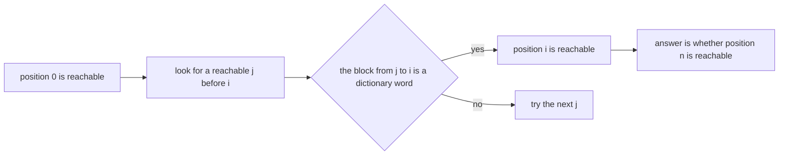
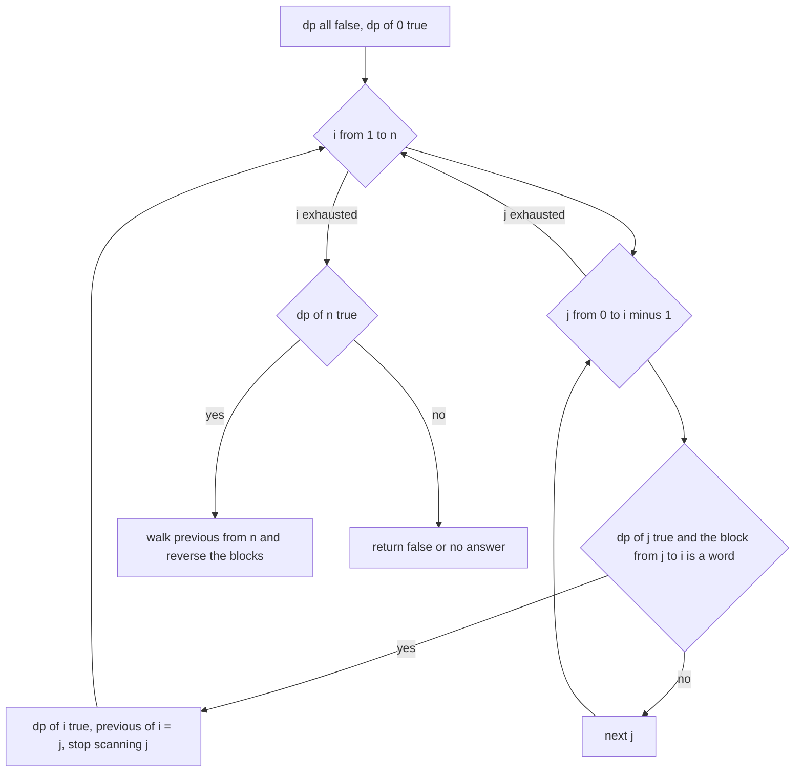
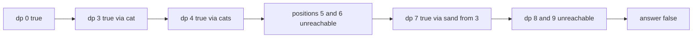
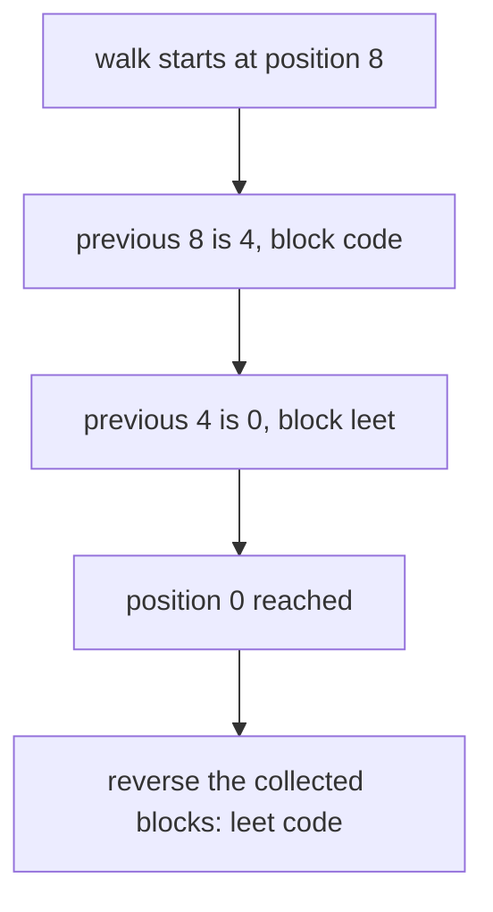

# 124 — Word break (DP).

> **Tier:** Beginner · **CTCI chapter:** Ch 8 — Recursion and Dynamic Programming
> **Task spec:** [124-word-break-dp.md](../../../tasks/beginner/124-word-break-dp.md)
> **Solutions:** [Python](../../../solutions/python/beginner/124-word-break-dp/solution.py) ·
> [Java](../../../solutions/java/beginner/124-word-break-dp/Solution.java) ·
> [JavaScript](../../../solutions/javascript/beginner/124-word-break-dp/solution.js) ·
> [C#](../../../solutions/csharp/beginner/124-word-break-dp/Solution.cs)

## 1. Problem restatement

**Input:** a string `s` with no spaces and a dictionary of words.

**Output:** `word_break(s, dictionary)` returns whether `s` can be split into a sequence of
dictionary words joined without separators. `word_break_segmentation(s, dictionary)` returns one
such splitting as a list of words, or `None` / `null` when no splitting exists.

The dictionary is treated as a set, so duplicates in it are irrelevant, and word order inside `s`
is the only constraint.

| Call | Result | Why |
| --- | --- | --- |
| `word_break("leetcode", ["leet", "code"])` | `true` | `leet + code` |
| `word_break("catsandog", ["cats", "dog", "sand", "and", "cat"])` | `false` | every candidate split strands a suffix |
| `word_break("applepenapple", ["apple", "pen"])` | `true` | `apple + pen + apple`, a word may be reused |
| `word_break("", [])` | `true` | the empty string needs no words |
| `word_break("a", [])` | `false` | a non-empty string needs at least one dictionary word |
| `word_break_segmentation("leetcode", ["leet", "code"])` | `["leet", "code"]` | one concrete splitting |
| `word_break_segmentation("catsandog", ["cats", "dog"])` | `None` | no splitting exists |

The Python docstring also names the performance notes the tutorial follows: `dp[i]` is "can `s[:i]`
be segmented into dictionary words", `dp[i]` is true when some `j < i` has `dp[j]` true and `s[j:i]`
in the dictionary, and the naive slicing costs O(n² · L) where `L` is the word length — the same
docstring points at task 116's trie as the way to make each check cheaper.

## 2. Intuition

The greedy reading fails immediately. Deciding at the front — "`cats` is in the dictionary, take
it" — is fatal for `catsandog`: after `cats` the remaining `andog` needs `and` plus `og`, and `og`
is not a word, even though the shorter prefix `cat` plus `sand` also strands the tail. A local choice
cannot know which dictionary words exist deeper in the string.

The key insight is that only the *set of reachable cut positions* matters. Define `dp[i]` as "the
prefix of length `i` can be completely covered by dictionary words". Then the whole problem is a
reachability question over the positions `0 .. n`: position 0 is reachable by definition, and
position `i` is reachable when some reachable position `j` has the block `s[j:i]` in the dictionary.
The answer is whether position `n` is reachable.



Two properties make this cheap. A reachable position never becomes unreachable, so the array of
`n + 1` booleans is enough state — no sets, no recursion. And every reachability claim is justified
by exactly one word, so remembering which `j` proved position `i` gives the segmentation for free;
that is the parent-pointer trick again, and it is why `word_break_segmentation` only needs one extra
integer array.

The loop order matters for a different reason. Scanning `j` from 0 upward and breaking at the first
success is what makes the reconstruction deterministic, and the `break` is also what keeps the
typical cost well below the worst case.

## 3. Algorithm

1. Convert the dictionary to a set for O(1) membership tests. If the set is empty, the only
   segmentable string is the empty one.
2. Create `dp` with `n + 1` booleans, all false, and set `dp[0] = true`.
3. For each end position `i` from 1 to `n`, and each start position `j` from 0 up to `i - 1`: if
   `dp[j]` is true and the block `s[j:i]` is in the dictionary, mark `dp[i]` true and stop scanning
   `j` for this `i`.
4. Return `dp[n]`.
5. For the segmentation, also record `prev[i] = j` when position `i` is first reached; if `dp[n]` is
   false there is no answer, otherwise walk the `prev` chain from `n` back to 0 and reverse the
   blocks.

```text
function word_break(s, dictionary)
    words ← a set built from dictionary
    if words is empty then
        return s is empty
    end
    dp ← array of length(s) + 1 entries, all false
    dp[0] ← true
    for i ← 1 to length(s) do
        for j ← 0 to i - 1 do
            if dp[j] is true and s[j:i] is in words then
                dp[i] ← true
                break
            end
        end
    end
    return dp[length(s)]
end

function word_break_segmentation(s, dictionary)
    words ← a set built from dictionary
    dp ← array of length(s) + 1 entries, all false
    previous ← array of length(s) + 1 entries, all -1
    dp[0] ← true
    for i ← 1 to length(s) do
        for j ← 0 to i - 1 do
            if dp[j] is true and s[j:i] is in words then
                dp[i] ← true
                previous[i] ← j
                break
            end
        end
    end
    if dp[length(s)] is false then
        return no answer
    end
    parts ← an empty list
    i ← length(s)
    while i > 0 do
        j ← previous[i]
        prepend the block s[j:i] to parts
        i ← j
    end
    return parts
end
```

The `break` inside the inner loop matters in both directions. It means "the first reachable start
that works wins", which fixes `["leet", "code"]` as the answer for the first assertion, and it also
means a position is never re-derived once it is known to be reachable. Without it the result would
still be correct, since `dp[i]` can only be set true, but the recorded `previous[i]` would depend on
which `j` was examined last.



## 4. Worked example

Trace `word_break("catsandog", ["cats", "dog", "sand", "and", "cat"])` — the failing case, which is
the most instructive one because three positions are reachable and the tail still dies. Indices are
prefix lengths, so block `j` to `i` is `s[j:i]`.

| `i` | Block candidates `s[j:i]` | Reachable `j` with a dictionary word | `dp[i]` |
| --- | --- | --- | --- |
| 0 | — | — | `true` |
| 1 | `c` | none | `false` |
| 2 | `ca` | none | `false` |
| 3 | `cat` | `j = 0` gives `cat` | `true` |
| 4 | `cats` | `j = 0` gives `cats` | `true` |
| 5 | `a` at `j = 4`, `sa` at `j = 3`, `tsa`, `atsa`, `catsa` | none | `false` |
| 6 | suffixes ending at 6 | none | `false` |
| 7 | `sand` at `j = 3` | `dp[3]` is true and `sand` is a word | `true` |
| 8 | `o` at `j = 7`, `do` at `j = 6`, `ndo`, `ando`, `sando`, `tsando`, `atsando`, `catsando` | none, because `dp[6]` is false and `sando` is not a word | `false` |
| 9 | `g` at `j = 8`, `og` at `j = 7`, `dog` at `j = 6` | none, because `dp[6]` and `dp[8]` are false and `sandog` is not a word | `false` |

The final `dp` array is `[true, false, false, true, true, false, false, true, false, false]` and the
answer is `dp[9] = false`. The failure is visible at position 9: the tempting `dog` sits at `j = 6`,
but `dp[6]` is false, so the split `cats + and? + dog` has no valid middle. The dictionary contains
`and` but the block `s[3:7]` is `sand`, not `and`, so `and` is never usable at all.



The success case, `"leetcode"` with `["leet", "code"]`, shows the same table with a path all the way
through: `dp = [true, false, false, false, true, false, false, false, true]`, reached at position 4
by `leet` and at position 8 by `code`. The reconstruction starts at `previous[8] = 4`, so the last
block is `code`, then `previous[4] = 0` gives `leet`, and reversing yields exactly the asserted
`["leet", "code"]`.

| Step | `i` | `previous[i]` | Block prepended | `parts` so far |
| --- | --- | --- | --- | --- |
| start | 8 | 4 | `code` | `["code"]` |
| 2 | 4 | 0 | `leet` | `["leet", "code"]` |
| 3 | 0 | — | loop ends | `["leet", "code"]` |



The third assertion, `"applepenapple"` with `["apple", "pen"]`, is the reuse check:
`dp = [true, false, false, false, false, true, false, false, true, false, false, false, false, true]`,
so `apple` (position 5), `pen` (position 8) and `apple` again (position 13) chain up on the same
dictionary entry. Nothing in the algorithm forbids reusing a word, and `dp` position 5 being true
twice over is exactly how it is expressed.

## 5. Complexity

Let `n = len(s)`, `L` the length of the longest dictionary word, and `W` the total size of the
dictionary.

| Measure | Bound | Why it holds |
| --- | --- | --- |
| Time, best | O(n · L) | for each `i` a single successful `j` may be enough, and a membership test costs up to the block length |
| Time, average | O(n² · L) | `n(n + 1) / 2` candidate blocks, each costing up to `L` to hash and compare |
| Time, worst | O(n² · L) | the docstring names this bound explicitly: a block for every pair `j < i` |
| Space | O(n) | the `dp` array plus, for the segmentation, the `previous` array; the dictionary set is O(W) |
| Building the set | O(W) | one pass over the dictionary, which also removes the duplicates |
| Trie-based membership (task 116) | O(n²) overall | each start position walks the trie instead of slicing, removing the `L` factor |

The `L` factor is easy to overlook: `s[j:i]` creates a substring, and hashing it costs up to `L`
character comparisons. A trie walk from position `j` reuses the work of the walk from position `j - 1`
and never materialises a block, which is exactly the improvement the solution's docstring points at
when it references task 116.

## 6. Pitfalls and edge cases

- **Greedy fails.** Taking the longest available word at each step breaks `catsandog`; the DP
  explores every reachable cut position instead. This is the reason the task is a DP at all.
- **Empty dictionary.** The Python guard returns `s == ""`, so `word_break("", [])` is true and
  `word_break("a", [])` is false. The Java version reaches the same results through the ordinary
  table: `dp[0]` is true and no word can ever extend it.
- **The empty string.** `word_break("", ["anything"])` is asserted true — the empty prefix is
  trivially segmentable, without consuming any word. This is the base case `dp[0] = true`, not an
  accident.
- **`dp[0]` must be the reachability seed.** Starting anywhere else, or treating `dp[0]` as "false
  because the empty string is not a word", breaks every input.
- **Words may be reused.** `applepenapple` uses `apple` twice. Tracking used words would be a
  different problem.
- **The dictionary is exact-match.** `and` is in the dictionary for the failing sample, but the only
  occurrence inside `catsandog` is part of `sand`, so it never applies; the algorithm compares whole
  blocks and does no partial matching.
- **Reachability is monotone.** `dp[i]` is only ever set from false to true, so the `break` cannot
  cause a wrong answer — it only decides which predecessor is recorded.
- **`previous` indexing.** `previous[i] = j` records the start of the block that ends at `i`, so the
  walk is `i = previous[i]` and the blocks are collected right to left, requiring a reverse.
- **Slicing cost.** In Java and C# `substring` allocates a new string per candidate, which is where
  the `L` factor and the allocation pressure come from. Passing a start and end into the set lookup
  is not possible with a plain hash set of strings, which is the argument for the trie.
- **Case and punctuation.** Membership is exact, so `"LeetCode"` would need a dictionary entry with
  those exact characters; no normalisation happens anywhere in the four solutions.
- **Answer forms differ.** Python and Java return `None` / `null` from the segmentation function when
  there is no split, while the boolean function returns `false`. Mixing the two conventions in one
  API is a common source of confusion.

## 7. Variants and follow-ups

- **Trie-accelerated membership.** The docstring's suggested improvement: walk the trie of
  [116-insert-and-search-in-trie.md](../../../tasks/beginner/116-insert-and-search-in-trie.md) from
  each reachable position instead of testing every substring, which also removes the `L` factor.
- **Find all segmentations.** Remove the `break`, collect every `j` that works and recurse — an
  exponential number of answers in the worst case, usually asked as a follow-up to a count-the-ways
  DP such as [125-climbing-stairs-dp-count-ways.md](../../../tasks/beginner/125-climbing-stairs-dp-count-ways.md).
- **Count instead of decide.** Summing over the working `j` values turns `dp` from booleans into
  counts, the same shape as the decode-ways recurrence of
  [127-decode-ways-num-decodings-dp.md](../../../tasks/beginner/127-decode-ways-num-decodings-dp.md).
- **Two strings at once.** The LCS table of
  [121-longest-common-subsequence-lcs-dp.md](../../../tasks/beginner/121-longest-common-subsequence-lcs-dp.md)
  answers a matching question between two strings rather than a segmentation question about one.
- **Minimum number of words.** Replacing the booleans with best-known counts turns the reachability
  table into a shortest-path computation over the same positions.
- The chapter walkthrough in [Recursion and Dynamic Programming](../../ctci/08-recursion-and-dp.md)
  lists this as the reachability-style DP, next to the counting DPs that fill the same kind of array
  with numbers instead of flags.

## 8. Check yourself

1. Why is greedy not enough for this problem?

<details><summary>Show answer</summary>

Because a locally valid word can destroy every later option. In `catsandog` the dictionary contains
`cats` and `sand`, both usable at the front, but taking `cats` leaves `andog` while taking `cat`
leaves `sandog`; neither tail can be completed, and only a search over all reachable positions can
establish that no split exists.

</details>

2. What exactly does `dp[i]` mean, and why is the answer `dp[n]`?

<details><summary>Show answer</summary>

`dp[i]` means the prefix `s[:i]` can be fully covered by dictionary words. A full segmentation of `s`
is precisely a segmentation of the prefix of length `n`, so the answer is `dp[n]`.

</details>

3. On `catsandog`, which positions are reachable and why does the run still fail?

<details><summary>Show answer</summary>

Positions 0, 3, 4 and 7: the empty prefix, `cat`, `cats`, and `cat` followed by `sand`. Nothing
extends position 4 (`a`, `sa`, `tsa`, `atsa`, `catsa` are all absent) and nothing extends position 7
(`o`, `og`, `sando`, `sandog` are all absent, and `dog` would need position 6, which is unreachable).

</details>

4. Where does the O(n² · L) come from, and which single change removes the `L`?

<details><summary>Show answer</summary>

From the `n(n + 1) / 2` candidate blocks `s[j:i]`, each of which must be hashed and compared with
dictionary entries at a cost of up to `L` characters. Replacing the slice-and-hash membership test
with a walk down the trie of task 116 removes the factor, leaving O(n²).

</details>

5. Why is `break` safe inside the inner loop even though several `j` values might work?

<details><summary>Show answer</summary>

Because `dp[i]` records reachability, and one witness is as good as any other: once a reachable `j`
provides a dictionary word for the block, position `i` is reachable no matter what the remaining
`j` values would say. The `break` only decides which predecessor is stored for the reconstruction,
and choosing the smallest `j` makes the output deterministic.

</details>
