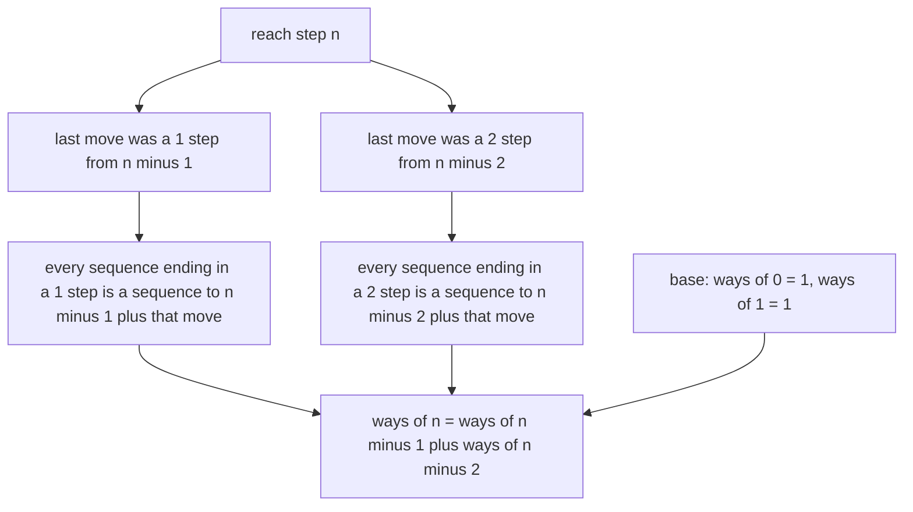
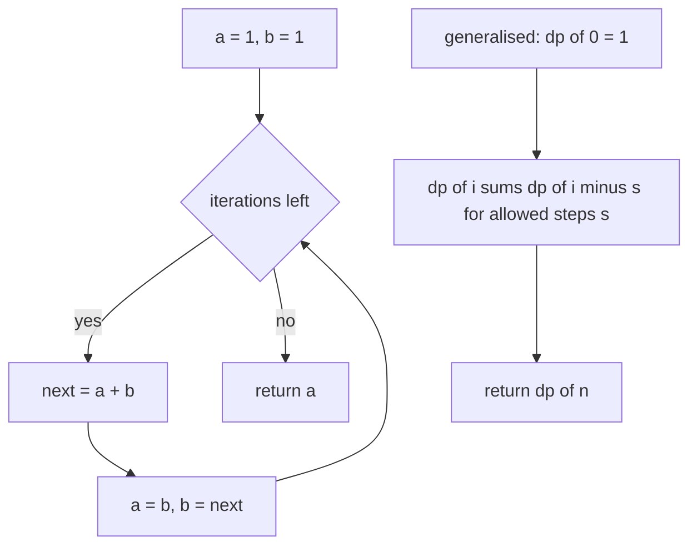
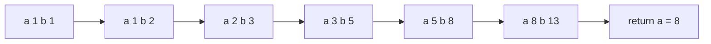
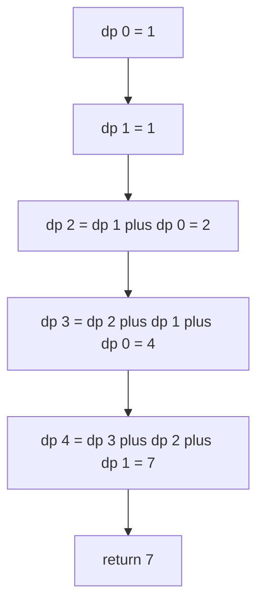

# 125 — Climbing stairs DP (count ways).

> **Tier:** Beginner · **CTCI chapter:** Ch 8 — Recursion and Dynamic Programming
> **Task spec:** [125-climbing-stairs-dp-count-ways.md](../../../tasks/beginner/125-climbing-stairs-dp-count-ways.md)
> **Solutions:** [Python](../../../solutions/python/beginner/125-climbing-stairs-dp-count-ways/solution.py) ·
> [Java](../../../solutions/java/beginner/125-climbing-stairs-dp-count-ways/Solution.java) ·
> [JavaScript](../../../solutions/javascript/beginner/125-climbing-stairs-dp-count-ways/solution.js) ·
> [C#](../../../solutions/csharp/beginner/125-climbing-stairs-dp-count-ways/Solution.cs)

## 1. Problem restatement

**Input:** a non-negative integer `n`, the number of steps. By default each move climbs either 1 or
2 steps. The generalised form also takes a set of allowed step sizes.

**Output:** the number of distinct ordered sequences of moves that reach exactly step `n`.

The Python docstring names the recurrence and the base cases:
`ways(n) = ways(n-1) + ways(n-2)` with `ways(0) = 1` (the empty climb) and `ways(1) = 1`, and it
notes the consequence: O(n) time, O(1) space with two rolling variables — *Fibonacci in disguise*.
A negative `n` is rejected: Python raises `ValueError`, Java `IllegalArgumentException`, C#
`ArgumentException`.

| Call | Result | Why |
| --- | --- | --- |
| `climb_ways(n)` for `n = 0, 1, 2, 3, 4, 5` | `1, 1, 2, 3, 5, 8` | the empty climb, then the Fibonacci sequence |
| `climb_ways(35)` | `14930352` | the 36th Fibonacci number, asserted directly |
| `climb_ways_general(4, [1, 2, 3])` | `7` | `1111, 112, 121, 13, 211, 22, 31` — the exact list appears in the solution comment |
| `climb_ways_general(0, [1, 2])` | `1` | the empty climb again, whatever the allowed steps are |

`climb_ways(0) = 1` is the load-bearing convention: the empty climb counts as one way to be at the
bottom, which is what makes `climb_ways(2) = 2` rather than 1.

## 2. Intuition

The direct reading is to enumerate move sequences recursively: from step `i`, branch into `i + 1` and
`i + 2`. That is correct but exponential, and its recursion tree contains massive duplication — the
count for step `n - 3` is computed along every path that happens to arrive there. A memoised version
already fixes most of it, but there is a better observation available.

The key insight is that the *last* move into step `n` is either a 1-step from `n - 1` or a 2-step
from `n - 2`, and no sequence can arrive any other way. Every valid sequence ends with exactly one of
those two moves, and the two sets of sequences are disjoint. So the count decomposes exactly:
`ways(n) = ways(n - 1) + ways(n - 2)`, with `ways(0) = 1` and `ways(1) = 1` as the bases.



Once the recurrence is written down, the recurrence itself disappears from the code. Only two values
are ever needed — the counts for the two previous steps — so the whole DP collapses into a pair of
rolling variables advanced `n` times. That is why the solutions are three lines long and why the
values are Fibonacci numbers started at the right offset: `climb_ways(n)` is `F(n + 1)` for the
sequence `1, 1, 2, 3, 5, 8, ...`.

The generalised variant keeps the same shape but a wider window: with allowed steps `1, 2, 3` the
last move comes from one of three predecessor steps, so the recurrence sums three terms. That is the
honest generalisation — the two-variable trick stops working and a full array of `n + 1` counts
returns.

## 3. Algorithm

1. Reject a negative `n` with the language's argument error.
2. Hold two counts: `a` for the number of ways to reach the previous step and `b` for the one before
   that, both initialised to 1 so that `ways(0) = ways(1) = 1` falls out of the same loop.
3. Repeat `n` times: shift the pair to `(b, a + b)`.
4. After the loop, `a` holds `ways(n)`; return it.

```text
function climb_ways(n)
    if n < 0 then
        signal an argument error
    end
    a ← 1
    b ← 1
    for step ← 1 to n do
        next ← a + b
        a ← b
        b ← next
    end
    return a
end

function climb_ways_general(n, steps)
    dp ← array of n + 1 entries, all 0
    dp[0] ← 1
    for i ← 1 to n do
        for each s in steps do
            if s ≤ i then
                dp[i] ← dp[i] + dp[i - s]
            end
        end
    end
    return dp[n]
end
```

The rolling update deserves a close look, because it is where an off-by-one hides. After the first
iteration `a = 1` (ways to reach step 0) and `b = 2` (ways to reach step 1); after the second,
`a = 2` and `b = 3`; and so on. Returning `a` after `n` iterations is what makes `climb_ways(0) = 1`
fall out of a loop that never runs.



## 4. Worked example

Trace `climb_ways(5)`, the last value of the first assertion. Both variables start at 1, and the loop
runs exactly five times.

| Iteration | `a` before | `b` before | `next = a + b` | `a` after | `b` after |
| --- | --- | --- | --- | --- | --- |
| start | 1 | 1 | — | 1 | 1 |
| 1 | 1 | 1 | 2 | 1 | 2 |
| 2 | 1 | 2 | 3 | 2 | 3 |
| 3 | 2 | 3 | 5 | 3 | 5 |
| 4 | 3 | 5 | 8 | 5 | 8 |
| 5 | 5 | 8 | 13 | 8 | 13 |

After five iterations `a = 8`, so the answer is 8 — the number of ordered move sequences to reach
step 5: `11111, 1112, 1121, 1211, 2111, 122, 212, 221`.



The generalised variant on `steps = [1, 2, 3]` and `n = 4` builds an explicit array and is worth
tracing because the sum has three terms:

| `i` | `dp[i - 1]` | `dp[i - 2]` | `dp[i - 3]` | `dp[i]` | Sequences |
| --- | --- | --- | --- | --- | --- |
| 0 | — | — | — | 1 | the empty climb |
| 1 | 1 | — | — | 1 | `1` |
| 2 | 1 | 1 | — | 2 | `11`, `2` |
| 3 | 2 | 1 | 1 | 4 | `111`, `12`, `21`, `3` |
| 4 | 4 | 2 | 1 | 7 | `1111, 112, 121, 211, 22, 13, 31` |

`dp[4] = 7`, matching the assertion and the list of sequences recorded in the solution comment. Note
that `dp[i]` sums `dp[i - 1] + dp[i - 2] + dp[i - 3]` and that each term corresponds to the allowed
size of the final move.



## 5. Complexity

Let `n` be the number of steps and `k` the number of allowed step sizes.

| Measure | Bound | Why it holds |
| --- | --- | --- |
| Time, best | O(n) | exactly `n` iterations of constant work; there is no input-dependent shortcut |
| Time, average | O(n) | one addition and two assignments per iteration |
| Time, worst | O(n) | memoryless and branchless, so the data cannot change the count of operations |
| Space | O(1) | two integers; the recursion and the DP array are both gone |
| Generalised variant | O(n · k) time, O(n) space | one addition per allowed step per position, plus the array |
| Top-down recursion | O(2ⁿ) time, O(n) stack | two recursive calls per level with no cache |
| Memoised recursion | O(n) time, O(n) space | one value per step, the pattern task 128 wraps |

The counterexample for the recursive version is the asserted `climb_ways(35) = 14930352`: the naive
recursion would make on the order of 30 million calls to answer it, while the loop makes 35. That
is the entire value of finding the recurrence before writing the code.

## 6. Pitfalls and edge cases

- **`climb_ways(0)`.** Asserted 1, and the loop body never runs, so the initial `a = 1` is the answer.
  Returning 0 here breaks `climb_ways(2) = 2`, because the recurrence would lose the base case.
- **Negative input.** Python raises `ValueError("n must be >= 0")`, Java
  `IllegalArgumentException`, C# `ArgumentException`. The spec does not define an answer for negative
  steps, so the argument error is the contract.
- **The initial pair must be `1, 1`.** Starting from `0, 1` computes the Fibonacci numbers in the
  ordinary indexing and returns `climb_ways(0) = 0`, which contradicts the assertion.
- **Returning the wrong variable.** After the loop `a` holds the answer and `b` is one step ahead;
  returning `b` gives `climb_ways(n + 1)`.
- **Overflow at large `n`.** `climb_ways(35)` is 14 930 352, which fits in 32 bits, but the value
  grows like `φⁿ` and overflows a 32-bit `int` at `n = 46`. Java and C# use `long` for this reason;
  Python has unbounded integers and does not care.
- **Ordered sequences, not sets.** `1 + 2` and `2 + 1` are different climbs, which is why the counts
  grow so fast and why the recurrence is a sum rather than a maximum.
- **The generalised variant's guard.** `if s ≤ i` skips steps longer than the current prefix; without
  it the sum would index a negative position.
- **Allowed steps must contain 1 for small `n` to be reachable.** `climb_ways_general(1, [2])` is 0
  (there is no way to climb a single step in twos), and nothing in the code rejects such a set.
- **`steps` is not validated.** Duplicates in `steps` would double-count; an empty list gives 1 for
  `n = 0` and 0 for everything else.
- **The two variables are not `dp[n - 1]` and `dp[n - 2]` in disguise forever.** They are positions in
  a sliding window, so any variant that needs an older value — like the third step size in the
  generalised form — has to keep the window, which is why that version uses an array.

## 7. Variants and follow-ups

- **A sliding window over more history.** With a no-two-adjacent constraint the window is "rob this
  house or the previous one", the same two-variable pattern used by
  [126-house-robber-problem-1d-dp.md](../../../tasks/beginner/126-house-robber-problem-1d-dp.md).
- **Counting strings instead of paths.** Decode ways applies the same "the last token has one or two
  possibilities" recurrence to digits, with zero handling added:
  [127-decode-ways-num-decodings-dp.md](../../../tasks/beginner/127-decode-ways-num-decodings-dp.md).
- **Caching instead of deriving.** The recursive climb can be rescued by memoisation rather than by
  finding the recurrence, which is exactly what the wrapper of
  [128-implement-basic-memoization-wrapper.md](../../../tasks/beginner/128-implement-basic-memoization-wrapper.md)
  does; the grid-path counter in that tutorial is this problem in two dimensions.
- **The same recurrence, different base.** Climbing stairs with a forbidden step, or with a maximum
  run of consecutive 1-steps, changes only the base cases and the terms summed.
- **Closed form.** Since the count is Fibonacci, `climb_ways(n)` can be computed in O(log n) by
  fast doubling, the technique behind binary exponentiation; the iterative O(n) loop is what the
  solutions ship because it is simpler and already fast enough.
- The chapter walkthrough in [Recursion and Dynamic Programming](../../ctci/08-recursion-and-dp.md)
  opens the DP section with this problem as the smallest example of "a recurrence that removes the
  recursion tree".

## 8. Check yourself

1. Why is `climb_ways(0)` 1 rather than 0?

<details><summary>Show answer</summary>

Because the empty sequence of moves reaches step 0, and counting sequences is the task. The base case
is also required by the recurrence: `climb_ways(2) = climb_ways(1) + climb_ways(0) = 1 + 1 = 2`, which
matches the asserted value.

</details>

2. Why do the solutions use two variables instead of an array of `n + 1` counts?

<details><summary>Show answer</summary>

Because the recurrence only ever reads the two previous values, so the array would be written but
never read again. Two variables hold exactly the live part of the DP and give O(1) space; the
generalised variant needs a wider window and therefore does use an array.

</details>

3. What does `climb_ways(35)` return, and why is that a Fibonacci number?

<details><summary>Show answer</summary>

`14930352`, which is the 36th Fibonacci number. The recurrence `ways(n) = ways(n-1) + ways(n-2)` with
`ways(0) = ways(1) = 1` is the Fibonacci recurrence with a one-position offset, so
`climb_ways(n) = F(n + 1)`.

</details>

4. For `n = 4` and allowed steps `1, 2, 3`, why is the answer 7 and not 6 or 8?

<details><summary>Show answer</summary>

Because there are exactly seven ordered sequences: `1111, 112, 121, 211, 22, 13, 31`. Counted by the
recurrence, `dp[4] = dp[3] + dp[2] + dp[1] = 4 + 2 + 1 = 7`, where the three terms correspond to a
final 1-step, 2-step or 3-step.

</details>

5. Why must the two variables be updated together rather than one after the other?

<details><summary>Show answer</summary>

Because the new values both depend on the old pair. `a` must receive the old `b` while `b` receives
the old `a + b`; updating `a` first destroys the value `b` needs. Python's simultaneous assignment
handles it, and Java and C# store the sum in a temporary before overwriting.

</details>
