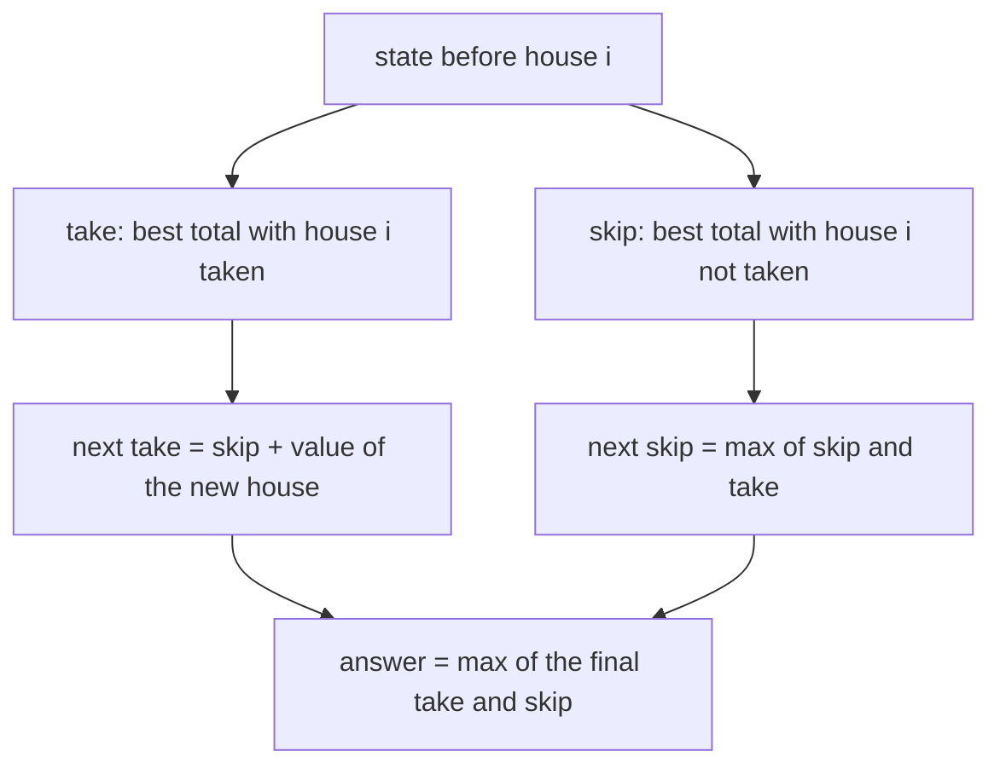
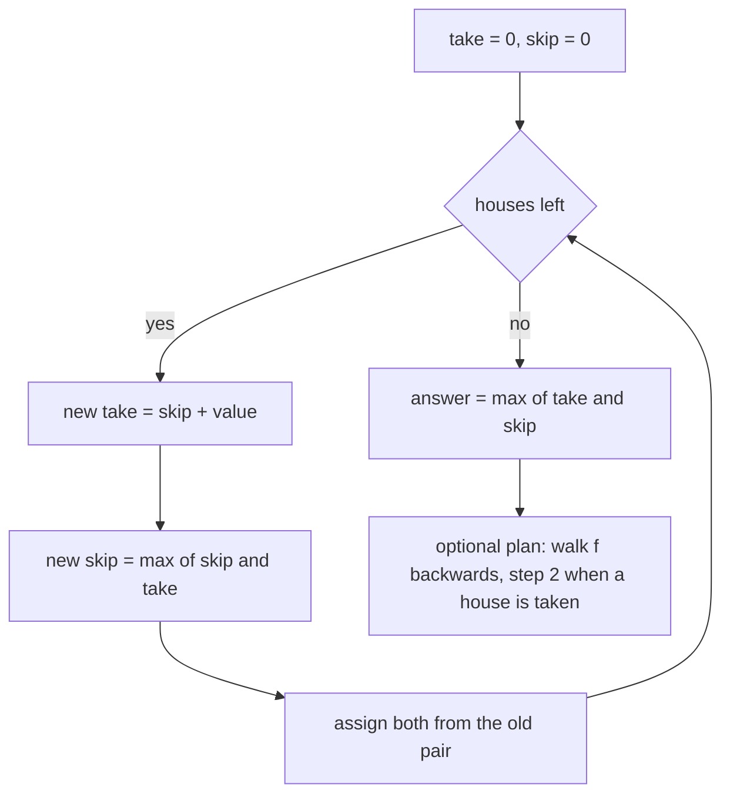
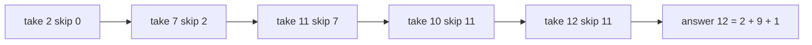
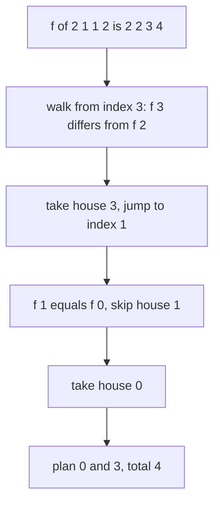

# 126 — House robber problem (1D DP).

> **Tier:** Beginner · **CTCI chapter:** Ch 8 — Recursion and Dynamic Programming
> **Task spec:** [126-house-robber-problem-1d-dp.md](../../../tasks/beginner/126-house-robber-problem-1d-dp.md)
> **Solutions:** [Python](../../../solutions/python/beginner/126-house-robber-problem-1d-dp/solution.py) ·
> [Java](../../../solutions/java/beginner/126-house-robber-problem-1d-dp/Solution.java) ·
> [JavaScript](../../../solutions/javascript/beginner/126-house-robber-problem-1d-dp/solution.js) ·
> [C#](../../../solutions/csharp/beginner/126-house-robber-problem-1d-dp/Solution.cs)

## 1. Problem restatement

**Input:** an array of non-negative house values, in a fixed order along a street.

**Output:** the largest total that can be collected without taking two adjacent houses.
`rob(houses)` returns that total. `rob_with_plan(houses)` returns the total together with the sorted
indices of one optimal selection.

The Python docstring defines the two running values the solutions use: *take* is the best total
ending at the current house if that house is robbed, and *skip* is the best total so far without
using the previous house. The alternative formulation is recorded as well:
`f[i] = max(f[i-1], f[i-2] + v[i])`.

| Call | Result | Why |
| --- | --- | --- |
| `rob([2, 7, 9, 3, 1])` | `12` | houses 0, 2 and 4: `2 + 9 + 1` |
| `rob([])` | `0` | nothing to take |
| `rob([5])` | `5` | a single house is always safe |
| `rob([2, 1, 1, 2])` | `4` | taking both ends is legal: `2 + 2` |
| `rob([5, 1, 1, 5])` | `10` | the same shape with larger ends, asserted by Java and C# |
| `rob_with_plan([2, 7, 9, 3, 1])` | `(12, [0, 2, 4])` | the plan is checked to be non-adjacent and to sum to the best value |

`rob([2, 1, 1, 2])` is the case that rules out a parity-based shortcut: taking "every other house"
starting from index 0 gives `2 + 1 = 3`, while starting from index 1 gives `1 + 2 = 3`, yet the
optimum is 4 because the two ends are not adjacent.

## 2. Intuition

A local greedy rule — "take a house whenever it is worth more than its neighbours" — fails on
`[2, 1, 1, 2]` and on `[2, 7, 9, 3, 1]` in subtler ways, because taking one house changes which
houses remain available. Enumerating subsets is exponential and mostly invalid.

The key insight is that a decision at house `i` depends only on whether house `i - 1` was taken.
Two running values capture the entire state:

- `take` = the best total for the prefix ending at `i` **assuming house `i` is taken**;
- `skip` = the best total for the same prefix **without house `i`**.

Advancing to the next house has a clean rule. To take the new house you must leave the previous one
alone, so the new `take` is `skip + value`. To skip the new house, you may keep whichever of the two
previous states was better, so the new `skip` is `max(skip, take)`. Nothing else about the earlier
history matters, because no constraint reaches further back than one house.



The final answer is `max(take, skip)`, because the last house may or may not be part of the optimum.
The loop needs no array at all: the two values are updated in place, and the new pair depends only on
the old pair, which makes the whole thing O(n) time and O(1) space.

Reconstruction needs the array form back. With `f[i] = max(f[i - 1], f[i - 2] + v[i])` stored for
every house, a house `i` belongs to an optimal selection exactly when `f[i] != f[i - 1]`, i.e. when
taking it improved the best value. Walking backwards from the last house and stepping by 2 whenever a
house is taken produces the plan; the solutions sort the collected indices before returning them.

## 3. Algorithm

1. Initialise `take = 0` and `skip = 0`.
2. For each house value `value` in order: compute `new_take = skip + value` and
   `new_skip = max(skip, take)`, then assign both, reading only the previous pair.
3. Return `max(take, skip)`.
4. For the plan, fill `f` where `f[i] = max(f[i - 1], v[i] + f[i - 2])`, then walk from `n - 1`
   downwards: if `i` equals 0 or `f[i] != f[i - 1]`, record `i` and step by 2; otherwise step by 1.
5. Sort the recorded indices and return them with `f[n - 1]`.

```text
function rob(houses)
    take ← 0
    skip ← 0
    for each value in houses do
        new_take ← skip + value
        new_skip ← the larger of skip and take
        take ← new_take
        skip ← new_skip
    end
    return the larger of take and skip
end

function rob_with_plan(houses)
    n ← length(houses)
    if n is 0 then
        return (0, an empty list)
    end
    f ← array of n entries
    for i ← 0 to n - 1 do
        taken ← houses[i] + (f[i - 2] if i ≥ 2, otherwise 0)
        if i is 0 then
            f[i] ← taken
        else
            f[i] ← the larger of f[i - 1] and taken
        end
    end
    plan ← an empty list
    i ← n - 1
    while i ≥ 0 do
        if i is 0 or f[i] ≠ f[i - 1] then
            append i to plan
            i ← i - 2
        else
            i ← i - 1
        end
    end
    return (f[n - 1], the sorted plan)
end
```

The two lines of the loop must read the old pair; this is the same simultaneous-update discipline as
`climb_ways` in task 125. Java and C# spell it out with a temporary, while Python and JavaScript can
write the pair in one tuple assignment.



## 4. Worked example

Trace `rob([2, 7, 9, 3, 1])`, the first assertion. Every row shows the state *before* the next house
is processed.

| House | Value | `take` before | `skip` before | `new_take = skip + value` | `new_skip = max(skip, take)` | `take` after | `skip` after |
| --- | --- | --- | --- | --- | --- | --- | --- |
| 0 | 2 | 0 | 0 | 2 | 0 | 2 | 0 |
| 1 | 7 | 2 | 0 | 7 | 2 | 7 | 2 |
| 2 | 9 | 7 | 2 | 11 | 7 | 11 | 7 |
| 3 | 3 | 11 | 7 | 10 | 11 | 10 | 11 |
| 4 | 1 | 10 | 11 | 12 | 11 | 12 | 11 |

The answer is `max(12, 11) = 12`, the selection `2 + 9 + 1`. Row 3 is the interesting one: taking the
house worth 3 would have to skip the house worth 9, so `new_take` is 10 and loses to the best
skip-so-far of 11.



The plan variant computes the whole `f` array on the same input: `f = [2, 7, 11, 11, 12]`. The walk
starts at index 4, where `f[4] = 12 != f[3] = 11`, so house 4 is taken and the walk jumps to index 2.
There `f[2] = 11 != f[1] = 7`, so house 2 is taken and the walk jumps to index 0, where the `i == 0`
case takes house 0. The plan is `[4, 2, 0]`, sorted to `[0, 2, 4]`, and the values at those indices
are `2 + 9 + 1 = 12`, matching `f[4]`.

| Step | `i` | `f[i]` | `f[i - 1]` | Decision | Plan so far |
| --- | --- | --- | --- | --- | --- |
| start | 4 | 12 | 11 | differs: take house 4, jump to 2 | `[4]` |
| 2 | 2 | 11 | 7 | differs: take house 2, jump to 0 | `[4, 2]` |
| 3 | 0 | 2 | — | `i == 0`: take house 0, jump to -2 | `[4, 2, 0]` |
| end | -2 | — | — | loop ends, sort | `[0, 2, 4]` |

The `[2, 1, 1, 2]` assertion exercises the other branch: `f = [2, 2, 3, 4]`, and the walk at index 3
sees `f[3] = 4 != f[2] = 3`, takes house 3, jumps to index 1 where `f[1] = 2 == f[0] = 2` so house 1
is skipped, then index 0 is taken. The plan is `[0, 3]` and the total is 4 — the two ends, which no
parity-based rule would find.



## 5. Complexity

Let `n` be the number of houses.

| Measure | Bound | Why it holds |
| --- | --- | --- |
| Time, best | O(n) | one constant amount of work per house, no early exit exists |
| Time, average | O(n) | two additions or comparisons and two assignments per house |
| Time, worst | O(n) | the loop is fixed |
| Space | O(1) | two integers, `take` and `skip` |
| Space, plan variant | O(n) | the `f` array plus the collected indices |
| Naive subset enumeration | O(2ⁿ) | every subset tested for adjacency, then maximised |
| Top-down recursion with memo | O(n) time, O(n) stack | one value per house, the style task 128 wraps |
| Circle variant | O(n) time, O(n) or O(1) space | two passes of the same loop, one excluding each end |

The constant space is the headline result of this task compared with the neighbouring DP problems:
tasks 121 to 124 all need a two-dimensional table, while this recurrence has a one-step memory and
collapses into two variables.

## 6. Pitfalls and edge cases

- **Empty street.** `rob([])` is asserted `0`; the loop never runs and `max(0, 0)` is 0.
- **Single house.** `rob([5])` is asserted `5`: house 0 is taken, `take = 5`, `skip = 0`.
- **Two houses.** `rob([2, 3])` is 3, because the two are adjacent and only the better one can be
  taken. The `max(take, skip)` at the end is what expresses that choice.
- **The parity shortcut is wrong.** `[2, 1, 1, 2]` and `[5, 1, 1, 5]` both beat every fixed-stride
  selection; the assertion exists to catch a solution that assumes alternating houses.
- **Values must be non-negative.** The recurrence assumes taking a house never hurts. With negative
  values `max(take, skip)` still avoids them, but the `f[i] != f[i - 1]` test in the plan walk loses
  its meaning because taking a negative house can still be recorded as an improvement.
- **The simultaneous update.** `new_take` uses the old `skip`, and `new_skip` uses the old `take`;
  assigning `take` first destroys the value `skip`'s computation needs. Java and C# make the
  temporary explicit.
- **Reconstruction condition.** A house belongs to the selection when `f[i] != f[i - 1]`. Using
  `>=` or `<` flips the test and produces plans that skip houses that were actually taken.
- **The first house in the plan walk.** `i == 0` must count as "taken", otherwise the walk misses the
  final house of every plan that reaches index 0.
- **Plan order.** The walk produces indices from the end to the start, so the plan must be reversed or
  sorted before being returned; the assertions check the sorted form.
- **Adjacency check in the assertions.** The plan is validated to be non-adjacent
  (`plan[i + 1] - plan[i] > 1`) and to sum to the reported best, so a plan that merely has the right
  length is not accepted.
- **Overflow.** With large values across many houses the total can exceed a 32-bit integer, which is
  why Java and C# accumulate into `long`.
- **Circle of houses (follow-up).** If the first and last houses are adjacent, the answer is the
  better of two runs of this same loop: one over houses `0 .. n - 2` and one over `1 .. n - 1`.

## 7. Variants and follow-ups

- **Counting instead of maximising.** Climbing stairs has the same one-step memory with a sum instead
  of a maximum: [125-climbing-stairs-dp-count-ways.md](../../../tasks/beginner/125-climbing-stairs-dp-count-ways.md).
- **Two decoding choices per position.** Decode ways replaces the "take or skip" branch with "one
  digit or two digits" and counts instead of maximising:
  [127-decode-ways-num-decodings-dp.md](../../../tasks/beginner/127-decode-ways-num-decodings-dp.md).
- **Two-dimensional grid instead of a line.** The memoised grid-path counter in
  [128-implement-basic-memoization-wrapper.md](../../../tasks/beginner/128-implement-basic-memoization-wrapper.md)
  keeps the same "best so far" idea but in two dimensions, where a top-down cache is the natural
  implementation.
- **Reconstruction via parents.** The plan walk mirrors the parent-pointer reconstruction of
  [119-longest-increasing-subsequence-naive-dp-o-n-2.md](../../../tasks/beginner/119-longest-increasing-subsequence-naive-dp-o-n-2.md):
  storing which predecessor won is what turns an optimal value into an optimal witness.
- **Circular and tree layouts.** The circle variant runs the loop twice with one end excluded; the
  tree variant of the same DP is a post-order traversal choosing take-or-skip at each node.
- The chapter walkthrough in [Recursion and Dynamic Programming](../../ctci/08-recursion-and-dp.md)
  uses this as the first DP where the state is "was the previous item used", which is the pattern
  behind every take-or-skip problem.

## 8. Check yourself

1. What do `take` and `skip` mean, and why are two values enough?

<details><summary>Show answer</summary>

`take` is the best total for the prefix that includes the current house; `skip` is the best total that
excludes it. The only constraint reaching backwards is "the previous house must not be taken", so
nothing older than the current house affects the future, and the two values carry all the state the
recurrence needs.

</details>

2. Why is `max(take, skip)` needed at the end?

<details><summary>Show answer</summary>

Because the optimal selection may or may not include the last house. `take` forces it in and `skip`
leaves it out, and the answer is whichever is larger; on `[2, 7, 9, 3, 1]` the winning total includes
the last house, so `take = 12` beats `skip = 11`.

</details>

3. On `[2, 1, 1, 2]`, why does a fixed-stride strategy fail?

<details><summary>Show answer</summary>

Because both parity classes give 3: indices 0 and 2 sum to `2 + 1`, and indices 1 and 3 sum to
`1 + 2`. The optimum is 4 by taking the two ends, which are not adjacent, so it uses indices 0 and 3
— the two ends of the array, which no alternation rule can produce.

</details>

4. How does `rob_with_plan` decide which houses were taken?

<details><summary>Show answer</summary>

By comparing `f[i]` with `f[i - 1]` while walking backwards: a difference means taking house `i`
improved the best value, so it is in the plan and the walk jumps two positions; equality means the
house was skipped and the walk moves one position.

</details>

5. What is the total space, and where does the plan variant spend its extra memory?

<details><summary>Show answer</summary>

`rob` uses O(1) space — two integers. `rob_with_plan` needs O(n) for the `f` array so it can compare
`f[i]` with `f[i - 1]` during the backward walk, plus the plan list itself.

</details>
