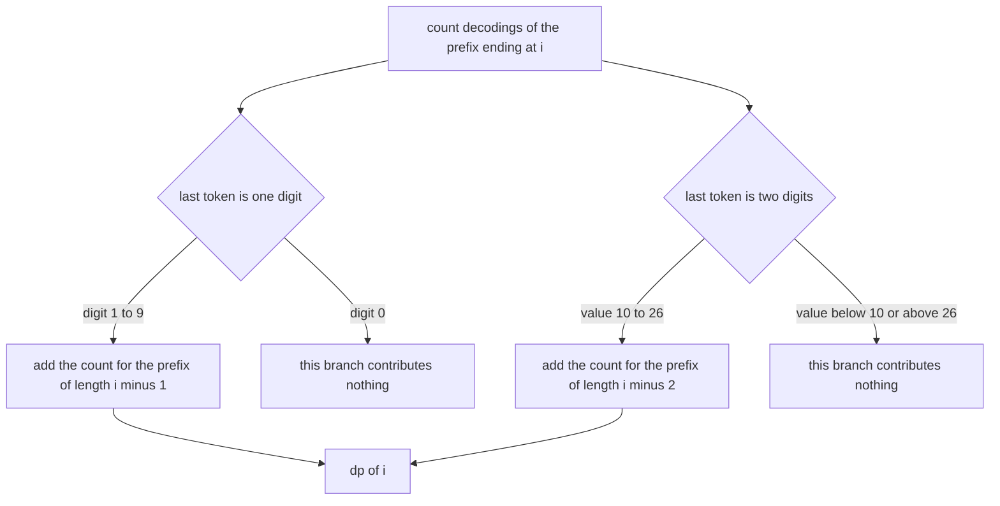
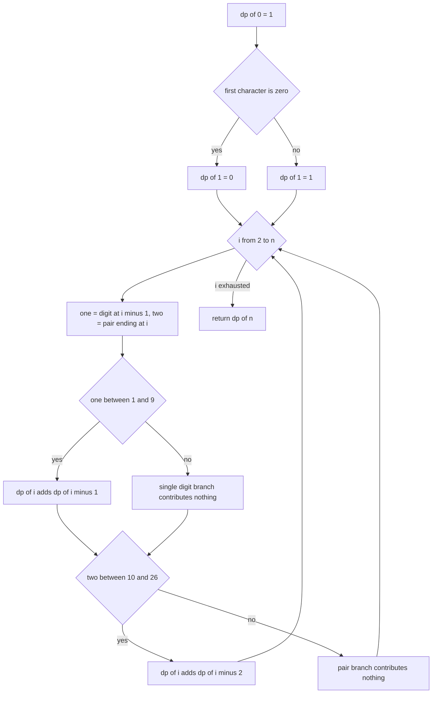
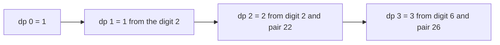
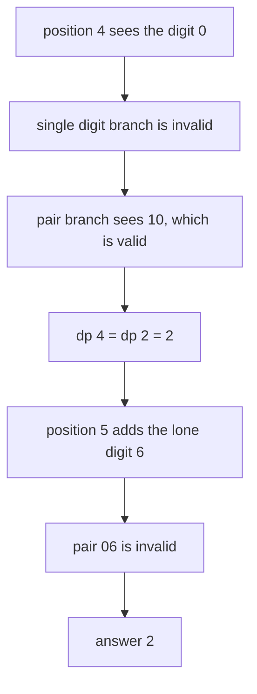

# 127 — Decode ways (num decodings) DP.

> **Tier:** Beginner · **CTCI chapter:** Ch 8 — Recursion and Dynamic Programming
> **Task spec:** [127-decode-ways-num-decodings-dp.md](../../../tasks/beginner/127-decode-ways-num-decodings-dp.md)
> **Solutions:** [Python](../../../solutions/python/beginner/127-decode-ways-num-decodings-dp/solution.py) ·
> [Java](../../../solutions/java/beginner/127-decode-ways-num-decodings-dp/Solution.java) ·
> [JavaScript](../../../solutions/javascript/beginner/127-decode-ways-num-decodings-dp/solution.js) ·
> [C#](../../../solutions/csharp/beginner/127-decode-ways-num-decodings-dp/Solution.cs)

## 1. Problem restatement

**Input:** a string of digits, possibly empty. The letters `A` to `Z` correspond to the numbers
`1` to `26`, so a message is decoded by cutting the digit string into one- or two-digit tokens, each
in the range 1 to 26.

**Output:** the number of distinct ways to decode the string.

The Python docstring defines the state and the two transitions: `dp[i]` is the number of ways to
decode `s[:i]`; `dp[i]` gains `dp[i - 1]` when `s[i - 1]` is a valid single digit (1 to 9) and gains
`dp[i - 2]` when the two-digit number `s[i - 2:i]` is between 10 and 26. It also states the rule that
makes the problem interesting: *leading zeros and zeros inside pairs make strings invalid*.

| Call | Result | Why |
| --- | --- | --- |
| `num_decodings("12")` | `2` | `1, 2` as `AB`, or `12` as `L` |
| `num_decodings("226")` | `3` | `2, 2, 6` as `BBF`; `22, 6` as `VF`; `2, 26` as `BZ` |
| `num_decodings("06")` | `0` | a leading zero cannot start any token |
| `num_decodings("10")` | `1` | `10` is `J`, and the `0` alone is nothing |
| `num_decodings("27")` | `1` | `27` is out of range, so only `2, 7` works |
| `num_decodings("0")` | `0` | a lone zero decodes to nothing |
| `num_decodings("11106")` | `2` | the comment in the solution lists them as `1-1-10-6` and `11-10-6` |
| `num_decodings("")` | `0` | the empty string is defined to have no decoding, not one |

The last row is a deliberate convention that differs from the climbing-stairs base case of task 125:
there `ways(0) = 1` because the empty climb is a valid move sequence, while here the empty message is
declared to have no decoding at all.

## 2. Intuition

The natural reading is "split the string into tokens of one or two digits, each between 1 and 26".
Doing that greedily fails on the first zero: in `110`, taking `1` and then deciding about `10` is
fine, but taking `11` and then facing `0` is not, and nothing local distinguishes the two. The
branching recursion is correct but recomputes the same suffix counts over and over.

The key insight is that the last token of a decoding is either one digit or two, and nothing else.
So `dp[i]`, the number of decodings of the prefix `s[:i]`, is the sum of:

- `dp[i - 1]` if the one-digit token `s[i - 1]` is a legal letter, i.e. between `1` and `9`;
- `dp[i - 2]` if the two-digit token `s[i - 2:i]` is between `10` and `26`.



The base cases carry the whole zero-handling logic. `dp[0] = 1` says "the empty prefix has one
decoding, the empty one" — that is what lets a two-digit token stand alone at the start of the
string. `dp[1]` is `1` when the first digit is `1` to `9` and **`0`** when it is `0`, which is how a
leading zero poisons every longer prefix that depends on it.

The two-digit condition is a value range, not a character test: `10` to `26` inclusive. That single
range handles `10` and `20` (valid pairs ending in zero), rejects `30`, `40` and so on, rejects `27`,
`28`, `29`, and rejects any pair starting with zero because such a pair is at most 9. Verifying the
range rather than the characters is what keeps `06` and `27` correct.

## 3. Algorithm

1. If the string is empty, return 0 — this is the documented convention.
2. Create `dp` with `n + 1` entries, all 0, and set `dp[0] = 1`.
3. Set `dp[1]` to `1` when `s[0]` is not `0`, otherwise `0`.
4. For `i` from 2 to `n`: read `one` as the digit `s[i - 1]` and `two` as the number `s[i - 2:i]`.
   Add `dp[i - 1]` when `one` is between 1 and 9, and add `dp[i - 2]` when `two` is between 10 and 26.
5. Return `dp[n]`.

```text
function num_decodings(s)
    if s is empty then
        return 0
    end
    n ← length(s)
    dp ← array of n + 1 entries, all 0
    dp[0] ← 1
    if the first character of s is not the character zero then
        dp[1] ← 1
    end
    for i ← 2 to n do
        one ← the numeric value of the character s[i - 1]
        two ← the numeric value of the two characters s[i - 2] and s[i - 1]
        if one is between 1 and 9 then
            dp[i] ← dp[i] + dp[i - 1]
        end
        if two is between 10 and 26 then
            dp[i] ← dp[i] + dp[i - 2]
        end
    end
    return dp[n]
end
```

The two additions are independent, so a position can take both branches — that is what makes `226`
have three decodings rather than two. Note also that the two-digit test is written as a numeric range
comparison in every implementation: Python converts the slice with `int`, Java uses
`Integer.parseInt`, and JavaScript and C# parse the two characters as well. Comparing strings against
the literals `"10"` and `"26"` would need extra care for `"9"` and would not express the range.



## 4. Worked example

Trace `num_decodings("226")`, the second assertion. The string has three characters, all non-zero.

| `i` | Prefix | `one` = `s[i - 1]` | Valid? | `two` = `s[i - 2:i]` | Valid? | `dp[i]` |
| --- | --- | --- | --- | --- | --- | --- |
| 0 | `""` | — | — | — | — | 1 |
| 1 | `"2"` | 2 | yes | — | — | 1 |
| 2 | `"22"` | 2 | yes, adds `dp[1] = 1` | 22 | yes, adds `dp[0] = 1` | 2 |
| 3 | `"226"` | 6 | yes, adds `dp[2] = 2` | 26 | yes, adds `dp[1] = 1` | 3 |

The three decodings correspond exactly to the three paths through the table: `2, 2, 6` from the
single-digit chain, `22, 6` from the pair at position 2, and `2, 26` from the pair at position 3.



The zero-heavy case `"11106"` shows where a branch dies. The last position cannot take the
single-digit branch because `s[3]` is `0`, and it cannot take the pair branch because `s[3:5]` is
`06`, which is 6 and not a letter:

| `i` | Prefix | `one` | Valid? | `two` | Valid? | `dp[i]` | Comment |
| --- | --- | --- | --- | --- | --- | --- | --- |
| 0 | `""` | — | — | — | — | 1 | base |
| 1 | `"1"` | 1 | yes | — | — | 1 | |
| 2 | `"11"` | 1 | yes, `+dp[1] = 1` | 11 | yes, `+dp[0] = 1` | 2 | `1-1` or `11` |
| 3 | `"111"` | 1 | yes, `+dp[2] = 2` | 11 | yes, `+dp[1] = 1` | 3 | |
| 4 | `"1110"` | 0 | **no** | 10 | yes, `+dp[2] = 2` | 2 | the `0` must be part of the pair `10` |
| 5 | `"11106"` | 6 | yes, `+dp[4] = 2` | 06 | **no** | 2 | the `6` stands alone |

The final answer is 2, matching the solution comment: `1-1-10-6` (equivalently `K1F`-style grouping
`11-10-6`). Position 4 is the pivot: the zero kills the single-digit branch and forces the pair, which
is exactly why the algorithm must test the pair as a numerical range 10 to 26 instead of merely
checking two digits.



## 5. Complexity

Let `n` be the length of the digit string.

| Measure | Bound | Why it holds |
| --- | --- | --- |
| Time, best | O(n) | every position is processed once, whatever the digits are |
| Time, average | O(n) | two value parsings and at most two additions per position |
| Time, worst | O(n) | no branch can add work at a later position |
| Space | O(n) | the `dp` array |
| Space, rolling variant | O(1) | only `dp[i - 1]` and `dp[i - 2]` are ever read |
| Naive recursion over splits | exponential | every split point branches twice, with heavy recomputation of suffixes |
| Memoised recursion | O(n) time, O(n) space | one value per prefix, the wrapper style of task 128 |

This is the same shape as the climbing-stairs recurrence of task 125, with two additions instead of
one and a validity test on each token. The difference in cost is only constant work per position, so
the O(n) bound transfers directly.

## 6. Pitfalls and edge cases

- **Leading zero.** `num_decodings("06")` is asserted 0. `dp[1]` must be 0 when `s[0] == '0'`; a
  version that always sets `dp[1] = 1` reports 1 for this input.
- **A lone zero.** `num_decodings("0")` is 0, the same rule applied at length 1.
- **Zero inside a pair.** `"10"` is asserted 1 because the pair `10` is legal even though the single
  digit `0` is not. This is the case that makes the range test (10 to 26) necessary instead of a
  per-character check.
- **Pair above 26.** `"27"` is asserted 1: the pair is rejected and only `2, 7` survives. `"30"` is
  likewise invalid as a pair and invalid as a single digit, so it decodes to 0.
- **Empty string.** Asserted 0 by an explicit early return. Without it the table would report
  `dp[0] = 1`, which contradicts the documented convention — note the contrast with task 125, where
  the analogous base case *is* 1.
- **The two branches are additive.** Both can fire at the same position; using `if/else` instead of
  two independent `if`s would cap every answer at 1 and break `"226"`.
- **`dp[0] = 1` is required for two-digit tokens.** It is what gives `"12"` the decoding `12` as a
  single token; without it the pair branch adds nothing and the answer halves.
- **Parsing the pair.** `s[i - 2:i]` is a string; converting it to a number is what makes the range
  test work for `"06"` (value 6, rejected) and for `"10"` (value 10, accepted). String comparison
  against `"10"` and `"26"` happens to work for two-digit strings but is easy to get wrong.
- **Counts can grow large.** The number of decodings has no closed form and grows quickly with `n`;
  Java and C# use `int` here because the asserted samples are small, but a long string of ones
  (`"111...1"`) produces answers equal to Fibonacci numbers, which overflow 32 bits at 46 characters.
- **All four solutions guard the empty string explicitly.** Each returns 0 before the table is built,
  which keeps the documented convention visible in one place; the table's own `dp[0] = 1` is a
  multiplier for two-digit tokens, never the answer for an empty input.
- **Digits outside 0 to 9.** No validation happens; a non-digit character would parse to a value
  outside both ranges in Java and C#, while Python's `int()` would raise.
- **No reconstruction.** The task returns a count only; recovering all decodings needs a parent array
  per position and would return exponentially many strings.

## 7. Variants and follow-ups

- **The counting ancestor.** Climbing stairs counts ordered move sequences with one or two steps and
  the same base-case reasoning, minus the validity rules:
  [125-climbing-stairs-dp-count-ways.md](../../../tasks/beginner/125-climbing-stairs-dp-count-ways.md).
- **Take-or-skip instead of count.** House robber uses the same one-step memory with a maximum:
  [126-house-robber-problem-1d-dp.md](../../../tasks/beginner/126-house-robber-problem-1d-dp.md).
- **Covering instead of counting.** Word break asks whether a string can be covered by dictionary
  words at all, the reachability version of the same segmentation idea:
  [124-word-break-dp.md](../../../tasks/beginner/124-word-break-dp.md).
- **Caching the recursion.** The decodings can be counted by a memoised recursive suffix scan, whose
  call count drops from exponential to `n`; that is exactly what the wrapper of
  [128-implement-basic-memoization-wrapper.md](../../../tasks/beginner/128-implement-basic-memoization-wrapper.md)
  makes easy.
- **Arbitrary alphabets.** If letters mapped to 1 to 9, the pair range becomes 10 to 99 and the same
  recurrence applies with a wider window; with 1 to 99 999 it becomes a sliding-window sum.
- The chapter walkthrough in [Recursion and Dynamic Programming](../../ctci/08-recursion-and-dp.md)
  groups this with word break as the two segmentation DPs, one counting and one deciding.

## 8. Check yourself

1. Why is `dp[0] = 1` even though the empty string has no decoding of its own?

<details><summary>Show answer</summary>

Because `dp[0]` is the multiplier for a two-digit token that covers the whole prefix, and there is
exactly one way to decode nothing before it. The documented convention about the *empty input*
returning 0 is handled before the table is built, so the two facts do not conflict.

</details>

2. What exactly must be true for the two-digit branch to fire?

<details><summary>Show answer</summary>

The numerical value of the two characters must lie between 10 and 26 inclusive. That accepts `10` and
`20` (pairs containing a zero) and rejects every pair with a leading zero as well as `27` and above
and `30`, `40`, and so on.

</details>

3. How does `"10"` decode, and what does that say about testing single digits?

<details><summary>Show answer</summary>

Exactly one way: as the single token `10`, the letter `J`. The digit `0` alone is not a letter, so a
solution that only checks single digits returns 0 for this input, which contradicts the assertion.

</details>

4. For `"11106"`, which position decides the answer, and which branch dies there?

<details><summary>Show answer</summary>

Position 4, the digit `0`. Its single-digit branch is invalid, and the only way to reach it is as the
pair `10`, so `dp[4] = dp[2] = 2`. The final position then adds a lone `6` while its pair `06` is
rejected, leaving the answer 2.

</details>

5. Why is `num_decodings("")` 0 while `climb_ways(0)` is 1?

<details><summary>Show answer</summary>

The two problems count different things and the solutions document the difference. An empty sequence of
moves is a legitimate way to reach step 0, so `ways(0) = 1`. An empty digit string produces no tokens,
and the decodings solutions assert 0 for it; the `dp[0] = 1` inside the table is a different beast —
it is only the multiplier for a two-digit token that covers the whole prefix.

</details>
