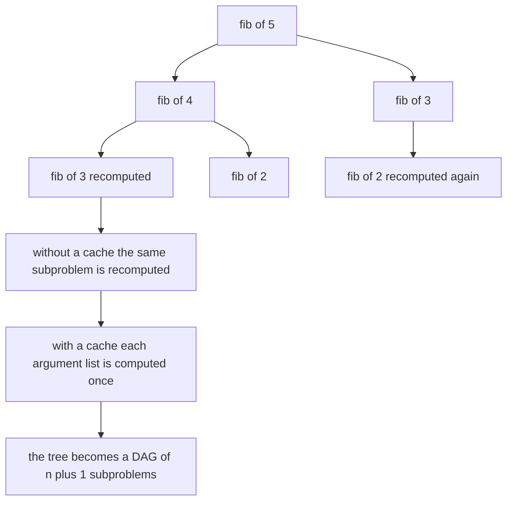
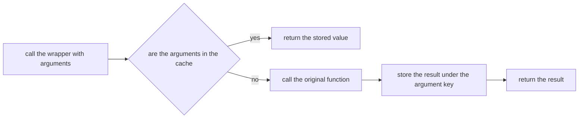
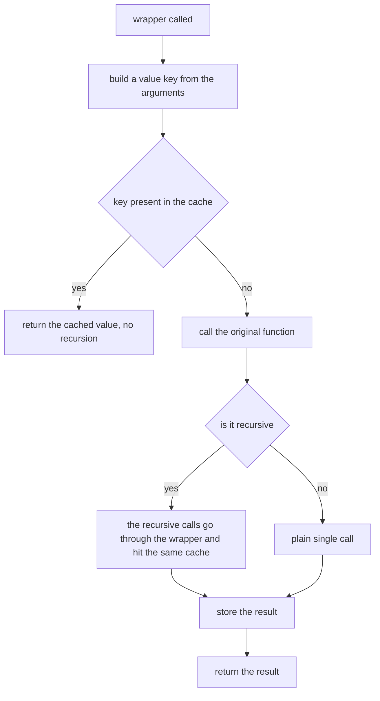
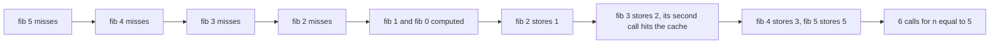

# 128 — Implement basic memoization wrapper.

> **Tier:** Beginner · **CTCI chapter:** Ch 8 — Recursion and Dynamic Programming
> **Task spec:** [128-implement-basic-memoization-wrapper.md](../../../tasks/beginner/128-implement-basic-memoization-wrapper.md)
> **Solutions:** [Python](../../../solutions/python/beginner/128-implement-basic-memoization-wrapper/solution.py) ·
> [Java](../../../solutions/java/beginner/128-implement-basic-memoization-wrapper/Solution.java) ·
> [JavaScript](../../../solutions/javascript/beginner/128-implement-basic-memoization-wrapper/solution.js) ·
> [C#](../../../solutions/csharp/beginner/128-implement-basic-memoization-wrapper/Solution.cs)

## 1. Problem restatement

**Input:** a function, and a way to remember what it has already computed.

**Output:** a wrapper that returns the same results as the original function, computes each distinct
argument list at most once, and exposes its cache. This is the generic mechanism behind every
top-down DP in this chapter, and task 13 asks for the Fibonacci-specific version of it.

Each language implements the same idea with its own idiomatic shape, and the tutorial describes all
four because they are genuinely different:

| Language | Shape | Key |
| --- | --- | --- |
| Python | decorator `memoize(fn)` closing over a `dict`, `wrapper.cache` exposed | `(args, tuple(sorted(kwargs.items())))` |
| JavaScript | `memoize(fn)` returning an arrow function closing over a `Map` | `JSON.stringify(args)` |
| Java | `<T, R> Function<T, R> memoize(Function<T, R> fn, Map<T, R> cache)` using `computeIfAbsent` | the single argument |
| C# | `Func<T, R> Memoize<T, R>(Func<T, R> fn, Dictionary<T, R> cache)` with `TryGetValue` | the single argument |

Every solution also ships a hand-written memoised `fib` with an explicit call counter, so the effect
can be measured instead of assumed:

| Call | Result | Why |
| --- | --- | --- |
| `fib(30)` | `832040` | the 30th Fibonacci number |
| call count after `fib(30)` | `31` | the subproblems `0` through `30`, each computed once |
| cache lookup of the argument `10` | `55` | the cache is inspectable: `fib.cache` in Python, `fib.cache` (a `Map`) in JavaScript, `FibCache` in Java and C# |
| `grid_paths(3, 3)` | `20` | monotone paths on a 3 by 3 grid, computed twice to show the second call is cached |
| `grid_paths(2, 2, ((1, 1),))` | `2` | the same grid with one blocked cell, and the argument stays hashable |
| `memo_square(9)`, twice | `81`, with cache size `1` | the generic wrapper on a non-recursive function |

The Python comment on the grid example records the key requirement explicitly: *`blocked` stays a
tuple of pairs: memoize keys must be hashable*.

## 2. Intuition

The naive `fib(n) = fib(n - 1) + fib(n - 2)` recursion is the textbook exponential. Its problem is not
the branching factor but the *repetition*: `fib(n - 3)` is recomputed along every path that reaches
it, so the recursion tree has `2ⁿ` nodes while the number of distinct questions asked is only `n + 1`.

The key insight is that the recursion is a function, not a process. The same arguments always deserve
the same answer, so the first thing to do on entry is to look the arguments up in a table, and the last
thing to do on exit is to write the answer in. That single change collapses the recursion tree into a
DAG of distinct subproblems, and the measured effect is the asserted 31 calls for `fib(30)` instead of
the millions the tree would need.



The wrapper generalises the pattern away from Fibonacci. Rather than writing a cache into every
function, take the function as an argument and hand back a cached version; the recursion inside still
calls the *wrapped* name, so every recursive call passes through the cache. That is why the Python
decorator works with an ordinary recursive definition and why the JavaScript version defines the
function through the wrapper it is assigned to.

Two design details fall out of the generalisation. The key must identify an argument list by value, as
a hashable or stringifiable object, and it must be constructed deterministically — that is why Python
sorts the keyword items before hashing them and why JavaScript serialises the arguments to a string.
And the wrapper must not change the function's behaviour, only its cost, which is why every solution's
cache is keyed by the *arguments* and not by anything internal.



## 3. Algorithm

1. Create an empty cache: a `dict` in Python, a `Map` in JavaScript, and a `Map` / `Dictionary` passed
   in by the caller in Java and C#.
2. Return a wrapper that accepts the same arguments as the original function.
3. On each call, build the key from the arguments: a tuple of the positional arguments plus the
   sorted keyword items in Python, the JSON serialisation of the argument array in JavaScript, and the
   single argument itself in Java and C#.
4. If the key is present, return the stored value without calling the original function.
5. Otherwise call the original function, store the result under the key, and return it.
6. Expose the cache on the wrapper (Python and JavaScript attach a `cache` attribute) so the
   assertions can inspect it.

```text
function memoize(fn)
    cache ← an empty mapping
    function wrapper(arguments)
        key ← a value-identifying key built from arguments
        if cache contains key then
            return the value stored at key
        end
        value ← fn applied to arguments
        store value at key in cache
        return value
    end
    attach cache to wrapper
    return wrapper
end

function fib(n)
    if the cache holds the answer for n then
        return that answer
    end
    increment the call counter
    value ← n when n is 0 or 1, otherwise fib(n - 1) + fib(n - 2)
    store value for n in the cache
    return value
end
```

The hand-written `fib` in the Java, C# and Python solutions is the same algorithm spelled out without
the wrapper, and it is what the call counter measures. Python shows both at once: the decorator-based
`fib` for the generic path and the explicit `cache` dictionary for the counting path.



## 4. Worked example

Count the calls for `fib(5)` with a memoising wrapper. The recursion descends the left spine to the
base cases and caches each value on the way back up, so there are exactly six real calls.

| Order | Call | Cache before | Hit or miss | Value stored | Cache after |
| --- | --- | --- | --- | --- | --- |
| 1 | `fib(5)` | `{}` | miss, recurse | — | `{}` |
| 2 | `fib(4)` | `{}` | miss, recurse | — | `{}` |
| 3 | `fib(3)` | `{}` | miss, recurse | — | `{}` |
| 4 | `fib(2)` | `{}` | miss, recurse | — | `{}` |
| 5 | `fib(1)` | `{}` | miss, base case | 1 | `{1}` |
| 6 | `fib(0)` | `{1}` | miss, base case | 0 | `{0, 1}` |
| 7 | `fib(2)` returns | `{0, 1}` | store | 1 | `{0, 1, 2}` |
| 8 | `fib(3)` returns | `{0, 1, 2}` | store, its `fib(1)` call was a hit | 2 | `{0, 1, 2, 3}` |
| 9 | `fib(4)` returns | `{0, 1, 2, 3}` | store, its `fib(2)` call was a hit | 3 | `{0, 1, 2, 3, 4}` |
| 10 | `fib(5)` returns | `{0, 1, 2, 3, 4}` | store, its `fib(3)` call was a hit | 5 | `{0, 1, 2, 3, 4, 5}` |

The counter lands on 6 calls, which is `n + 1` for `n = 5`: every argument from 0 to 5 is computed
exactly once, and the second half of the recursion is pure cache hits. The asserted
`fib(30) == 832040` with a call count of exactly 31 is the same statement one scale larger — every
argument from 0 to 30, each computed once, instead of a recursion tree with millions of nodes.



The grid example shows the same wrapper on a two-argument function with an extra argument that must
stay hashable. Python's `grid_paths(rows, cols, blocked=())` treats `blocked` as a tuple of pairs so
that the key construction succeeds, and `grid_paths(3, 3)` returns 20 twice — the second call is a
cache hit. With one blocked cell, `grid_paths(2, 2, ((1, 1),))` returns 2: of the six monotone paths
across a 2 by 2 grid, the four that pass through `(1, 1)` are removed.

| Call | Cache key (Python form) | Behaviour |
| --- | --- | --- |
| `grid_paths(3, 3)` | `((3, 3), ())` | computed, 20 stored |
| `grid_paths(3, 3)` again | `((3, 3), ())` | cache hit, no recursion at all |
| `grid_paths(2, 2, ((1, 1),))` | `((2, 2, ((1, 1),)), ())` | computed, 2 stored |

The keys show the two-part structure: a tuple of the positional arguments, then a tuple of the
keyword items — empty whenever the call uses only positional arguments, as the asserted
`fib.cache[((10,), ())] == 55` records for the argument 10.

## 5. Complexity

Let `n` be the argument of a one-argument recursive function such as `fib`, `S` the number of distinct
argument lists the function is ever called with, and `k` the size of an argument list.

| Measure | Bound | Why it holds |
| --- | --- | --- |
| Calls, without memoisation | O(2ⁿ) for `fib` | two recursive calls per level with no sharing |
| Calls, with memoisation | O(n) for `fib` | one call per distinct argument, so `n + 1` for arguments 0 to `n` |
| Time, with memoisation | O(S · (cost of `fn` + cost of key)) | each distinct argument list pays for one real call plus one cache lookup |
| Space | O(S) | one entry per distinct argument list, plus the recursion depth |
| Key construction | O(k) for a positional key, O(k log k) for Python's sorted keyword items | the key must be built before the lookup |
| Grid example | O(rows · cols) states | one cached value per grid position |
| Call counter overhead | O(1) per real call | the counter is incremented only on a miss |

Memoisation never changes the answer, only the number of times the answer is computed. That is the
whole point of the pattern, and it is why the assertions measure the *call count* as well as the value:
`fib(30) == 832040` would pass for a broken cache, while `fibCalls == 31` would not.

## 6. Pitfalls and edge cases

- **Keys must be value-based and hashable.** Python builds `(args, tuple(sorted(kwargs.items())))`, so
  every argument must be hashable — a list or a set raises at key construction. The solution comment
  about `blocked` being a tuple of pairs is exactly this constraint.
- **Keyword order must be normalised.** Two calls with the same keyword arguments in different orders
  are the same call, which is why Python sorts the keyword items before hashing them. Skipping the sort
  computes the same subproblem twice under two keys.
- **Recursion must go through the wrapper.** In Python the decorator rebinds the name, so the recursive
  call inside the body resolves to the wrapper and hits the cache. In JavaScript the arrow function is
  assigned to `const fib = memoize(...)` and calls `fib(...)`, which is the wrapped version. A helper
  that calls the *original* function reference bypasses the cache entirely and silently restores the
  exponential cost.
- **JavaScript serialises keys.** `JSON.stringify(args)` is order-sensitive for arrays but loses
  information for values that do not serialise uniquely (functions, `undefined` inside arrays becoming
  `null`). It works for the numeric and tuple arguments here and is a documented weakness of the
  approach.
- **Mutating a cached argument.** If a caller passes an object and later mutates it, the key no longer
  describes the value that produced the cached result. Every solution avoids this by using immutable
  argument shapes.
- **Unbounded caches.** Nothing here ever evicts an entry, so memory grows with the number of distinct
  argument lists. For `fib` that is O(n), which is fine; for a function called with many distinct
  inputs it is the reason real systems bound or discard caches.
- **Not every function can be memoised.** Only deterministic functions of their arguments can: a
  function that reads a file, the clock, or a global that changes must not be cached this way.
- **The Java and C# wrappers take one argument.** `Function<T, R>` and `Func<T, R>` are single-argument
  shapes, so a two-argument function needs a key type or a tuple instead. Python and JavaScript avoid
  this by variadic argument lists.
- **Cache inspection is asserted.** `fib.cache[((10,), ())] == 55` in Python,
  `fib.cache.get(JSON.stringify([10])) == 55` in JavaScript, `FibCache[10] == 55` in Java and C#: the
  cache must actually be reachable from the wrapper, not hidden in a local.
- **The base case still has to be correct.** Memoisation cannot fix a wrong recurrence; it only stops
  recomputing it. `fib(0) = 0` and `fib(1) = 1` are asserted through `fib(30) == 832040`.
- **Call counts depend on the recursion order.** The counter is incremented only on a miss, so the
  number is exactly the number of distinct arguments — 31 for `fib(30)`, independent of the order in
  which the DAG is traversed.

## 7. Variants and follow-ups

- **The specific version.** The Fibonacci memoisation task without the generic wrapper, which the
  call-count assertions here generalise:
  [013-compute-nth-fibonacci-with-memoization.md](../../../tasks/beginner/013-compute-nth-fibonacci-with-memoization.md).
- **Where the wrapper is needed most.** Every top-down solution in this group becomes linear with it —
  the LIS DP of
  [119-longest-increasing-subsequence-naive-dp-o-n-2.md](../../../tasks/beginner/119-longest-increasing-subsequence-naive-dp-o-n-2.md),
  the decodings recursion of
  [127-decode-ways-num-decodings-dp.md](../../../tasks/beginner/127-decode-ways-num-decodings-dp.md)
  and the stair climbing recursion of
  [125-climbing-stairs-dp-count-ways.md](../../../tasks/beginner/125-climbing-stairs-dp-count-ways.md).
- **Tabulation instead of memoisation.** The bottom-up tables of
  [121-longest-common-subsequence-lcs-dp.md](../../../tasks/beginner/121-longest-common-subsequence-lcs-dp.md)
  and [123-edit-distance-levenshtein-dp.md](../../../tasks/beginner/123-edit-distance-levenshtein-dp.md)
  fill the same set of states in a deliberate order, with no cache lookups and no recursion depth.
- **Bounded caches.** Least-recently-used eviction, and the fixed-width window used by rolling-row DPs,
  are the two standard answers when the cache cannot grow.
- **Comparing the two styles.** A memoised recursion and a DP table have the same asymptotic cost; the
  recursion is easier to write from the recurrence, the table is easier to make space-efficient.
- The chapter walkthrough in [Recursion and Dynamic Programming](../../ctci/08-recursion-and-dp.md)
  closes the section with this pattern, since it is the mechanical step that turns any exponential
  recursive DP into a polynomial one.

## 8. Check yourself

1. Why does `fib(30)` make exactly 31 calls instead of something like 2 million?

<details><summary>Show answer</summary>

Because the wrapper computes each distinct argument list once. Every argument from 0 to 30 is computed
on some miss and cached, so there are 31 real calls; the other calls in the recursion tree — millions
of them in the unmemoised version — all return from the cache without calling the body.

</details>

2. What makes a valid cache key, and how does Python's version construct one?

<details><summary>Show answer</summary>

The key must identify the argument list by value and must be hashable. Python builds a tuple of the
positional arguments plus a tuple of the sorted keyword items, so two calls that differ only in the
order of their keyword arguments map to the same key.

</details>

3. Why must the recursive call inside `fib` go through the wrapper rather than the original function?

<details><summary>Show answer</summary>

Because only the wrapper consults the cache. If the body called the raw function, every recursive call
would bypass the cache and the exponential recomputation would return. The decorator achieves this by
rebinding the name, and the JavaScript version assigns the wrapped arrow function to the name the body
calls.

</details>

4. The grid helper takes a `blocked` argument. Why does the Python comment insist it stays a tuple of
   pairs?

<details><summary>Show answer</summary>

Because the key is built from the arguments, and a list or set cannot be hashed, so passing a mutable
container raises when the key is constructed. A tuple of pairs is hashable and value-comparable, so
two calls with the same blocked cells share one cache entry.

</details>

5. What does memoisation cost, and when is it the wrong tool?

<details><summary>Show answer</summary>

It costs O(S) memory for `S` distinct argument lists plus the key construction on every call, and it
can only be applied to deterministic functions of their arguments. If the function depends on external
state, if the argument space is huge and mostly distinct, or if memory is tighter than time, a bounded
cache or a bottom-up table is the better choice.

</details>
